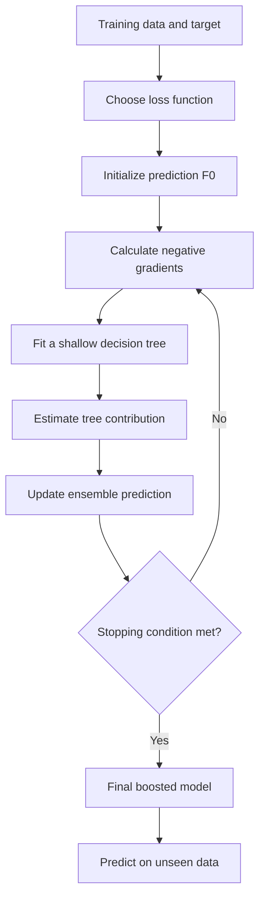
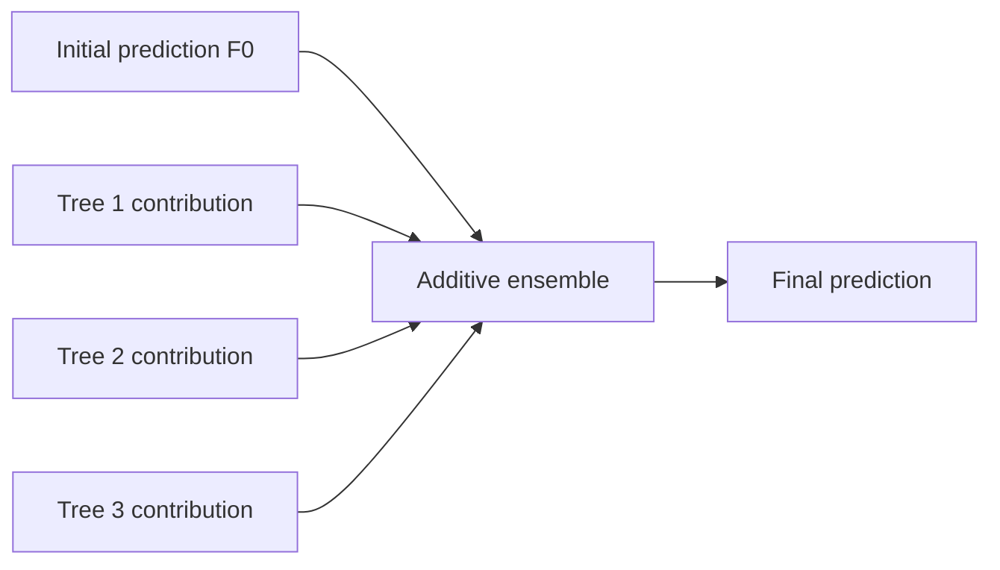
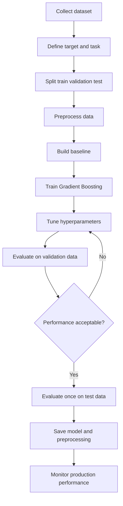
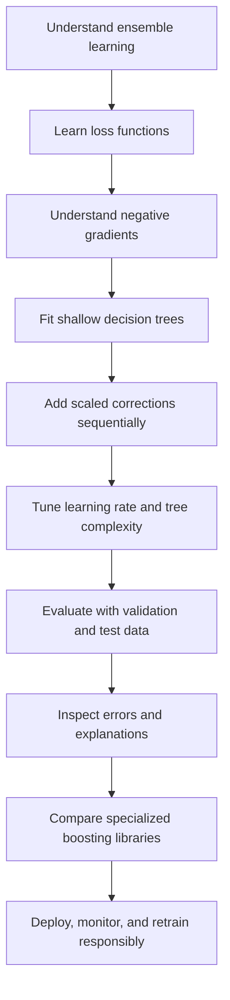

# 🌳 Gradient Boosting — Complete Machine Learning Notes

> **Goal:** Understand Gradient Boosting from first principles, implement it with scikit-learn, evaluate it correctly, and recognize when to use it.

---

## 📚 Table of Contents

1. [Introduction](#1--introduction)
2. [Why Gradient Boosting?](#2--why-gradient-boosting)
3. [Core Terminology](#3--core-terminology)
4. [How Gradient Boosting Works](#4--how-gradient-boosting-works)
5. [Mathematical Intuition](#5--mathematical-intuition)
6. [Gradient Boosting Workflow](#6--gradient-boosting-workflow)
7. [Important Hyperparameters](#7--important-hyperparameters)
8. [Gradient Boosting for Regression](#8--gradient-boosting-for-regression)
9. [Gradient Boosting for Classification](#9--gradient-boosting-for-classification)
10. [Implementation with Scikit-learn](#10--implementation-with-scikit-learn)
11. [Evaluation Metrics](#11--evaluation-metrics)
12. [Gradient Boosting vs Other Algorithms](#12--gradient-boosting-vs-other-algorithms)
13. [Popular Gradient Boosting Libraries](#13--popular-gradient-boosting-libraries)
14. [Feature Importance and Interpretability](#14--feature-importance-and-interpretability)
15. [Advantages and Limitations](#15--advantages-and-limitations)
16. [Use Cases and Real-World Examples](#16--use-cases-and-real-world-examples)
17. [Best Practices](#17--best-practices)
18. [Common Mistakes](#18--common-mistakes)
19. [Advanced Concepts](#19--advanced-concepts)
20. [Mini-Project: Predicting Diabetes Risk](#20--mini-project-predicting-diabetes-risk)
21. [Interview Questions and Answers](#21--interview-questions-and-answers)
22. [Quick Revision](#22--quick-revision)

---

## 1. 🎯 Introduction

**Gradient Boosting** is an ensemble machine learning technique that builds a strong predictive model by adding weak models—usually shallow decision trees—sequentially. Each new tree is trained to improve the current ensemble by following the gradient of a chosen loss function.

The central idea is:

> Build a model, measure its errors using a loss function, then add a new model that helps reduce that loss. Repeat this process.

Gradient Boosting can be used for:
- **Regression:** predicting continuous values such as house prices.
- **Classification:** predicting categories such as fraud/not fraud.
- **Ranking and other tasks:** supported by specialized libraries and objectives.

A typical implementation uses **decision trees as base learners**, but the general boosting idea is broader.

### 1.1 Ensemble Learning

Ensemble learning combines multiple models to create a predictor that is often more accurate or robust than a single model.

Two major ensemble families are:

| Technique | How models are built | Main idea | Example |
|---|---|---|---|
| Bagging | Usually in parallel on resampled data | Reduce variance by averaging | Random Forest |
| Boosting | Sequentially, each stage improves the ensemble | Reduce errors by optimizing a loss | Gradient Boosting |
| Stacking | Base models are combined using a meta-model | Learn how to combine different predictors | StackingClassifier |

### 1.2 Why Is It Called “Gradient Boosting”?

- **Gradient:** the model uses gradient information from a loss function to decide how to improve predictions.
- **Boosting:** weak learners are added sequentially to create a stronger ensemble.

---

## 2. 💡 Why Gradient Boosting?

A single decision tree may be too simple and underfit, or too complex and overfit. Gradient Boosting builds an additive sequence of trees, with each stage correcting shortcomings of the current prediction.

### 2.1 Intuitive Example

Imagine predicting house prices:

1. Start by predicting the average price for every house.
2. Calculate how far each prediction is from its true price.
3. Train a small tree to predict a useful correction.
4. Add a fraction of that correction to the current predictions.
5. Recalculate the errors and repeat.

For example, if the current prediction is ₹50 lakh and the next tree estimates a correction of ₹8 lakh, a learning rate of `0.1` adds only ₹0.8 lakh. The updated prediction becomes ₹50.8 lakh.

This is a simplified illustration; the exact target for each new tree depends on the chosen loss function and gradient.

### 2.2 Main Characteristics

- Trees are trained **sequentially**, not independently.
- Each stage depends on the predictions from earlier stages.
- A loss function defines what the model tries to minimize.
- The learning rate controls the contribution of each new tree.
- Shallow trees are common because many small corrections can generalize better than a few overly complex trees.

---

## 3. 🧠 Core Terminology

| Term | Meaning |
|---|---|
| Ensemble | A combination of multiple models |
| Weak learner | A relatively simple model that performs better than a trivial baseline |
| Base learner | An individual model added to the ensemble |
| Residual | Difference between the target and prediction; most directly used with squared-error loss |
| Pseudo-residual | Negative gradient of the loss with respect to current predictions |
| Loss function | Quantifies how bad predictions are |
| Gradient | Direction and rate of change of a function |
| Learning rate (`learning_rate`) | Shrinks each tree's contribution |
| Number of estimators (`n_estimators`) | Number of boosting stages or trees |
| Tree depth (`max_depth`) | Limits the complexity of each tree |
| Subsampling | Uses only a fraction of training examples for a stage |
| Regularization | Methods that reduce overfitting |
| Additive model | A prediction built by summing contributions from multiple learners |
| Early stopping | Stops training when validation performance stops improving |

**Important distinction:** Residuals and negative gradients are identical in the standard squared-error regression setting, but not in every Gradient Boosting objective.

---

## 4. ⚙️ How Gradient Boosting Works

### 4.1 Step-by-Step Process

1. **Choose a loss function** suitable for the task.
2. **Initialize the model** with a simple prediction that minimizes the loss on the training data.
3. **Calculate pseudo-residuals** using the negative gradient of the loss.
4. **Fit a weak learner**—often a small decision tree—to those pseudo-residuals.
5. **Determine the contribution** of the new tree, potentially using a line search or leaf-value optimization.
6. **Update the ensemble** by adding the scaled contribution of the new tree.
7. **Repeat** until the desired number of stages is reached or early stopping triggers.

### 4.2 Mermaid Flowchart



### 4.3 Additive Model Structure

The model grows by adding new learners:



The prediction after \(M\) stages is commonly represented as:

\[
F_M(x)=F_0(x)+\sum_{m=1}^{M}\eta\,h_m(x)
\]

Where:
- \(F_0(x)\): initial prediction.
- \(h_m(x)\): contribution from the \(m\)-th fitted learner.
- \(\eta\): learning rate.
- \(M\): number of boosting stages.

Some implementations optimize leaf values separately, so this expression is a useful general intuition rather than every implementation's complete internal formula.

---

## 5. 📐 Mathematical Intuition

Gradient Boosting constructs an additive model by minimizing a loss over the training data.

Let:
- \(y_i\) be the true target for observation \(i\).
- \(F(x_i)\) be the current prediction.
- \(L(y_i,F(x_i))\) be the loss for that observation.

The total objective can be written as:

\[
\mathcal{L}=\sum_{i=1}^{n}L(y_i,F(x_i))
\]

### 5.1 Initialization

Choose a constant prediction that minimizes the total training loss:

\[
F_0(x)=\arg\min_c\sum_{i=1}^{n}L(y_i,c)
\]

For squared-error regression, this constant is the **mean target value**. For absolute-error loss, it is a median.

### 5.2 Pseudo-Residuals

At boosting stage \(m\), calculate the negative gradient:

\[
r_{im}=-\left[
\frac{\partial L(y_i,F(x_i))}
{\partial F(x_i)}
\right]_{F=F_{m-1}}
\]

A new learner is fitted to approximate these values.

### 5.3 Update the Model

A simplified update is:

\[
F_m(x)=F_{m-1}(x)+\eta h_m(x)
\]

Here, \(\eta\) is the learning rate. In standard Gradient Boosting, the algorithm may also optimize the multiplier or leaf values for the chosen loss.

### 5.4 Squared-Error Regression Example

For half squared-error loss,

\[
L(y,F)=\frac{1}{2}(y-F)^2
\]

The derivative with respect to the prediction is:

\[
\frac{\partial L}{\partial F}=F-y
\]

Therefore, the negative gradient is:

\[
-\frac{\partial L}{\partial F}=y-F
\]

This is the familiar residual: **actual value minus predicted value**.

Suppose actual house prices are `[100, 120, 150]` and the current predictions are `[110, 110, 130]`.

| Actual | Prediction | Residual (`actual - prediction`) |
|---:|---:|---:|
| 100 | 110 | -10 |
| 120 | 110 | 10 |
| 150 | 130 | 20 |

The next tree learns patterns in these residuals. It does not simply memorize one correction per row; it learns splits and leaf values that approximate corrections for groups of observations.

---

## 6. 🔄 Gradient Boosting Workflow

### 6.1 End-to-End Machine Learning Workflow



### 6.2 Training, Validation, and Test Sets

- **Training set:** used to fit the model.
- **Validation set:** used to tune hyperparameters and decide when to stop.
- **Test set:** reserved for a final, unbiased estimate of generalization.

Do not repeatedly tune decisions against the test set; doing so leaks information from the test set into the model-selection process.

---

## 7. 🎛️ Important Hyperparameters

| Hyperparameter | Purpose | Typical tuning direction |
|---|---|---|
| `n_estimators` | Number of boosting stages | Increase with validation monitoring |
| `learning_rate` | Shrinks each stage's contribution | Lower values often need more stages |
| `max_depth` | Maximum depth of each tree | Shallow trees are a strong starting point |
| `max_leaf_nodes` | Limits leaves per tree | Lower values constrain complexity |
| `min_samples_split` | Minimum samples required to split a node | Increase to make trees more conservative |
| `min_samples_leaf` | Minimum samples in a leaf | Increase to reduce overly specific rules |
| `subsample` | Fraction of training examples sampled for each stage | Values below `1.0` introduce stochasticity |
| `max_features` | Features considered when splitting | Can reduce correlation and computation |
| `loss` | Objective optimized by the model | Match to regression/classification needs |
| `validation_fraction` | Fraction reserved for internal early stopping | Relevant when early stopping is enabled |
| `n_iter_no_change` | Number of stages without sufficient improvement before stopping | Use with a suitable validation fraction |
| `tol` | Minimum improvement used for stopping decisions | Adjust to the scale of the metric/objective |

Exact supported values depend on the scikit-learn version and estimator. Check the installed version's documentation before using a particular loss name or parameter.

### 7.1 Learning Rate and Number of Trees

A smaller learning rate makes each tree contribute less. It often improves generalization but usually requires more trees and more computation.

| Learning rate | Number of estimators | General intuition |
|---:|---:|---|
| High | Low | Fast, but may overfit or miss a good solution |
| Moderate | Moderate | Useful baseline |
| Low | High | More gradual learning; can perform well with proper tuning |

The best pair depends on the data, loss function, tree complexity, and stopping criterion. Do not assume that the lowest learning rate is always best.

### 7.2 Tree Depth

- **Very shallow trees:** capture simple interactions and can generalize well.
- **Deeper trees:** capture more complex interactions but can overfit.
- **More leaves:** allow more detailed correction patterns.

Start with shallow trees and increase complexity only when validation results justify it.

### 7.3 Subsampling

When `subsample < 1.0`, each boosting stage uses a random subset of training observations. This is commonly called **stochastic Gradient Boosting**.

Potential benefits:
- Adds randomness that can reduce overfitting.
- Can reduce training time per stage.
- May improve generalization.

Potential cost:
- Each stage sees less data.
- Very low sampling fractions can make learning unstable or less accurate.

---

## 8. 📈 Gradient Boosting for Regression

Regression predicts a continuous value, such as a home's price, delivery time, or electricity demand.

Common loss choices include:
- **Squared error:** strongly penalizes large errors.
- **Absolute error:** less sensitive to extreme errors.
- **Huber loss:** combines squared-error behavior near zero with more robust behavior for large errors, depending on the implementation.

### 8.1 Example

A Gradient Boosting regressor can learn nonlinear relationships such as:
- House prices increasing with area.
- Price changes depending on location and property age.
- Interactions between area, location, and number of bedrooms.

Tree-based models do not require feature scaling in the way that many distance-based or gradient-based linear models do. However, data quality, leakage prevention, and sensible feature representation remain important.

---

## 9. 🏷️ Gradient Boosting for Classification

Classification predicts a class or class probability.

Examples:
- Spam vs. legitimate email.
- Fraud vs. legitimate transaction.
- Customer churn vs. retention.
- Disease risk categories.

For classification, Gradient Boosting optimizes a classification loss such as **log loss**. It typically builds additive scores that are transformed into probabilities or class predictions.

### 9.1 Binary Classification

For binary classification, a model can estimate the probability of the positive class:

\[
P(y=1\mid x)
\]

A threshold—often `0.5`, but not always optimal—converts probability into a class. The threshold should be chosen according to the business objective, class imbalance, and costs of false positives and false negatives.

### 9.2 Multiclass Classification

For multiple classes, the model learns scores for classes and converts them to class probabilities. Exact internal parameterization depends on the implementation and objective.

---

## 10. 💻 Implementation with Scikit-learn

Install the required libraries:

```bash
pip install numpy pandas scikit-learn matplotlib
```

### 10.1 Regression Example

This example uses a built-in dataset so it runs without downloading a separate CSV.

```python
from sklearn.datasets import fetch_california_housing
from sklearn.ensemble import GradientBoostingRegressor
from sklearn.metrics import mean_absolute_error, mean_squared_error, r2_score
from sklearn.model_selection import train_test_split

# Load dataset
X, y = fetch_california_housing(return_X_y=True)

# Split before fitting any learned preprocessing
X_train, X_test, y_train, y_test = train_test_split(
    X, y, test_size=0.2, random_state=42
)

# Create model
model = GradientBoostingRegressor(
    n_estimators=200,
    learning_rate=0.05,
    max_depth=3,
    min_samples_leaf=3,
    loss="squared_error",
    random_state=42
)

# Train
model.fit(X_train, y_train)

# Predict
y_pred = model.predict(X_test)

# Evaluate
mae = mean_absolute_error(y_test, y_pred)
mse = mean_squared_error(y_test, y_pred)
rmse = mse ** 0.5
r2 = r2_score(y_test, y_pred)

print(f"MAE:  {mae:.4f}")
print(f"RMSE: {rmse:.4f}")
print(f"R²:   {r2:.4f}")
```

**Notes:**
- The California Housing dataset may require a network download the first time it is fetched.
- Its target is expressed in units of hundreds of thousands of US dollars.
- Treat these scores as an example run, not a guaranteed result; results depend on library versions and data handling.

### 10.2 Classification Example

This example uses the Breast Cancer Wisconsin dataset provided by scikit-learn.

```python
from sklearn.datasets import load_breast_cancer
from sklearn.ensemble import GradientBoostingClassifier
from sklearn.metrics import (
    accuracy_score,
    classification_report,
    confusion_matrix,
    roc_auc_score
)
from sklearn.model_selection import train_test_split

# Load dataset
dataset = load_breast_cancer()
X, y = dataset.data, dataset.target

X_train, X_test, y_train, y_test = train_test_split(
    X, y,
    test_size=0.2,
    random_state=42,
    stratify=y
)

model = GradientBoostingClassifier(
    n_estimators=150,
    learning_rate=0.05,
    max_depth=2,
    min_samples_leaf=3,
    random_state=42
)

model.fit(X_train, y_train)

y_pred = model.predict(X_test)
y_prob = model.predict_proba(X_test)[:, 1]

print("Accuracy:", accuracy_score(y_test, y_pred))
print("ROC-AUC:", roc_auc_score(y_test, y_prob))
print("\nConfusion Matrix:\n", confusion_matrix(y_test, y_pred))
print("\nClassification Report:\n", classification_report(y_test, y_pred))
```

**Important:** The dataset's encoded target labels and positive-class interpretation should be checked before interpreting probabilities in a medical context. This is an educational example, not a clinical diagnostic tool.

### 10.3 Hyperparameter Tuning with RandomizedSearchCV

Randomized search samples a fixed number of parameter combinations from the specified distributions or lists. It is often more practical than trying every possible combination.

```python
from sklearn.ensemble import GradientBoostingRegressor
from sklearn.model_selection import RandomizedSearchCV

base_model = GradientBoostingRegressor(random_state=42)

param_distributions = {
    "n_estimators": [100, 200, 300, 500],
    "learning_rate": [0.01, 0.03, 0.05, 0.1],
    "max_depth": [2, 3, 4],
    "min_samples_leaf": [2, 3, 5, 10],
    "subsample": [0.7, 0.8, 0.9, 1.0],
    "max_features": [None, "sqrt", 0.8]
}

search = RandomizedSearchCV(
    estimator=base_model,
    param_distributions=param_distributions,
    n_iter=30,
    scoring="neg_root_mean_squared_error",
    cv=5,
    random_state=42,
    n_jobs=-1,
    verbose=1
)

search.fit(X_train, y_train)

print("Best parameters:", search.best_params_)
print("Best CV RMSE:", -search.best_score_)

best_model = search.best_estimator_
```

The example assumes `X_train` and `y_train` are regression training data from the preceding regression workflow. In a real project, keep a separate final test set and do not tune on it.

### 10.4 Feature Importance

```python
import pandas as pd

importance = pd.Series(
    best_model.feature_importances_,
    index=getattr(X_train, "columns", range(X_train.shape[1]))
).sort_values(ascending=False)

print(importance)
```

For NumPy arrays, the displayed feature labels are numeric indices. Built-in tree importance can favor features with many potential split points; use permutation importance or SHAP as complementary analyses.

### 10.5 Save and Load a Model

```python
import joblib

joblib.dump(best_model, "gradient_boosting_model.joblib")

loaded_model = joblib.load("gradient_boosting_model.joblib")
predictions = loaded_model.predict(X_test)
```

Only load model files from trusted sources. For production, save preprocessing and model components together in a pipeline where appropriate, record library versions, and validate input schemas.

---

## 11. 📊 Evaluation Metrics

### 11.1 Regression Metrics

| Metric | What it measures | Interpretation |
|---|---|---|
| MAE | Mean absolute error | Average absolute error in target units |
| MSE | Mean squared error | Penalizes large errors more strongly |
| RMSE | Square root of MSE | Error in target units |
| R² | Relative fit compared with predicting the target mean | Can be negative on unseen data |

### 11.2 Classification Metrics

| Metric | Formula or meaning | Useful when |
|---|---|---|
| Accuracy | Correct predictions / all predictions | Classes are reasonably balanced and error costs are similar |
| Precision | \(TP/(TP+FP)\) | False positives are costly |
| Recall | \(TP/(TP+FN)\) | False negatives are costly |
| F1-score | Harmonic mean of precision and recall | Need a balance between precision and recall |
| ROC-AUC | Ranking quality across thresholds | Comparing binary classifiers across thresholds |
| PR-AUC / Average Precision | Precision-recall performance | Often useful with rare positive classes |

Always compare against a meaningful baseline. In imbalanced classification, accuracy alone can be misleading.

---

## 12. ⚖️ Gradient Boosting vs Other Algorithms

| Algorithm | Training strategy | Strength | Limitation |
|---|---|---|---|
| Single Decision Tree | One tree | Easy to explain and fast | Often unstable or less accurate |
| Random Forest | Many trees trained independently, then aggregated | Robust baseline; parallelizable | May not match boosted models on every structured dataset |
| Gradient Boosting | Trees added sequentially | Strong predictive performance on tabular data | Sequential training can be slower |
| AdaBoost | Reweights observations or otherwise emphasizes difficult cases, depending on variant | Simple boosting approach | Sensitive to noisy labels/outliers in common setups |
| XGBoost | Optimized gradient-boosted trees with regularization and engineering improvements | Efficient, flexible, widely used | More parameters and implementation complexity |
| LightGBM | Gradient-boosted trees with histogram-based learning and leaf-wise growth | Fast on many large tabular datasets | Leaf-wise growth may overfit without constraints |
| CatBoost | Boosting with specialized handling of categorical features | Convenient categorical handling | Training configuration and behavior differ from classic Gradient Boosting |
| Neural Network | Learns layered representations using gradient-based optimization | Flexible for complex unstructured data | Often needs more tuning/data; tabular performance varies |

### 12.1 Random Forest vs Gradient Boosting

| Aspect | Random Forest | Gradient Boosting |
|---|---|---|
| Tree relationship | Trees are largely independent | Trees depend on earlier ensemble predictions |
| Main mechanism | Bagging and feature randomness | Sequential loss minimization |
| Parallelism | Trees can be trained in parallel | Boosting stages are inherently sequential |
| Tuning sensitivity | Often easier to establish a baseline | Can be more sensitive to learning rate and tree complexity |
| Typical use | Robust baseline, reduced variance | Fine-grained optimization of predictive performance |

Neither algorithm is always better. Compare them using the same split strategy and evaluation metric.

---

## 13. 🧰 Popular Gradient Boosting Libraries

### 13.1 Scikit-learn Gradient Boosting

- `GradientBoostingRegressor`
- `GradientBoostingClassifier`
- Straightforward API and good for learning the algorithm.
- Can be slower than specialized implementations on large datasets.

### 13.2 XGBoost

- Provides regularization and efficient tree construction.
- Supports many objectives and advanced training features.
- Commonly used for structured/tabular data.

### 13.3 LightGBM

- Uses histogram-based methods and leaf-wise tree growth.
- Often efficient on larger datasets.
- Requires attention to leaf count, depth, and minimum data per leaf.

### 13.4 CatBoost

- Offers specialized support for categorical features.
- Can reduce the need for manual one-hot encoding in many workflows.
- Has its own parameters and training conventions.

**Practical advice:** Begin with a scikit-learn baseline to understand the data and evaluation setup. Then benchmark specialized libraries if speed, scale, categorical handling, or accuracy justifies the added complexity.

---

## 14. 🔍 Feature Importance and Interpretability

### 14.1 Built-in Feature Importance

Tree-based Gradient Boosting models often expose `feature_importances_`, commonly based on the reduction in split impurity or loss attributed to each feature.

Advantages:
- Fast to calculate.
- Easy to rank features.

Limitations:
- Importance is not causal.
- Correlated features can divide or distort importance.
- Features with many possible split points can be favored.
- Importance does not show whether a feature raises or lowers predictions.

### 14.2 Permutation Importance

Permutation importance measures how much a chosen evaluation metric worsens when one feature is randomly shuffled.

```python
from sklearn.inspection import permutation_importance

result = permutation_importance(
    best_model,
    X_test,
    y_test,
    scoring="neg_root_mean_squared_error",
    n_repeats=10,
    random_state=42,
    n_jobs=-1
)

for index in result.importances_mean.argsort()[::-1]:
    print(index, result.importances_mean[index])
```

Use the scoring metric appropriate to the task. Permutation importance should be computed on held-out data when the goal is to understand generalization.

### 14.3 SHAP

SHAP values can help explain how features contribute to individual predictions and overall model behavior. For tree ensembles, TreeSHAP can be efficient. Interpret explanations carefully: they describe model behavior, not proof of causation.

---

## 15. ✅ Advantages and Limitations

### 15.1 Advantages

- Often delivers strong results on structured/tabular datasets.
- Captures nonlinear relationships and feature interactions.
- Supports regression and classification.
- Can optimize different loss functions.
- Usually does not require standardization of numerical features.
- Can model complex decision boundaries without manual polynomial feature construction.
- Offers feature importance and supports several interpretability techniques.

### 15.2 Limitations

- Sequential training limits parallelism across boosting stages.
- Many trees can increase training time and model size.
- Overfitting is possible with excessive depth, too many stages, or noisy features.
- Hyperparameter tuning can be demanding.
- Extrapolation beyond the training target range is often poor for standard tree-based regression.
- Missing-value and categorical-feature behavior depends on the implementation.
- Predictions can be difficult to explain compared with a small decision tree or linear model.
- Class imbalance and data leakage still require deliberate handling.

---

## 16. 🌍 Use Cases and Real-World Examples

| Domain | Example problem | Potentially useful features |
|---|---|---|
| Banking | Credit default risk | Payment history, debt ratio, income |
| E-commerce | Purchase or churn prediction | Browsing activity, order history, customer tenure |
| Healthcare research | Risk classification | Validated clinical and demographic variables |
| Real estate | Property price prediction | Location, area, age, nearby amenities |
| Manufacturing | Predict equipment failure | Sensor statistics, operating hours, maintenance history |
| Transport | Demand or travel-time prediction | Time, weather, traffic, route characteristics |
| Cybersecurity | Suspicious transaction detection | Transaction amount, frequency, device signals |
| Energy | Electricity demand forecasting | Historical load, temperature, calendar variables |

Real-world deployment requires representative data, privacy safeguards, domain review, monitoring, and evaluation against the costs of incorrect predictions. For high-impact decisions, predictive performance alone is not sufficient.

---

## 17. 🧪 Best Practices

1. **Create a baseline.** Compare against a simple model and a reasonable benchmark.
2. **Use the right split.** For time-dependent data, prefer chronological splits rather than random splits.
3. **Prevent leakage.** Fit transformations only on training data; use pipelines for learned preprocessing.
4. **Start small.** Try shallow trees and a moderate learning rate first.
5. **Tune learning rate and number of estimators together.**
6. **Use cross-validation** when data size and compute allow it.
7. **Use early stopping** when supported and when a valid validation strategy is available.
8. **Handle class imbalance deliberately.** Evaluate precision, recall, PR-AUC, and thresholds where appropriate.
9. **Inspect errors.** Look for segments, outliers, or populations where performance is poor.
10. **Check calibration** if predicted probabilities will be used as probabilities in decisions.
11. **Benchmark specialized libraries** rather than assuming one implementation is best.
12. **Track reproducibility.** Set random seeds where supported and record versions, features, splits, and parameters.
13. **Monitor drift.** Production data may change after deployment.
14. **Keep a final test set untouched** until model selection is complete.

---

## 18. 🚫 Common Mistakes

| Mistake | Why it is a problem | Better approach |
|---|---|---|
| Using too many deep trees | Can overfit training patterns | Tune depth, leaf size, learning rate, and stages |
| Setting a very high learning rate | Each new tree may make overly large corrections | Test smaller values with more stages |
| Using too few trees with a tiny learning rate | Model may underfit | Increase stages and monitor validation performance |
| Evaluating only on training data | Hides poor generalization | Use validation and test sets |
| Tuning repeatedly on the test set | Makes the test score optimistic | Use cross-validation or validation data for selection |
| Using accuracy for rare classes | Can hide poor positive-class detection | Inspect precision, recall, F1, PR-AUC, and confusion matrix |
| Assuming feature importance is causal | Importance only describes model reliance under a method | Use domain reasoning and appropriate causal methods |
| Ignoring data leakage | Produces unrealistically strong scores | Audit features and preprocessing timing |
| Randomly splitting time-series data | Can leak future patterns into training | Use chronological or time-aware validation |
| Treating default probability threshold as universal | May not match error costs | Select threshold on validation data |
| Assuming all boosting libraries behave identically | Objectives, defaults, categorical support, and tree growth differ | Read documentation for the chosen estimator |

---

## 19. 🚀 Advanced Concepts

### 19.1 Stochastic Gradient Boosting

Uses a random subset of observations for each stage, commonly controlled by `subsample`. It introduces randomness and can improve generalization in some settings.

### 19.2 Early Stopping

Stops training when validation performance fails to improve sufficiently for a specified number of stages.

Benefits:
- Reduces unnecessary training.
- Can reduce overfitting.
- Helps choose an effective number of stages.

Use a validation set that reflects the intended deployment setting. Early-stopping parameter names and behavior vary by library.

### 19.3 Regularization

Common controls include:
- Lower learning rates.
- Shallower trees.
- Larger minimum leaf sizes.
- Subsampling.
- Limits on leaves or features.
- Explicit regularization terms in libraries such as XGBoost and LightGBM.

### 19.4 Loss Functions

The loss function determines the kind of error the model tries to reduce. Examples include squared error, absolute error, Huber loss, and classification log loss. Available options depend on the implementation and version.

### 19.5 Histogram-Based Gradient Boosting

Instead of evaluating every possible numerical split, histogram-based algorithms bin feature values. This can reduce computation and memory use. Scikit-learn provides `HistGradientBoostingRegressor` and `HistGradientBoostingClassifier`, which can be useful on larger datasets.

Example:

```python
from sklearn.ensemble import HistGradientBoostingRegressor

hist_model = HistGradientBoostingRegressor(
    learning_rate=0.1,
    max_iter=200,
    max_leaf_nodes=31,
    random_state=42
)

hist_model.fit(X_train, y_train)
```

### 19.6 Gradient Boosting vs Gradient Descent

These concepts are related but different:

- **Gradient Descent** updates numerical parameters of a model in a direction that reduces a loss.
- **Gradient Boosting** adds new learners to an ensemble, fitting them to negative gradients of the loss with respect to current predictions.

Gradient Boosting can be understood as a form of functional gradient descent: the model is improved in prediction-function space by adding a new function at each stage.

### 19.7 Probability Calibration

A model can rank examples well while producing probabilities that are poorly calibrated. If decisions depend on reliable probabilities, assess calibration with suitable plots or metrics and consider calibration methods using separate validation data or cross-validation.

### 19.8 Handling Categorical Features and Missing Values

Support differs by library:
- Classic scikit-learn Gradient Boosting generally expects numeric features; encode categorical variables as needed.
- CatBoost has specialized categorical-feature handling.
- LightGBM and XGBoost support categorical or missing-value workflows subject to version and configuration.
- Imputation should be fitted only on training data, ideally within a pipeline.

---

## 20. 🛠️ Mini-Project: Predicting Diabetes Risk

> **Educational project only:** This exercise demonstrates a classification workflow. It is not a diagnostic tool and must not be used for clinical decisions.

### 20.1 Objective

Train a Gradient Boosting classifier to predict a binary outcome using a public dataset, evaluate the model, inspect feature importance, and save the trained model.

### 20.2 Dataset Options

Choose a reputable public dataset appropriate for educational use, such as a diabetes-related classification dataset. Review the dataset's license, provenance, feature definitions, class balance, and limitations before use.

The following implementation uses scikit-learn's Breast Cancer dataset as a self-contained binary-classification substitute, so the code runs without requiring an external diabetes CSV.

### 20.3 Project Steps

1. Load a binary classification dataset.
2. Inspect its dimensions and target distribution.
3. Split the data using stratification.
4. Train a Gradient Boosting classifier.
5. Evaluate classification metrics.
6. Plot a confusion matrix and feature importance.
7. Save the model.
8. Write a short report explaining limitations and next steps.

### 20.4 Complete Mini-Project Code

```python
import joblib
import matplotlib.pyplot as plt
import pandas as pd

from sklearn.datasets import load_breast_cancer
from sklearn.ensemble import GradientBoostingClassifier
from sklearn.metrics import (
    ConfusionMatrixDisplay,
    classification_report,
    roc_auc_score
)
from sklearn.model_selection import train_test_split

# 1. Load dataset
dataset = load_breast_cancer(as_frame=True)
X = dataset.data
y = dataset.target

print("Dataset shape:", X.shape)
print("\nClass counts:\n", y.value_counts())

# 2. Split the data
X_train, X_test, y_train, y_test = train_test_split(
    X,
    y,
    test_size=0.2,
    random_state=42,
    stratify=y
)

# 3. Train model
model = GradientBoostingClassifier(
    n_estimators=150,
    learning_rate=0.05,
    max_depth=2,
    min_samples_leaf=3,
    random_state=42
)
model.fit(X_train, y_train)

# 4. Predict and evaluate
y_pred = model.predict(X_test)
y_prob = model.predict_proba(X_test)[:, 1]

print("\nClassification Report:\n")
print(classification_report(y_test, y_pred, target_names=dataset.target_names))
print("ROC-AUC:", round(roc_auc_score(y_test, y_prob), 4))

# 5. Plot confusion matrix
ConfusionMatrixDisplay.from_predictions(
    y_test,
    y_pred,
    display_labels=dataset.target_names,
    xticks_rotation="vertical"
)
plt.title("Gradient Boosting — Confusion Matrix")
plt.tight_layout()
plt.show()

# 6. Plot feature importance
importance = pd.Series(
    model.feature_importances_,
    index=X.columns
).sort_values(ascending=False).head(10)

importance.sort_values().plot(kind="barh")
plt.title("Top 10 Feature Importances")
plt.xlabel("Importance")
plt.tight_layout()
plt.show()

# 7. Save model
joblib.dump(model, "gradient_boosting_classifier.joblib")
print("Saved: gradient_boosting_classifier.joblib")
```

### 20.5 Suggested Project Report

Include:
- Problem statement and intended use.
- Dataset source, license, and limitations.
- Target definition and class distribution.
- Train/test splitting method.
- Model configuration and baseline.
- Precision, recall, F1-score, ROC-AUC, and confusion matrix.
- Feature-importance caveats.
- Potential leakage, fairness, privacy, and deployment concerns.
- Future work: cross-validation, calibration, threshold tuning, and comparison with Random Forest and HistGradientBoosting.

---

## 21. 🎤 Interview Questions and Answers

### Q1. What is Gradient Boosting?

Gradient Boosting is an ensemble technique that adds weak learners sequentially. Each new learner is trained to reduce a chosen loss by approximating the negative gradient of that loss with respect to current predictions.

### Q2. Why are decision trees commonly used?

Small trees can capture nonlinear patterns and feature interactions. Their predictions can be added to the ensemble as local corrections.

### Q3. What is a pseudo-residual?

It is the negative gradient of the loss with respect to current model predictions. Under squared-error regression, it equals the ordinary residual.

### Q4. What is the role of the learning rate?

It scales each new learner's contribution. A smaller learning rate often requires more boosting stages and can improve generalization when tuned properly.

### Q5. What happens if `n_estimators` is too high?

The model may overfit, especially with complex trees or noisy data. Validation monitoring and early stopping can help.

### Q6. How is Gradient Boosting different from Random Forest?

Random Forest trains many trees largely independently and aggregates their predictions. Gradient Boosting builds trees sequentially, with each stage improving the current ensemble under a loss function.

### Q7. Does Gradient Boosting require feature scaling?

Classic tree-based implementations generally do not require standardization because splits depend on feature ordering and thresholds. Scaling may still be needed for other models in a combined pipeline.

### Q8. Can Gradient Boosting handle missing values?

It depends on the implementation. Some modern histogram-based and specialized boosting libraries support missing values natively; other estimators require imputation.

### Q9. What is stochastic Gradient Boosting?

It uses a random subset of training observations for each stage, often by setting `subsample` below `1.0`.

### Q10. What is early stopping?

It halts training when validation performance stops improving sufficiently, reducing unnecessary stages and potentially limiting overfitting.

### Q11. When would you choose XGBoost, LightGBM, or CatBoost?

Consider dataset size, training speed, categorical features, missing-value handling, deployment constraints, available expertise, and validation results. Benchmark candidates rather than assuming one is universally best.

### Q12. What are the main disadvantages?

Sequential training can be slow; tuning can be sensitive; deep or excessive trees can overfit; and the final ensemble is less transparent than a small decision tree.

### Q13. How do you evaluate a classification model on an imbalanced dataset?

Inspect the confusion matrix, precision, recall, F1-score, PR-AUC, and possibly ROC-AUC. Choose a decision threshold based on the cost of different errors.

### Q14. Why use a smaller learning rate with more trees?

It creates smaller incremental updates, allowing the model to improve more gradually. This can generalize well, but requires more computation and should be validated empirically.

### Q15. Is Gradient Boosting the same as Gradient Descent?

No. Gradient Descent updates model parameters; Gradient Boosting adds new learners that approximate the negative gradient of the loss in function space.

---

## 22. ⚡ Quick Revision

### 22.1 Key Points

- Gradient Boosting is a **sequential ensemble** method.
- Each stage adds a learner to improve the current model.
- The loss function defines the objective.
- The negative gradient produces pseudo-residual targets.
- With squared-error regression, pseudo-residuals equal `actual - prediction`.
- `learning_rate` shrinks each learner's contribution.
- `n_estimators` controls the number of boosting stages.
- Tree depth and leaf constraints control learner complexity.
- `subsample < 1.0` introduces stochasticity.
- Validation, early stopping, and leakage prevention are essential.
- Random Forest uses bagging; Gradient Boosting uses sequential loss minimization.
- XGBoost, LightGBM, and CatBoost are popular specialized implementations.
- Feature importance indicates model reliance, not causation.
- Use the metric that reflects the actual task and error costs.

### 22.2 Essential Formula Sheet

**Overall objective**

\[
\mathcal{L}=\sum_{i=1}^{n}L(y_i,F(x_i))
\]

**Initial constant model**

\[
F_0(x)=\arg\min_c\sum_{i=1}^{n}L(y_i,c)
\]

**Negative gradient / pseudo-residual**

\[
r_{im}=-\left[
\frac{\partial L(y_i,F(x_i))}
{\partial F(x_i)}
\right]_{F=F_{m-1}}
\]

**Simplified additive update**

\[
F_m(x)=F_{m-1}(x)+\eta h_m(x)
\]

**Squared-error residual**

\[
r_i=y_i-\hat y_i
\]

### 22.3 Essential Scikit-learn Commands

```python
from sklearn.ensemble import (
    GradientBoostingRegressor,
    GradientBoostingClassifier,
    HistGradientBoostingRegressor,
    HistGradientBoostingClassifier
)

# Regression
regressor = GradientBoostingRegressor(
    n_estimators=200,
    learning_rate=0.05,
    max_depth=3,
    random_state=42
)

# Classification
classifier = GradientBoostingClassifier(
    n_estimators=150,
    learning_rate=0.05,
    max_depth=2,
    random_state=42
)

# Fit and predict
regressor.fit(X_train, y_train)
predictions = regressor.predict(X_test)

classifier.fit(X_train, y_train)
class_predictions = classifier.predict(X_test)
class_probabilities = classifier.predict_proba(X_test)
```

### 22.4 Visual Summary / Learning Roadmap



### 22.5 One-Line Memory Trick

**Gradient Boosting = Start with a prediction → calculate how to reduce loss → fit a small tree to the correction signal → add a scaled correction → repeat.**

---

**End of Notes**
