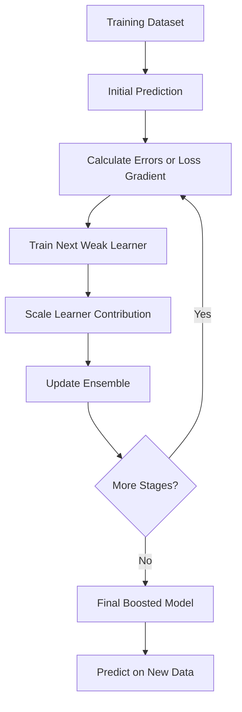

# Boosting in Machine Learning

> **Topic:** Ensemble Learning | **Level:** Beginner to Intermediate

## 📚 Table of Contents
1. Introduction
2. Ensemble Learning
3. What Is Boosting?
4. How Boosting Works
5. Boosting Architecture
6. Main Boosting Algorithms
7. AdaBoost
8. Gradient Boosting
9. XGBoost
10. LightGBM
11. CatBoost
12. Classification and Regression
13. Boosting vs Bagging vs Voting
14. Bias–Variance Trade-off
15. Important Hyperparameters
16. Practical Classification Example
17. Practical Regression Example
18. Model Evaluation
19. Preventing Overfitting
20. Advantages and Limitations
21. Best Practices
22. When to Use Boosting
23. Mini Project
24. Interview Questions
25. Quick Revision
26. Visual Summary

---

## 1. Introduction

**Boosting** is an ensemble machine learning technique that combines multiple weak learners into a stronger model. Learners are added **sequentially**: each new learner attempts to improve the current ensemble by focusing on errors or residual-like information left by earlier stages.

A common base learner is a small decision tree. A decision stump is a tree with only one split.

**Example:** One small tree makes imperfect predictions. The next tree improves the current ensemble, and more trees are added until the stopping condition is reached. The final prediction combines contributions from all learners.

## 2. Ensemble Learning

Ensemble learning combines predictions from multiple models.

| Technique | Main idea | Training style |
|---|---|---|
| Voting | Combine predictions from different models | Usually independent |
| Bagging | Train models on bootstrap samples and aggregate | Usually independent/parallel |
| Boosting | Add learners sequentially to improve the ensemble | Sequential |
| Stacking | Train a meta-model on base-model predictions | Base models, then meta-model |

## 3. What Is Boosting?

A boosted model is commonly represented as an additive model:

\[
F_M(x)=\sum_{m=1}^{M}\alpha_m h_m(x)
\]

Where:
- \(F_M(x)\): final model score or prediction
- \(M\): number of boosting stages
- \(h_m(x)\): learner added at stage \(m\)
- \(\alpha_m\): contribution of that learner

The exact formulation varies by algorithm. AdaBoost uses sample and learner weights; Gradient Boosting adds learners based on the negative gradient of a loss function.

### Why use Boosting?
- Improve predictive accuracy over a simple baseline.
- Capture nonlinear relationships and feature interactions.
- Combine simple learners into a more powerful model.
- Work well on many structured/tabular datasets.
- Support both classification and regression.

Boosting does not guarantee better results on every dataset; performance depends on data quality, algorithm, and tuning.

## 4. How Boosting Works

1. Start with an initial prediction.
2. Calculate the current errors or loss-gradient information.
3. Train a new weak learner to improve the current model.
4. Scale its contribution using a learning rate or algorithm-specific weight.
5. Add it to the ensemble.
6. Repeat for the selected number of stages or until early stopping.
7. Evaluate the final model on unseen data.

### Conceptual example

| Stage | What happens |
|---|---|
| Learner 1 | Learns broad patterns but leaves errors |
| Learner 2 | Focuses on remaining errors or gradient information |
| Learner 3 | Improves the current ensemble further |
| Final model | Combines all learners' contributions |

“Focus on mistakes” is an intuitive summary, but not every boosting algorithm literally reweights misclassified rows. AdaBoost does; Gradient Boosting generally fits negative-gradient signals.

## 5. Boosting Architecture

```text
Training Data
     |
     v
Initial Prediction
     |
     v
Calculate Errors / Loss Gradient
     |
     v
Train Weak Learner
     |
     v
Scale and Add Learner to Ensemble
     |
     v
More Stages? ---- Yes ----> Calculate Errors / Gradient
     |
     No
     v
Final Boosted Model
     |
     v
Prediction on New Data
```

## 6. Main Boosting Algorithms

| Algorithm | Main idea | Python library |
|---|---|---|
| AdaBoost | Reweights examples and combines learners using learner weights | `sklearn.ensemble` |
| Gradient Boosting | Adds learners to reduce a chosen loss function | `sklearn.ensemble` |
| XGBoost | Optimized gradient-boosted trees with regularization | `xgboost` |
| LightGBM | Efficient gradient boosting, often useful for large datasets | `lightgbm` |
| CatBoost | Gradient boosting with specialized categorical-feature handling | `catboost` |

## 7. AdaBoost (Adaptive Boosting)

AdaBoost trains weak learners sequentially and adjusts the importance of training examples. Examples misclassified by a learner generally receive greater relative weight in the next stage.

### Simplified steps
1. Give all training examples equal initial weights.
2. Train a weak learner using the weighted data.
3. Calculate its weighted classification error.
4. Give stronger learners a larger contribution.
5. Increase the relative weight of misclassified examples and decrease the relative weight of correctly classified examples.
6. Normalize weights and train the next learner.
7. Combine learner predictions using their learned weights.

For standard binary AdaBoost, a common learner-weight formula is:

\[
\alpha_m=\frac{1}{2}\ln\left(\frac{1-\epsilon_m}{\epsilon_m}\right)
\]

Here, \(\epsilon_m\) is the weighted error of learner \(m\). This formula assumes the standard binary setup and a learner whose error is below 0.5.

### Advantages
- Straightforward core idea.
- Can turn simple learners into a stronger classifier.
- Available in scikit-learn.

### Limitations
- Can be sensitive to noisy labels and outliers.
- A weak learner that performs worse than random guessing is not useful in the standard setup.
- May be outperformed by modern gradient-boosted tree libraries on some tabular tasks.

```python
from sklearn.ensemble import AdaBoostClassifier
from sklearn.tree import DecisionTreeClassifier

base_tree = DecisionTreeClassifier(max_depth=1, random_state=42)

model = AdaBoostClassifier(
    estimator=base_tree,
    n_estimators=100,
    learning_rate=0.5,
    random_state=42
)
```

Older scikit-learn versions may use `base_estimator` instead of `estimator`.

## 8. Gradient Boosting

Gradient Boosting builds an additive model by adding a learner that moves the ensemble toward lower loss.

For squared-error regression, the idea is closely related to fitting residuals:

\[
r_i=y_i-\hat{y}_i
\]

Where \(y_i\) is the actual value and \(\hat{y}_i\) is the current prediction. For other loss functions, the learner fits a negative-gradient signal rather than necessarily the raw residual.

A simplified update is:

\[
F_m(x)=F_{m-1}(x)+\eta h_m(x)
\]

Where:
- \(F_m(x)\): ensemble after stage \(m\)
- \(h_m(x)\): new learner's contribution
- \(\eta\): learning rate

### Important parameters
- `n_estimators`: number of boosting stages.
- `learning_rate`: scales each stage's contribution.
- `max_depth` / `max_leaf_nodes`: controls tree complexity.
- `subsample`: fraction of rows used per stage in supported implementations.
- `min_samples_leaf`: minimum examples required in a leaf.

```python
from sklearn.ensemble import GradientBoostingClassifier

model = GradientBoostingClassifier(
    n_estimators=100,
    learning_rate=0.05,
    max_depth=3,
    random_state=42
)
```

## 9. XGBoost (Extreme Gradient Boosting)

XGBoost is a popular, optimized implementation of gradient-boosted decision trees. It includes regularization and engineering optimizations for efficient learning.

### Features
- Regularization of tree complexity.
- Efficient tree-building methods.
- Missing-value handling in its tree-learning process.
- Parallelized operations within tree construction.
- Classification, regression, and ranking objectives.

| Parameter | Meaning |
|---|---|
| `n_estimators` | Number of boosting rounds |
| `learning_rate` / `eta` | Contribution scale |
| `max_depth` | Maximum tree depth |
| `subsample` | Fraction of rows sampled per round |
| `colsample_bytree` | Fraction of features sampled per tree |
| `reg_alpha` | L1 regularization |
| `reg_lambda` | L2 regularization |
| `min_child_weight` | Minimum child-node weight threshold |
| `gamma` | Minimum loss reduction required for a split |

Install with `pip install xgboost`.

```python
from xgboost import XGBClassifier

model = XGBClassifier(
    n_estimators=200,
    learning_rate=0.05,
    max_depth=3,
    subsample=0.8,
    colsample_bytree=0.8,
    eval_metric="logloss",
    random_state=42
)
```

For binary classification, encode the target as 0/1 when using this common setup. Tune using validation data or cross-validation.

## 10. LightGBM (Light Gradient Boosting Machine)

LightGBM is designed for efficient gradient boosting, particularly on large or high-dimensional datasets.

### Characteristics
- Histogram-based split finding.
- Leaf-wise tree growth by default, subject to limits.
- Often fast and memory-efficient on large datasets.
- Supports categorical features with its supported input formats and configuration.

| Parameter | Meaning |
|---|---|
| `n_estimators` | Number of boosting iterations |
| `learning_rate` | Contribution scale |
| `num_leaves` | Maximum leaves per tree |
| `max_depth` | Maximum depth; `-1` commonly means no explicit limit |
| `min_child_samples` | Minimum data points in a leaf |
| `colsample_bytree` | Feature sampling rate |
| `reg_alpha`, `reg_lambda` | L1 and L2 regularization |

Install with `pip install lightgbm`.

```python
from lightgbm import LGBMClassifier

model = LGBMClassifier(
    n_estimators=200,
    learning_rate=0.05,
    num_leaves=31,
    max_depth=-1,
    random_state=42,
    verbosity=-1
)
```

Leaf-wise growth can overfit smaller datasets if tree complexity is not controlled. Tune leaf count, minimum leaf data, depth, and regularization.

## 11. CatBoost (Categorical Boosting)

CatBoost is a gradient-boosting library with specialized methods for categorical features and reducing certain forms of target leakage during training.

### Characteristics
- Native categorical-feature support.
- May reduce the need for manual one-hot encoding.
- Supports classification and regression.
- Offers feature importance and model analysis tools.

| Parameter | Meaning |
|---|---|
| `iterations` | Number of boosting iterations |
| `learning_rate` | Learning rate |
| `depth` | Tree depth |
| `loss_function` | Objective to optimize |
| `l2_leaf_reg` | L2 regularization |
| `verbose` | Logging control |

Install with `pip install catboost`.

```python
from catboost import CatBoostClassifier

model = CatBoostClassifier(
    iterations=300,
    learning_rate=0.05,
    depth=6,
    loss_function="Logloss",
    verbose=False,
    random_seed=42
)
```

For categorical columns, provide their indices or names through `cat_features`. Check the installed version's API and input format.

## 12. Classification and Regression

### Classification
The target is a category, such as benign/malignant or spam/not spam.

Common estimators:
- `AdaBoostClassifier`
- `GradientBoostingClassifier`
- `HistGradientBoostingClassifier`
- `XGBClassifier`
- `LGBMClassifier`
- `CatBoostClassifier`

Metrics: accuracy, precision, recall, F1-score, ROC-AUC, and PR-AUC.

### Regression
The target is continuous, such as price, demand, or temperature.

Common estimators:
- `AdaBoostRegressor`
- `GradientBoostingRegressor`
- `HistGradientBoostingRegressor`
- `XGBRegressor`
- `LGBMRegressor`
- `CatBoostRegressor`

Metrics: MAE, MSE, RMSE, and \(R^2\).

Choose metrics according to the practical cost of prediction errors.

## 13. Boosting vs Bagging vs Voting

| Feature | Bagging | Boosting | Voting |
|---|---|---|---|
| Strategy | Train on resampled data and aggregate | Add learners sequentially | Combine predictions |
| Learner dependency | Usually independent | Each stage depends on current ensemble | Usually independent |
| Training | Often parallelizable | Sequential across stages | Base models often train independently |
| Typical benefit | Often reduces variance | Can reduce bias and improve accuracy | Combines complementary models |
| Example | Random Forest | AdaBoost, XGBoost | `VotingClassifier` |

**Memory trick:**
- **Bagging:** train many models on different samples, then aggregate.
- **Boosting:** add models step by step to improve the ensemble.
- **Voting:** combine predictions from different models.

## 14. Bias–Variance Trade-off

- **Bias:** error from overly simplistic assumptions.
- **Variance:** sensitivity to the particular training sample.
- **Irreducible noise:** uncertainty that cannot be eliminated by the model.

Boosting often improves performance by building a more expressive model and reducing bias. However, too many stages, deep trees, or a large learning rate can lead to overfitting.

Practical guidance:
- Start with shallow trees.
- Tune `learning_rate` and `n_estimators` together.
- Use validation data or cross-validation.
- Apply early stopping when supported.
- Compare training and validation performance.

## 15. Important Hyperparameters

| Hyperparameter | Purpose | Guidance |
|---|---|---|
| `n_estimators` | Number of learners/stages | More stages can help but may overfit |
| `learning_rate` | Scales each learner's contribution | Smaller values often need more stages |
| `max_depth` | Tree depth | Shallower trees are simpler |
| `max_leaf_nodes` / `num_leaves` | Limits leaf count | Controls tree complexity |
| `subsample` | Row sampling | Can add randomness in supported algorithms |
| `max_features` / `colsample_bytree` | Feature sampling | May reduce overfitting and cost |
| `min_samples_leaf` / `min_child_samples` | Minimum leaf data | Larger values make trees more conservative |
| Regularization | Penalizes model complexity | Useful when overfitting |
| Early stopping | Stops when validation stops improving | Requires validation data in supported APIs |

Exact parameter names and behavior vary by library. A lower learning rate makes each update smaller and often requires more stages, but it is not automatically better.

## 16. Practical Classification Example

This example uses `Breast Cancer Wisconsin (Diagnostic) Data Set.csv`, with `diagnosis` as the target (`M` = malignant, `B` = benign). Adjust the column names if your CSV differs.

### Load and prepare data

```python
import pandas as pd

from sklearn.model_selection import train_test_split
from sklearn.ensemble import GradientBoostingClassifier
from sklearn.metrics import (
    accuracy_score, classification_report,
    confusion_matrix, roc_auc_score
)

df = pd.read_csv("Breast Cancer Wisconsin (Diagnostic) Data Set.csv")

target_column = "diagnosis"
X = df.drop(columns=[target_column])
y = df[target_column]

if "id" in X.columns:
    X = X.drop(columns=["id"])

y = y.map({"M": 1, "B": 0})

if y.isna().any():
    raise ValueError("Unexpected target labels. Inspect df[target_column].unique().")

print("Features:", X.shape)
print(y.value_counts())
```

### Split and train

```python
X_train, X_test, y_train, y_test = train_test_split(
    X, y, test_size=0.2, random_state=42, stratify=y
)

model = GradientBoostingClassifier(
    n_estimators=100,
    learning_rate=0.05,
    max_depth=2,
    random_state=42
)

model.fit(X_train, y_train)
```

### Evaluate

```python
y_pred = model.predict(X_test)
y_prob = model.predict_proba(X_test)[:, 1]

print("Accuracy:", accuracy_score(y_test, y_pred))
print(classification_report(
    y_test, y_pred, target_names=["Benign", "Malignant"]
))
print("Confusion matrix:\n", confusion_matrix(y_test, y_pred))
print("ROC-AUC:", roc_auc_score(y_test, y_prob))
```

- `test_size=0.2`: reserves 20% for testing.
- `random_state=42`: makes the split reproducible.
- `stratify=y`: preserves approximate class proportions.

**Safety note:** This is an educational example, not a clinically validated diagnostic system. Medical use requires appropriate clinical validation and expert oversight.

## 17. Practical Regression Example

This example uses scikit-learn's California Housing dataset and predicts a continuous target.

```python
from sklearn.datasets import fetch_california_housing
from sklearn.model_selection import train_test_split
from sklearn.ensemble import GradientBoostingRegressor
from sklearn.metrics import mean_absolute_error, mean_squared_error, r2_score
import numpy as np

data = fetch_california_housing(as_frame=True)
X, y = data.data, data.target

X_train, X_test, y_train, y_test = train_test_split(
    X, y, test_size=0.2, random_state=42
)

model = GradientBoostingRegressor(
    n_estimators=150,
    learning_rate=0.05,
    max_depth=2,
    random_state=42
)
model.fit(X_train, y_train)
y_pred = model.predict(X_test)

mse = mean_squared_error(y_test, y_pred)
print("MAE:", mean_absolute_error(y_test, y_pred))
print("MSE:", mse)
print("RMSE:", np.sqrt(mse))
print("R2:", r2_score(y_test, y_pred))
```

The first run may download the dataset. If internet access is unavailable, use a locally available regression dataset.

## 18. Model Evaluation

Do not select a model using accuracy alone.

### Classification metrics
- **Precision:** Of predicted positives, how many were actually positive?
- **Recall:** Of actual positives, how many did the model identify?
- **F1-score:** Harmonic mean of precision and recall.
- **ROC-AUC:** Ranking quality across classification thresholds.
- **PR-AUC:** Often useful when the positive class is rare.

For medical screening, false negatives may be costly, so recall and the clinical context can be particularly important.

### Regression metrics
- **MAE:** Average absolute prediction error.
- **MSE:** Average squared error, penalizing large errors more.
- **RMSE:** Square root of MSE, in the target's units.
- **R²:** Comparison with a mean-target baseline; can be negative on test data.

### Fair model comparison
1. Use the same split or cross-validation folds.
2. Fit preprocessing only on training data.
3. Tune using training/validation data.
4. Keep the final test set untouched during tuning.
5. Report metric values and limitations.

## 19. Preventing Overfitting

1. Reduce tree depth or number of leaves.
2. Tune the learning rate and number of estimators together.
3. Use row/feature subsampling where supported.
4. Increase minimum leaf-data requirements.
5. Apply regularization in libraries that support it.
6. Use early stopping with a validation set.
7. Check for data leakage.
8. Avoid repeated tuning against the final test set.

## 20. Advantages and Limitations

### Advantages
- Often strong on structured/tabular data.
- Captures nonlinear patterns and feature interactions.
- Supports classification and regression.
- Combines simple learners into a powerful model.
- Modern implementations provide regularization and diagnostics.
- Usually needs less feature scaling than distance-based models.

### Limitations
- Sequential stages can make training slower than parallel bagging.
- Hyperparameter tuning can matter considerably.
- Complex trees or excessive stages can overfit.
- Some methods are sensitive to noise and mislabeled examples.
- Ensembles are less interpretable than small individual trees.
- Missing and categorical values need library-appropriate handling.

## 21. Best Practices

### Common mistakes
- Assuming all boosting algorithms reweight misclassified rows.
- Increasing `n_estimators` without validation.
- Using deep trees without checking overfitting.
- Tuning repeatedly on the test set.
- Using accuracy alone on imbalanced data.
- Keeping identifier columns that carry no predictive signal.
- Preprocessing on the full dataset before splitting.

### Recommended workflow
- Start with a simple baseline.
- Make reproducible train/validation/test splits.
- Tune a small set of meaningful hyperparameters.
- Use cross-validation where appropriate.
- Inspect confusion matrices or regression residuals.
- Treat feature importance as predictive information, not proof of causation.
- Choose the simplest model that meets the task requirements.

## 22. When to Use Boosting

Consider boosting when:
- Data is structured/tabular.
- Relationships are nonlinear.
- A single tree underperforms.
- Predictive performance is important.
- You can afford validation and tuning.

Consider alternatives when interpretability, training latency, or simplicity is the main requirement, or when a simpler model already performs well.

Starting points:
- Learning with scikit-learn: `GradientBoostingClassifier`.
- Large tabular data: test XGBoost or LightGBM.
- Many categorical features: test CatBoost.
- Conceptual learning: start with AdaBoost and Gradient Boosting.

These are starting points, not universal rankings. Evaluate candidates on the actual task.

## 23. Mini Project: Compare Models

**Objective:** Compare Decision Tree, Random Forest, AdaBoost, and Gradient Boosting on the Breast Cancer Wisconsin Diagnostic dataset.

Suggested metrics:
- Accuracy
- Precision
- Recall
- F1-score
- ROC-AUC
- Training time

Workflow:

```text
Load Dataset
     |
Clean and Prepare Features
     |
Stratified Train-Test Split
     |
Train Each Model
     |
Evaluate Using the Same Metrics
     |
Create Comparison Table
     |
Choose Model Based on Requirements
```

For a stronger comparison, use stratified cross-validation on the training data, then evaluate the selected model once on the held-out test set.

## 24. Interview Questions

**1. What is Boosting?**  
An ensemble method that adds learners sequentially to improve the current model.

**2. What is a weak learner?**  
A simple learner with limited predictive strength under the task's evaluation setup.

**3. Why are decision stumps used in AdaBoost?**  
They are simple learners that can be combined into a stronger model.

**4. Is Boosting sequential or parallel?**  
Boosting stages are generally sequential because each stage depends on the current ensemble.

**5. Can Boosting be used for regression?**  
Yes. Gradient Boosting, AdaBoost, XGBoost, LightGBM, and CatBoost offer regression estimators.

**6. How does AdaBoost focus on difficult examples?**  
It increases the relative weight of examples misclassified by the current learner.

**7. How does Gradient Boosting work?**  
It adds learners that fit negative-gradient signals from a chosen loss function.

**8. What is the learning rate?**  
A parameter that scales the contribution of each new learner.

**9. What happens if the learning rate is too high?**  
Updates may be too large and generalization can suffer.

**10. How can Boosting overfit?**  
Excessive stages, complex trees, noise, or poorly tuned parameters can cause overfitting.

**11. Difference between AdaBoost and Gradient Boosting?**  
AdaBoost typically adjusts example and learner weights; Gradient Boosting optimizes a loss using negative-gradient information.

**12. What is early stopping?**  
Stopping training when validation performance no longer improves sufficiently.

**13. Why can LightGBM overfit small datasets?**  
Leaf-wise growth can produce complex trees unless leaf count, depth, and minimum leaf data are controlled.

**14. When might you choose CatBoost?**  
When its native handling of categorical features fits your dataset and workflow.

## 25. Quick Revision Cheat Sheet

| Concept | Remember |
|---|---|
| Boosting | Sequentially adds learners to improve the ensemble |
| Weak learner | A simple learner with limited predictive strength |
| AdaBoost | Reweights examples and combines learners by learned weights |
| Gradient Boosting | Adds learners using negative-gradient information |
| XGBoost | Optimized gradient-boosted trees with regularization |
| LightGBM | Efficient gradient boosting, often with leaf-wise growth |
| CatBoost | Specialized categorical-feature handling |
| Learning rate | Controls each learner's contribution |
| `n_estimators` | Number of boosting stages/rounds |
| Tree depth | Controls tree complexity |
| Early stopping | Stops when validation performance stops improving |
| Main risks | Overfitting, noise sensitivity, tuning complexity |

**One-line memory trick:** Boosting = build a model, learn what it still gets wrong, add a learner to improve it, and repeat.

Remember: this is the general intuition. AdaBoost and Gradient Boosting use different mathematical mechanisms.

## 26. Visual Summary



---

## Final Takeaway

Boosting combines weak learners through sequential improvement. **AdaBoost** emphasizes difficult training examples using sample weights, while **Gradient Boosting** adds learners that optimize a loss function. **XGBoost, LightGBM, and CatBoost** extend gradient boosting with different engineering, regularization, and feature-handling strategies.

Start with a baseline, tune using validation data, compare suitable metrics, and keep the test set untouched until final evaluation.
