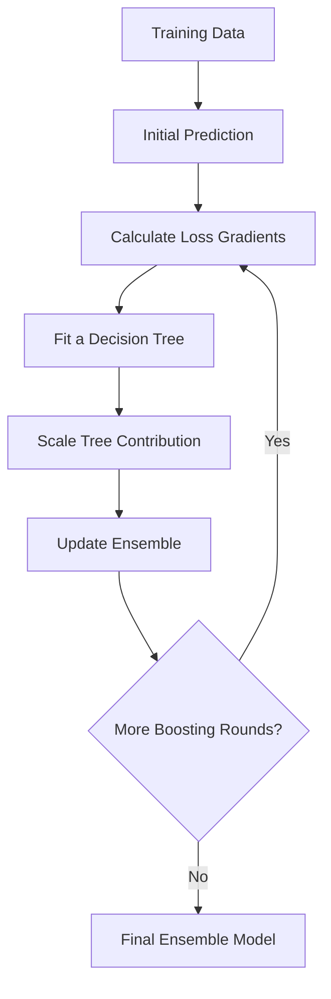
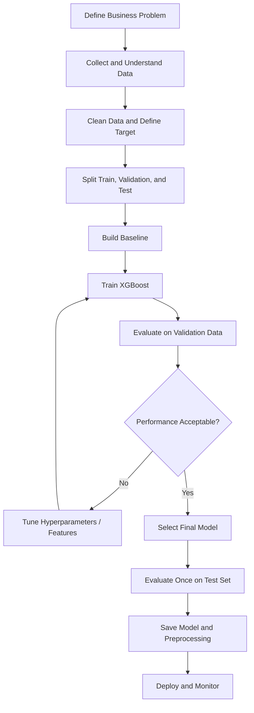
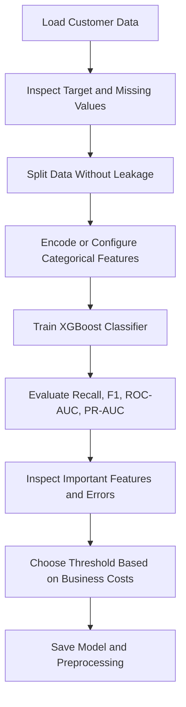
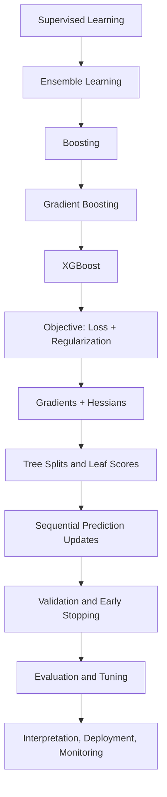

# 🚀 XGBoost (Extreme Gradient Boosting) — Complete Notes

## 📚 Table of Contents

1. [Introduction to XGBoost](#1--introduction-to-xgboost)
2. [Why XGBoost?](#2--why-xgboost)
3. [Boosting Fundamentals](#3--boosting-fundamentals)
4. [How XGBoost Works](#4--how-xgboost-works)
5. [Important Terminology](#5--important-terminology)
6. [Mathematical Foundation](#6--mathematical-foundation)
7. [Objective Function and Regularization](#7--objective-function-and-regularization)
8. [Tree Construction and Split Finding](#8--tree-construction-and-split-finding)
9. [Important Hyperparameters](#9--important-hyperparameters)
10. [XGBoost for Classification](#10--xgboost-for-classification)
11. [XGBoost for Regression](#11--xgboost-for-regression)
12. [Practical Python Examples](#12--practical-python-examples)
13. [Hyperparameter Tuning](#13--hyperparameter-tuning)
14. [Missing Values and Categorical Features](#14--missing-values-and-categorical-features)
15. [Evaluation Metrics](#15--evaluation-metrics)
16. [Feature Importance and Explainability](#16--feature-importance-and-explainability)
17. [XGBoost Workflow](#17--xgboost-workflow)
18. [Real-World Use Cases](#18--real-world-use-cases)
19. [Advantages and Limitations](#19--advantages-and-limitations)
20. [Best Practices](#20--best-practices)
21. [Common Mistakes](#21--common-mistakes)
22. [XGBoost vs Other Algorithms](#22--xgboost-vs-other-algorithms)
23. [Advanced Concepts](#23--advanced-concepts)
24. [Mini Project: Customer Churn Prediction](#24--mini-project-customer-churn-prediction)
25. [Interview Questions and Answers](#25--interview-questions-and-answers)
26. [Quick Revision](#26--quick-revision)

---

## 1. 🎯 Introduction to XGBoost

**XGBoost (Extreme Gradient Boosting)** is an optimized, regularized, and scalable implementation of gradient-boosted decision trees. It is widely used for supervised learning tasks involving structured or tabular data.

XGBoost builds an ensemble of decision trees sequentially. Each new tree improves the current model by learning patterns in the errors or gradients left by the existing ensemble.

### Key characteristics

- Uses gradient boosting with a second-order optimization method.
- Supports regularization to reduce overfitting.
- Handles missing values natively in tree-based learning.
- Supports classification, regression, and ranking.
- Includes efficient split-finding methods and system-level optimizations.
- Supports parallel computation for parts of training, such as split evaluation.
- Can work with sparse data and large datasets.

> **Important:** XGBoost is an algorithm/library, not a single decision tree. A trained model is generally an additive ensemble of many trees.

### When is it useful?

XGBoost is often a strong starting point when the dataset is tabular, the relationship between features and target is nonlinear, and interactions between features matter.

---

## 2. 🤔 Why XGBoost?

A single decision tree is easy to interpret but may have high variance and limited predictive power. Bagging trains models independently and combines their predictions, while boosting trains learners sequentially so later learners improve the current ensemble.

| Challenge | How XGBoost helps |
|---|---|
| Complex nonlinear patterns | Learns nonlinear decision boundaries through trees |
| Overfitting | Uses regularization, shrinkage, subsampling, and tree constraints |
| Missing numeric values | Learns default directions for missing values during split construction |
| Large tabular datasets | Uses optimized data structures and efficient training algorithms |
| Weak individual trees | Adds trees sequentially to improve the ensemble |
| Imbalanced classification | Supports class weighting and suitable evaluation metrics |

XGBoost is not guaranteed to outperform every alternative. Always compare it with a baseline and validate it on data that represents the intended deployment setting.

---

## 3. 🌱 Boosting Fundamentals

### 3.1 What is boosting?

Boosting combines multiple relatively weak learners into a stronger model. In gradient boosting, each new learner is fitted to improve the loss of the current ensemble.

A simplified sequence is:

1. Start with an initial prediction.
2. Calculate how the current predictions differ from the target, using the loss gradient.
3. Fit a small tree to the gradient information.
4. Add the tree's contribution, scaled by a learning rate.
5. Repeat for a chosen number of boosting rounds.

### 3.2 Boosting vs bagging

| Property | Bagging | Boosting |
|---|---|---|
| Training | Learners are usually trained independently | Learners are added sequentially |
| Main goal | Reduce variance | Improve predictive fit by correcting residual patterns/gradients |
| Data sampling | Often uses bootstrap samples | May use row subsampling; not necessarily bootstrap sampling |
| Parallelism | Base learners can often train in parallel | Boosting rounds depend on earlier rounds |
| Example | Random Forest | XGBoost, AdaBoost, Gradient Boosting |

### 3.3 Gradient boosting vs XGBoost

Gradient boosting is a general method. XGBoost is a particular optimized implementation that adds regularization and engineering improvements.



---

## 4. ⚙️ How XGBoost Works

Suppose a model predicts customer spending. The first model may make rough predictions. Subsequent trees learn which feature-based adjustments can improve those predictions.

### Step-by-step process

1. **Initialize predictions:** choose an initial score based on the objective function.
2. **Compute gradients and Hessians:** for each training example, estimate the first and second derivatives of the loss with respect to the current prediction.
3. **Build a tree:** evaluate candidate splits using the gradient statistics.
4. **Score splits:** measure the improvement in the regularized objective.
5. **Prune or stop growth:** avoid splits that do not improve the objective enough or violate constraints.
6. **Update predictions:** add the new tree's output multiplied by the learning rate.
7. **Repeat:** continue for additional boosting rounds or stop early based on validation performance.

### Model prediction

For a model with \(K\) trees, a simplified raw prediction is:

\[
\hat{y}_i = \sum_{k=1}^{K} f_k(x_i)
\]

where each \(f_k\) is a decision tree. The initial prediction or base score may also be part of the model's scoring setup.

For binary classification, the raw score is typically transformed into a probability using a logistic function:

\[
p_i = \frac{1}{1+e^{-\hat{y}_i}}
\]

A classification threshold then converts probability into a class label.

---

## 5. 🧠 Important Terminology

| Term | Meaning |
|---|---|
| **Boosting round** | One iteration that adds a new tree or group of trees |
| **Weak learner** | A relatively simple model, commonly a shallow decision tree |
| **Ensemble** | A combination of multiple models |
| **Gradient** | First derivative of the loss with respect to the current prediction |
| **Hessian** | Second derivative of the loss with respect to the current prediction |
| **Objective function** | Training loss plus regularization terms |
| **Learning rate (`eta`)** | Scales each new tree's contribution |
| **Regularization** | Penalizes model complexity to reduce overfitting |
| **Gain** | Improvement in the objective from a split |
| **Leaf weight** | Value predicted by a leaf |
| **Subsampling** | Using only part of the rows or features in a training round |
| **Early stopping** | Ending training when a validation metric stops improving |
| **Base score** | Initial prediction score used by the model |
| **DMatrix** | XGBoost's optimized data structure in its native API |
| **Boosted tree** | A tree added as a correction to the existing ensemble |

---

## 6. 📐 Mathematical Foundation

XGBoost optimizes a regularized objective:

\[
\mathcal{L}^{(t)} = \sum_{i=1}^{n} l(y_i,\hat{y}_i^{(t-1)} + f_t(x_i)) + \Omega(f_t)
\]

where:

- \(n\) is the number of training examples.
- \(l\) is the chosen loss function.
- \(y_i\) is the actual target.
- \(\hat{y}_i^{(t-1)}\) is the prediction from the existing ensemble.
- \(f_t(x_i)\) is the contribution of the new tree.
- \(\Omega(f_t)\) penalizes tree complexity.

XGBoost approximates the objective around the current predictions with a second-order Taylor expansion:

\[
\mathcal{L}^{(t)} \approx \sum_{i=1}^{n}
\left[g_i f_t(x_i) + \frac{1}{2}h_i f_t(x_i)^2\right] + \Omega(f_t)
\]

where:

\[
g_i = \frac{\partial l(y_i,\hat{y}_i)}{\partial \hat{y}_i},
\qquad
h_i = \frac{\partial^2 l(y_i,\hat{y}_i)}{\partial \hat{y}_i^2}
\]

The gradient indicates the direction of local loss change, while the Hessian captures local curvature. The exact derivatives depend on the objective.

### Why use second-order information?

The gradient tells the algorithm how the loss changes locally. The Hessian adds curvature information, helping XGBoost estimate the effect of a proposed leaf value or split more effectively.

---

## 7. 🛡️ Objective Function and Regularization

A common tree-complexity penalty is:

\[
\Omega(f) = \gamma T + \frac{1}{2}\lambda \sum_{j=1}^{T} w_j^2
\]

where:

- \(T\) is the number of leaves.
- \(w_j\) is the score assigned to leaf \(j\).
- \(\gamma\) penalizes adding leaves.
- \(\lambda\) is L2 regularization on leaf scores.

An optional L1 penalty is controlled by `alpha` (also called `reg_alpha` in the sklearn-style API).

### Important regularization controls

| Parameter | Effect of increasing it |
|---|---|
| `reg_lambda` | Stronger L2 penalty on leaf weights; often makes predictions more conservative |
| `reg_alpha` | Stronger L1 penalty; can push leaf weights toward zero |
| `gamma` | Requires greater gain before adding a split |
| `max_depth` | Allows more complex trees when increased |
| `min_child_weight` | Requires more Hessian weight in a child before a split is allowed |
| `subsample` | Lower values introduce row sampling and may reduce overfitting |
| `colsample_bytree` | Uses fewer features per tree and may reduce overfitting |

These controls interact. Tune them using validation data rather than assuming that increasing any one parameter always improves generalization.

---

## 8. 🌳 Tree Construction and Split Finding

XGBoost evaluates splits by comparing the regularized objective before and after splitting a node.

A commonly used split-gain expression is:

\[
Gain = \frac{1}{2}\left[
\frac{G_L^2}{H_L+\lambda}
+\frac{G_R^2}{H_R+\lambda}
-\frac{(G_L+G_R)^2}{H_L+H_R+\lambda}
\right]-\gamma
\]

where:

- \(G_L, G_R\) are the sums of gradients for the left and right children.
- \(H_L, H_R\) are the sums of Hessians for the left and right children.
- \(\lambda\) is L2 regularization.
- \(\gamma\) is the split penalty.

A split is useful when its gain is sufficiently positive and it satisfies other tree constraints.

### Tree-building methods

- **Exact:** considers candidate split points exhaustively; can be costly on large data.
- **Approximate:** uses quantile-based candidate split points.
- **Histogram-based:** groups continuous feature values into bins to reduce split-search cost.
- **`tree_method="auto"`:** lets the installed XGBoost version choose an appropriate method.
- **`tree_method="hist"`:** often a strong practical choice for tabular data.

The available methods and defaults can vary by XGBoost version and hardware.

### Tree boosters

| Booster | Description | Typical use |
|---|---|---|
| `gbtree` | Gradient-boosted decision trees | General tabular tasks |
| `dart` | Dropout-style regularization for boosted trees | May help with some overfitting patterns; requires validation |
| `gblinear` | Regularized linear model booster | High-dimensional, approximately linear relationships |

---

## 9. 🎛️ Important Hyperparameters

### 9.1 General parameters

| Parameter | Purpose |
|---|---|
| `booster` | Selects the model type: `gbtree`, `dart`, or `gblinear` |
| `n_estimators` | Number of boosting rounds in the sklearn-style API |
| `objective` | Defines the learning task and loss |
| `eval_metric` | Metric used to monitor model performance |
| `random_state` | Controls random behavior where applicable |
| `n_jobs` | Number of CPU threads used by supported operations |

### 9.2 Tree parameters

| Parameter | Meaning | Practical guidance |
|---|---|---|
| `max_depth` | Maximum depth of each tree | Start modestly; deeper trees can overfit |
| `min_child_weight` | Minimum sum of Hessians in a child | Increase to make splits more conservative |
| `gamma` | Minimum loss reduction required for a split | Increase to restrict tree growth |
| `subsample` | Fraction of training rows sampled per boosting round | Values below 1.0 can improve generalization |
| `colsample_bytree` | Fraction of features sampled per tree | Useful for reducing feature dependence |
| `colsample_bylevel` | Feature fraction sampled per tree level | More granular feature sampling |
| `colsample_bynode` | Feature fraction sampled per split node | Adds further feature sampling |

### 9.3 Learning and regularization parameters

| Parameter | Meaning |
|---|---|
| `learning_rate` / `eta` | Shrinks each new tree's contribution |
| `reg_lambda` | L2 regularization |
| `reg_alpha` | L1 regularization |
| `max_delta_step` | Limits the maximum update magnitude for a leaf; may help some imbalanced logistic tasks |

### 9.4 Practical starting configuration

```python
from xgboost import XGBClassifier

model = XGBClassifier(
    n_estimators=500,
    learning_rate=0.05,
    max_depth=4,
    min_child_weight=2,
    subsample=0.8,
    colsample_bytree=0.8,
    reg_lambda=1.0,
    objective="binary:logistic",
    eval_metric="logloss",
    tree_method="hist",
    random_state=42,
    n_jobs=-1,
)
```

This is a starting point, not a universally optimal configuration. Select parameters based on cross-validation or a validation set.

---

## 10. 🏷️ XGBoost for Classification

Classification predicts a discrete class, such as fraud/not fraud or churn/no churn.

### Common objectives

| Objective | Task |
|---|---|
| `binary:logistic` | Binary classification; outputs probabilities |
| `binary:logitraw` | Binary classification; outputs raw margins |
| `multi:softprob` | Multiclass classification; outputs class probabilities |
| `multi:softmax` | Multiclass classification; outputs class labels |

For multiclass classification, set `num_class` in the native API when required. The sklearn wrapper usually infers the class count from labels.

### Binary classification workflow

```python
from sklearn.model_selection import train_test_split
from sklearn.metrics import accuracy_score, classification_report
from xgboost import XGBClassifier

X_train, X_test, y_train, y_test = train_test_split(
    X, y, test_size=0.2, random_state=42, stratify=y
)

model = XGBClassifier(
    n_estimators=300,
    max_depth=4,
    learning_rate=0.05,
    subsample=0.8,
    colsample_bytree=0.8,
    objective="binary:logistic",
    eval_metric="logloss",
    tree_method="hist",
    random_state=42,
)

model.fit(X_train, y_train)
predictions = model.predict(X_test)

print("Accuracy:", accuracy_score(y_test, predictions))
print(classification_report(y_test, predictions))
```

`X` and `y` must be defined from your dataset before running this example. For binary classification, encode the target as two classes supported by the selected XGBoost wrapper/version.

---

## 11. 📈 XGBoost for Regression

Regression predicts a continuous value such as price, demand, or delivery time.

### Common objectives

| Objective | Description |
|---|---|
| `reg:squarederror` | Squared-error regression; a common default choice |
| `reg:absoluteerror` | Absolute-error regression |
| `reg:pseudohubererror` | Smooth robust loss related to absolute error |
| `count:poisson` | Poisson regression for nonnegative count targets under appropriate assumptions |
| `reg:quantileerror` | Quantile regression in versions that support it |

Check the installed version's documentation for objective availability and restrictions.

### Regression example

```python
from xgboost import XGBRegressor
from sklearn.model_selection import train_test_split
from sklearn.metrics import mean_absolute_error, mean_squared_error, r2_score

X_train, X_test, y_train, y_test = train_test_split(
    X, y, test_size=0.2, random_state=42
)

model = XGBRegressor(
    n_estimators=500,
    learning_rate=0.05,
    max_depth=4,
    subsample=0.8,
    colsample_bytree=0.8,
    objective="reg:squarederror",
    eval_metric="rmse",
    tree_method="hist",
    random_state=42,
)

model.fit(X_train, y_train)
predictions = model.predict(X_test)

print("MAE:", mean_absolute_error(y_test, predictions))
print("RMSE:", mean_squared_error(y_test, predictions) ** 0.5)
print("R²:", r2_score(y_test, predictions))
```

---

## 12. 💻 Practical Python Examples

### 12.1 Install XGBoost

```bash
pip install xgboost scikit-learn pandas numpy matplotlib
```

Verify the installation:

```python
import xgboost
print(xgboost.__version__)
```

### 12.2 Complete example with a built-in dataset

This example uses the breast cancer dataset available in scikit-learn. It demonstrates a full classification pipeline without requiring an external file.

```python
import pandas as pd
import xgboost as xgb
from sklearn.datasets import load_breast_cancer
from sklearn.model_selection import train_test_split
from sklearn.metrics import (
    accuracy_score,
    classification_report,
    confusion_matrix,
    roc_auc_score,
)

# Load data
dataset = load_breast_cancer(as_frame=True)
X = dataset.data
y = dataset.target

# Create stratified train/test split
X_train, X_test, y_train, y_test = train_test_split(
    X, y,
    test_size=0.2,
    random_state=42,
    stratify=y,
)

# Define model
model = xgb.XGBClassifier(
    n_estimators=400,
    learning_rate=0.05,
    max_depth=3,
    min_child_weight=2,
    subsample=0.8,
    colsample_bytree=0.8,
    objective="binary:logistic",
    eval_metric="logloss",
    tree_method="hist",
    random_state=42,
    n_jobs=-1,
)

# Train
model.fit(X_train, y_train)

# Predict
y_pred = model.predict(X_test)
y_prob = model.predict_proba(X_test)[:, 1]

# Evaluate
print(f"Accuracy: {accuracy_score(y_test, y_pred):.4f}")
print(f"ROC-AUC: {roc_auc_score(y_test, y_prob):.4f}")
print("\nClassification report:\n", classification_report(y_test, y_pred))
print("\nConfusion matrix:\n", confusion_matrix(y_test, y_pred))
```

**Note:** The class labels in this dataset have a specific mapping. Check `dataset.target_names` before interpreting class `0` and class `1`.

### 12.3 Visualize feature importance

```python
import matplotlib.pyplot as plt
from xgboost import plot_importance

plot_importance(model, max_num_features=12, importance_type="gain")
plt.title("Top XGBoost Features by Gain")
plt.tight_layout()
plt.show()
```

Feature importance describes how features were used by the fitted model. It does not establish causality.

### 12.4 Save and load a model

```python
# Save the trained model
model.save_model("xgboost_model.json")

# Load it into a compatible XGBoost model object
loaded_model = xgb.XGBClassifier()
loaded_model.load_model("xgboost_model.json")

predictions = loaded_model.predict(X_test)
```

JSON or UBJSON model formats are preferable for portable XGBoost model storage. Keep preprocessing, feature order, and label mappings consistent between training and inference.

---

## 13. 🧪 Hyperparameter Tuning

Hyperparameter tuning searches for settings that generalize well to unseen data.

### Recommended tuning sequence

1. Establish a baseline.
2. Tune tree complexity (`max_depth`, `min_child_weight`, `gamma`).
3. Tune sampling (`subsample`, `colsample_bytree`).
4. Tune learning rate and number of trees together.
5. Tune regularization (`reg_alpha`, `reg_lambda`).
6. Re-evaluate the selected model on the held-out test set only after model selection.

### GridSearchCV example

```python
from sklearn.model_selection import GridSearchCV, StratifiedKFold
from xgboost import XGBClassifier

base_model = XGBClassifier(
    objective="binary:logistic",
    eval_metric="logloss",
    tree_method="hist",
    random_state=42,
    n_jobs=1,  # Avoid nested CPU oversubscription with GridSearchCV
)

param_grid = {
    "n_estimators": [200, 400],
    "max_depth": [3, 5],
    "learning_rate": [0.03, 0.1],
    "subsample": [0.8, 1.0],
    "colsample_bytree": [0.8, 1.0],
}

cv = StratifiedKFold(n_splits=5, shuffle=True, random_state=42)

search = GridSearchCV(
    estimator=base_model,
    param_grid=param_grid,
    scoring="roc_auc",
    cv=cv,
    n_jobs=-1,
    verbose=1,
)

search.fit(X_train, y_train)

print("Best parameters:", search.best_params_)
print("Best CV ROC-AUC:", search.best_score_)

best_model = search.best_estimator_
```

The grid above has many combinations and may take time. Start with a smaller search space when compute is limited. The test set should not be used to select hyperparameters.

### Early stopping

Early stopping monitors a validation metric and stops adding trees when the metric no longer improves. The precise API for configuring early stopping has changed across XGBoost versions. For versions supporting `early_stopping_rounds` in the sklearn estimator's `fit` method, a pattern is:

```python
model = XGBClassifier(
    n_estimators=2000,
    learning_rate=0.03,
    max_depth=4,
    eval_metric="logloss",
    tree_method="hist",
    random_state=42,
)

model.fit(
    X_train,
    y_train,
    eval_set=[(X_valid, y_valid)],
    verbose=False,
    # In compatible versions, pass early_stopping_rounds
    # through the estimator constructor or fit method as documented.
)
```

Create `X_valid` and `y_valid` from the training data before fitting. Do not use the final test set as the early-stopping validation set.

---

## 14. 🧩 Missing Values and Categorical Features

### 14.1 Missing values

Tree boosters in XGBoost can learn a default direction for missing values when evaluating a split. In many cases, numerical missing values can remain as `NaN`.

```python
import numpy as np
import pandas as pd

X = pd.DataFrame({
    "age": [22, 35, np.nan, 48],
    "income": [25000, 52000, 41000, np.nan],
})
```

This does not mean every data-quality issue can be ignored. Investigate why values are missing, and ensure the missing-value patterns at training time resemble those at deployment.

### 14.2 Categorical features

Depending on the XGBoost version and data interface, native categorical support can be enabled with `enable_categorical=True` and suitable pandas categorical columns. The histogram tree method is generally used for this workflow.

```python
import pandas as pd
from xgboost import XGBClassifier

X = pd.DataFrame({
    "age": [21, 35, 44, 29, 52, 40],
    "city": pd.Series(
        ["Pune", "Mumbai", "Pune", "Nashik", "Mumbai", "Nashik"],
        dtype="category",
    ),
})
y = [0, 1, 1, 0, 1, 0]

model = XGBClassifier(
    tree_method="hist",
    enable_categorical=True,
    n_estimators=100,
    max_depth=3,
    random_state=42,
)

model.fit(X, y)
```

This small example is for demonstrating syntax, not for meaningful model evaluation. Ensure train and inference data preserve compatible categorical dtypes and category mappings. Alternatively, encode categorical variables using a preprocessing pipeline.

---

## 15. 📊 Evaluation Metrics

Choose metrics according to the task, class balance, and cost of errors.

### Classification metrics

| Metric | What it measures | Useful when |
|---|---|---|
| Accuracy | Fraction of predictions that are correct | Classes are reasonably balanced and errors have similar cost |
| Precision | Fraction of predicted positives that are truly positive | False positives are costly |
| Recall | Fraction of actual positives detected | False negatives are costly |
| F1-score | Harmonic mean of precision and recall | Need a balance between precision and recall |
| ROC-AUC | Ranking quality across thresholds | Evaluating binary ranking performance |
| PR-AUC / Average Precision | Precision-recall trade-off | Often informative for rare positive classes |
| Log loss | Quality of predicted probabilities | Probability estimates matter |

For imbalanced data, accuracy alone can be misleading. Review the confusion matrix, per-class recall, precision, F1, and an appropriate ranking metric.

### Regression metrics

| Metric | Meaning | Caution |
|---|---|---|
| MAE | Mean absolute error | Treats errors linearly |
| MSE | Mean squared error | Penalizes large errors more heavily |
| RMSE | Square root of MSE | Expressed in target units |
| R² | Relative fit compared with predicting the target mean | Can be negative on held-out data; not a direct error measure |
| RMSLE | Root mean squared logarithmic error | Requires valid nonnegative/log-compatible targets and predictions |

---

## 16. 🔍 Feature Importance and Explainability

XGBoost provides multiple feature-importance views:

- **Weight:** number of times a feature is used in splits.
- **Gain:** average improvement in the objective from splits using a feature.
- **Cover:** amount of data or Hessian weight affected by splits using a feature, depending on the API definition.

Gain is often a useful first inspection, but no importance type alone fully explains an individual prediction.

### SHAP explanations

SHAP (SHapley Additive exPlanations) can explain how features contribute to predictions relative to a baseline.

```python
# Install if needed:
# pip install shap

import shap

explainer = shap.TreeExplainer(model)
shap_values = explainer.shap_values(X_test)

shap.summary_plot(shap_values, X_test)
```

SHAP API output can vary by model type, number of classes, and package version. For multiclass models, inspect the returned structure before plotting.

**Interpretation caution:** Feature importance and SHAP values describe model behavior, not necessarily causal relationships. Correlated features can share or redistribute apparent importance.

---

## 17. 🗺️ XGBoost Workflow



### Practical checklist

- Define the target and success metric before training.
- Remove target leakage and split data appropriately.
- Use stratified splits for ordinary classification when suitable.
- Use time-based splits for forecasting or temporal prediction.
- Use group-aware splits when multiple records belong to the same person, device, or entity.
- Compare with a simple baseline.
- Track model settings, library versions, and random seeds.
- Monitor drift and performance after deployment.

---

## 18. 🌍 Real-World Use Cases

| Domain | Example | Potential features | Typical output |
|---|---|---|---|
| Banking | Credit risk estimation | Repayment history, utilization, income | Risk score or default probability |
| E-commerce | Churn or purchase prediction | Visits, cart events, purchase history | Probability or propensity score |
| Cybersecurity | Fraud or anomaly prioritization | Transaction patterns, device signals | Risk score |
| Healthcare research | Risk stratification on structured records | Clinical measurements and history | Predicted risk; requires rigorous validation |
| Manufacturing | Predictive maintenance | Sensor summaries, vibration, temperature | Failure probability or remaining-life estimate |
| Marketing | Campaign response prediction | Engagement, demographics where lawful, prior responses | Response probability |
| Transport | Delivery-time estimation | Distance, traffic summaries, route, time | Predicted duration |
| Energy | Demand estimation | Weather, time, historic load | Forecast value |

High-stakes applications require domain validation, bias analysis, privacy safeguards, calibration where relevant, and human oversight. A strong benchmark score does not by itself make a model safe for deployment.

---

## 19. ⚖️ Advantages and Limitations

### Advantages

- Often performs strongly on structured/tabular data.
- Captures nonlinear relationships and feature interactions.
- Supports multiple objectives and evaluation metrics.
- Includes regularization and early-stopping workflows.
- Handles missing numerical values in tree boosters.
- Provides feature-importance tools and supports SHAP explanations.
- Offers CPU and GPU training options, depending on version and hardware.

### Limitations

- Can require substantial tuning to reach the best performance.
- Many trees can increase training time, memory use, and model size.
- Less naturally interpretable than a single small decision tree or linear model.
- Can overfit noisy data or data leakage.
- Does not automatically solve class imbalance, biased labels, or distribution shift.
- Generally does not extrapolate smoothly beyond the target range in the way some parametric regression models can.
- Native categorical workflows and some API options are version-dependent.
- Neural networks or specialized methods may perform better on images, audio, text, or other unstructured data.

---

## 20. ✅ Best Practices

1. **Start with a baseline:** compare XGBoost with logistic regression, a decision tree, or a simple domain baseline.
2. **Use the right split strategy:** random splits are not appropriate for every dataset.
3. **Avoid leakage:** do not include information unavailable at prediction time.
4. **Tune learning rate and tree count together:** lower learning rates often need more boosting rounds.
5. **Constrain complexity:** use modest depth, `min_child_weight`, and regularization as starting points.
6. **Use early stopping correctly:** monitor validation data, not the final test set.
7. **Choose meaningful metrics:** optimize the metric that reflects real-world error costs.
8. **Inspect probabilities:** assess calibration if decisions depend on probability thresholds.
9. **Use reproducible experiments:** record versions, seeds, splits, and parameters.
10. **Preserve preprocessing:** keep feature order, transformations, category mappings, and label mappings consistent.
11. **Benchmark hardware choices:** test `hist` and supported GPU options on representative data.
12. **Monitor production behavior:** track data drift, performance, latency, and failure modes.

---

## 21. 🚫 Common Mistakes

| Mistake | Why it is a problem | Better approach |
|---|---|---|
| Using accuracy alone for imbalanced data | Can hide poor minority-class recall | Use precision, recall, F1, PR-AUC, and a confusion matrix |
| Tuning on the test set | Makes the reported test result optimistic | Keep a separate validation or cross-validation process |
| Making trees very deep immediately | Increases model complexity and overfitting risk | Start with modest depth and tune |
| Setting a very low learning rate with too few trees | Can underfit | Increase boosting rounds or use early stopping |
| Ignoring leakage | Produces unrealistically strong validation scores | Audit every feature's availability time |
| Scaling all features automatically | Tree splits generally do not require standardization | Scale only when needed by other pipeline components |
| Ignoring class imbalance | Model may favor the majority class | Use appropriate metrics, threshold tuning, or weighting |
| Assuming importance means causation | Importance describes model use, not causal effect | Use causal methods and domain reasoning where needed |
| Using inconsistent columns at inference | Changes or breaks predictions | Persist and validate the feature schema |
| Over-parallelizing nested jobs | Can cause CPU oversubscription | Coordinate `n_jobs` across search and estimator |

---

## 22. 🆚 XGBoost vs Other Algorithms

| Algorithm | Core idea | Strengths | Considerations |
|---|---|---|---|
| Decision Tree | One tree | Easy to visualize and explain | Can be unstable and overfit |
| Random Forest | Bagged randomized trees | Robust baseline, parallel training | Can be larger; boosting may win on some tabular tasks |
| Gradient Boosting | Sequential trees optimize loss | Flexible and effective | Implementations differ in speed and features |
| XGBoost | Regularized, optimized gradient-boosted trees | Strong tabular performance, many controls | Tuning and compute costs |
| LightGBM | Gradient boosting with histogram-based optimizations | Often fast on large tabular datasets | May need care on small datasets and with tuning |
| CatBoost | Gradient boosting with strong categorical-feature support | Convenient categorical handling | Training options and performance depend on data |
| Logistic Regression | Linear model for classification | Fast, interpretable baseline | Limited nonlinear behavior without feature engineering |
| Neural Network | Layers of learned transformations | Flexible for complex representations and unstructured data | Often needs more data and tuning |

There is no universally best algorithm. Compare models using the same split strategy, metrics, and leakage controls.

---

## 23. 🧠 Advanced Concepts

### 23.1 Gradient and Hessian aggregation

For each leaf, XGBoost aggregates gradients and Hessians for the observations routed to it:

\[
G_j = \sum_{i \in I_j} g_i,
\qquad
H_j = \sum_{i \in I_j} h_i
\]

With L2 regularization, a simplified optimal leaf score is:

\[
w_j^* = -\frac{G_j}{H_j+\lambda}
\]

This explains why leaf outputs depend on the loss derivatives and regularization rather than being simple averages of target values.

### 23.2 Learning-rate shrinkage

The update is scaled by the learning rate:

\[
\hat{y}_i^{(t)} = \hat{y}_i^{(t-1)} + \eta f_t(x_i)
\]

A smaller \(\eta\) makes each tree's contribution more conservative. It often requires more trees and can improve generalization when tuned properly.

### 23.3 Row and column subsampling

- `subsample` selects a fraction of rows for each boosting round.
- `colsample_bytree` selects a fraction of features per tree.
- `colsample_bylevel` and `colsample_bynode` apply feature sampling at finer levels.

Sampling can reduce variance and training cost, but aggressive sampling can cause underfitting.

### 23.4 Class imbalance

For binary classification, `scale_pos_weight` can increase the relative weight of positive-class examples in the training objective.

A common initial heuristic is:

\[
scale\_pos\_weight \approx \frac{\text{number of negative examples}}{\text{number of positive examples}}
\]

This is only a starting point. Validate it against the intended metric, and assess probability calibration if probabilities will drive decisions. It does not replace appropriate splitting, threshold selection, or error analysis.

### 23.5 Custom objectives and metrics

The native API supports custom objectives and evaluation metrics for specialized problems. A custom objective generally needs to provide gradient and Hessian information with the expected shapes and conventions. Verify API requirements for the installed version before implementing one.

### 23.6 GPU training

Some XGBoost versions support GPU training through options such as `tree_method="hist"` and `device="cuda"`. Hardware support and parameter conventions are version-dependent.

```python
model = XGBClassifier(
    tree_method="hist",
    device="cuda",
    n_estimators=300,
    max_depth=4,
    learning_rate=0.05,
    random_state=42,
)
```

Use this only when a compatible GPU-enabled installation and CUDA environment are available. Otherwise, use CPU training.

### 23.7 Ranking and survival analysis

XGBoost also supports ranking objectives for ordering items and survival-analysis objectives in compatible versions. These tasks need specialized labels, group information, evaluation methods, and validation procedures; they are not interchangeable with ordinary classification.

### 23.8 Model calibration and decision thresholds

A predicted probability is not automatically a well-calibrated real-world probability. If probabilities drive decisions:

1. Evaluate calibration on held-out validation data.
2. Consider calibration methods such as sigmoid or isotonic calibration where appropriate.
3. Choose a decision threshold based on business costs and constraints.
4. Report the chosen threshold and its validation performance.
5. Reassess calibration when the data distribution changes.

---

## 24. 🛠️ Mini Project: Customer Churn Prediction

### Objective

Predict whether a customer is likely to leave a service using historical customer attributes and behavior.

### Suggested dataset columns

| Feature | Description |
|---|---|
| `tenure_months` | Length of customer relationship |
| `monthly_charges` | Current monthly cost |
| `support_tickets` | Number of support tickets |
| `usage_hours` | Usage over a defined period |
| `contract_type` | Contract category |
| `payment_method` | Payment category |
| `churn` | Target label: 1 for churn, 0 otherwise |

These are illustrative columns. Use a real dataset and verify its schema before running the code.

### Project workflow



### Example implementation for already-encoded features

This code assumes all model features are numeric and the target column is named `churn`.

```python
import pandas as pd
from xgboost import XGBClassifier
from sklearn.model_selection import train_test_split
from sklearn.metrics import (
    classification_report,
    confusion_matrix,
    roc_auc_score,
    average_precision_score,
)

# Load your dataset
df = pd.read_csv("customer_churn.csv")

target = "churn"
X = df.drop(columns=[target])
y = df[target]

# This example assumes X is already numeric and cleaned appropriately.
X_train, X_test, y_train, y_test = train_test_split(
    X, y,
    test_size=0.2,
    random_state=42,
    stratify=y,
)

model = XGBClassifier(
    n_estimators=500,
    learning_rate=0.04,
    max_depth=4,
    min_child_weight=2,
    subsample=0.8,
    colsample_bytree=0.8,
    objective="binary:logistic",
    eval_metric="logloss",
    tree_method="hist",
    random_state=42,
    n_jobs=-1,
)

model.fit(X_train, y_train)

pred = model.predict(X_test)
prob = model.predict_proba(X_test)[:, 1]

print(classification_report(y_test, pred))
print("Confusion matrix:\n", confusion_matrix(y_test, pred))
print("ROC-AUC:", roc_auc_score(y_test, prob))
print("Average precision:", average_precision_score(y_test, prob))

model.save_model("customer_churn_xgboost.json")
```

### Project deliverables

- Data exploration notebook.
- Train/validation/test split strategy.
- Baseline model and XGBoost model comparison.
- Evaluation report with class-wise metrics.
- Feature-importance plot and error analysis.
- Saved model and documented feature schema.
- Short explanation of how a business team could use predictions responsibly.

### Important project checks

- If categorical features exist, encode them in a leakage-safe pipeline or use supported native categorical handling.
- Do not include columns that reveal churn after it happened.
- If rows are time-dependent, consider a chronological split.
- Choose a threshold using validation data and the cost of false positives versus false negatives.
- Do not report invented performance numbers; calculate them from your dataset.

---

## 25. 🎤 Interview Questions and Answers

### Q1. What is XGBoost?

XGBoost is an optimized implementation of gradient-boosted decision trees that uses regularization and efficient training techniques to improve predictive performance and scalability.

### Q2. How is XGBoost different from Random Forest?

Random Forest generally trains randomized trees independently and combines them, primarily reducing variance. XGBoost adds trees sequentially, with each new tree improving the current ensemble's objective.

### Q3. What is gradient boosting?

Gradient boosting builds an additive model stage by stage. Each stage fits a learner to information derived from the gradient of the loss, improving the ensemble's predictions.

### Q4. Why does XGBoost use Hessians?

The Hessian provides second-order curvature information about the loss. XGBoost uses gradient and Hessian aggregates to score splits and calculate regularized leaf values.

### Q5. What is the role of `learning_rate`?

It shrinks each new tree's contribution. Smaller values can make learning more gradual but generally require more boosting rounds.

### Q6. What is `max_depth`?

It limits the maximum depth of a tree. Larger depth allows more complex interactions but can increase overfitting and computational cost.

### Q7. What is `min_child_weight`?

It sets a minimum sum of Hessians required in a child node. Larger values make the algorithm more conservative about creating splits.

### Q8. What is `gamma`?

It is the minimum loss reduction required for a split. Increasing it makes tree growth more conservative.

### Q9. How does XGBoost handle missing values?

Tree boosters can learn a default direction for missing values when evaluating splits. This native handling does not eliminate the need to understand missingness or validate deployment data.

### Q10. What is `scale_pos_weight`?

It adjusts the relative weight of positive examples in binary classification. It can help with imbalance, but should be tuned and evaluated with appropriate metrics.

### Q11. What is early stopping?

It stops training when the selected validation metric fails to improve for a specified number of rounds. It helps avoid adding unnecessary trees and can reduce overfitting.

### Q12. Does XGBoost require feature scaling?

Tree-based XGBoost generally does not require standardization because split decisions are based on feature thresholds. Scaling may still be necessary for other pipeline components.

### Q13. What is the difference between `reg_alpha` and `reg_lambda`?

`reg_alpha` controls L1 regularization, while `reg_lambda` controls L2 regularization on leaf weights.

### Q14. Which metrics should be used for imbalanced classification?

Consider precision, recall, F1, PR-AUC, ROC-AUC, and the confusion matrix. Select metrics based on the cost of different error types.

### Q15. Can XGBoost be used for multiclass classification?

Yes. Common objectives include `multi:softprob` for class probabilities and `multi:softmax` for class labels. The number of classes must be correctly configured where required.

### Q16. What is feature importance?

It summarizes how the model uses features, for example by split count, gain, or cover. It is not proof that a feature causes the target outcome.

### Q17. What is the difference between `n_estimators` and `max_depth`?

`n_estimators` controls the number of boosting rounds or trees in the sklearn-style tree booster. `max_depth` controls the maximum depth of each tree.

### Q18. Why can a model have high training accuracy but poor test performance?

It may be overfitting, affected by leakage, trained on a nonrepresentative split, or experiencing distribution differences. Reduce complexity, validate the split strategy, and perform error analysis.

---

## 26. ⚡ Quick Revision

### 26.1 Key points

- XGBoost = Extreme Gradient Boosting.
- It is a regularized, optimized gradient-boosting implementation.
- Trees are added sequentially.
- Each boosting round uses gradient and Hessian information to improve the objective.
- The objective combines training loss and a complexity penalty.
- `learning_rate` shrinks each tree's contribution.
- `n_estimators` controls boosting rounds.
- `max_depth` controls tree depth.
- `min_child_weight` and `gamma` help restrict splits.
- `subsample` and `colsample_bytree` introduce sampling.
- `reg_alpha` is L1 regularization; `reg_lambda` is L2 regularization.
- Use a validation set or cross-validation for tuning.
- Keep the final test set out of model selection.
- For imbalanced classes, do not rely on accuracy alone.
- Tree models generally do not require feature scaling.
- Feature importance describes model behavior, not causation.

### 26.2 Important formulas

**Additive model**

\[
\hat{y}_i = \sum_{k=1}^{K} f_k(x_i)
\]

**Regularized objective**

\[
\mathcal{L}^{(t)} =
\sum_{i=1}^{n} l(y_i,\hat{y}_i^{(t-1)}+f_t(x_i))+\Omega(f_t)
\]

**Tree complexity penalty**

\[
\Omega(f)=\gamma T+\frac{1}{2}\lambda\sum_{j=1}^{T}w_j^2
\]

**Optimal leaf weight (simplified)**

\[
w_j^*=-\frac{G_j}{H_j+\lambda}
\]

**Positive-class weight heuristic**

\[
scale\_pos\_weight \approx \frac{N_{\text{negative}}}{N_{\text{positive}}}
\]

### 26.3 Common commands

```bash
pip install xgboost scikit-learn pandas numpy matplotlib
```

```python
from xgboost import XGBClassifier, XGBRegressor

classifier = XGBClassifier(
    n_estimators=300,
    learning_rate=0.05,
    max_depth=4,
    tree_method="hist",
    random_state=42,
)

regressor = XGBRegressor(
    n_estimators=300,
    learning_rate=0.05,
    max_depth=4,
    tree_method="hist",
    random_state=42,
)

# Train
classifier.fit(X_train, y_train)
regressor.fit(X_train, y_train)

# Predict
class_predictions = classifier.predict(X_test)
class_probabilities = classifier.predict_proba(X_test)
regression_predictions = regressor.predict(X_test)

# Save
classifier.save_model("classifier.json")
regressor.save_model("regressor.json")
```

### 26.4 Visual summary / learning roadmap



### 26.5 Final checklist before an interview or project

- [ ] Explain boosting versus bagging.
- [ ] Explain the role of gradients and Hessians.
- [ ] Know the purpose of `learning_rate`, `n_estimators`, and `max_depth`.
- [ ] Distinguish `reg_alpha`, `reg_lambda`, and `gamma`.
- [ ] Explain missing-value handling and categorical-feature options.
- [ ] Choose metrics appropriate to the business problem.
- [ ] Use validation data correctly and avoid test-set leakage.
- [ ] Compare against a baseline and document the experiment.
- [ ] Save the model with a consistent feature schema.
- [ ] Explain limitations, potential bias, and monitoring needs.

**One-line summary:** XGBoost builds a powerful ensemble of decision trees by adding regularized, gradient-informed corrections in sequence, then uses validation and careful tuning to balance fit and generalization.
