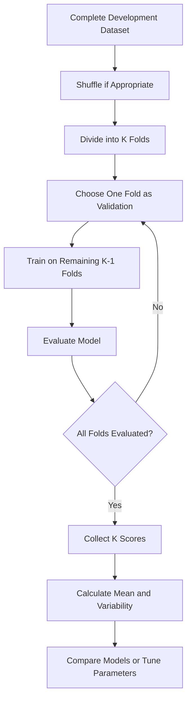
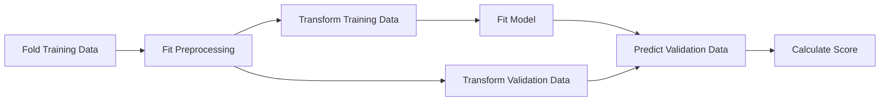
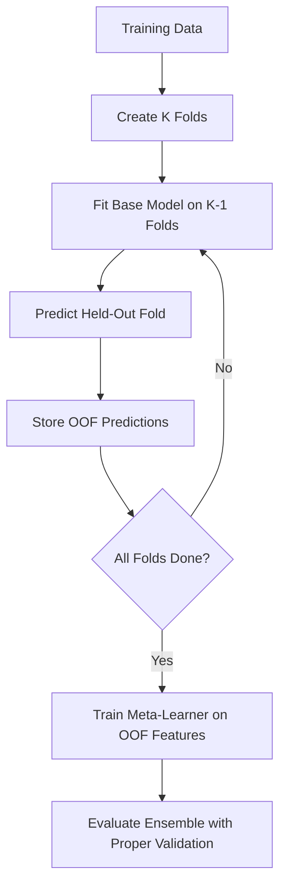
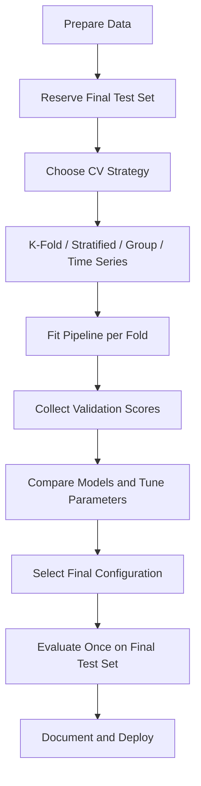

# 🔄 K-Fold Cross-Validation — Complete Markdown Notes

## 📚 Table of Contents

1. [Introduction to Cross-Validation](#1--introduction-to-cross-validation)
2. [What Is K-Fold Cross-Validation?](#2--what-is-k-fold-cross-validation)
3. [Why Use K-Fold?](#3--why-use-k-fold)
4. [How K-Fold Works](#4--how-k-fold-works)
5. [K-Fold Workflow Diagram](#5--k-fold-workflow-diagram)
6. [Important Terminology](#6--important-terminology)
7. [Mathematical Intuition](#7--mathematical-intuition)
8. [Types of Cross-Validation](#8--types-of-cross-validation)
9. [K-Fold vs Train-Test Split](#9--k-fold-vs-train-test-split)
10. [Choosing the Value of K](#10--choosing-the-value-of-k)
11. [K-Fold with Scikit-learn](#11--k-fold-with-scikit-learn)
12. [Stratified K-Fold](#12--stratified-k-fold)
13. [Cross-Validation for Regression](#13--cross-validation-for-regression)
14. [Cross-Validation with Pipelines](#14--cross-validation-with-pipelines)
15. [Hyperparameter Tuning with K-Fold](#15--hyperparameter-tuning-with-k-fold)
16. [K-Fold in Stacking and Model Selection](#16--k-fold-in-stacking-and-model-selection)
17. [Evaluation Metrics](#17--evaluation-metrics)
18. [Advantages and Limitations](#18--advantages-and-limitations)
19. [Best Practices](#19--best-practices)
20. [Common Mistakes](#20--common-mistakes)
21. [Real-World Applications](#21--real-world-applications)
22. [Mini Project: Compare Models with Cross-Validation](#22--mini-project-compare-models-with-cross-validation)
23. [Interview Questions and Answers](#23--interview-questions-and-answers)
24. [Quick Revision](#24--quick-revision)

---

## 1. 🎯 Introduction to Cross-Validation

**Cross-validation** is a model evaluation technique used to estimate how well a machine learning model may perform on unseen data. Instead of relying on only one train-validation split, the data is divided into multiple parts, and the model is trained and evaluated repeatedly.

Cross-validation is commonly used to:

- Compare machine learning algorithms.
- Estimate generalization performance.
- Tune hyperparameters.
- Select features and model configurations.
- Detect models that perform inconsistently across different subsets.

Cross-validation does not remove the need for a final test set when an unbiased final evaluation is required.

---

## 2. 🔍 What Is K-Fold Cross-Validation?

**K-Fold Cross-Validation** divides the available dataset into \(K\) approximately equal-sized folds.

During each of the \(K\) iterations:

- One fold is used as the validation set.
- The remaining \(K-1\) folds are used as the training set.
- The model is fitted on the training folds and scored on the held-out fold.

After all iterations, every row has served as validation data once, and the model has been evaluated \(K\) times.

### Example: 5-Fold Cross-Validation

For a dataset of 1,000 rows:

- Each fold contains approximately 200 rows.
- Each iteration trains on approximately 800 rows.
- Each iteration validates on approximately 200 rows.
- The procedure runs 5 times.

The exact fold sizes can differ by one row when the sample count is not divisible by \(K\).

---

## 3. 💡 Why Use K-Fold?

A single train-test split can produce a score that depends heavily on which observations happened to be selected. K-Fold evaluates the model on several subsets, providing a more informative view of performance.

| Purpose | Benefit |
|---|---|
| Model comparison | Compare algorithms across the same folds |
| Hyperparameter tuning | Evaluate parameter settings more robustly |
| Generalization estimate | Observe performance on multiple held-out subsets |
| Small-to-medium datasets | Each row can be used for validation and training in different iterations |
| Stability analysis | Inspect the variation in scores across folds |

K-Fold is especially useful when the dataset is not so large that repeated fitting becomes prohibitively expensive.

---

## 4. ⚙️ How K-Fold Works

Suppose there are 10 observations and \(K=5\). Each fold contains about 2 observations.

| Iteration | Training folds | Validation fold |
|---|---|---|
| 1 | Folds 2, 3, 4, 5 | Fold 1 |
| 2 | Folds 1, 3, 4, 5 | Fold 2 |
| 3 | Folds 1, 2, 4, 5 | Fold 3 |
| 4 | Folds 1, 2, 3, 5 | Fold 4 |
| 5 | Folds 1, 2, 3, 4 | Fold 5 |

### Step-by-step

1. Choose the number of folds \(K\).
2. Divide the dataset into \(K\) parts.
3. Select one fold as validation data.
4. Train the model on the other folds.
5. Calculate the chosen validation metric.
6. Repeat until every fold has been used for validation.
7. Summarize the scores using the mean and, optionally, standard deviation.

---

## 5. 🗺️ K-Fold Workflow Diagram



### Fold visualization

For 5-fold cross-validation, `V` means validation and `T` means training.

```text
Iteration 1: [ V ] [ T ] [ T ] [ T ] [ T ]
Iteration 2: [ T ] [ V ] [ T ] [ T ] [ T ]
Iteration 3: [ T ] [ T ] [ V ] [ T ] [ T ]
Iteration 4: [ T ] [ T ] [ T ] [ V ] [ T ]
Iteration 5: [ T ] [ T ] [ T ] [ T ] [ V ]
```

Each row of this illustration represents one training-and-validation run.

---

## 6. 📖 Important Terminology

| Term | Meaning |
|---|---|
| **Fold** | One partition of the dataset |
| **K** | Number of folds |
| **Training fold(s)** | Folds used to fit a model in an iteration |
| **Validation fold** | Fold used to score the fitted model in an iteration |
| **Cross-validation score** | Metric computed for one fold |
| **Mean CV score** | Average of scores across folds |
| **Standard deviation** | Measure of how much fold scores vary |
| **Stratification** | Preserving approximate class proportions across folds |
| **Shuffle** | Randomly reorders observations before fold assignment |
| **Data leakage** | Information that should be unavailable to a model improperly enters training |
| **Test set** | Data reserved for final evaluation after model selection |
| **OOF prediction** | Prediction for a training row from a model that did not train on that row |

### Mean cross-validation score

For fold scores \(s_1, s_2, \ldots, s_K\):

\[
\bar{s} = \frac{1}{K}\sum_{i=1}^{K}s_i
\]

A common measure of score variability is:

\[
s_{\text{std}} =
\sqrt{\frac{1}{K}\sum_{i=1}^{K}(s_i-\bar{s})^2}
\]

This expression uses the population-style standard deviation of the observed fold scores. Software libraries may report a standard deviation using a specific convention.

---

## 7. 📐 Mathematical Intuition

Let the dataset be:

\[
D = \{(x_i,y_i)\}_{i=1}^{N}
\]

Divide \(D\) into \(K\) disjoint folds:

\[
D = F_1 \cup F_2 \cup \cdots \cup F_K
\]

with no observation belonging to more than one fold.

For iteration \(j\):

\[
D_{\text{train}}^{(j)} = D \setminus F_j
\]

\[
D_{\text{valid}}^{(j)} = F_j
\]

Fit a model on \(D_{\text{train}}^{(j)}\) and calculate the validation score \(s_j\) on \(F_j\).

The mean score is:

\[
\bar{s} = \frac{1}{K}\sum_{j=1}^{K}s_j
\]

For metrics such as RMSE, averaging fold-level RMSE values is not always identical to calculating one RMSE from all pooled out-of-fold predictions. Know which summary your evaluation procedure uses.

---

## 8. 🧩 Types of Cross-Validation

### 8.1 Standard K-Fold

Splits data into \(K\) folds. Each fold is used once for validation.

```python
from sklearn.model_selection import KFold

cv = KFold(n_splits=5, shuffle=True, random_state=42)
```

Use for independent observations where ordinary K-Fold assumptions are appropriate.

### 8.2 Stratified K-Fold

Preserves approximately the same class proportions in each fold. It is commonly used for classification, especially when class frequencies are uneven.

```python
from sklearn.model_selection import StratifiedKFold

cv = StratifiedKFold(n_splits=5, shuffle=True, random_state=42)
```

### 8.3 Repeated K-Fold

Repeats K-Fold with different random partitions. This can help assess sensitivity to the partitioning, but requires more model fits.

```python
from sklearn.model_selection import RepeatedKFold

cv = RepeatedKFold(n_splits=5, n_repeats=3, random_state=42)
```

For classification, `RepeatedStratifiedKFold` is often more suitable.

### 8.4 Leave-One-Out Cross-Validation (LOOCV)

Each observation becomes its own validation fold. For \(N\) observations, this requires \(N\) model fits.

```python
from sklearn.model_selection import LeaveOneOut

cv = LeaveOneOut()
```

LOOCV can be expensive and has high variance in some settings. It is not automatically better than 5-fold or 10-fold CV.

### 8.5 Group K-Fold

Keeps all rows from a group in the same fold. Useful when multiple observations belong to the same customer, patient, machine, or other entity.

```python
from sklearn.model_selection import GroupKFold

cv = GroupKFold(n_splits=5)
# Use cv.split(X, y, groups=group_ids)
```

### 8.6 Time-series cross-validation

Uses earlier observations for training and later observations for validation. This avoids training on future information when predicting the future.

```python
from sklearn.model_selection import TimeSeriesSplit

cv = TimeSeriesSplit(n_splits=5)
```

### 8.7 Quick comparison

| Method | Main purpose | Important constraint |
|---|---|---|
| K-Fold | General cross-validation | Observations should be suitable for ordinary folds |
| Stratified K-Fold | Classification | Preserves class proportions approximately |
| Repeated K-Fold | Assess partition sensitivity | More computation |
| Leave-One-Out | Very small datasets or specific analyses | Many fits; can be costly |
| Group K-Fold | Grouped observations | Groups must not cross folds |
| TimeSeriesSplit | Temporal prediction | Validation must follow training in time |

---

## 9. ⚖️ K-Fold vs Train-Test Split

| Feature | Train-Test Split | K-Fold Cross-Validation |
|---|---|---|
| Number of model fits | Usually one | Usually \(K\) per parameter setting |
| Compute cost | Low | Higher |
| Score sensitivity to one split | Can be high | Usually reduced by multiple folds |
| Data used for validation | One held-out subset | Each row is validation once |
| Hyperparameter tuning | Possible, but less robust | Commonly used |
| Final test evaluation | Can provide final evaluation if untouched | Still recommended for final evaluation after selection |

A common workflow is to reserve a final test set first, then use K-Fold only on the remaining development data.

---

## 10. 🔢 Choosing the Value of K

Common values are \(K=5\) and \(K=10\).

| K value | Approximate training fraction per iteration | Advantages | Trade-offs |
|---:|---:|---|---|
| 3 | 66.7% | Faster | Less data used for each fit |
| 5 | 80% | Practical balance of cost and evaluation | Common default choice |
| 10 | 90% | More data used per fit | Roughly twice as many fits as 5-fold |
| N (LOOCV) | \((N-1)/N\) | Each fit uses nearly all data | Can be extremely expensive |

### Practical guidance

- Start with 5 folds for many ordinary classification/regression problems.
- Use 10 folds when extra computation is acceptable and the dataset size supports it.
- Use fewer folds when training is expensive.
- Ensure each classification fold has enough examples of each class.
- For grouped or temporal data, choose the split strategy based on the data structure, not just the desired value of K.
- More folds do not guarantee a more accurate or more useful estimate.

---

## 11. 💻 K-Fold with Scikit-learn

### 11.1 Install libraries

```bash
pip install scikit-learn numpy pandas
```

### 11.2 Basic K-Fold example

```python
from sklearn.datasets import load_breast_cancer
from sklearn.model_selection import KFold, cross_val_score
from sklearn.ensemble import RandomForestClassifier

data = load_breast_cancer()
X, y = data.data, data.target

model = RandomForestClassifier(
    n_estimators=200,
    random_state=42,
    n_jobs=-1,
)

cv = KFold(n_splits=5, shuffle=True, random_state=42)

scores = cross_val_score(
    model,
    X,
    y,
    cv=cv,
    scoring="accuracy",
    n_jobs=-1,
)

print("Fold scores:", scores)
print("Mean accuracy:", scores.mean())
print("Standard deviation:", scores.std())
```

### Explanation

- `n_splits=5` sets the number of folds.
- `shuffle=True` randomizes observations before splitting.
- `random_state=42` makes the shuffle reproducible.
- `scoring="accuracy"` selects the metric.
- `cross_val_score` clones and fits the estimator separately for each fold.

For classification, consider `StratifiedKFold` rather than plain `KFold` so class proportions remain approximately consistent.

### 11.3 Inspect each fold manually

```python
from sklearn.model_selection import KFold
from sklearn.metrics import accuracy_score
from sklearn.tree import DecisionTreeClassifier
import numpy as np

cv = KFold(n_splits=5, shuffle=True, random_state=42)
fold_scores = []

for fold, (train_idx, valid_idx) in enumerate(cv.split(X), start=1):
    X_train, X_valid = X[train_idx], X[valid_idx]
    y_train, y_valid = y[train_idx], y[valid_idx]

    model = DecisionTreeClassifier(random_state=42)
    model.fit(X_train, y_train)

    pred = model.predict(X_valid)
    score = accuracy_score(y_valid, pred)
    fold_scores.append(score)

    print(f"Fold {fold}: accuracy = {score:.4f}")

print(f"Mean accuracy: {np.mean(fold_scores):.4f}")
print(f"Std deviation: {np.std(fold_scores):.4f}")
```

This manual example uses standard K-Fold for demonstration. For a classification problem where class proportions matter, use `StratifiedKFold` and call `cv.split(X, y)`.

---

## 12. 🏷️ Stratified K-Fold

In classification, some folds may contain too few examples of a minority class if observations are split without considering labels. **Stratified K-Fold** tries to preserve class proportions in each fold.

### Example

Suppose a dataset contains:

- 900 negative examples (90%)
- 100 positive examples (10%)

With 5-fold stratified cross-validation, each fold will contain approximately 180 negative and 20 positive examples, subject to integer allocation.

### Code

```python
from sklearn.datasets import load_breast_cancer
from sklearn.model_selection import StratifiedKFold, cross_val_score
from sklearn.linear_model import LogisticRegression
from sklearn.pipeline import make_pipeline
from sklearn.preprocessing import StandardScaler

data = load_breast_cancer()
X, y = data.data, data.target

model = make_pipeline(
    StandardScaler(),
    LogisticRegression(max_iter=2000),
)

cv = StratifiedKFold(n_splits=5, shuffle=True, random_state=42)

scores = cross_val_score(
    model,
    X,
    y,
    cv=cv,
    scoring="f1",
    n_jobs=-1,
)

print("F1 scores:", scores)
print("Mean F1:", scores.mean())
```

Use a pipeline so the scaler is fitted separately inside each training fold rather than on the entire dataset.

---

## 13. 📈 Cross-Validation for Regression

For regression with independent observations, `KFold` is commonly used. Stratification is not directly available for continuous targets in the same way as ordinary classification. If the target distribution or data collection process requires special treatment, use a justified split strategy rather than arbitrarily treating every continuous target as a class.

```python
from sklearn.datasets import fetch_california_housing
from sklearn.model_selection import KFold, cross_val_score
from sklearn.ensemble import RandomForestRegressor

X, y = fetch_california_housing(return_X_y=True)

model = RandomForestRegressor(
    n_estimators=100,
    random_state=42,
    n_jobs=-1,
)

cv = KFold(n_splits=5, shuffle=True, random_state=42)

# Negated MAE is used because scikit-learn's scorer convention
# treats higher scores as better.
scores = cross_val_score(
    model,
    X,
    y,
    cv=cv,
    scoring="neg_mean_absolute_error",
    n_jobs=-1,
)

mae_scores = -scores
print("MAE by fold:", mae_scores)
print("Mean MAE:", mae_scores.mean())
print("Std MAE:", mae_scores.std())
```

The dataset may need to be downloaded on first access. If internet access is unavailable, use a local regression dataset.

### Why is MAE negated?

Scikit-learn follows a “higher score is better” convention for scorers. Loss metrics such as MAE are therefore returned as negative values when requested through `cross_val_score`.

---

## 14. 🧪 Cross-Validation with Pipelines

A **pipeline** chains preprocessing and model fitting together. It is essential when preprocessing learns information from the data.

### Why pipelines matter

Suppose standardization is fitted on the complete dataset before cross-validation. The validation fold then influences the scaler's mean and standard deviation. This is a form of leakage, even though the labels were not used.

Fit transformations only on the training part of each fold.



### Example: imputation, scaling, and classification

```python
from sklearn.datasets import load_breast_cancer
from sklearn.model_selection import StratifiedKFold, cross_val_score
from sklearn.pipeline import Pipeline
from sklearn.impute import SimpleImputer
from sklearn.preprocessing import StandardScaler
from sklearn.linear_model import LogisticRegression

data = load_breast_cancer()
X, y = data.data, data.target

pipeline = Pipeline([
    ("imputer", SimpleImputer(strategy="median")),
    ("scaler", StandardScaler()),
    ("model", LogisticRegression(max_iter=2000)),
])

cv = StratifiedKFold(n_splits=5, shuffle=True, random_state=42)

scores = cross_val_score(
    pipeline,
    X,
    y,
    cv=cv,
    scoring="roc_auc",
    n_jobs=-1,
)

print("ROC-AUC by fold:", scores)
print("Mean ROC-AUC:", scores.mean())
```

For mixed numerical and categorical columns, consider `ColumnTransformer` inside a pipeline.

---

## 15. 🎛️ Hyperparameter Tuning with K-Fold

K-Fold can evaluate many hyperparameter combinations. `GridSearchCV` evaluates all specified combinations, while `RandomizedSearchCV` samples a limited number of combinations.

### GridSearchCV example

```python
from sklearn.datasets import load_breast_cancer
from sklearn.model_selection import train_test_split, StratifiedKFold, GridSearchCV
from sklearn.ensemble import RandomForestClassifier

data = load_breast_cancer()
X, y = data.data, data.target

# Keep an untouched final test set
X_train, X_test, y_train, y_test = train_test_split(
    X, y, test_size=0.2, stratify=y, random_state=42
)

model = RandomForestClassifier(random_state=42, n_jobs=1)

param_grid = {
    "n_estimators": [100, 200],
    "max_depth": [None, 5, 10],
    "min_samples_leaf": [1, 2],
}

cv = StratifiedKFold(n_splits=5, shuffle=True, random_state=42)

search = GridSearchCV(
    estimator=model,
    param_grid=param_grid,
    scoring="roc_auc",
    cv=cv,
    n_jobs=-1,
    refit=True,
)

search.fit(X_train, y_train)

print("Best parameters:", search.best_params_)
print("Best mean CV ROC-AUC:", search.best_score_)

best_model = search.best_estimator_
```

`GridSearchCV` refits the selected estimator on the full `X_train` after choosing the best parameters. Evaluate `best_model` on `X_test` only after model selection is complete.

### Grid Search vs Random Search

| Feature | Grid Search | Random Search |
|---|---|---|
| Parameters tested | Every specified combination | Randomly sampled combinations |
| Compute cost | Can grow quickly | Can be bounded by `n_iter` |
| Best use | Small, focused search spaces | Larger search spaces |
| Scikit-learn class | `GridSearchCV` | `RandomizedSearchCV` |

### Nested cross-validation

When an unbiased estimate of the full model-selection process is needed, nested cross-validation uses:

- **Inner CV:** chooses hyperparameters.
- **Outer CV:** evaluates the tuned procedure on held-out folds.

Nested CV is computationally expensive but helps estimate performance while accounting for hyperparameter selection.

---

## 16. 🧩 K-Fold in Stacking and Model Selection

K-Fold is also used to generate out-of-fold predictions for stacking ensembles.



For each row, the OOF prediction must come from a model that did not train on that row. Preprocessing must also be fitted within each training fold.

### Important distinction

- Cross-validation scores estimate performance across folds.
- OOF predictions provide training features for a meta-learner.
- A final test set is held out for final evaluation after model selection.

These are related concepts but serve different purposes.

---

## 17. 📊 Evaluation Metrics

Choose a metric based on the task and error costs.

### Classification metrics

| Metric | Meaning |
|---|---|
| Accuracy | Fraction of correct predictions |
| Precision | Fraction of predicted positives that are truly positive |
| Recall | Fraction of actual positives detected |
| F1-score | Harmonic mean of precision and recall |
| ROC-AUC | Ranking performance across classification thresholds |
| Average Precision | Summary of the precision-recall curve |
| Log loss | Quality of predicted class probabilities |

For imbalanced classification, accuracy alone may be misleading. Consider per-class recall, F1, PR-AUC, and the confusion matrix.

### Regression metrics

| Metric | Meaning |
|---|---|
| MAE | Mean absolute error |
| MSE | Mean squared error |
| RMSE | Square root of MSE |
| \(R^2\) | Fit relative to predicting the target mean |

When comparing models, use the same folds, scoring metric, and preprocessing strategy wherever possible.

---

## 18. ⚖️ Advantages and Limitations

### Advantages

- More informative than relying on a single split in many settings.
- Helps compare algorithms and tune hyperparameters.
- Each row is used for validation once in ordinary K-Fold.
- Enables OOF prediction generation for stacking.
- Fold-level scores reveal variability and unstable performance.

### Limitations

- Requires fitting the model multiple times.
- Can be expensive for large models or large search spaces.
- Does not automatically prevent leakage.
- Ordinary random folds are unsuitable for some temporal and grouped datasets.
- Fold scores are not fully independent because training sets overlap.
- A high CV score does not guarantee strong performance under distribution shift.

---

## 19. ✅ Best Practices

1. Reserve a final test set before model selection when an unbiased final score is required.
2. Choose a splitting strategy that reflects the data and deployment setting.
3. Use `StratifiedKFold` for many classification tasks.
4. Use `GroupKFold` when records from the same entity must remain together.
5. Use `TimeSeriesSplit` for ordered temporal prediction.
6. Put learned preprocessing inside a pipeline.
7. Use the same folds when comparing models.
8. Select metrics that reflect the real cost of errors.
9. Set `random_state` when shuffling to improve reproducibility.
10. Report mean and variability, not only the best fold.
11. Avoid excessively large grids; use randomized search when appropriate.
12. Do not tune repeatedly against the final test score.
13. Check that each fold has enough observations and class examples.
14. Record library versions, fold strategy, seed, metric, and parameters.

---

## 20. 🚫 Common Mistakes

| Mistake | Why it is a problem | Better approach |
|---|---|---|
| Using `KFold` without considering class balance | Some folds may contain very few minority examples | Use `StratifiedKFold` when suitable |
| Preprocessing before splitting folds | Validation data can influence learned transformations | Use a pipeline |
| Using random folds for time series | Future information can leak into training | Use chronological splits |
| Splitting related entities across folds | Model may recognize entities in validation | Use group-aware splitting |
| Selecting the best single fold | Overstates expected performance | Summarize all fold scores |
| Using the test set during tuning | Makes the final estimate optimistic | Tune on development data only |
| Assuming K-Fold removes all leakage | Feature engineering may still leak target or future information | Audit the full workflow |
| Choosing too many folds for an expensive model | Training cost becomes excessive | Start with 5 folds or a justified alternative |
| Comparing models on different folds | Differences may come from splits, not models | Use the same CV splitter |
| Reporting only the mean | Hides unstable fold performance | Report mean and standard deviation |

---

## 21. 🌍 Real-World Applications

| Domain | Example | Split strategy to consider |
|---|---|---|
| Finance | Default-risk classification | Stratified CV; time-aware split if predicting future periods |
| Healthcare research | Predicting outcomes from patient records | Group-aware CV if patients have repeated records |
| E-commerce | Customer churn | Group or temporal splits where customer history repeats |
| Manufacturing | Failure prediction across machines | Group-aware split by machine where appropriate |
| Marketing | Campaign response | Stratified CV for independent observations |
| Demand forecasting | Predicting future sales | Time-series cross-validation |
| Computer vision | Image classification | Group by subject/source when near-duplicate images exist |

The split strategy should reflect how the model will be used. Randomly splitting highly related observations can give an unrealistically optimistic estimate.

---

## 22. 🛠️ Mini Project: Compare Models with Cross-Validation

### Objective

Compare Logistic Regression, Decision Tree, and Random Forest using the same stratified 5-fold CV procedure.

### Code

```python
from sklearn.datasets import load_breast_cancer
from sklearn.model_selection import StratifiedKFold, cross_validate
from sklearn.pipeline import make_pipeline
from sklearn.preprocessing import StandardScaler
from sklearn.linear_model import LogisticRegression
from sklearn.tree import DecisionTreeClassifier
from sklearn.ensemble import RandomForestClassifier
import pandas as pd

data = load_breast_cancer()
X, y = data.data, data.target

cv = StratifiedKFold(n_splits=5, shuffle=True, random_state=42)

models = {
    "Logistic Regression": make_pipeline(
        StandardScaler(),
        LogisticRegression(max_iter=2000)
    ),
    "Decision Tree": DecisionTreeClassifier(random_state=42),
    "Random Forest": RandomForestClassifier(
        n_estimators=200, random_state=42, n_jobs=-1
    ),
}

scoring = {
    "accuracy": "accuracy",
    "precision": "precision",
    "recall": "recall",
    "f1": "f1",
    "roc_auc": "roc_auc",
}

results = []

for name, model in models.items():
    scores = cross_validate(
        model,
        X,
        y,
        cv=cv,
        scoring=scoring,
        n_jobs=-1,
        return_train_score=False,
    )

    row = {"Model": name}
    for metric in scoring:
        row[f"Mean {metric}"] = scores[f"test_{metric}"].mean()
        row[f"Std {metric}"] = scores[f"test_{metric}"].std()
    results.append(row)

results_df = pd.DataFrame(results).sort_values(
    "Mean roc_auc", ascending=False
)
print(results_df.to_string(index=False))
```

### Mini-project tasks

- Compare mean and standard deviation for each metric.
- Identify the best model according to a metric chosen before reviewing results.
- Explain whether one model's performance is more variable across folds.
- Try 3-fold and 10-fold CV and compare the compute cost.
- Add an XGBoost model if the package is installed.
- For a final unbiased evaluation, reserve a test set before tuning and evaluate only after model selection.

Do not hardcode expected scores; results depend on software versions and configuration.

---

## 23. 🎤 Interview Questions and Answers

### Q1. What is K-Fold Cross-Validation?

It divides data into \(K\) folds and trains/evaluates the model \(K\) times, using a different fold for validation each time.

### Q2. Why is K-Fold better than a single split?

It evaluates performance across several held-out subsets, reducing dependence on one particular split. It still has limitations and does not eliminate bias or leakage automatically.

### Q3. What are common values of K?

Five and ten are common practical choices. The best choice depends on data size, compute budget, and split requirements.

### Q4. What is Stratified K-Fold?

It attempts to preserve class proportions in every fold and is commonly used for classification.

### Q5. What is the difference between K-Fold and Stratified K-Fold?

K-Fold partitions observations without considering class labels, while Stratified K-Fold tries to maintain similar class distributions across folds.

### Q6. What is Leave-One-Out CV?

Each observation is used as a validation fold once, resulting in \(N\) fits for \(N\) observations.

### Q7. What is Group K-Fold?

It ensures that the same group does not appear in both training and validation data for a fold.

### Q8. Why is TimeSeriesSplit important?

It preserves temporal ordering so training data precedes validation data, reducing future-to-past leakage.

### Q9. Does cross-validation replace a test set?

Not necessarily. A separate untouched test set is useful for a final unbiased evaluation after model and hyperparameter selection.

### Q10. What is data leakage in cross-validation?

It occurs when information from validation data or unavailable future data influences training, for example through preprocessing fitted on all rows before cross-validation.

### Q11. How do you choose K?

Balance computational cost, dataset size, class counts, and the data's structure. Five folds is a common starting point for ordinary independent data.

### Q12. What does `cross_val_score` return?

It returns one score per fold for the estimator and selected scoring metric.

### Q13. What is the difference between `cross_val_score` and `cross_validate`?

`cross_val_score` returns one metric per fold. `cross_validate` can return multiple metrics and additional timing information.

### Q14. Why use the same folds for model comparison?

It makes the comparison fairer because models are evaluated on the same partitions.

### Q15. What is nested cross-validation?

It uses inner CV for hyperparameter selection and outer CV to estimate the performance of the full selection procedure.

---

## 24. ⚡ Quick Revision

### Key points

- K-Fold splits data into \(K\) folds.
- Each iteration uses \(K-1\) folds for training and one for validation.
- Each row is used for validation once in ordinary K-Fold.
- Mean CV score summarizes fold performance.
- Standard deviation summarizes fold-to-fold variability.
- `StratifiedKFold` is often suitable for classification.
- `GroupKFold` protects group separation.
- `TimeSeriesSplit` preserves temporal order.
- `Pipeline` prevents leakage from learned preprocessing.
- `GridSearchCV` and `RandomizedSearchCV` use CV for parameter selection.
- Cross-validation does not eliminate every type of leakage.
- Keep the final test set untouched until model selection is complete.

### Important formulas

**Mean score**

\[
\bar{s} = \frac{1}{K}\sum_{i=1}^{K}s_i
\]

**Training set in fold \(j\)**

\[
D_{\text{train}}^{(j)} = D \setminus F_j
\]

**Validation set in fold \(j\)**

\[
D_{\text{valid}}^{(j)} = F_j
\]

**Approximate training fraction per iteration**

\[
\frac{K-1}{K}
\]

### Essential scikit-learn classes and functions

```python
from sklearn.model_selection import (
    KFold,
    StratifiedKFold,
    RepeatedKFold,
    RepeatedStratifiedKFold,
    GroupKFold,
    TimeSeriesSplit,
    cross_val_score,
    cross_validate,
    GridSearchCV,
    RandomizedSearchCV,
)
```

### Visual learning roadmap



### Final checklist

- [ ] Understand training and validation folds.
- [ ] Choose K based on data and compute budget.
- [ ] Use stratification when class balance matters.
- [ ] Use group or temporal splits when the data requires them.
- [ ] Keep preprocessing inside a pipeline.
- [ ] Compare models on identical folds.
- [ ] Report mean and variability.
- [ ] Keep the final test set out of tuning.
- [ ] Record the random seed, scoring metric, split strategy, and library versions.

**One-line summary:** K-Fold Cross-Validation evaluates a model over multiple train-validation partitions to provide a more robust view of generalization and to support model selection, while careful splitting and leakage prevention remain essential.
