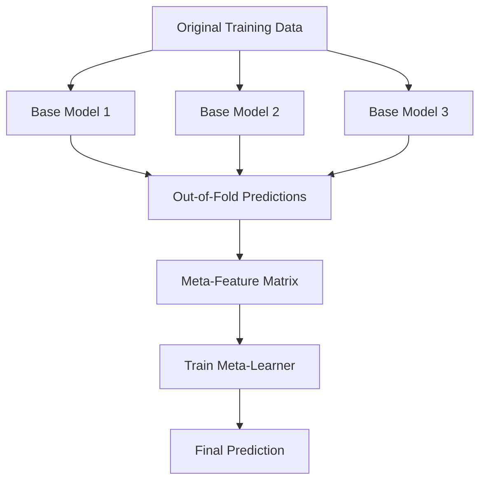
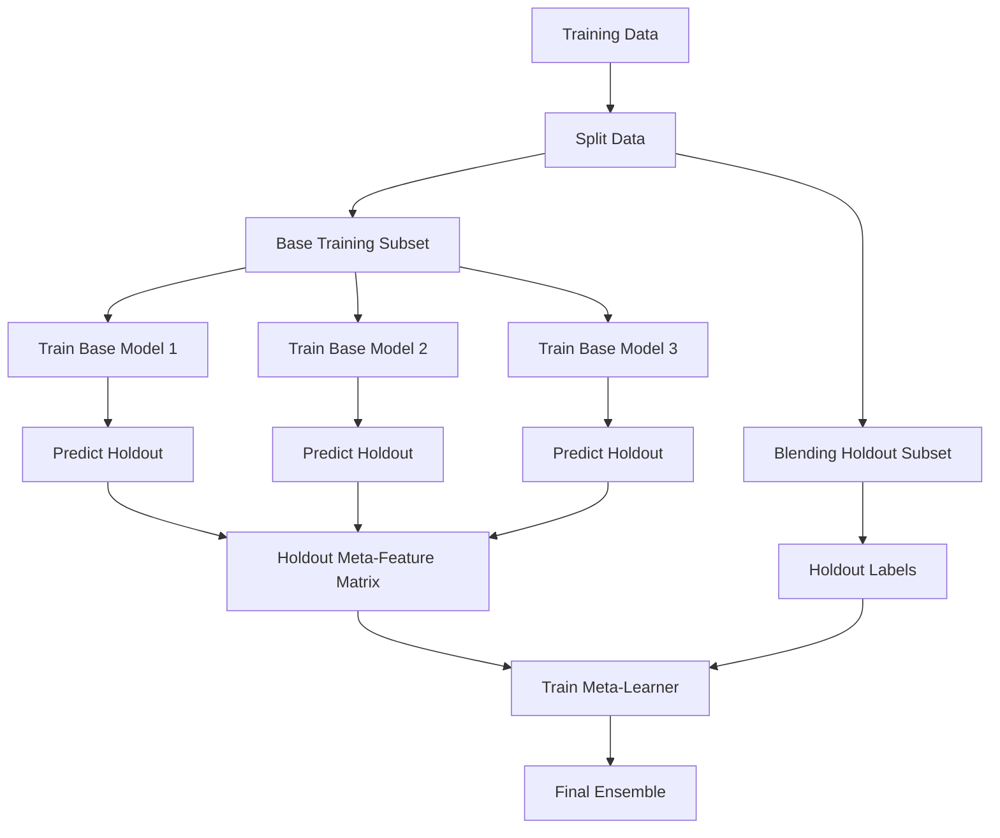
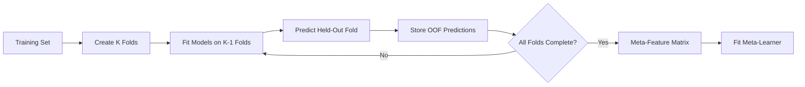
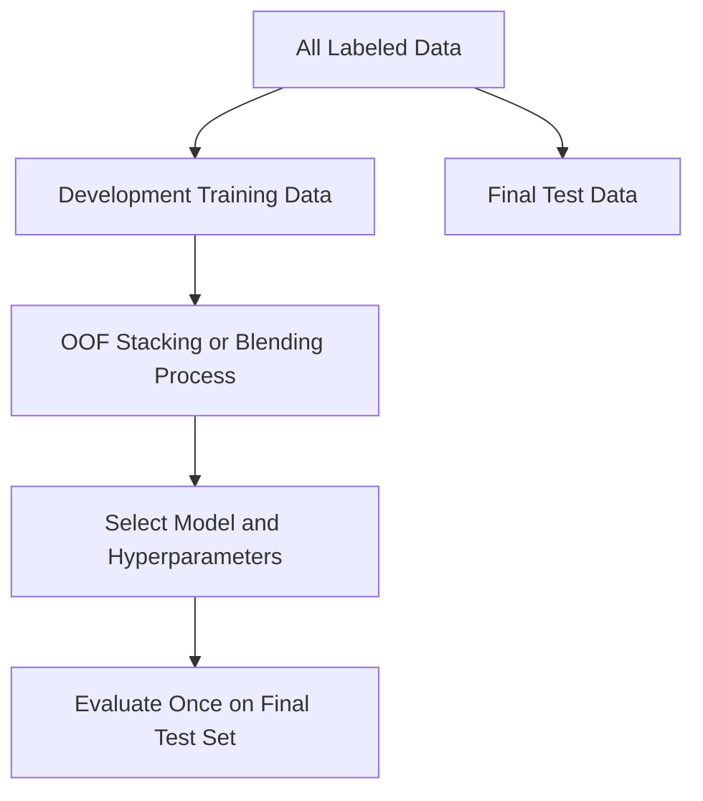
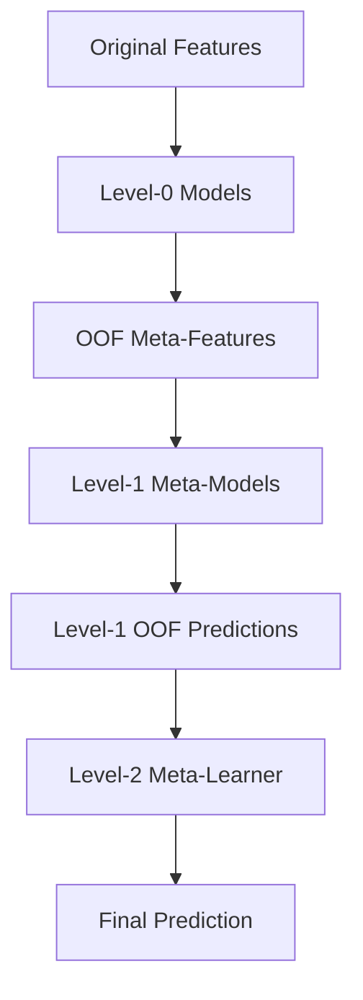
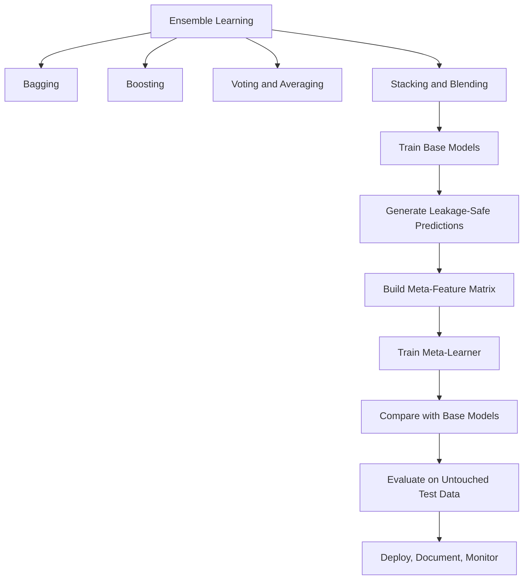

# 🧠 Stacking and Blending Ensembles — Complete Notes

## 📚 Table of Contents

1. [Introduction to Ensemble Learning](#1--introduction-to-ensemble-learning)
2. [Stacking: Definition and Architecture](#2--stacking-definition-and-architecture)
3. [Blending: Definition and Architecture](#3--blending-definition-and-architecture)
4. [Stacking vs Blending](#4--stacking-vs-blending)
5. [Important Terminology](#5--important-terminology)
6. [How Stacking Works](#6--how-stacking-works)
7. [How Blending Works](#7--how-blending-works)
8. [Mathematical Intuition](#8--mathematical-intuition)
9. [Selecting Base Models and Meta-Learners](#9--selecting-base-models-and-meta-learners)
10. [Data Splitting and Leakage Prevention](#10--data-splitting-and-leakage-prevention)
11. [Stacking with Scikit-learn](#11--stacking-with-scikit-learn)
12. [Manual Stacking with Out-of-Fold Predictions](#12--manual-stacking-with-out-of-fold-predictions)
13. [Blending with Scikit-learn](#13--blending-with-scikit-learn)
14. [Classification and Regression](#14--classification-and-regression)
15. [Evaluation Metrics](#15--evaluation-metrics)
16. [Hyperparameter Tuning](#16--hyperparameter-tuning)
17. [Advantages and Limitations](#17--advantages-and-limitations)
18. [Best Practices](#18--best-practices)
19. [Common Mistakes](#19--common-mistakes)
20. [Real-World Use Cases](#20--real-world-use-cases)
21. [Advanced Concepts](#21--advanced-concepts)
22. [Mini Project: Ensemble Classification](#22--mini-project-ensemble-classification)
23. [Interview Questions and Answers](#23--interview-questions-and-answers)
24. [Quick Revision](#24--quick-revision)

---

## 1. 🎯 Introduction to Ensemble Learning

**Ensemble learning** combines predictions from multiple models to improve generalization, robustness, or predictive accuracy compared with relying on one model.

| Technique | Main idea | Examples |
|---|---|---|
| Bagging | Train models independently on resampled data and combine predictions | Random Forest, bagged trees |
| Boosting | Add learners sequentially to improve the current model | AdaBoost, Gradient Boosting, XGBoost |
| Voting | Combine class predictions or probabilities using a fixed rule | Hard voting, soft voting |
| Averaging | Average model outputs, commonly for regression | Mean or weighted mean |
| Stacking | Train a meta-model on predictions from base models | `StackingClassifier`, `StackingRegressor` |
| Blending | Train a meta-model on predictions for a dedicated holdout subset | Holdout-based ensemble |

### Why combine models?

Different algorithms can learn different patterns. Logistic regression may capture linear relationships, random forests may capture nonlinear interactions, and gradient boosting may capture complex patterns in tabular data. A meta-learner can learn how to combine their predictions.

**Important:** Adding more models does not automatically improve results. The models should be individually useful and contribute complementary information.

---

## 2. 🧱 Stacking: Definition and Architecture

**Stacking (stacked generalization)** is an ensemble method in which predictions from several base models become input features for a second-level model called the **meta-learner**.

### Main components

- **Base models / Level-0 models:** Learn from original input features.
- **Meta-features:** Predictions generated by base models.
- **Meta-learner / Level-1 model:** Learns how to combine the meta-features.
- **Final prediction:** Output from the meta-learner.

Possible base models include Logistic Regression, Random Forest, Extra Trees, SVM, K-Nearest Neighbors, and XGBoost. Common meta-learners include Logistic Regression for classification and Ridge Regression for regression.

### Stacking architecture



### Example

Suppose three models estimate whether a customer will churn.

| Customer | Logistic Regression | Random Forest | Gradient Boosting | Actual |
|---|---:|---:|---:|---:|
| A | 0.20 | 0.35 | 0.25 | 0 |
| B | 0.75 | 0.60 | 0.80 | 1 |
| C | 0.45 | 0.70 | 0.55 | 1 |

The values are illustrative probabilities. The meta-learner learns how to combine the predictions using known labels.

**Critical rule:** Train the meta-learner on out-of-fold predictions, not predictions made by base models on rows they already trained on.

---

## 3. 🪄 Blending: Definition and Architecture

**Blending** is similar to stacking, but typically uses a dedicated holdout subset of the training data to generate meta-features.

### Typical procedure

1. Split the available training data into a base-training set and a blending holdout set.
2. Train each base model on the base-training set.
3. Predict on the blending holdout set.
4. Combine those predictions into a meta-feature matrix.
5. Train the meta-learner using the meta-features and holdout labels.
6. For inference, pass base-model predictions through the trained meta-learner.

### Blending architecture



Blending is usually easier to implement, but the base models do not train on the blending holdout rows. The meta-learner also learns from only that holdout subset.

---

## 4. ⚖️ Stacking vs Blending

| Feature | Stacking | Blending |
|---|---|---|
| Meta-training data | Usually out-of-fold predictions from cross-validation | Predictions on a dedicated holdout subset |
| Data usage | Uses folds to generate predictions across training rows | Base models train on only the base-training subset |
| Implementation | More involved | Usually simpler |
| Computational cost | Often higher because of cross-validation fits | Often lower |
| Sensitivity to one split | Reduced by using multiple folds | Can be sensitive to the chosen holdout split |
| Leakage prevention | Requires correct OOF predictions | Requires strict separation of base-training and blending data |
| Best fit | When data-efficient meta-feature generation matters | When a sufficiently large holdout subset is available |

Both require a final test set or an equivalent unbiased evaluation procedure. Neither guarantees an improvement over the strongest base model.

---

## 5. 📖 Important Terminology

| Term | Meaning |
|---|---|
| Base learner | Model trained on the original features |
| Meta-learner | Model trained on base-model predictions |
| Level-0 model | Another name for a base learner |
| Level-1 model | Another name for the meta-learner |
| Meta-feature | A base model's prediction used as a meta-model input |
| Out-of-fold (OOF) prediction | Prediction for a row made by a model that did not train on that row |
| Fold | A data partition used in cross-validation |
| Holdout set | Data withheld from a model's fitting process for a specific purpose |
| Data leakage | Information from validation/test targets or future data improperly influences training |
| Diversity | Differences in models' learned patterns or errors |
| Calibration | Agreement between predicted probabilities and observed event frequencies |
| Generalization | Performance on unseen data |

---

## 6. 🔄 How Stacking Works

Assume \(N\) training examples and \(M\) base models.

1. Divide the training set into \(K\) folds.
2. For each fold, train each base model on the other \(K-1\) folds.
3. Predict on the held-out fold and store predictions in the correct rows of the meta-feature matrix.
4. Repeat until every training row has an OOF prediction from every base model.
5. Train the meta-learner on the meta-feature matrix and original targets.
6. For inference, fit each base model on the full training set, then pass its predictions to the meta-learner.



### Why OOF predictions matter

If a base model predicts rows it has already seen, those predictions may be unrealistically accurate. The meta-learner may learn to trust that optimistic signal and perform poorly on new data. OOF predictions reduce this risk because each row's meta-feature is produced without training on that row.

---

## 7. 🧪 How Blending Works

1. Split training data into `base_train` and `blend_valid`.
2. Train base models on `base_train` only.
3. Generate predictions on `blend_valid`.
4. Concatenate predictions into meta-features.
5. Train the meta-learner using the meta-features and `y_blend_valid`.
6. At inference, generate base-model predictions and feed them into the meta-learner.

For example, a dataset with 10,000 development rows might use 8,000 rows to fit base models and 2,000 to fit the meta-learner. Keep a separate untouched final test set if available. These values are illustrative; choose splits based on data size, class balance, groups, and time ordering.

**Trade-off:** Blending is simple, but it reserves data for meta-training instead of base-model fitting. Cross-validated stacking often uses the available training data more efficiently.

---

## 8. 📐 Mathematical Intuition

Let the base models be \(f_1, f_2, \ldots, f_M\). Their predictions for example \(x_i\) form the meta-feature vector:

\[
z_i = [f_1(x_i), f_2(x_i), \ldots, f_M(x_i)]
\]

The meta-learner \(g\) produces the final prediction:

\[
\hat{y}_i = g(z_i)
\]

For a linear regression meta-learner:

\[
\hat{y}_i = b + \sum_{j=1}^{M} w_j f_j(x_i)
\]

where \(w_j\) are learned weights and \(b\) is an intercept.

Simple averaging uses a fixed combination:

\[
\hat{y} = \frac{1}{M}\sum_{j=1}^{M} f_j(x)
\]

Stacking learns the combination from data. It may improve results when models have complementary strengths, but can overfit when the meta-training set is small or the models are redundant.

---

## 9. 🧰 Selecting Base Models and Meta-Learners

### Base-model selection

| Base model | Potential contribution |
|---|---|
| Logistic Regression | Linear relationships and stable probability estimates |
| Random Forest | Nonlinear patterns and interactions |
| Extra Trees | More randomized tree splits |
| XGBoost / Gradient Boosting | Sequentially optimized tree ensemble |
| Support Vector Machine | Margin-based decision boundaries |
| K-Nearest Neighbors | Local similarity patterns |
| Neural Network | Flexible nonlinear patterns where suitable |

Choose models that are useful and sufficiently different. Do not add every algorithm automatically.

### Meta-learner selection

| Task | Starting meta-learner | Reason |
|---|---|---|
| Binary classification | Logistic Regression | Simple, regularized probability combination |
| Multiclass classification | Logistic Regression | Combines class-probability features |
| Regression | Ridge Regression | Learns a regularized weighted combination |
| Complex combinations | Small tree-based model | Can learn nonlinear combinations, but may overfit |

Start with a simple meta-learner. It is trained on model predictions, not the full original feature space (unless passthrough is enabled).

---

## 10. 🔐 Data Splitting and Leakage Prevention



### Rules

- Never generate stacking meta-training predictions from a base model fitted on those same rows.
- Never use final test labels to train base models, the meta-learner, or tune thresholds.
- Fit imputation, scaling, encoding, and feature selection inside each training fold.
- Use stratified folds for ordinary classification when appropriate.
- Use group-aware folds when multiple rows belong to the same person, customer, or device.
- Use chronological/rolling splits for time-dependent data.
- For extensive tuning, consider nested cross-validation or a clearly separated validation process.
- Preserve the exact order of meta-feature columns during training and inference.

OOF predictions prevent one important form of leakage, but do not automatically prevent leakage from feature engineering, target encoding, duplicate records, temporal joins, or inappropriate data splitting.

---

## 11. 💻 Stacking with Scikit-learn

### 11.1 Install dependencies

```bash
pip install scikit-learn numpy pandas
```

### 11.2 Binary classification example

This example uses scikit-learn's built-in breast cancer dataset.

```python
from sklearn.datasets import load_breast_cancer
from sklearn.model_selection import train_test_split, StratifiedKFold
from sklearn.ensemble import (
    RandomForestClassifier,
    ExtraTreesClassifier,
    StackingClassifier,
)
from sklearn.linear_model import LogisticRegression
from sklearn.pipeline import make_pipeline
from sklearn.preprocessing import StandardScaler
from sklearn.metrics import (
    accuracy_score,
    classification_report,
    roc_auc_score,
)

data = load_breast_cancer()
X, y = data.data, data.target

X_train, X_test, y_train, y_test = train_test_split(
    X, y, test_size=0.2, random_state=42, stratify=y
)

base_models = [
    ("rf", RandomForestClassifier(
        n_estimators=200, min_samples_leaf=2, random_state=42, n_jobs=-1
    )),
    ("extra", ExtraTreesClassifier(
        n_estimators=200, min_samples_leaf=2, random_state=42, n_jobs=-1
    )),
    ("lr", make_pipeline(
        StandardScaler(),
        LogisticRegression(max_iter=2000)
    )),
]

cv = StratifiedKFold(n_splits=5, shuffle=True, random_state=42)

stack_model = StackingClassifier(
    estimators=base_models,
    final_estimator=LogisticRegression(max_iter=2000),
    cv=cv,
    stack_method="predict_proba",
    passthrough=False,
    n_jobs=-1,
)

stack_model.fit(X_train, y_train)

y_pred = stack_model.predict(X_test)
y_prob = stack_model.predict_proba(X_test)[:, 1]

print("Accuracy:", accuracy_score(y_test, y_pred))
print("ROC-AUC:", roc_auc_score(y_test, y_prob))
print(classification_report(y_test, y_pred))
```

### Explanation

- `estimators`: list of named base models.
- `final_estimator`: the meta-learner.
- `cv`: cross-validation strategy for generating OOF predictions.
- `stack_method="predict_proba"`: uses probabilities where supported.
- `passthrough=False`: meta-learner receives base predictions only.
- During fitting, scikit-learn generates OOF predictions for the meta-learner and fits base estimators on the full training data for inference.

Scores depend on the split and software environment. Run the code to obtain your actual results; do not assume a particular score in advance.

### 11.3 Regression example

```python
from sklearn.datasets import fetch_california_housing
from sklearn.model_selection import train_test_split, KFold
from sklearn.ensemble import RandomForestRegressor, ExtraTreesRegressor, StackingRegressor
from sklearn.linear_model import Ridge
from sklearn.metrics import mean_absolute_error, mean_squared_error, r2_score

X, y = fetch_california_housing(return_X_y=True)

X_train, X_test, y_train, y_test = train_test_split(
    X, y, test_size=0.2, random_state=42
)

estimators = [
    ("rf", RandomForestRegressor(
        n_estimators=150, min_samples_leaf=2, random_state=42, n_jobs=-1
    )),
    ("extra", ExtraTreesRegressor(
        n_estimators=150, min_samples_leaf=2, random_state=42, n_jobs=-1
    )),
]

cv = KFold(n_splits=5, shuffle=True, random_state=42)

stack_regressor = StackingRegressor(
    estimators=estimators,
    final_estimator=Ridge(alpha=1.0),
    cv=cv,
    passthrough=False,
    n_jobs=-1,
)

stack_regressor.fit(X_train, y_train)
pred = stack_regressor.predict(X_test)

print("MAE:", mean_absolute_error(y_test, pred))
print("RMSE:", mean_squared_error(y_test, pred) ** 0.5)
print("R²:", r2_score(y_test, pred))
```

The California housing dataset may be downloaded on first access. If internet access is unavailable, use a local regression dataset.

---

## 12. 🧑‍💻 Manual Stacking with Out-of-Fold Predictions

Manual implementation shows how the meta-feature matrix is constructed. This example assumes numeric features and binary labels.

```python
import numpy as np
from sklearn.datasets import load_breast_cancer
from sklearn.model_selection import train_test_split, StratifiedKFold
from sklearn.base import clone
from sklearn.ensemble import RandomForestClassifier, ExtraTreesClassifier
from sklearn.linear_model import LogisticRegression
from sklearn.metrics import roc_auc_score

data = load_breast_cancer()
X, y = data.data, data.target

X_train, X_test, y_train, y_test = train_test_split(
    X, y, test_size=0.2, stratify=y, random_state=42
)

base_models = [
    RandomForestClassifier(n_estimators=150, random_state=42, n_jobs=-1),
    ExtraTreesClassifier(n_estimators=150, random_state=42, n_jobs=-1),
]

oof_train = np.zeros((len(X_train), len(base_models)))
test_meta = np.zeros((len(X_test), len(base_models)))
cv = StratifiedKFold(n_splits=5, shuffle=True, random_state=42)

for model_idx, base_model in enumerate(base_models):
    fold_test_predictions = []

    for train_idx, valid_idx in cv.split(X_train, y_train):
        model = clone(base_model)
        model.fit(X_train[train_idx], y_train[train_idx])

        # Predictions for rows excluded from this fold's fitting
        oof_train[valid_idx, model_idx] = model.predict_proba(
            X_train[valid_idx]
        )[:, 1]

        fold_test_predictions.append(
            model.predict_proba(X_test)[:, 1]
        )

    test_meta[:, model_idx] = np.mean(fold_test_predictions, axis=0)

meta_model = LogisticRegression(max_iter=2000)
meta_model.fit(oof_train, y_train)

final_prob = meta_model.predict_proba(test_meta)[:, 1]
print("Stacked ROC-AUC:", roc_auc_score(y_test, final_prob))
```

### Notes

- If preprocessing is needed, place it inside a pipeline so it is fitted separately within each fold.
- The test set is not used for base-model fitting or meta-learner fitting.
- At inference, preserve the base-model order used to construct the meta-features.
- `StackingClassifier` is generally less error-prone than custom OOF code unless you need custom behavior.

---

## 13. 🪄 Blending with Scikit-learn

This example uses a dedicated holdout subset for training the meta-learner.

```python
import numpy as np
from sklearn.datasets import load_breast_cancer
from sklearn.model_selection import train_test_split
from sklearn.ensemble import RandomForestClassifier, ExtraTreesClassifier
from sklearn.linear_model import LogisticRegression
from sklearn.metrics import accuracy_score, roc_auc_score

data = load_breast_cancer()
X, y = data.data, data.target

# Final test set stays untouched
X_dev, X_test, y_dev, y_test = train_test_split(
    X, y, test_size=0.2, stratify=y, random_state=42
)

# Separate base-training and blending holdout sets
X_base, X_blend, y_base, y_blend = train_test_split(
    X_dev, y_dev, test_size=0.25, stratify=y_dev, random_state=21
)

base_models = [
    RandomForestClassifier(n_estimators=200, random_state=42, n_jobs=-1),
    ExtraTreesClassifier(n_estimators=200, random_state=42, n_jobs=-1),
]

for model in base_models:
    model.fit(X_base, y_base)

blend_train = np.column_stack([
    model.predict_proba(X_blend)[:, 1] for model in base_models
])

meta_model = LogisticRegression(max_iter=2000)
meta_model.fit(blend_train, y_blend)

blend_test = np.column_stack([
    model.predict_proba(X_test)[:, 1] for model in base_models
])

final_pred = meta_model.predict(blend_test)
final_prob = meta_model.predict_proba(blend_test)[:, 1]

print("Accuracy:", accuracy_score(y_test, final_pred))
print("ROC-AUC:", roc_auc_score(y_test, final_prob))
```

### Interpretation

- `X_base` fits the base models.
- `X_blend` creates meta-features and supplies labels to train the meta-learner.
- `X_test` is reserved for final evaluation.
- This simple example does not refit base models on all development data after blending. Refitting requires care because the meta-learner was trained on predictions from models fitted to a smaller subset; their prediction distributions may change.

---

## 14. 🏷️ Classification and Regression

### Classification

Base models can contribute probabilities or class labels. Probabilities often preserve more information than hard labels.

For binary classification with \(M\) base models, the meta-feature matrix can have shape:

\[
Z \in \mathbb{R}^{N \times M}
\]

when each model contributes one positive-class probability. Multiclass problems can use multiple probability columns per model. Ensure probability columns align to the same class order across all models; inspect each estimator's `classes_` attribute.

### Regression

Each base regressor typically contributes one numeric prediction per row. The meta-regressor learns how to combine those predictions into a continuous output.

### Passing original features to the meta-learner

In scikit-learn, `passthrough=True` gives the meta-learner both base predictions and original features.

| Setting | Meta-learner input | Consideration |
|---|---|---|
| `passthrough=False` | Base predictions only | Simpler starting point |
| `passthrough=True` | Base predictions plus original features | May help, but increases complexity and overfitting risk |

Evaluate both settings using the same validation strategy.

---

## 15. 📊 Evaluation Metrics

### Classification

| Metric | Purpose | Useful when |
|---|---|---|
| Accuracy | Fraction of correct predictions | Classes are balanced and errors have similar costs |
| Precision | Fraction of predicted positives that are correct | False positives are costly |
| Recall | Fraction of actual positives detected | False negatives are costly |
| F1-score | Harmonic mean of precision and recall | Need balance between precision and recall |
| ROC-AUC | Ranking quality across thresholds | Evaluating binary ranking performance |
| PR-AUC / Average Precision | Precision-recall performance | Often informative for rare positive classes |
| Log loss | Quality of predicted probabilities | Probability estimates matter |

### Regression

| Metric | Meaning |
|---|---|
| MAE | Average absolute error |
| MSE | Average squared error |
| RMSE | Square root of MSE, expressed in target units |
| \(R^2\) | Fit relative to predicting the target mean |

Always compare the ensemble with every individual base model on the same held-out data. Complexity is worthwhile only if it adds measurable value.

---

## 16. 🎛️ Hyperparameter Tuning

Tune the full ensemble, not only the meta-learner.

1. Establish baseline performance for each base model.
2. Keep models with useful performance or complementary errors.
3. Choose an appropriate cross-validation or holdout strategy.
4. Tune base-model parameters using training/validation data.
5. Tune meta-learner regularization.
6. Compare `passthrough=True` and `False` if appropriate.
7. Evaluate the selected system once on the final test set.

### Example: tune the meta-learner

```python
from sklearn.model_selection import GridSearchCV

# Assumes stack_model, X_train, and y_train are defined.
param_grid = {
    "final_estimator__C": [0.01, 0.1, 1.0, 10.0],
}

search = GridSearchCV(
    estimator=stack_model,
    param_grid=param_grid,
    scoring="roc_auc",
    cv=5,
    n_jobs=-1,
)

search.fit(X_train, y_train)
print("Best parameters:", search.best_params_)
print("Best CV ROC-AUC:", search.best_score_)
```

This can be computationally expensive because every candidate stack fits base estimators across folds. Avoid nested parallelism that oversubscribes the CPU.

---

## 17. ⚖️ Advantages and Limitations

### Stacking — advantages

- Learns how to combine base-model predictions.
- Can exploit complementary strengths.
- Cross-validation uses training rows efficiently for meta-feature generation.
- Supports different model families and both classification and regression.

### Stacking — limitations

- More computationally expensive than a single model.
- More complicated to validate, debug, and deploy.
- Can overfit when data is limited or too many base models are used.
- Requires correct OOF generation and leakage-safe preprocessing.

### Blending — advantages

- Simple to understand and implement.
- Uses a single holdout to create meta-features.
- Often faster than cross-validated stacking.

### Blending — limitations

- Base models cannot use the blending holdout for fitting.
- The meta-learner sees only the holdout subset's labels.
- Results may depend on the selected holdout split.
- Refitting base models after blending can change prediction distributions.

---

## 18. ✅ Best Practices

1. Build strong individual models first.
2. Measure diversity by comparing validation errors, not just algorithm names.
3. Use OOF predictions for stacking.
4. Keep the final test set untouched.
5. Put preprocessing inside pipelines.
6. Start with a simple meta-learner.
7. Align probability columns for multiclass tasks.
8. Use group-aware or time-aware splits when needed.
9. Compare with the strongest individual base model.
10. Control compute costs because stacking fits models repeatedly.
11. Save preprocessing, model order, class mapping, and package versions.
12. Monitor input drift and prediction quality after deployment.

---

## 19. 🚫 Common Mistakes

| Mistake | Why it is harmful | Better approach |
|---|---|---|
| Using in-sample predictions to train the meta-learner | Predictions are overly optimistic | Use OOF predictions |
| Using the test set as blending holdout | Test data becomes training data | Reserve separate development and test sets |
| Adding many similar models | Higher cost without useful diversity | Compare error patterns |
| Tuning based on test performance | Optimistic final estimate | Tune using CV or validation data |
| Preprocessing before fold splitting | Validation-fold information can leak | Use pipelines |
| Changing base-model order | Meta-feature columns no longer match | Preserve and document column order |
| Ignoring class order | Probability columns can be misinterpreted | Align columns by labels |
| Using an overly complex meta-learner | It may overfit limited meta-data | Start with regularized linear models |
| Assuming stacking always wins | Complexity may add no value | Compare fairly against base models |
| Refitting base models after blending without validation | Prediction distributions can shift | Design and validate the refitting strategy |

---

## 20. 🌍 Real-World Use Cases

| Domain | Example | Potential model combination |
|---|---|---|
| Finance | Credit-risk estimation | Logistic regression, random forest, boosted trees |
| E-commerce | Purchase propensity | Linear model, boosted trees, nearest neighbors |
| Cybersecurity | Fraud prioritization | Random forest, XGBoost, other risk models |
| Healthcare research | Risk prediction from structured records | Regularized regression and tree ensembles |
| Real estate | Price estimation | Random forest, gradient boosting, ridge regression |
| Demand planning | Sales prediction | Different regression and boosting models |
| Marketing | Campaign response | Logistic regression, SVM, boosted trees |

Use validation that reflects the real problem. Time-dependent forecasting should not use shuffled splits that let future data influence the past. High-stakes applications require domain validation, bias assessment, privacy safeguards, and human oversight.

---

## 21. 🧠 Advanced Concepts

### 21.1 Diversity and error correlation

Ensembling is most useful when models are competent and make different errors. If two models produce almost identical predictions, combining them may add little information.

Useful checks:

- Compare validation predictions.
- Compare residuals for regression.
- Compare confusion matrices and per-class errors for classification.
- Inspect prediction correlation, remembering that correlation alone does not fully measure complementarity.

### 21.2 Probability calibration

A meta-learner trained on probabilities may benefit from well-calibrated base predictions. Calibration must not leak validation or test labels. Consider cross-validated calibration or a separate calibration set where appropriate.

### 21.3 Multi-layer stacking

Stacking can be extended to multiple levels, but every layer needs leakage-safe training predictions.



Additional layers increase complexity and often have diminishing returns.

### 21.4 OOF predictions and refitting

During cross-validated stacking, each training row's meta-feature is produced by a model trained on only a portion of the data. At inference, base models are commonly fitted on the full training set. This is standard, but full-data models may have slightly different prediction distributions from fold-trained models. Validate the complete process end to end.

### 21.5 Time series and grouped data

- **Time series:** use chronological or rolling-origin splits; do not let future rows influence earlier predictions.
- **Grouped data:** use group-aware folds so related records remain together.
- **Repeated observations:** ensure the split matches the intended deployment setting.

### 21.6 Soft voting versus stacking versus blending

- **Soft voting:** combines predicted probabilities using a fixed average or specified weights.
- **Stacking:** learns a combination from OOF predictions.
- **Blending:** learns a combination from predictions on a dedicated holdout set.

Soft voting is simpler and should often be a baseline before introducing stacking.

### 21.7 Computational cost

With \(M\) base models and \(K\) folds, stacking typically requires around \(M \times K\) fits to generate OOF predictions, plus full-data base-model refits and any extra fits required by tuning. Actual costs depend on the implementation.

---

## 22. 🛠️ Mini Project: Ensemble Classification

### Objective

Build and compare individual models, a stacking classifier, and a blending classifier on a binary classification dataset.

### Workflow

1. Load and inspect a labeled dataset.
2. Examine missing values, class balance, duplicates, and leakage risks.
3. Split off a final test set.
4. Train and evaluate individual base models.
5. Train stacking using out-of-fold predictions.
6. Train blending using a dedicated development holdout.
7. Compare results and training time.
8. Inspect false positives and false negatives.
9. Save the selected model and preprocessing workflow.
10. Document limitations and the split strategy.

### Comparison table

Fill in actual values from your experiment.

| Model | Accuracy | Precision | Recall | F1 | ROC-AUC |
|---|---:|---:|---:|---:|---:|
| Logistic Regression | — | — | — | — | — |
| Random Forest | — | — | — | — | — |
| Extra Trees | — | — | — | — | — |
| Stacking | — | — | — | — | — |
| Blending | — | — | — | — | — |

### Suggested project structure

```text
ensemble-project/
├── data/
│   └── dataset.csv
├── notebooks/
│   └── ensemble_experiments.ipynb
├── src/
│   ├── train_base_models.py
│   ├── train_stacking.py
│   └── train_blending.py
├── models/
│   └── selected_ensemble.joblib
├── reports/
│   └── model_comparison.md
├── requirements.txt
└── README.md
```

### Success criteria

- Evaluate all base models using the same split strategy.
- Use OOF predictions for stacking.
- Keep blending holdout rows out of base-model fitting.
- Keep the final test set out of all fitting and tuning.
- Compare the ensemble with the strongest base model.
- Document actual results; do not invent performance values.

---

## 23. 🎤 Interview Questions and Answers

### Q1. What is stacking?

Stacking combines several base models by training a meta-learner on their predictions.

### Q2. What is blending?

Blending uses a dedicated holdout set to generate base-model predictions that train the meta-learner.

### Q3. What is the main difference between stacking and blending?

Stacking usually uses cross-validated out-of-fold predictions, while blending usually uses predictions on one dedicated holdout subset.

### Q4. Why are OOF predictions important?

They ensure each training row's meta-feature comes from a base model that did not train on that row, reducing leakage and overly optimistic predictions.

### Q5. What is a meta-learner?

The second-level model that combines base-model predictions into the final output.

### Q6. Which meta-learner should be used?

Start with Logistic Regression for classification or Ridge Regression for regression. Choose more complex models only when validation supports them.

### Q7. Does stacking always improve performance?

No. It may underperform the strongest base model, especially when models are highly correlated, data is limited, or the meta-learner overfits.

### Q8. Can different algorithms be combined?

Yes. For example, logistic regression, random forests, SVM, and gradient boosting can be combined if their predictions are compatible and useful.

### Q9. How does stacking differ from voting?

Voting applies a fixed rule such as majority vote or probability averaging. Stacking learns the combination using a meta-learner.

### Q10. How can leakage occur?

Leakage can occur when meta-training predictions come from models trained on those same rows, or when preprocessing or target information crosses validation boundaries.

### Q11. Can stacking be used for regression?

Yes. `StackingRegressor` combines regressors through a meta-regressor and can be evaluated with MAE, RMSE, and \(R^2\).

### Q12. What does `passthrough=True` do?

It sends both the original features and base-model predictions to the meta-learner.

### Q13. What are blending's disadvantages?

It reserves data for meta-training rather than base-model fitting and can be sensitive to the chosen holdout.

### Q14. How do you evaluate an ensemble fairly?

Use the same untouched test set and metrics for the ensemble and each base model. Do not use test results to select or tune the final model.

### Q15. What is multi-layer stacking?

It feeds predictions from one meta-level into another. Each level must use leakage-safe training predictions.

---

## 24. ⚡ Quick Revision

### Key points

- **Stacking:** trains a meta-learner on out-of-fold predictions.
- **Blending:** trains a meta-learner on predictions from a dedicated holdout set.
- **Base models:** learn from original features.
- **Meta-learner:** learns how to combine base predictions.
- **OOF predictions:** each row is predicted by a model that did not train on it.
- **Diversity matters:** models should contribute complementary information.
- **Start simple:** Logistic Regression or Ridge Regression is a good meta-learner baseline.
- **Prevent leakage:** fit preprocessing inside folds and keep the final test set untouched.
- **Compare fairly:** evaluate the ensemble against each base model.
- **Stacking costs more:** cross-validation requires repeated model fits.
- **Blending is simpler:** but reserves data for meta-training.
- **Neither method guarantees better performance.**

### Quick comparison

| Question | Stacking | Blending |
|---|---|---|
| How are meta-features created? | Out-of-fold predictions | Holdout predictions |
| Uses cross-validation? | Usually | Not necessarily |
| Easier to implement? | Moderate | Usually easier |
| Uses training data efficiently? | Usually more efficiently | Less efficiently for base-model fitting |
| Main risk | Incorrect OOF logic or overfitting | Holdout sensitivity and reduced base-training data |

### Essential scikit-learn classes

```python
from sklearn.ensemble import StackingClassifier, StackingRegressor
from sklearn.linear_model import LogisticRegression, Ridge

stack_classifier = StackingClassifier(
    estimators=base_models,
    final_estimator=LogisticRegression(),
    cv=5,
)

stack_regressor = StackingRegressor(
    estimators=regression_models,
    final_estimator=Ridge(),
    cv=5,
)
```

`base_models` and `regression_models` must be lists of `(name, estimator)` pairs.

### Visual learning roadmap



### Final checklist

- [ ] Explain stacking and blending in your own words.
- [ ] Identify base models, meta-features, and the meta-learner.
- [ ] Generate OOF predictions correctly for stacking.
- [ ] Keep blending holdout data separate from base-model fitting.
- [ ] Prevent preprocessing and target leakage.
- [ ] Choose a simple meta-learner as a baseline.
- [ ] Compare ensemble metrics with each base model.
- [ ] Keep the final test set untouched until model selection is complete.
- [ ] Document model order, preprocessing, class mappings, and package versions.

**One-line summary:** Stacking learns how to combine base-model predictions using out-of-fold training data, while blending learns the combination from a dedicated holdout set; both require leakage-safe validation and should be retained only when they outperform a strong baseline.
