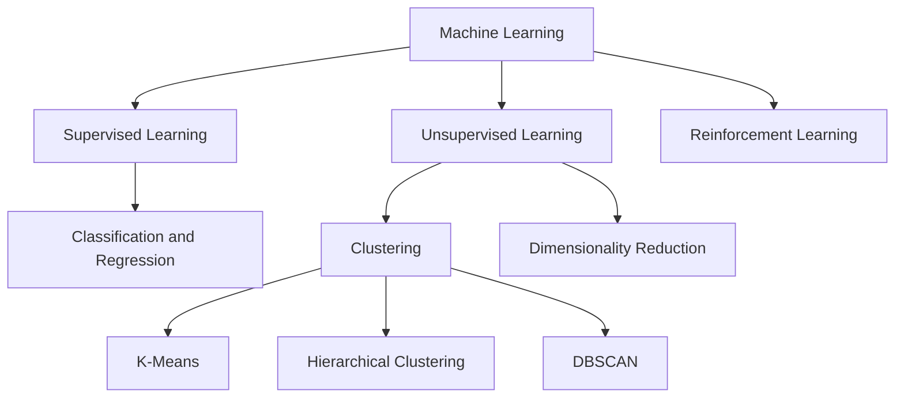
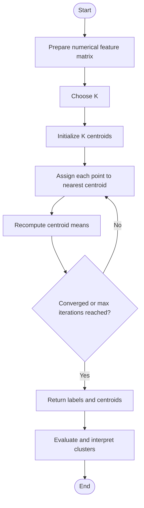
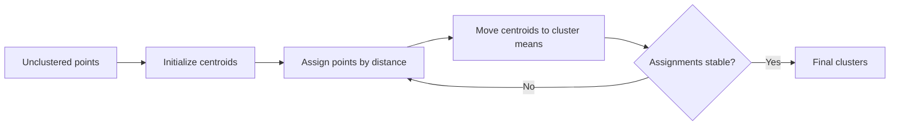
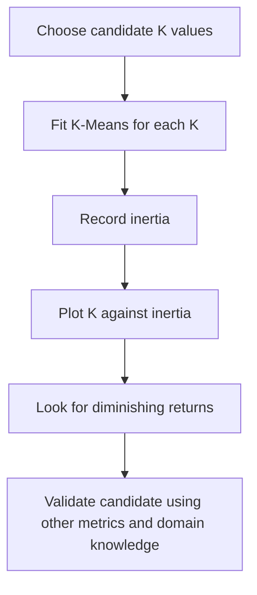
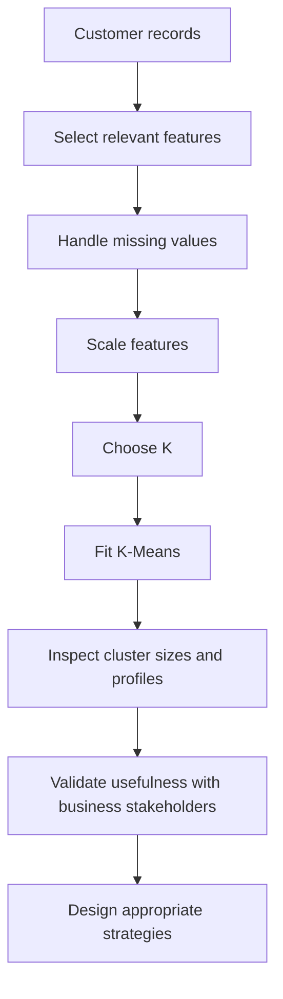
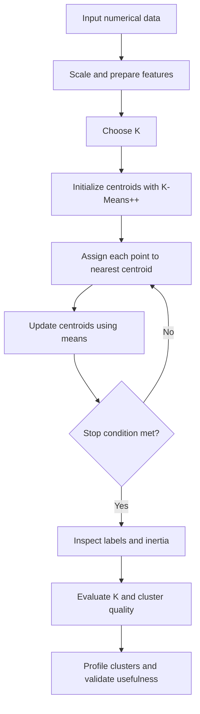

# 🎯 24. K-Means Clustering Algorithm

## 📌 Folder Overview
Welcome to the **K-Means Clustering Algorithm** module! K-Means is a foundational, intuitive unsupervised machine learning algorithm designed to partition unlabeled data points into $K$ distinct, non-overlapping clusters based on geometric feature proximity. This folder covers clustering fundamentals, mathematical distance metrics, centroid initialization techniques (Random vs K-Means++), optimization via Within-Cluster Sum of Squares (WCSS / Inertia), strategies for choosing optimal $K$ (Elbow Method & Silhouette Analysis), Scikit-Learn implementation, Mini-Batch K-Means, and practical customer segmentation.

### Why is this topic important?
Unlike supervised learning, real-world data frequently arrives without ground truth labels. Clustering provides an essential tool for exploratory data analysis, customer segmentation, image compression, anomaly detection, and document grouping. K-Means remains the benchmark clustering algorithm in industry and academia due to its algorithmic simplicity, linear scalability, and clear geometric interpretation.

### What You Will Learn
- **Unsupervised Learning & Clustering Mechanics**: Grouping unlabeled observations into $K$ clusters by iteratively minimizing within-cluster variance.
- **Centroids & Voronoi Partitions**: How cluster centers ($\mu_k$) represent data groups and induce Voronoi tessellations across feature space.
- **Distance Metrics**:
  - **Euclidean Distance**: $d(x, \mu) = \sqrt{\sum_{j=1}^m (x_j - \mu_j)^2}$
  - **Manhattan Distance**: $d(x, \mu) = \sum_{j=1}^m |x_j - \mu_j|$
- **The Optimization Objective (Inertia / WCSS)**:
  $$\text{WCSS} = \sum_{k=1}^K \sum_{x_i \in C_k} \|x_i - \mu_k\|^2$$
- **Centroid Initialization & K-Means++**: Overcoming poor local minima traps by spacing initial centroids probabilistically:
  $$P(x) = \frac{D(x)^2}{\sum_{x' \in X} D(x')^2}$$
- **Determining the Optimal Number of Clusters ($K$)**:
  - **The Elbow Method**: Spotting the point of diminishing returns in WCSS reduction.
  - **Silhouette Coefficient**: Evaluating intra-cluster cohesion vs inter-cluster separation:
    $$s(i) = \frac{b(i) - a(i)}{\max(a(i), b(i))}, \quad s(i) \in [-1, +1]$$
- **Feature Scaling Prerequisite**: Why unscaled features distort Euclidean distances and bias centroid convergence.
- **Mini-Batch K-Means**: Scaling K-Means to massive, streaming, or memory-constrained datasets using mini-batch stochastic updates.
- **End-to-End Practical Implementation**: Training, evaluating, and visualizing customer segments using Python and `sklearn.cluster.KMeans`.

---

## 📚 Topics Covered

Organized logically from clustering intuitions and mathematics to model evaluation and large-scale deployment:

### 🟢 Beginner
- **Clustering Fundamentals**: Differences between Supervised and Unsupervised Learning.
- **Core Algorithm Iteration**:
  1. Initialize $K$ centroids.
  2. Assign each point to its nearest centroid.
  3. Recompute centroid positions as the mean of assigned points.
  4. Repeat until convergence ($\Delta \mu \approx 0$ or maximum iterations reached).

### 🟡 Intermediate
- **Distance Metrics & Scaling**: Euclidean distance, Manhattan distance, and `StandardScaler` / `MinMaxScaler` normalization.
- **Objective Function (Inertia)**: Minimizing Within-Cluster Sum of Squares (WCSS).
- **Selecting $K$**:
  - **Elbow Method**: Plotting inertia vs $K$ to detect the curve's inflection point.
  - **Silhouette Analysis**: Silhouette scores, silhouette plots, and thickness analysis per cluster.
- **Initialization Strategies**: Random initialization vs smart probabilistic seeding with **K-Means++**.

### 🔴 Advanced
- **Algorithm Performance & Scalability**:
  - Computational complexity: $\mathcal{O}(n \cdot K \cdot d \cdot i)$.
  - **Mini-Batch K-Means**: Updating centroids using random subsamples to reduce computation time.
- **Limitations & Diagnostic Pitfalls**: Non-spherical cluster geometry, varying cluster densities/sizes, sensitivity to outliers.
- **Alternative Clustering Paradigms**: When to transition from K-Means to DBSCAN (density-based), Agglomerative Hierarchical clustering, or Gaussian Mixture Models (probabilistic soft clustering).
- **Practical Mini-Project**: Customer Segmentation and behavioral persona profiling.

| Topic / Section | Focus Area | Key Concepts & Tools | Level |
| :--- | :--- | :--- | :--- |
| **Clustering Foundations** | Section 1 – 4 | Unsupervised taxonomy, centroids, Voronoi cells | Beginner |
| **Algorithm & Mathematics** | Section 5 – 8 | 2-step iteration, WCSS objective, K-Means++ initialization | Intermediate |
| **Hyperparameter Tuning ($K$)** | Section 9 – 10 | Elbow Method, Silhouette score, feature scaling | Intermediate |
| **Scikit-Learn Implementation** | Section 11 – 13 | `KMeans`, `MiniBatchKMeans`, visual cluster plots | Intermediate → Advanced |
| **Advanced & Comparative** | Section 14 – 20 | K-Means vs DBSCAN vs GMM, outlier handling, best practices | Advanced |
| **Mini-Project & Interview Prep** | Section 21 – 24 | Customer segmentation pipeline, 10+ interview Q&As, cheat sheet | Practical / Reference |

---

## 📂 File Structure

The module is organized as a self-contained, end-to-end master guide covering theory, mathematical formulations, Scikit-Learn pipelines, visualizations, and an applied business mini-project:

```text
24_K-Means Clustering Algorithm/
├── app.py
├── kmeans-clustering-demo.ipynb
├── Kmeans.py
├── student_clustering.csv
└── README.md
```

---

# 📊 K-Means Clustering Algorithm — Complete Notes

## 📚 Table of Contents

1. [🎯 Introduction](#-1-introduction)
2. [🧠 Fundamentals of Clustering](#-2-fundamentals-of-clustering)
3. [🔍 What Is K-Means?](#-3-what-is-k-means)
4. [📖 Important Terminology](#-4-important-terminology)
5. [⚙️ How K-Means Works](#-5-how-k-means-works)
6. [📐 Mathematical Foundation](#-6-mathematical-foundation)
7. [🧮 Distance Metrics](#-7-distance-metrics)
8. [🎲 Initialization Methods](#-8-initialization-methods)
9. [🔢 Choosing the Number of Clusters (K)](#-9-choosing-the-number-of-clusters-k)
10. [🧹 Data Preprocessing](#-10-data-preprocessing)
11. [🐍 K-Means with Python and Scikit-learn](#-11-k-means-with-python-and-scikit-learn)
12. [📈 Visualizing Clusters](#-12-visualizing-clusters)
13. [🧪 Practical Example: Customer Segmentation](#-13-practical-example-customer-segmentation)
14. [🌍 Real-World Use Cases](#-14-real-world-use-cases)
15. [✅ Advantages](#-15-advantages)
16. [⚠️ Limitations](#-16-limitations)
17. [🆚 K-Means vs. Other Clustering Algorithms](#-17-k-means-vs-other-clustering-algorithms)
18. [🚀 Advanced Concepts](#-18-advanced-concepts)
19. [🛠️ Best Practices](#-19-best-practices)
20. [🚫 Common Mistakes](#-20-common-mistakes)
21. [🎓 Interview Questions and Answers](#-21-interview-questions-and-answers)
22. [🧩 Mini-Project: Customer Segmentation](#-22-mini-project-customer-segmentation)
23. [⚡ Quick Revision](#-23-quick-revision)

---

## 🎯 1. Introduction

**K-Means Clustering** is an unsupervised machine learning algorithm that partitions data points into **K clusters**. It groups observations so that points within the same cluster are relatively similar according to the selected features and distance measure.

It is widely used for exploratory data analysis, customer segmentation, grouping documents or images, and discovering structure in data without predefined labels.

### 🎯 Learning objectives

By the end of these notes, you should be able to:

- Explain clustering and unsupervised learning.
- Describe the K-Means algorithm step by step.
- Understand centroids, inertia, and the objective function.
- Choose a reasonable value for `K`.
- Prepare data and train a K-Means model using Scikit-learn.
- Visualize, evaluate, interpret, and troubleshoot clusters.
- Recognize the algorithm's strengths, limitations, and alternatives.

### 🧭 Where K-Means fits in machine learning



---

## 🧠 2. Fundamentals of Clustering

### 2.1 What is clustering?

**Clustering** is the process of organizing data points into groups, called clusters, based on similarity. It does not require target labels during training.

For example, an online store might group customers according to annual spending and purchase frequency:

- Cluster 1: low spending, infrequent purchases
- Cluster 2: high spending, frequent purchases
- Cluster 3: moderate spending, occasional purchases

These descriptions are interpretations made after clustering; K-Means itself only assigns cluster IDs.

### 2.2 Supervised vs. unsupervised learning

| Aspect | Supervised Learning | Unsupervised Learning |
|---|---|---|
| Training data | Features and known target labels | Features without target labels |
| Goal | Predict a target | Discover patterns or structure |
| Common tasks | Classification, regression | Clustering, dimensionality reduction |
| Example | Predict whether a customer will churn | Group customers by behavior |
| Evaluation | Often uses known target outcomes | Often uses internal metrics or domain validation |

### 2.3 Types of clustering

| Method | Main idea | Examples |
|---|---|---|
| Centroid-based | Assign points to representative centers | K-Means, K-Medoids |
| Hierarchical | Build a hierarchy of nested clusters | Agglomerative clustering |
| Density-based | Find dense regions separated by sparse regions | DBSCAN, HDBSCAN |
| Distribution-based | Model data as a mixture of probability distributions | Gaussian Mixture Models |
| Graph-based | Cluster nodes based on graph connectivity or similarity | Spectral clustering |

---

## 🔍 3. What Is K-Means?

K-Means divides a dataset into **K non-overlapping clusters**. Each cluster is represented by its **centroid**, which is the mean of the observations assigned to that cluster.

The algorithm repeatedly:

1. Initializes `K` centroids.
2. Assigns each point to its nearest centroid.
3. Recalculates each centroid as the mean of its assigned points.
4. Repeats assignment and update until convergence or a stopping condition is met.

### 3.1 Why is it called K-Means?

- **K** is the number of clusters selected before fitting.
- **Means** refers to the mean feature vector used as each cluster's centroid.

### 3.2 Example

Imagine customers represented by two features:

- Annual spending (in thousands of currency units)
- Number of purchases per year

K-Means with `K = 3` may identify three groups. The algorithm does not know what “premium customer” or “occasional customer” means; those business labels are assigned after examining the cluster profiles.

### 3.3 Important characteristics

- It is an **unsupervised** algorithm.
- Standard K-Means uses distance, usually Euclidean distance.
- It works best when clusters are reasonably compact and roughly spherical in the feature space.
- The number of clusters must be chosen in advance.
- Feature scaling can substantially affect results.
- Cluster IDs such as `0`, `1`, and `2` have no inherent ranking or meaning.

---

## 📖 4. Important Terminology

| Term | Meaning |
|---|---|
| **K** | Number of clusters requested |
| **Cluster** | Group of points assigned to the same cluster |
| **Centroid** | Mean feature vector of a cluster |
| **Assignment step** | Assign each point to its nearest centroid |
| **Update step** | Recompute each centroid from assigned points |
| **Inertia** | Sum of squared distances from points to their assigned centroids |
| **Within-cluster sum of squares (WCSS)** | Another name commonly used for the K-Means squared-distance objective |
| **Convergence** | The algorithm reaches a stopping condition, often when assignments or centroid movement stop changing significantly |
| **Initialization** | Method used to select starting centroids |
| **Local optimum** | A solution that cannot be improved by the algorithm's local update steps, but may not be globally optimal |
| **Silhouette score** | Internal measure comparing within-cluster cohesion with separation from other clusters |
| **Label** | The cluster ID assigned to an observation |
| **Feature scaling** | Transforming feature ranges or distributions to make them more comparable |

### 🧩 Centroid vs. medoid

| Centroid | Medoid |
|---|---|
| Mean of points in a cluster | Actual data point chosen as the representative |
| May not correspond to a real observation | Always corresponds to an observation |
| Used by K-Means | Used by K-Medoids |
| Sensitive to extreme values | Often more robust to extreme values |

---

## ⚙️ 5. How K-Means Works

### 5.1 Algorithm workflow



### 5.2 Step 1 — Select K

Choose the number of clusters based on domain knowledge, exploratory analysis, and evaluation methods such as the elbow method or silhouette score.

### 5.3 Step 2 — Initialize centroids

Select `K` starting positions. Poor initialization may lead to a weaker local solution, so modern implementations commonly use K-Means++.

### 5.4 Step 3 — Assign points

Calculate each point's distance to each centroid and assign it to the closest one.

For point \(x_i\), the assignment is:

\[
c_i = \arg\min_{j \in \{1,\ldots,K\}} \|x_i-\mu_j\|_2^2
\]

where:
- \(x_i\) is a data point.
- \(\mu_j\) is centroid \(j\).
- \(c_i\) is the assigned cluster.

### 5.5 Step 4 — Update centroids

For every cluster, calculate the mean of all points assigned to it:

\[
\mu_j = \frac{1}{|C_j|}\sum_{x_i \in C_j}x_i
\]

If a cluster contains no points, implementations need a strategy for handling the empty cluster; Scikit-learn manages this internally.

### 5.6 Step 5 — Check convergence

The algorithm stops when a stopping condition is met, such as sufficiently small centroid movement, stable assignments, or reaching `max_iter`.

### 5.7 Visual intuition



The centroids move as the assignment and update steps repeat. The process generally reduces the K-Means objective at each iteration, although the final result depends on initialization.

---

## 📐 6. Mathematical Foundation

### 6.1 Objective function

K-Means seeks to minimize the total squared distance between each observation and its assigned centroid:

\[
J = \sum_{j=1}^{K}\sum_{x_i \in C_j}\|x_i-\mu_j\|_2^2
\]

This is commonly called **inertia** or the **within-cluster sum of squares**.

- Lower inertia means points are, on average, closer to their assigned centroids.
- Inertia cannot increase when `K` increases if the best possible solution is considered.
- Inertia alone cannot choose `K`, because it usually decreases as more clusters are added.

### 6.2 Euclidean distance

For two points \(x=(x_1,\ldots,x_n)\) and \(y=(y_1,\ldots,y_n)\):

\[
d(x,y)=\sqrt{\sum_{i=1}^{n}(x_i-y_i)^2}
\]

Example for points \(A=(2,3)\) and \(B=(5,7)\):

\[
d(A,B)=\sqrt{(5-2)^2+(7-3)^2}=\sqrt{25}=5
\]

### 6.3 Why the mean is used

For squared Euclidean distance, the arithmetic mean minimizes the sum of squared distances from the points in a cluster. This makes the mean the natural representative for the standard K-Means objective.

### 6.4 What K-Means optimizes—and what it does not

K-Means optimizes compactness according to its objective, not business usefulness, fairness, causal relationships, or predictive accuracy. Cluster usefulness must be validated separately.

---

## 🧮 7. Distance Metrics

Standard K-Means in Scikit-learn uses Euclidean distance in its assignment procedure. Other distance concepts are useful in clustering, but simply substituting a different distance metric does not automatically preserve the standard K-Means mean-update rule.

| Distance / similarity | Formula or idea | Notes |
|---|---|---|
| Euclidean | Straight-line distance | Standard K-Means; sensitive to scale |
| Manhattan | Sum of absolute coordinate differences | Often used with medoid-based approaches |
| Cosine similarity | Angle between vectors | Common for text and high-dimensional embeddings; spherical K-Means is a related variant |
| Hamming | Count of differing positions | Useful for categorical or binary representations with appropriate algorithms |
| Mahalanobis | Distance adjusted by covariance | Requires covariance estimation; not standard K-Means |

**Practical rule:** use standard K-Means with scaled numeric features when Euclidean geometry is meaningful. For text vectors, categorical-heavy data, or unusual shapes, consider methods designed for those data types.

---

## 🎲 8. Initialization Methods

### 8.1 Random initialization

Centroids are selected from random starting positions or observations. Different starts may produce different results.

### 8.2 K-Means++

K-Means++ chooses initial centroids with a strategy that tends to spread them apart. It often improves convergence quality compared with naive random initialization.

### 8.3 Multiple initializations

Running the algorithm with multiple starts gives it several chances to find a lower-inertia solution.

In Scikit-learn, use `n_init` to control the number of initializations. Explicitly setting it makes experiments easier to reproduce.

```python
from sklearn.cluster import KMeans

model = KMeans(
    n_clusters=3,
    init="k-means++",
    n_init=10,
    max_iter=300,
    random_state=42
)
```

| Parameter | Purpose |
|---|---|
| `n_clusters` | Number of clusters (`K`) |
| `init` | Centroid initialization strategy |
| `n_init` | Number of independent initializations |
| `max_iter` | Maximum iterations per run |
| `tol` | Relative tolerance for convergence |
| `random_state` | Seed for reproducible initialization |
| `algorithm` | Optimization algorithm implementation, such as `"lloyd"` |

**Version note:** Scikit-learn defaults can change between releases. Set important parameters explicitly and check the documentation for the installed version.

---

## 🔢 9. Choosing the Number of Clusters (K)

There is no universally correct `K`. Use multiple sources of evidence and ensure the result is useful for the task.

### 9.1 Elbow method

Fit K-Means for several values of `K` and plot inertia. Choose a candidate near the point where additional clusters produce diminishing reductions in inertia.



The elbow can be subtle or absent. It is a heuristic, not a guaranteed optimum.

### 9.2 Silhouette score

The silhouette score measures whether points are closer to their own cluster than to neighboring clusters.

For a sample:

\[
s = \frac{b-a}{\max(a,b)}
\]

where:
- \(a\) is the average distance to points in the same cluster.
- \(b\) is the smallest average distance to points in another cluster.

The score ranges from `-1` to `1`:
- Near `1`: clusters are well separated for that sample.
- Near `0`: sample lies near a cluster boundary.
- Below `0`: sample may be closer to another cluster.

A high silhouette score is useful evidence, but it does not automatically mean the clusters are valuable for the business problem.

### 9.3 Example: evaluate several K values

```python
import matplotlib.pyplot as plt
from sklearn.cluster import KMeans
from sklearn.metrics import silhouette_score

# X_scaled is a scaled numerical feature matrix.
k_values = range(2, 11)
inertias = []
silhouette_scores = []

for k in k_values:
    model = KMeans(
        n_clusters=k,
        init="k-means++",
        n_init=10,
        random_state=42
    )
    labels = model.fit_predict(X_scaled)

    inertias.append(model.inertia_)
    silhouette_scores.append(silhouette_score(X_scaled, labels))

fig, axes = plt.subplots(1, 2, figsize=(12, 4))

axes[0].plot(list(k_values), inertias, marker="o")
axes[0].set_title("Elbow Method")
axes[0].set_xlabel("Number of clusters (K)")
axes[0].set_ylabel("Inertia")

axes[1].plot(list(k_values), silhouette_scores, marker="o")
axes[1].set_title("Silhouette Score")
axes[1].set_xlabel("Number of clusters (K)")
axes[1].set_ylabel("Silhouette score")

plt.tight_layout()
plt.show()
```

**Note:** This code assumes `X_scaled` is already created. Silhouette calculation can be expensive on large datasets; use a sample when appropriate.

### 9.4 Other evaluation approaches

| Method | What it measures | Caveat |
|---|---|---|
| Inertia / WCSS | Within-cluster squared distance | Always favors more clusters |
| Elbow method | Diminishing inertia improvement | Elbow may be unclear |
| Silhouette score | Cohesion and separation | Favors certain cluster geometries |
| Davies–Bouldin index | Similarity between each cluster and its most similar competitor | Lower is better; depends on metric and shape |
| Calinski–Harabasz index | Between-cluster dispersion relative to within-cluster dispersion | Higher is better; may favor particular structures |
| Domain validation | Whether clusters are meaningful and actionable | Requires context and expert judgment |
| Stability analysis | Whether similar data or random starts produce similar clusters | Needs repeated fits or resampling |

---

## 🧹 10. Data Preprocessing

Preprocessing is essential because K-Means is distance-based.

### 10.1 Handle missing values

Standard Scikit-learn K-Means does not accept missing values (`NaN`) directly. Impute or otherwise handle missing data before fitting.

```python
from sklearn.impute import SimpleImputer

imputer = SimpleImputer(strategy="median")
X_imputed = imputer.fit_transform(X)
```

Fit preprocessing transformations on training data only when evaluating a model on held-out data.

### 10.2 Scale features

Suppose a dataset contains annual income ranging from `20,000` to `200,000` and age ranging from `18` to `80`. Income may dominate Euclidean distance simply because its numeric scale is larger.

Common options:

| Method | Transformation | Useful when |
|---|---|---|
| StandardScaler | Mean 0, standard deviation 1 | Features have different units and scaling is appropriate |
| MinMaxScaler | Maps values to a chosen range, often 0–1 | Bounded ranges are useful; outliers can compress most values |
| RobustScaler | Uses median and interquartile range | Features contain some outliers |
| Normalization | Scales each row/vector to a norm | Direction matters more than magnitude, such as some text representations |

```python
from sklearn.preprocessing import StandardScaler

scaler = StandardScaler()
X_scaled = scaler.fit_transform(X)
```

### 10.3 Outliers

K-Means uses means and squared distances, so extreme observations can pull centroids. Investigate outliers and consider robust preprocessing or a different algorithm when appropriate. Do not remove unusual observations without understanding whether they are errors or important real cases.

### 10.4 Encode categorical features carefully

Standard K-Means is not designed for raw categorical labels. One-hot encoding can be appropriate for some mixed datasets, but it changes the geometry and may give high-cardinality categories disproportionate influence. For primarily categorical data, consider **K-Modes** or **K-Prototypes**.

### 10.5 Avoid data leakage

Use a pipeline so preprocessing is fitted consistently and, in predictive workflows, only on the training portion of the data.

```python
from sklearn.pipeline import Pipeline
from sklearn.impute import SimpleImputer
from sklearn.preprocessing import StandardScaler
from sklearn.cluster import KMeans

pipeline = Pipeline([
    ("imputer", SimpleImputer(strategy="median")),
    ("scaler", StandardScaler()),
    ("kmeans", KMeans(n_clusters=3, n_init=10, random_state=42))
])
```

---

## 🐍 11. K-Means with Python and Scikit-learn

### 11.1 Install dependencies

```bash
pip install numpy pandas matplotlib scikit-learn
```

### 11.2 Minimal example using synthetic data

```python
import matplotlib.pyplot as plt
from sklearn.datasets import make_blobs
from sklearn.cluster import KMeans
from sklearn.preprocessing import StandardScaler

# Create sample data with three underlying groups.
X, _ = make_blobs(
    n_samples=300,
    centers=3,
    cluster_std=1.0,
    random_state=42
)

# Scale features.
scaler = StandardScaler()
X_scaled = scaler.fit_transform(X)

# Fit K-Means.
kmeans = KMeans(
    n_clusters=3,
    init="k-means++",
    n_init=10,
    max_iter=300,
    random_state=42
)
labels = kmeans.fit_predict(X_scaled)

print("Cluster labels:", labels[:10])
print("Inertia:", kmeans.inertia_)
print("Centroids in scaled space:\n", kmeans.cluster_centers_)

# Visualize assignments (two features only).
plt.figure(figsize=(8, 5))
plt.scatter(
    X_scaled[:, 0],
    X_scaled[:, 1],
    c=labels,
    cmap="viridis",
    s=35
)
plt.scatter(
    kmeans.cluster_centers_[:, 0],
    kmeans.cluster_centers_[:, 1],
    marker="X",
    s=200,
    edgecolor="black",
    label="Centroids"
)
plt.title("K-Means Clustering")
plt.xlabel("Scaled feature 1")
plt.ylabel("Scaled feature 2")
plt.legend()
plt.tight_layout()
plt.show()
```

**Explanation:**
- `make_blobs()` creates a synthetic dataset for demonstration.
- `fit_predict()` fits the model and returns a cluster ID for every point.
- `inertia_` reports the final sum of squared distances.
- `cluster_centers_` contains centroids in the scaled feature space.
- Plotting works directly here because there are two features.

### 11.3 Fit, predict, and inspect

```python
kmeans.fit(X_scaled)

labels = kmeans.labels_
centers = kmeans.cluster_centers_
new_labels = kmeans.predict(new_scaled_data)
```

- `fit()` learns centroids.
- `fit_predict()` fits and returns labels for the training observations.
- `predict()` assigns new observations to the nearest learned centroid.
- `labels_` contains fitted labels for the training observations.
- `cluster_centers_` contains learned centroids.
- `inertia_` contains the final inertia.
- `n_iter_` reports the number of iterations used.

### 11.4 Add labels to a DataFrame

```python
import pandas as pd

df = pd.DataFrame({
    "AnnualIncome": [25, 30, 75, 80, 120, 130],
    "SpendingScore": [20, 25, 70, 75, 30, 35]
})

features = df[["AnnualIncome", "SpendingScore"]]

scaler = StandardScaler()
X_scaled = scaler.fit_transform(features)

model = KMeans(n_clusters=3, n_init=10, random_state=42)
df["Cluster"] = model.fit_predict(X_scaled)

print(df)
```

Cluster IDs can vary across different fits. Do not assume cluster `0` always represents the same customer type.

---

## 📈 12. Visualizing Clusters

### 12.1 Two-dimensional data

A scatter plot is an effective way to inspect cluster shape and centroid positions when the data has two meaningful features.

```python
plt.scatter(
    X_scaled[:, 0],
    X_scaled[:, 1],
    c=labels,
    cmap="viridis",
    s=40
)
plt.scatter(
    centers[:, 0],
    centers[:, 1],
    marker="X",
    s=220,
    edgecolor="black"
)
plt.show()
```

### 12.2 More than two features

When there are more than two features, a 2D plot does not show the complete geometry. Options include:

- Plot selected original features.
- Use PCA to project data into two dimensions for visualization.
- Use domain-specific visual summaries and cluster profiles.
- Compare visual projections with numerical evaluation.

```python
from sklearn.decomposition import PCA

X_2d = PCA(n_components=2, random_state=42).fit_transform(X_scaled)

plt.scatter(X_2d[:, 0], X_2d[:, 1], c=labels, cmap="viridis", s=35)
plt.xlabel("Principal component 1")
plt.ylabel("Principal component 2")
plt.title("Clusters projected with PCA")
plt.show()
```

PCA projection can distort distances and separation. Use it as a visualization aid, not as proof that clusters are well separated in the original feature space.

---

## 🧪 13. Practical Example: Customer Segmentation

### 13.1 Problem statement

A retailer wants to group customers based on annual income and spending score to tailor marketing strategies.

**Features:**
- `AnnualIncome`: annual income, in a consistent currency unit.
- `SpendingScore`: a numerical score representing spending behavior.

**Goal:** Discover groups without using a target label.

### 13.2 Workflow



### 13.3 Example cluster interpretations

| Illustrative profile | Possible interpretation | Potential action |
|---|---|---|
| High income, high spending | High-value customers | Loyalty benefits and premium services |
| High income, low spending | Potential growth segment | Test relevant offers and understand barriers |
| Low income, high spending | Active spenders with limited income | Value bundles and useful rewards |
| Low income, low spending | Lower current engagement | Low-cost campaigns and engagement experiments |

These are illustrative interpretations, not guaranteed outcomes. Actual cluster profiles must be calculated from the data and validated.

### 13.4 Summarize cluster profiles

```python
# df should contain the original features and a Cluster column.
cluster_summary = (
    df.groupby("Cluster")
      .agg(
          CustomerCount=("Cluster", "size"),
          AverageIncome=("AnnualIncome", "mean"),
          AverageSpendingScore=("SpendingScore", "mean")
      )
      .round(2)
)

print(cluster_summary)
```

The summary is often more useful to stakeholders than raw cluster IDs.

---

## 🌍 14. Real-World Use Cases

| Domain | Example | Important consideration |
|---|---|---|
| Retail and e-commerce | Customer segmentation | Clusters should support actionable decisions |
| Banking | Explore customer behavior patterns | Apply privacy, fairness, and regulatory controls |
| Marketing | Group campaigns or audience profiles | Validate outcomes with controlled experiments |
| Image processing | Color quantization by grouping pixel colors | Can reduce color palette but may introduce artifacts |
| Document analysis | Group document embeddings | Consider cosine similarity or algorithms suited to embeddings |
| Operations | Group similar demand or workload patterns | Scale features and account for time dependence |
| Manufacturing | Explore sensor operating states | Anomaly detection may require a different method |
| Education | Explore patterns in learning behavior | Avoid using clusters as unsupported judgments about students |
| Healthcare research | Explore patient subgroups | Clinical validation and expert oversight are essential |
| Geographic analysis | Group locations using numeric coordinates or features | Use suitable geographic distances and account for spatial context |

---

## ✅ 15. Advantages

1. **Simple to understand:** The assignment and centroid-update steps are intuitive.
2. **Efficient on many datasets:** It scales well relative to many more complex clustering methods.
3. **Easy to implement:** Widely available in libraries such as Scikit-learn.
4. **Centroids are interpretable:** Cluster means can help summarize group profiles.
5. **Predicts assignments for new data:** A fitted model can assign new observations to learned clusters.
6. **Useful baseline:** A strong first approach for compact, numeric datasets.

---

## ⚠️ 16. Limitations

1. **Must choose K:** The algorithm does not automatically determine the appropriate number of clusters.
2. **Sensitive to initialization:** Different starts may yield different local solutions.
3. **Sensitive to scaling:** Features with large numeric ranges may dominate distances.
4. **Sensitive to outliers:** Extreme points can pull centroids.
5. **Assumes centroid-based geometry:** It may perform poorly for non-convex or highly elongated clusters.
6. **Numeric features are expected:** Raw categorical values are not directly appropriate.
7. **Hard assignments:** Every point is assigned to one cluster, even when it lies between groups.
8. **High-dimensional challenges:** Distance geometry and interpretation can become difficult as dimensions increase.
9. **Cluster IDs are arbitrary:** Labels are not stable semantic categories across runs.
10. **Optimization is local:** The algorithm is not guaranteed to find the global minimum of the objective.

---

## 🆚 17. K-Means vs. Other Clustering Algorithms

| Feature | K-Means | Hierarchical | DBSCAN | Gaussian Mixture Model |
|---|---|---|---|---|
| Cluster model | Centroids / means | Nested hierarchy | Dense regions | Probability distributions |
| Must specify K? | Yes | Not always; cut level determines groups | No | Usually number of components is specified |
| Non-spherical clusters | Often poor | Depends on linkage and metric | Often good | Can model some elliptical clusters |
| Noise handling | Assigns every point | Usually assigns all points | Can label noise | Usually gives probabilities to components |
| Scalability | Often good | Can be expensive for large data | Depends on implementation and data | Can be computationally heavier |
| Soft assignments | No | No in standard form | No in standard form | Yes, posterior probabilities |
| Best fit | Compact numeric clusters | Nested structure | Arbitrary shapes and noise | Overlapping distributional groups |

### 17.1 When should you choose another algorithm?

- Use **DBSCAN** when clusters may have irregular shapes and noise points matter.
- Use **hierarchical clustering** when nested relationships and dendrograms are valuable.
- Use a **Gaussian Mixture Model** when probabilistic or soft cluster assignments are useful and distributional assumptions are reasonable.
- Use **K-Modes** for categorical data, or **K-Prototypes** for mixed numeric and categorical data.
- Use **K-Medoids** when representative observations and greater robustness to outliers are desirable.

No algorithm is universally best. Select based on data structure, scale, interpretability, and the task.

---

## 🚀 18. Advanced Concepts

### 18.1 Mini-Batch K-Means

Mini-Batch K-Means updates centroids using small random batches rather than the full dataset at each iteration. This can substantially reduce computation for large datasets, often with a trade-off in solution quality.

```python
from sklearn.cluster import MiniBatchKMeans

model = MiniBatchKMeans(
    n_clusters=5,
    batch_size=1024,
    n_init=10,
    random_state=42
)
labels = model.fit_predict(X_scaled)
```

Use it when training speed and memory efficiency are important. Evaluate its clusters against a standard K-Means baseline where feasible.

### 18.2 K-Means++ in more detail

K-Means++ selects the first centroid randomly and chooses subsequent centroids with probabilities related to their squared distance from the nearest existing centroid. This tends to spread initial centers across the data and often improves the final result.

### 18.3 Cluster stability

A useful clustering result should not change drastically due to small data perturbations or random initialization.

A practical stability check:
1. Fit models with several random seeds.
2. Compare inertia and cluster sizes.
3. Compare assignments using a label-invariant metric such as Adjusted Rand Index (ARI) when comparing assignments over the same observations.
4. Repeat on resampled data if appropriate.
5. Investigate unstable clusters before deploying them.

Cluster labels can permute across fits, so comparing raw integer IDs directly is not reliable.

### 18.4 Dimensionality reduction before clustering

PCA can reduce redundancy and noise in numerical features before K-Means. However, PCA may discard low-variance information that matters for a task. Compare clustering with and without dimensionality reduction and validate the result.

### 18.5 K-Means and PCA

PCA and K-Means solve different problems:

| PCA | K-Means |
|---|---|
| Unsupervised dimensionality reduction | Unsupervised clustering |
| Finds directions of high variance | Finds centroid-based groups |
| Produces transformed components | Produces cluster assignments and centroids |
| Does not inherently create clusters | Does not inherently reduce dimensions |

### 18.6 Weighted observations

Some implementations support `sample_weight`, allowing certain observations to contribute more to centroid updates and the objective. Weights should reflect a justified modeling choice, not be used casually to force a desired result.

### 18.7 Online and streaming scenarios

For evolving datasets, Mini-Batch K-Means and incremental update strategies may help. Monitor drift, cluster sizes, centroid movement, and whether old clusters remain meaningful as new data arrives.

### 18.8 High-dimensional data

In high-dimensional spaces, distances can become less discriminative, and irrelevant features can obscure structure. Consider feature selection, justified dimensionality reduction, domain-specific representations, and validation against meaningful baselines.

### 18.9 Image color quantization

K-Means can group pixel colors into a smaller palette. Each pixel is represented by its color vector, and the centroid color replaces the original color.

```python
import numpy as np
from sklearn.cluster import KMeans

# image must be a NumPy array with shape (height, width, 3).
pixels = image.reshape(-1, 3)

model = KMeans(n_clusters=8, n_init=5, random_state=42)
labels = model.fit_predict(pixels)

compressed_pixels = model.cluster_centers_[labels]
compressed_image = compressed_pixels.reshape(image.shape).clip(0, 255).astype(np.uint8)
```

For best results, handle image color space and pixel sampling thoughtfully. The example assumes an 8-bit RGB-like three-channel image; OpenCV images are commonly BGR and may need conversion.

### 18.10 Fitting and evaluating in a pipeline

A pipeline helps ensure the same imputation and scaling transformations are applied consistently at fit and prediction time.

```python
from sklearn.pipeline import Pipeline
from sklearn.impute import SimpleImputer
from sklearn.preprocessing import StandardScaler
from sklearn.cluster import KMeans

cluster_pipeline = Pipeline([
    ("imputer", SimpleImputer(strategy="median")),
    ("scaler", StandardScaler()),
    ("kmeans", KMeans(n_clusters=4, n_init=10, random_state=42))
])

labels = cluster_pipeline.fit_predict(raw_features)
```

For evaluation, fit preprocessing only on the relevant training data when using a held-out or resampling design.

---

## 🛠️ 19. Best Practices

- **Understand the business question first.** Clusters should serve a purpose.
- **Select features intentionally.** Irrelevant or duplicated features can distort distances.
- **Scale numeric features when appropriate.** Choose a scaler based on the data and intended geometry.
- **Handle missing values explicitly.** K-Means does not natively accept `NaN`.
- **Investigate outliers.** Do not automatically delete unusual but valid observations.
- **Try multiple values of K.** Use inertia, silhouette, and domain interpretation together.
- **Use K-Means++ and multiple initializations.** This reduces sensitivity to poor starts.
- **Set `random_state`.** Improve reproducibility for experiments.
- **Inspect cluster sizes.** Tiny clusters may be meaningful, noise-like, or artifacts.
- **Profile clusters in original units.** Transform centroids back when useful for interpretation.
- **Check stability.** Repeat fits and assess sensitivity to sampling or preprocessing.
- **Validate actionability.** A metric score alone does not establish business value.
- **Document the pipeline.** Record features, scaling, K, parameters, software versions, and evaluation results.
- **Monitor drift in production.** Reassess clusters as the data distribution changes.
- **Protect sensitive data.** Apply privacy, security, and fairness practices in consequential settings.

---

## 🚫 20. Common Mistakes

| Mistake | Why it is a problem | Better approach |
|---|---|---|
| Choosing K only because it looks familiar | May not fit the data or use case | Compare candidate K values and validate usefulness |
| Using raw features with different units | Large-scale features dominate distance | Scale appropriately |
| Treating lower inertia as proof of better clustering | Inertia decreases as K grows | Use complementary metrics and domain validation |
| Assuming cluster 0 is always the same group | Cluster IDs are arbitrary | Interpret clusters from their profiles |
| Using K-Means on raw categories | Numeric distance is not meaningful for category codes | Encode carefully or use K-Modes/K-Prototypes |
| Ignoring outliers | Centroids may be pulled away from dense groups | Investigate outliers and alternatives |
| Assuming every dataset has spherical clusters | Irregular groups may be split incorrectly | Compare with density- or hierarchy-based methods |
| Evaluating only with a 2D plot | Projection can hide or distort structure | Use metrics and original-space analysis |
| Forgetting preprocessing at prediction time | New data is represented differently | Save and reuse the complete pipeline |
| Interpreting clusters as causal explanations | Clustering reveals structure, not causality | Use further analysis or experiments |
| Comparing raw labels between runs | Labels may be permuted | Use label-invariant metrics such as ARI |
| Ignoring business context | Statistically compact clusters may not be useful | Validate with stakeholders and outcome measures |

---

## 🎓 21. Interview Questions and Answers

### Q1. What is K-Means clustering?

K-Means is an unsupervised algorithm that partitions observations into K clusters by assigning each observation to its nearest centroid and repeatedly updating centroids to reduce within-cluster squared distances.

### Q2. Why is K-Means unsupervised?

It learns groups from input features without requiring known target labels during training.

### Q3. What is a centroid?

A centroid is the mean feature vector of all points assigned to a cluster.

### Q4. What is inertia?

Inertia is the sum of squared distances between each observation and its assigned centroid. Lower values indicate tighter clusters for a given representation and K.

### Q5. Why should features often be scaled?

K-Means uses distances. Features with larger numeric ranges can dominate the distance calculation unless scaling or another justified weighting strategy is applied.

### Q6. How do you choose K?

Use domain knowledge, the elbow method, silhouette score, other internal metrics, cluster stability, and whether the resulting groups are useful. No single method guarantees the correct K.

### Q7. What is K-Means++?

It is a centroid initialization method that tends to spread starting centers apart, often improving convergence quality.

### Q8. Does K-Means guarantee a global optimum?

No. The iterative algorithm can converge to a local solution, and initialization can affect the result.

### Q9. Can K-Means handle categorical data?

Not directly in its standard form. Numeric encodings can create misleading distances. Consider K-Modes for categorical data or K-Prototypes for mixed data.

### Q10. What are the assumptions or preferred data characteristics?

K-Means is most effective when Euclidean distance is meaningful and clusters are reasonably compact, separated, and roughly spherical in the feature space. These are practical characteristics rather than strict statistical assumptions.

### Q11. What is the difference between K-Means and K-Medoids?

K-Means represents a cluster by the arithmetic mean, which may not be an observed point. K-Medoids uses an actual observation as the representative and can be more robust to outliers.

### Q12. What happens if K is too large?

Clusters may become unnecessarily fragmented, and the fit may over-segment the data. Inertia will generally decrease, so use additional metrics and domain judgment.

### Q13. What happens if K is too small?

Distinct groups may be merged, hiding meaningful patterns.

### Q14. Can K-Means predict clusters for new samples?

Yes. After fitting, `predict()` assigns each new sample to its nearest learned centroid, provided the same preprocessing and feature order are used.

### Q15. What is the difference between `fit()` and `fit_predict()`?

`fit()` learns the cluster centers. `fit_predict()` learns the centers and returns the cluster assignments for the supplied data.

### Q16. What is the silhouette score?

It compares a sample's average distance to its own cluster with its average distance to the nearest alternative cluster. Values closer to 1 generally indicate better separation for that sample.

### Q17. Why can K-Means perform poorly on crescent-shaped clusters?

Its centroid-based assignment partitions space into regions associated with nearest centers, which does not naturally represent non-convex shapes. DBSCAN or another suitable method may work better.

### Q18. How can you make K-Means faster on a large dataset?

Consider Mini-Batch K-Means, sensible feature selection, reducing redundant dimensions, sampling for exploratory evaluation, and avoiding unnecessarily large `n_init` or `max_iter` values without checking quality.

### Q19. Are K-Means cluster labels ordered?

No. Cluster IDs are arbitrary identifiers, not rankings or semantic labels.

### Q20. What is the main difference between K-Means and a Gaussian Mixture Model?

K-Means makes hard nearest-centroid assignments and optimizes a squared-distance objective. A Gaussian Mixture Model estimates probabilistic components and can provide soft membership probabilities.

---

## 🧩 22. Mini-Project: Customer Segmentation

### 22.1 Project objective

Build a small customer segmentation analysis using K-Means. Use customer features to discover groups, evaluate candidate values of K, visualize the result, and summarize the groups in business-friendly terms.

### 22.2 Suggested dataset

Use a customer dataset containing fields such as:
- `CustomerID`
- `AnnualIncome`
- `SpendingScore`

A common learning exercise uses a mall customer segmentation dataset. Confirm the source's license and data dictionary before using it in a real project.

### 22.3 Project structure

```text
kmeans-customer-segmentation/
├── data/
│   └── customers.csv
├── outputs/
│   ├── elbow_silhouette.png
│   └── customer_clusters.png
├── notebooks/
│   └── exploration.ipynb
├── src/
│   └── segment_customers.py
├── requirements.txt
└── README.md
```

### 22.4 Requirements

```text
numpy
pandas
matplotlib
scikit-learn
```

Install with:

```bash
pip install -r requirements.txt
```

### 22.5 End-to-end starter code

This example expects a CSV file named `data/customers.csv` with `AnnualIncome` and `SpendingScore` columns. Adjust the column names to match your dataset.

```python
from pathlib import Path

import matplotlib.pyplot as plt
import pandas as pd
from sklearn.cluster import KMeans
from sklearn.metrics import silhouette_score
from sklearn.preprocessing import StandardScaler

DATA_PATH = Path("data/customers.csv")
OUTPUT_DIR = Path("outputs")
OUTPUT_DIR.mkdir(parents=True, exist_ok=True)

# 1. Load data.
df = pd.read_csv(DATA_PATH)

feature_columns = ["AnnualIncome", "SpendingScore"]
X = df[feature_columns].copy()

# 2. Basic validation.
X = X.apply(pd.to_numeric, errors="coerce")
X = X.dropna()

# 3. Scale features.
scaler = StandardScaler()
X_scaled = scaler.fit_transform(X)

# 4. Compare candidate K values.
k_values = range(2, 9)
inertias = []
silhouettes = []

for k in k_values:
    model = KMeans(
        n_clusters=k,
        init="k-means++",
        n_init=10,
        max_iter=300,
        random_state=42
    )
    labels = model.fit_predict(X_scaled)
    inertias.append(model.inertia_)
    silhouettes.append(silhouette_score(X_scaled, labels))

# 5. Save evaluation plots.
fig, axes = plt.subplots(1, 2, figsize=(12, 4))

axes[0].plot(list(k_values), inertias, marker="o")
axes[0].set_title("Elbow Method")
axes[0].set_xlabel("K")
axes[0].set_ylabel("Inertia")

axes[1].plot(list(k_values), silhouettes, marker="o")
axes[1].set_title("Silhouette Score")
axes[1].set_xlabel("K")
axes[1].set_ylabel("Score")

plt.tight_layout()
fig.savefig(OUTPUT_DIR / "elbow_silhouette.png", dpi=150)
plt.close(fig)

# 6. Choose K only after reviewing the evaluation plots.
chosen_k = 4
final_model = KMeans(
    n_clusters=chosen_k,
    init="k-means++",
    n_init=10,
    random_state=42
)
labels = final_model.fit_predict(X_scaled)

# 7. Attach labels to retained observations.
results = X.copy()
results["Cluster"] = labels

# 8. Summarize cluster profiles in original units.
summary = (
    results.groupby("Cluster")
    .agg(
        CustomerCount=("Cluster", "size"),
        AverageIncome=("AnnualIncome", "mean"),
        AverageSpendingScore=("SpendingScore", "mean")
    )
    .round(2)
)

print("Cluster summary:")
print(summary)

# 9. Visualize original feature values.
plt.figure(figsize=(8, 5))
plt.scatter(
    results["AnnualIncome"],
    results["SpendingScore"],
    c=results["Cluster"],
    cmap="viridis",
    s=45
)

# Transform learned centers back to original feature units.
centers_original = scaler.inverse_transform(final_model.cluster_centers_)
plt.scatter(
    centers_original[:, 0],
    centers_original[:, 1],
    marker="X",
    s=220,
    edgecolor="black",
    label="Centroids"
)

plt.xlabel("Annual income")
plt.ylabel("Spending score")
plt.title(f"Customer Segmentation (K={chosen_k})")
plt.legend()
plt.tight_layout()
plt.savefig(OUTPUT_DIR / "customer_clusters.png", dpi=150)
plt.show()

# 10. Save cluster assignments and summary.
results.to_csv(OUTPUT_DIR / "customer_cluster_assignments.csv", index=False)
summary.to_csv(OUTPUT_DIR / "cluster_summary.csv")
```

### 22.6 Important project notes

- The code drops rows with missing selected features; in a production workflow, consider imputation and retain a way to trace records.
- `chosen_k = 4` is only a starting choice. Review evaluation results and business requirements before finalizing K.
- The sample code assumes the selected features are numerical.
- Keep customer identifiers out of the distance calculation unless there is a well-justified reason to include them.
- If you need to preserve original row alignment, create a validity mask rather than silently dropping rows from only the feature matrix.
- Document the chosen features, scaling method, K, evaluation metrics, and cluster interpretations.

### 22.7 Project extensions

1. Compare StandardScaler with RobustScaler.
2. Compare K-Means with DBSCAN and hierarchical clustering.
3. Add a cluster profile chart and a written description for each group.
4. Check stability across several random seeds.
5. Build a simple Streamlit dashboard to explore cluster summaries.
6. Test whether the segments lead to better outcomes using a carefully designed experiment.

### 22.8 Deliverables checklist

- [ ] Data cleaning and feature selection
- [ ] Feature scaling
- [ ] Elbow and silhouette analysis
- [ ] Final model with reproducible settings
- [ ] Cluster visualization
- [ ] Cluster profile summary
- [ ] Interpretation and limitations
- [ ] README with setup and usage instructions

---

## ⚡ 23. Quick Revision

### 23.1 Key points

- K-Means is an **unsupervised, centroid-based clustering algorithm**.
- `K` is the number of clusters chosen by the user.
- Each point is assigned to its nearest centroid.
- Each centroid is updated to the mean of its assigned points.
- The algorithm minimizes **inertia / WCSS**, the sum of squared distances to assigned centroids.
- K-Means++ and multiple initializations help reduce poor-start outcomes.
- Scaling matters because distances are sensitive to feature magnitudes.
- The elbow method, silhouette score, stability, and domain knowledge can help choose K.
- K-Means works best for reasonably compact clusters where Euclidean distance is meaningful.
- It is sensitive to outliers and does not naturally model arbitrary-shaped clusters.
- Cluster labels are arbitrary and may change across runs.
- Always interpret and validate cluster profiles rather than relying on a metric alone.

### 23.2 Important formulas

**Euclidean distance**

\[
d(x,y)=\sqrt{\sum_{i=1}^{n}(x_i-y_i)^2}
\]

**Centroid update**

\[
\mu_j=\frac{1}{|C_j|}\sum_{x_i\in C_j}x_i
\]

**K-Means objective / inertia**

\[
J=\sum_{j=1}^{K}\sum_{x_i\in C_j}\|x_i-\mu_j\|_2^2
\]

**Silhouette score for one sample**

\[
s=\frac{b-a}{\max(a,b)}
\]

### 23.3 Important Scikit-learn commands

| Command / attribute | Purpose |
|---|---|
| `KMeans(n_clusters=K)` | Create a K-Means estimator |
| `model.fit(X)` | Learn centroids |
| `model.fit_predict(X)` | Fit and return cluster labels |
| `model.predict(X_new)` | Assign new samples to learned clusters |
| `model.cluster_centers_` | Read centroids |
| `model.labels_` | Read fitted labels |
| `model.inertia_` | Read final inertia |
| `model.n_iter_` | Read iteration count |
| `silhouette_score(X, labels)` | Calculate silhouette score |
| `StandardScaler().fit_transform(X)` | Standardize numeric features |
| `MiniBatchKMeans(...)` | Use mini-batch updates for larger datasets |

### 23.4 One-minute algorithm recap



### 23.5 Learning roadmap

```mermaid
flowchart LR
    A[Clustering basics] --> B[Distance and centroids]
    B --> C[K-Means workflow]
    C --> D[Preprocessing and scaling]
    D --> E[Choosing K]
    E --> F[Python implementation]
    F --> G[Visualization and profiling]
    G --> H[Evaluation and stability]
    H --> I[Advanced methods and alternatives]
    I --> J[Mini-project]
```



### 23.6 Final memory trick

**K-Means = Choose K → Initialize → Assign → Update → Repeat → Evaluate.**

Remember: **scaling + sensible K + good initialization + domain validation** are the foundation of a useful K-Means solution.
