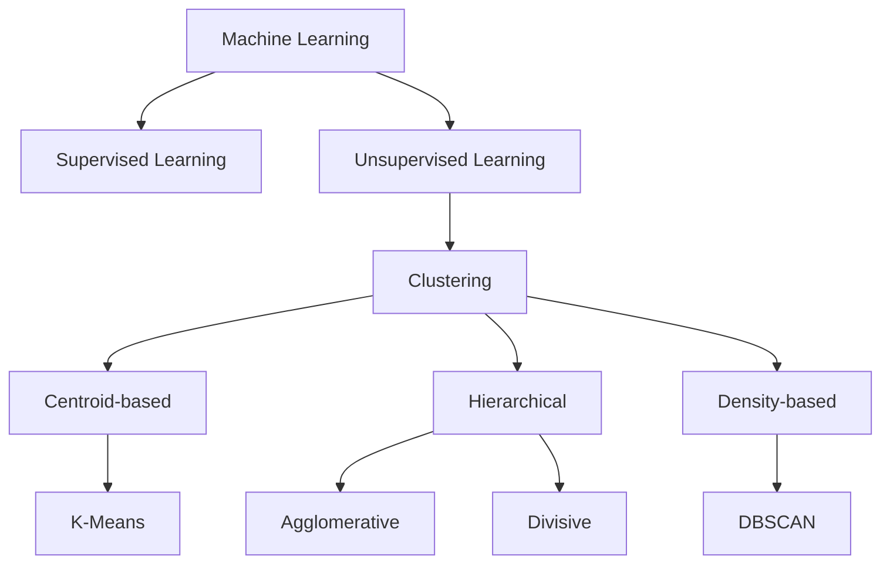
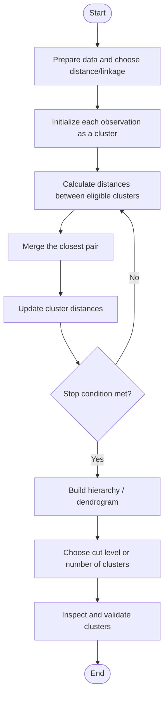
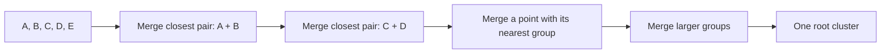
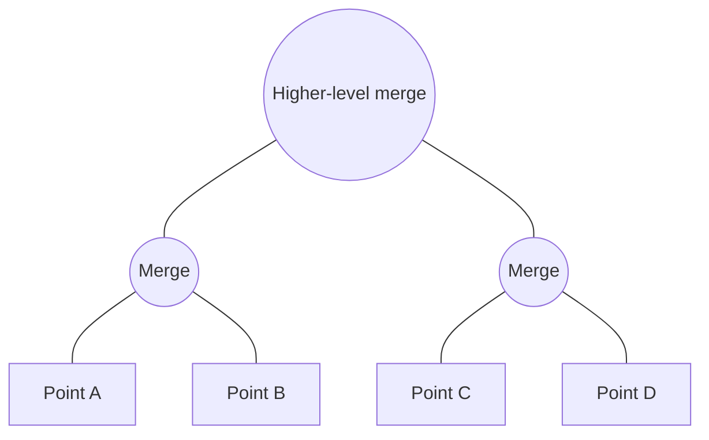
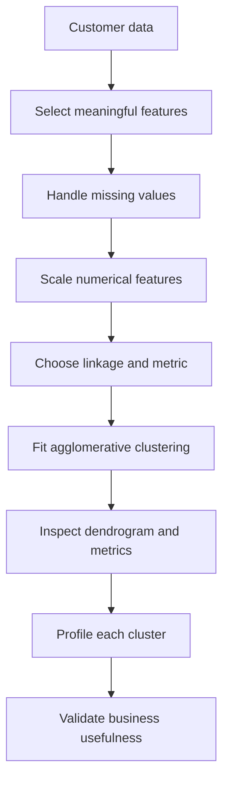
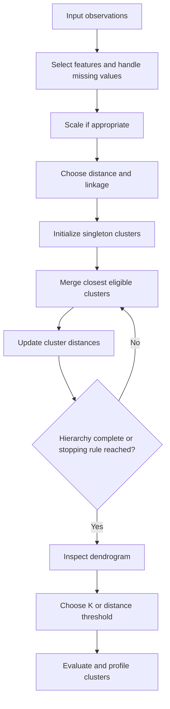
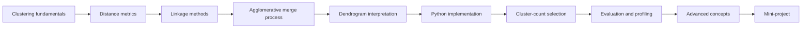

# 🌳 25. Agglomerative Hierarchical Clustering

## 📌 Folder Overview
Welcome to the **Agglomerative Hierarchical Clustering** module! Hierarchical clustering is an unsupervised machine learning family that constructs an interpretable nested tree of clusters without requiring you to specify the number of clusters $K$ in advance. This folder covers the bottom-up agglomerative paradigm, distance metrics (Euclidean, Manhattan, Cosine), linkage criteria (Single, Complete, Average, Ward's Minimum Variance), dendrogram construction and interpretation, cophenetic correlation, and customer shopping segmentation using Scikit-Learn and SciPy.

### Why is this topic important?
Unlike flat partitioning methods such as K-Means, hierarchical clustering reveals multi-level relationships across observations through a dendrogram tree. It allows practitioners to inspect cluster structures at varying granularities, model natural hierarchical taxonomies (such as gene expression or evolutionary lineages), and select optimal cluster boundaries without heuristic guessing.

### What You Will Learn
- **Agglomerative Bottom-Up Paradigm**: Starting from individual singleton clusters and iteratively merging the closest pairs until a single unified cluster forms.
- **Linkage Criteria**:
  - **Single Linkage**: Minimum pairwise distance $d(A, B) = \min_{x \in A, y \in B} d(x, y)$ (chains elongated clusters, sensitive to outliers).
  - **Complete Linkage**: Maximum pairwise distance $d(A, B) = \max_{x \in A, y \in B} d(x, y)$ (produces compact, spherical clusters).
  - **Average Linkage (UPGMA)**: Mean pairwise distance $d(A, B) = \frac{1}{|A||B|} \sum_{x \in A} \sum_{y \in B} d(x, y)$.
  - **Ward's Linkage**: Minimizes the total within-cluster variance increase upon merging ($\Delta \text{ESS}$).
- **Dendrograms & Distance Thresholds**: Generating, reading, and cutting dendrograms using `scipy.cluster.hierarchy` to choose the optimal cluster count.
- **Feature Scaling Prerequisite**: Using `StandardScaler` to ensure pairwise Euclidean distances remain unbiased by feature scale.
- **Customer Segmentation Pipeline**: Applying `AgglomerativeClustering` on shopping mall customer datasets to reveal high-value consumer segments.

---

## 📚 Topics Covered

Organized logically from hierarchical concepts and distance math to dendrogram cutting and customer profiling:

### 🟢 Beginner
- **Clustering Taxonomy**: Flat (Partitional) vs Hierarchical clustering.
- **Agglomerative vs Divisive**: Bottom-up aggregation vs top-down division.
- **Proximity Matrix**: Tracking pairwise distances and sequential cluster merging.

### 🟡 Intermediate
- **Distance Metrics**: Euclidean, Manhattan, and Cosine distance measures.
- **Linkage Comparison**: Trade-offs between Single, Complete, Average, and Ward's linkage.
- **Dendrogram Construction**: Visualizing hierarchical merges using SciPy (`linkage`, `dendrogram`).
- **Cluster Number Selection**: Locating the longest unbroken vertical distance without crossing horizontal thresholds.

### 🔴 Advanced
- **Computational Complexity**: Managing $\mathcal{O}(n^2)$ spatial memory and $\mathcal{O}(n^3)$ / $\mathcal{O}(n^2 \log n)$ time requirements.
- **Cophenetic Correlation**: Quantifying how well a dendrogram preserves pairwise input distances.
- **Scalability Alternatives**: When to pivot to large-scale hierarchical algorithms such as BIRCH.
- **Practical Application**: Customer shopping behavior segmentation in Scikit-Learn.

| File / Notebook | Focus Area | Key Concepts & Tools | Level |
| :--- | :--- | :--- | :--- |
| `agglomerative-clustering.ipynb` | Hands-on clustering & dendrogram analysis. | `scipy.cluster.hierarchy`, `AgglomerativeClustering`, customer segmentation. | Intermediate |
| `hierarchical-clustering-with-python-and-scikit-learn-shopping-data.csv` | Mall Customer Segmentation Dataset. | Annual Income, Spending Score, Age attributes. | Practice Data |
| `README.md (Complete Notes)` | Theoretical and mathematical master guide. | Linkage math, Lance-Williams algorithm, interview Q&As, cheat sheet. | Comprehensive Reference |

---

## 📂 File Structure

The module is organized as a self-contained, end-to-end master guide covering theory, mathematical formulations, Scikit-Learn and SciPy pipelines, dendrogram visualizations, and an applied customer segmentation project:

```text
25_Agglomerative Hierarchical Clustering/
├── agglomerative-clustering.ipynb
├── hierarchical-clustering-with-python-and-scikit-learn-shopping-data.csv
└── README.md
```

---

# 🌳 Agglomerative Hierarchical Clustering — Complete Notes

## 📚 Table of Contents

1. [🎯 Introduction](#-1-introduction)
2. [🧠 Clustering Fundamentals](#-2-clustering-fundamentals)
3. [🌳 What Is Agglomerative Hierarchical Clustering?](#-3-what-is-agglomerative-hierarchical-clustering)
4. [📖 Important Terminology](#-4-important-terminology)
5. [⚙️ How the Algorithm Works](#-5-how-the-algorithm-works)
6. [📐 Mathematical Foundation](#-6-mathematical-foundation)
7. [🔗 Linkage Criteria](#-7-linkage-criteria)
8. [🌿 Dendrograms](#-8-dendrograms)
9. [🔢 Choosing the Number of Clusters](#-9-choosing-the-number-of-clusters)
10. [🧹 Data Preprocessing](#-10-data-preprocessing)
11. [🐍 Implementation with Python and Scikit-learn](#-11-implementation-with-python-and-scikit-learn)
12. [📊 Visualization](#-12-visualization)
13. [🧪 Practical Example: Customer Segmentation](#-13-practical-example-customer-segmentation)
14. [🌍 Real-World Use Cases](#-14-real-world-use-cases)
15. [✅ Advantages](#-15-advantages)
16. [⚠️ Limitations](#-16-limitations)
17. [🆚 Comparison with Other Clustering Algorithms](#-17-comparison-with-other-clustering-algorithms)
18. [🚀 Advanced Concepts](#-18-advanced-concepts)
19. [🛠️ Best Practices](#-19-best-practices)
20. [🚫 Common Mistakes](#-20-common-mistakes)
21. [🎓 Interview Questions and Answers](#-21-interview-questions-and-answers)
22. [🧩 Mini-Project: Hierarchical Customer Segmentation](#-22-mini-project-hierarchical-customer-segmentation)
23. [⚡ Quick Revision](#-23-quick-revision)

---

## 🎯 1. Introduction

**Agglomerative Hierarchical Clustering** is an unsupervised machine learning algorithm that builds a hierarchy of clusters by repeatedly merging the two closest clusters. It starts with every observation as its own cluster and continues merging until a stopping condition is met—often until one cluster remains.

Unlike K-Means, hierarchical clustering produces a hierarchy that can be inspected at different levels of granularity. A dendrogram helps visualize which observations or groups are merged and at what distance.

### 🎯 Learning objectives

- Explain hierarchical and agglomerative clustering.
- Describe the merge process and linkage criteria.
- Read and interpret a dendrogram.
- Choose a cluster count or distance threshold.
- Implement clustering with Scikit-learn and visualize a hierarchy with SciPy.
- Understand computational trade-offs, limitations, and applications.

### 🧭 Where it fits in machine learning



---

## 🧠 2. Clustering Fundamentals

### 2.1 What is clustering?

**Clustering** groups observations based on similarity in their features. In unsupervised learning, target labels are not supplied to the algorithm during training.

Examples include grouping customers by behavior, documents by content, or measurements by similarity.

### 2.2 Supervised vs. unsupervised learning

| Aspect | Supervised learning | Unsupervised learning |
|---|---|---|
| Data | Features with target labels | Features without target labels |
| Goal | Predict known outcomes | Discover patterns or structure |
| Common tasks | Classification, regression | Clustering, dimensionality reduction |
| Example | Predict customer churn | Discover customer segments |

### 2.3 Types of hierarchical clustering

| Type | Starting point | Process | Common usage |
|---|---|---|---|
| **Agglomerative** | Every observation is a separate cluster | Repeatedly merge clusters | Common hierarchical approach |
| **Divisive** | All observations start in one cluster | Repeatedly split clusters | Less commonly used; can be expensive |

Agglomerative clustering is a **bottom-up** approach. Divisive clustering is a **top-down** approach.

---

## 🌳 3. What Is Agglomerative Hierarchical Clustering?

Agglomerative Hierarchical Clustering (AHC) starts with \(n\) observations and initially treats each observation as its own cluster. At each iteration, it merges the two clusters considered closest under a selected distance and linkage rule.

The process creates a nested hierarchy:

- At the bottom, each observation is its own cluster.
- Small groups merge into larger groups.
- At the top, all observations belong to one cluster, if the full hierarchy is constructed.

### 3.1 Example

Suppose five objects have measurements that make A and B similar, C and D similar, and E closer to the C–D group than to A–B. Agglomerative clustering may first merge A with B, then C with D, then merge E with the C–D group, and finally merge the two larger groups.

The exact order depends on the distance metric, linkage method, and data.

### 3.2 Key characteristics

- It is unsupervised.
- It creates a hierarchy rather than only a single flat partition.
- It does not require specifying the final number of clusters when constructing a full tree.
- The final number of clusters can be chosen later by cutting the hierarchy.
- The choice of distance metric and linkage strongly affects results.
- Standard agglomerative clustering is generally less scalable than K-Means for very large datasets.

---

## 📖 4. Important Terminology

| Term | Meaning |
|---|---|
| **Hierarchy** | Nested sequence of clusters formed through merges |
| **Agglomeration** | Combining smaller clusters into larger clusters |
| **Cluster** | Group of observations |
| **Linkage** | Rule used to measure the distance between clusters |
| **Dendrogram** | Tree diagram showing the sequence and heights of merges |
| **Merge height** | Dendrogram height associated with a merge |
| **Distance metric** | Method used to measure dissimilarity between observations |
| **Cut / threshold** | Level at which the hierarchy is cut to produce flat clusters |
| **Leaf** | Individual observation at the bottom of a dendrogram |
| **Cophenetic distance** | Height at which two observations first join the same cluster |
| **Connectivity constraint** | Restriction on which observations or clusters may merge |
| **Ward linkage** | Criterion selecting merges by increase in within-cluster variance |

### 4.1 Agglomerative vs. divisive

| Agglomerative | Divisive |
|---|---|
| Bottom-up | Top-down |
| Starts with one cluster per observation | Starts with all observations in one cluster |
| Repeatedly merges clusters | Repeatedly splits clusters |
| Commonly available in standard libraries | Less commonly used in general-purpose workflows |

---

## ⚙️ 5. How the Algorithm Works

### 5.1 Workflow



### 5.2 Step 1 — Initialize clusters

If there are \(n\) observations, start with \(n\) singleton clusters:

\[
C_1=\{x_1\}, C_2=\{x_2\}, \ldots, C_n=\{x_n\}
\]

### 5.3 Step 2 — Calculate distances

Calculate pairwise distances between observations and, according to the linkage criterion, derive distances between clusters.

### 5.4 Step 3 — Find the closest clusters

Identify the pair of eligible clusters with the smallest linkage distance.

### 5.5 Step 4 — Merge

Combine the two selected clusters into one new cluster.

### 5.6 Step 5 — Update distances

Recalculate distances from the new cluster to the remaining clusters using the chosen linkage rule.

### 5.7 Step 6 — Repeat

Continue until a specified number of clusters remains, a distance threshold stops further merging, or a complete hierarchy has been built.

### 5.8 Visual summary



The sequence shown is illustrative only. Actual merge order depends on the data and settings.

---

## 📐 6. Mathematical Foundation

Let the dataset be:

\[
X=\{x_1,x_2,\ldots,x_n\}
\]

where each observation \(x_i\) is represented by a feature vector.

### 6.1 Observation distance

For Euclidean distance:

\[
d(x_i,x_j)=\sqrt{\sum_{p=1}^{m}(x_{ip}-x_{jp})^2}
\]

where \(n\) is the number of observations, \(m\) is the number of features, and \(x_{ip}\) is feature \(p\) of observation \(i\).

### 6.2 Cluster distance

Agglomerative clustering does not have one universal cluster-distance formula. The formula depends on the **linkage criterion**.

- Single linkage uses the minimum pairwise distance.
- Complete linkage uses the maximum pairwise distance.
- Average linkage uses the mean of all cross-cluster pairwise distances.
- Ward linkage chooses the merge with the smallest increase in within-cluster sum of squares, under its usual Euclidean formulation.

### 6.3 Number of merges

Starting with \(n\) singleton clusters, merging two clusters reduces the number of clusters by one. A complete binary agglomerative hierarchy therefore requires \(n-1\) merges to reach one cluster, assuming no early stopping.

### 6.4 Important distinction

Agglomerative clustering is a greedy algorithm: each merge is selected based on the current linkage criterion. A locally best merge sequence is not guaranteed to produce the globally best partition for every possible cluster-quality objective.

---

## 🔗 7. Linkage Criteria

Linkage is one of the most important choices in hierarchical clustering because it determines how cluster-to-cluster distances are measured.

### 7.1 Single linkage

The distance between two clusters is the minimum distance between any pair of observations, one from each cluster.

\[
D_{\text{single}}(A,B)=\min_{a\in A,b\in B}d(a,b)
\]

**Behavior:** Can discover elongated or irregular groups, but may create a chaining effect where clusters join through a sequence of nearby points.

### 7.2 Complete linkage

The distance between two clusters is the maximum pairwise distance across the clusters.

\[
D_{\text{complete}}(A,B)=\max_{a\in A,b\in B}d(a,b)
\]

**Behavior:** Tends to form compact clusters, but can be sensitive to outliers because one distant point can increase the cluster distance.

### 7.3 Average linkage

The distance between two clusters is the average of all pairwise distances between observations in the two clusters.

\[
D_{\text{average}}(A,B)=
\frac{1}{|A||B|}\sum_{a\in A}\sum_{b\in B}d(a,b)
\]

**Behavior:** A compromise between single and complete linkage in many datasets.

### 7.4 Ward linkage

Ward linkage chooses the merge that produces the smallest increase in the total within-cluster sum of squared deviations. It is typically used with Euclidean distance.

For two clusters \(A\) and \(B\), the increase in within-cluster sum of squares from merging them can be written as:

\[
\Delta(A,B)=\frac{|A||B|}{|A|+|B|}\|\mu_A-\mu_B\|_2^2
\]

where \(\mu_A\) and \(\mu_B\) are the cluster means.

**Behavior:** Often produces compact, roughly spherical clusters. It is not equivalent to simply choosing the nearest pair of centroids.

### 7.5 Linkage comparison

| Linkage | Cluster distance / criterion | Typical tendency | Common weakness |
|---|---|---|---|
| Single | Minimum pairwise distance | Can capture irregular shapes | Chaining |
| Complete | Maximum pairwise distance | Compact clusters | Sensitive to outliers |
| Average | Mean cross-cluster pairwise distance | Balanced compromise | Can struggle with complex geometry |
| Ward | Minimum increase in within-cluster variance | Compact groups | Requires Euclidean geometry; poor for irregular shapes |

### 7.6 Which linkage should you choose?

- Try **Ward** for scaled numerical data when compact clusters are plausible.
- Try **average** when you want a compromise based on all cross-cluster distances.
- Try **complete** when you prefer compact clusters and want to discourage long, spread-out groups.
- Try **single** when connectivity or irregular shapes matter, while watching for chaining.

There is no universally best linkage. Compare results using domain knowledge, visualization, and suitable metrics.

---

## 🌿 8. Dendrograms

A **dendrogram** is a tree diagram that visualizes the sequence of merges.

- Each leaf represents an original observation.
- Branches show which clusters are joined.
- The height of a merge represents its linkage distance or criterion value.
- A horizontal cut through the tree creates a flat partition.

### 8.1 Reading a dendrogram

1. Find the leaves along the bottom axis.
2. Trace upward to see which observations merge first.
3. Read the vertical height where branches join.
4. Look for large vertical gaps between merge heights.
5. Consider horizontal cuts through those gaps as candidate cluster solutions.

A large jump in merge height can indicate that relatively dissimilar groups are being forced together, but it is only a heuristic.

### 8.2 Dendrogram concept



This simplified diagram illustrates the tree structure. Real dendrograms usually include merge heights and may reorder leaves for clearer presentation.

### 8.3 Creating a dendrogram with SciPy

```python
import matplotlib.pyplot as plt
from scipy.cluster.hierarchy import linkage, dendrogram
from sklearn.preprocessing import StandardScaler

# X must be a numerical array or DataFrame without missing values.
X_scaled = StandardScaler().fit_transform(X)

# Ward linkage uses Euclidean geometry.
Z = linkage(X_scaled, method="ward", metric="euclidean")

plt.figure(figsize=(12, 6))
dendrogram(Z, truncate_mode="lastp", p=30, leaf_rotation=45)
plt.title("Agglomerative Hierarchical Clustering Dendrogram")
plt.xlabel("Observations or merged groups")
plt.ylabel("Ward linkage distance")
plt.tight_layout()
plt.show()
```

**Explanation:**
- `linkage()` builds the hierarchical merge structure.
- `Z` records the merge pairs, merge distances, and cluster sizes in SciPy's linkage-matrix format.
- `dendrogram()` draws the tree.
- `truncate_mode="lastp"` limits displayed detail for large trees.

For very large datasets, computing or displaying a full dendrogram can be expensive. Sampling or truncating can make exploration more practical, but sampling may change the apparent structure.

---

## 🔢 9. Choosing the Number of Clusters

Agglomerative clustering can create a full hierarchy without fixing the final number of clusters first. To get a flat clustering, choose a number of clusters or a distance threshold.

### 9.1 Cut the dendrogram

A horizontal cut at a selected height separates the tree into branches. Each disconnected branch below the cut becomes a cluster.

### 9.2 Choose K directly

Scikit-learn allows a specified number of clusters:

```python
from sklearn.cluster import AgglomerativeClustering

model = AgglomerativeClustering(n_clusters=4, linkage="ward")
labels = model.fit_predict(X_scaled)
```

### 9.3 Use a distance threshold

A distance threshold can determine where to stop merging. In Scikit-learn, set `n_clusters=None` and specify `distance_threshold`.

```python
from sklearn.cluster import AgglomerativeClustering

model = AgglomerativeClustering(
    n_clusters=None,
    distance_threshold=8.0,
    linkage="ward",
    compute_full_tree=True
)
labels = model.fit_predict(X_scaled)

print("Clusters found:", len(set(labels)))
```

The threshold value is scale- and linkage-dependent. It should not be copied blindly between datasets.

### 9.4 Silhouette score

Silhouette score can help compare flat partitions with different cluster counts, provided there are at least two clusters and fewer clusters than observations.

```python
from sklearn.cluster import AgglomerativeClustering
from sklearn.metrics import silhouette_score

for k in range(2, 8):
    model = AgglomerativeClustering(n_clusters=k, linkage="ward")
    labels = model.fit_predict(X_scaled)
    score = silhouette_score(X_scaled, labels)
    print(f"K={k}: silhouette={score:.3f}")
```

Use the same feature representation and distance assumptions when comparing candidate solutions. A higher silhouette score does not guarantee more actionable clusters.

### 9.5 Evaluation options

| Method | Purpose | Limitation |
|---|---|---|
| Dendrogram gaps | Identify possible cut heights | Subjective; gaps may be unclear |
| Silhouette score | Measure cohesion and separation | Favors some cluster shapes and sizes |
| Davies–Bouldin index | Compare within-cluster scatter with separation | Lower is better; interpretation depends on data |
| Calinski–Harabasz index | Compare between- and within-cluster dispersion | Higher is better; not universally decisive |
| Domain interpretation | Assess whether groups make sense | Requires subject knowledge |
| Stability checks | Assess sensitivity to data changes | Requires repeated fits or resampling |

---

## 🧹 10. Data Preprocessing

### 10.1 Missing values

Most standard distance calculations cannot work directly with missing values. Impute or remove missing observations thoughtfully before calculating distances.

```python
from sklearn.impute import SimpleImputer

imputer = SimpleImputer(strategy="median")
X_imputed = imputer.fit_transform(X)
```

### 10.2 Feature scaling

If one feature has values in thousands and another ranges from 0 to 1, the larger-scale feature may dominate the distance calculations.

```python
from sklearn.preprocessing import StandardScaler

scaler = StandardScaler()
X_scaled = scaler.fit_transform(X_imputed)
```

| Scaler | Typical use |
|---|---|
| `StandardScaler` | Standardize features to mean 0 and variance 1 |
| `MinMaxScaler` | Map values to a specified range |
| `RobustScaler` | Scale using median and interquartile range when outliers are present |

Scaling is not always mandatory. It is a modeling choice based on the meaning and units of the features.

### 10.3 Categorical features

Avoid treating arbitrary category codes as numeric distances. One-hot encoding may be useful for some mixed data, but it changes the distance geometry. For mostly categorical data, consider K-Modes or a suitable distance-based method.

### 10.4 Outliers

Outliers can strongly influence some linkage strategies and the order of merges. Inspect unusual observations and determine whether they are data errors, meaningful rare cases, or noise.

### 10.5 Feature selection

Remove identifiers and irrelevant features from the distance calculation unless they have a justified analytical meaning. Highly correlated or duplicated features can give the same information extra weight.

---

## 🐍 11. Implementation with Python and Scikit-learn

### 11.1 Install dependencies

```bash
pip install numpy pandas matplotlib scipy scikit-learn
```

### 11.2 Basic example with synthetic data

```python
import matplotlib.pyplot as plt
from sklearn.datasets import make_blobs
from sklearn.preprocessing import StandardScaler
from sklearn.cluster import AgglomerativeClustering

# Generate a demonstration dataset.
X, _ = make_blobs(
    n_samples=250,
    centers=4,
    cluster_std=1.0,
    random_state=42
)

# Scale features.
scaler = StandardScaler()
X_scaled = scaler.fit_transform(X)

# Fit hierarchical clustering.
model = AgglomerativeClustering(
    n_clusters=4,
    metric="euclidean",
    linkage="ward"
)
labels = model.fit_predict(X_scaled)

print("Cluster labels:", labels[:10])
print("Cluster sizes:")
for cluster_id in sorted(set(labels)):
    print(cluster_id, (labels == cluster_id).sum())

plt.figure(figsize=(8, 5))
plt.scatter(
    X_scaled[:, 0],
    X_scaled[:, 1],
    c=labels,
    cmap="viridis",
    s=35
)
plt.title("Agglomerative Hierarchical Clustering")
plt.xlabel("Scaled feature 1")
plt.ylabel("Scaled feature 2")
plt.tight_layout()
plt.show()
```

**Version note:** Current Scikit-learn versions use `metric`. Older releases may use `affinity`, which has been deprecated and removed in newer versions. Ward linkage requires Euclidean distance.

### 11.3 Common parameters

```python
AgglomerativeClustering(
    n_clusters=3,
    metric="euclidean",
    linkage="ward",
    distance_threshold=None,
    compute_full_tree="auto"
)
```

| Parameter | Meaning |
|---|---|
| `n_clusters` | Desired number of clusters |
| `metric` | Distance metric for eligible linkage methods |
| `linkage` | `"ward"`, `"complete"`, `"average"`, or `"single"` |
| `distance_threshold` | Stop merging beyond a specified distance threshold |
| `compute_full_tree` | Whether to compute the full hierarchy |
| `connectivity` | Optional graph limiting which clusters can merge |
| `compute_distances` | Whether to store merge distances for later inspection |

**Important:** `n_clusters` and `distance_threshold` cannot both be set to a non-`None` value. Ward linkage is restricted to Euclidean distance.

### 11.4 Compare linkage methods

```python
from sklearn.cluster import AgglomerativeClustering
from sklearn.metrics import silhouette_score

for linkage_method in ["ward", "complete", "average", "single"]:
    model = AgglomerativeClustering(
        n_clusters=4,
        linkage=linkage_method,
        metric="euclidean"
    )
    labels = model.fit_predict(X_scaled)
    score = silhouette_score(X_scaled, labels)
    print(f"{linkage_method:>8}: silhouette={score:.3f}")
```

Ward's method requires Euclidean distance; this example uses it consistently for all four linkages.

### 11.5 Inspect cluster profiles

```python
import pandas as pd

# df must contain the original features and a Cluster column.
summary = (
    df.groupby("Cluster")
      .agg(
          CustomerCount=("Cluster", "size"),
          AverageIncome=("AnnualIncome", "mean"),
          AverageSpending=("SpendingScore", "mean")
      )
      .round(2)
)

print(summary)
```

Cluster profiles help translate numeric labels into meaningful descriptions.

---

## 📊 12. Visualization

### 12.1 Scatter plot

For two numerical features, plot the points and color them by assigned cluster. The plot shows a projection of the clustering and may not represent every feature used by the model.

### 12.2 Dendrogram

Use a dendrogram to inspect the sequence and distance of merges. For large datasets, truncate the tree or use a carefully chosen sample.

### 12.3 PCA projection

For datasets with more than two features, PCA can project the data into two dimensions for visualization.

```python
import matplotlib.pyplot as plt
from sklearn.decomposition import PCA

X_2d = PCA(n_components=2).fit_transform(X_scaled)

plt.figure(figsize=(8, 5))
plt.scatter(X_2d[:, 0], X_2d[:, 1], c=labels, cmap="viridis", s=35)
plt.xlabel("Principal component 1")
plt.ylabel("Principal component 2")
plt.title("Hierarchical Clusters Visualized with PCA")
plt.tight_layout()
plt.show()
```

PCA may distort distances and group separation. Treat this as a visualization aid, not proof of cluster quality.

---

## 🧪 13. Practical Example: Customer Segmentation

### 13.1 Problem statement

A retailer wants to explore customer segments based on annual income and spending score. No segment labels are provided, so the task is unsupervised.

### 13.2 Workflow



### 13.3 Example interpretations

| Illustrative profile | Possible interpretation | Potential action |
|---|---|---|
| High income, high spending | High-value customer group | Test loyalty benefits |
| High income, low spending | Potential engagement opportunity | Explore relevant offers |
| Low income, high spending | Active spenders | Consider useful value bundles |
| Low income, low spending | Lower current engagement | Test low-cost engagement campaigns |

These interpretations are examples only. Use actual cluster means, sizes, and domain knowledge to describe the groups.

### 13.4 Profile the clusters

```python
import pandas as pd

# Assumes df contains AnnualIncome, SpendingScore, and Cluster.
profile = (
    df.groupby("Cluster")
      .agg(
          NumberOfCustomers=("Cluster", "size"),
          MeanAnnualIncome=("AnnualIncome", "mean"),
          MeanSpendingScore=("SpendingScore", "mean"),
          MedianAnnualIncome=("AnnualIncome", "median"),
          MedianSpendingScore=("SpendingScore", "median")
      )
      .round(2)
)

print(profile)
```

### 13.5 Business validation

Before using clusters for campaigns or decisions:
- Check whether the groups are stable and large enough to be useful.
- Verify that each group differs meaningfully on relevant behaviors.
- Avoid interpreting clustering as causal evidence.
- Protect customer data and evaluate fairness and privacy implications.
- Test interventions rather than assuming segmentation automatically improves results.

---

## 🌍 14. Real-World Use Cases

| Domain | Application | Consideration |
|---|---|---|
| Retail | Customer segmentation | Profile clusters in original units |
| Biology | Grouping genes or samples by expression patterns | Normalize data and use domain expertise |
| Document analysis | Group documents or embeddings | Select a suitable representation and distance |
| Image analysis | Group similar image regions or colors | Consider spatial relationships and image scale |
| Social sciences | Explore survey response patterns | Validate interpretation and measurement quality |
| Product analytics | Group users by behavior | Consider time windows and behavior drift |
| Research | Explore structure in small-to-medium datasets | Inspect dendrograms and stability |
| Operations | Group similar workloads or operating conditions | Scale features and account for temporal effects |

---

## ✅ 15. Advantages

1. **Hierarchy is informative:** It reveals nested groups at multiple levels.
2. **Flexible cluster count selection:** The hierarchy can be cut later at different levels.
3. **Multiple linkage options:** Different criteria can fit different notions of similarity.
4. **No centroid initialization required:** It does not need random starting centroids like K-Means.
5. **Dendrogram interpretability:** Merge structure can be visually inspected.
6. **Useful for smaller datasets:** It can reveal structure in data where a tree view is valuable.
7. **Can use distance matrices:** Some implementations and workflows support precomputed distances.

---

## ⚠️ 16. Limitations

1. **Computational cost:** Standard implementations can be expensive in time and memory for large datasets.
2. **Greedy merges:** Early decisions cannot generally be undone in ordinary agglomerative clustering.
3. **Sensitive to metric and linkage:** Different choices can produce very different hierarchies.
4. **Sensitive to feature scaling:** Distance calculations can be dominated by large-scale features.
5. **Outlier effects:** Certain linkage rules are especially affected by unusual points.
6. **No automatic semantic labels:** The algorithm produces cluster IDs, not human explanations.
7. **Dendrogram complexity:** Full trees become difficult to interpret for large datasets.
8. **Irreversible hierarchy:** Once clusters merge, later stages do not split them.
9. **No universal best K:** A cut must be selected and validated.
10. **Not always ideal for irregular data:** Results depend on linkage; other algorithms may better capture density or complex shapes.

---

## 🆚 17. Comparison with Other Clustering Algorithms

| Feature | Agglomerative | K-Means | DBSCAN | Gaussian Mixture Model |
|---|---|---|---|---|
| Main idea | Repeatedly merge clusters | Assign to centroids | Find dense regions | Fit probability distributions |
| Hierarchy produced | Yes | No | No | No |
| Must choose K? | Not for full tree; often for flat result | Yes | No | Usually number of components |
| Handles noise explicitly | Usually no | No | Yes | Not as a separate noise class by default |
| Cluster shapes | Depends on linkage | Best for compact centroid-based groups | Can find irregular dense groups | Can model some elliptical groups |
| Scalability | Often limited for large datasets | Often good | Depends on implementation and density structure | Depends on data and model |
| Dendrogram | Yes | No | No | No |
| Soft assignments | No in standard form | No | No | Yes |

### 17.1 When should you choose another method?

- Use **K-Means** for large numeric datasets with reasonably compact centroid-based groups.
- Use **DBSCAN** when density-based clusters and noise detection matter.
- Use **Gaussian Mixture Models** when probabilistic membership is useful.
- Use **K-Medoids** when representative observations and robustness to outliers are important.
- Use **spectral clustering** for some complex structures when dataset size and similarity representation make it practical.

---

## 🚀 18. Advanced Concepts

### 18.1 Connectivity constraints

A connectivity matrix or graph can restrict which observations are eligible to merge. This can encode neighborhood structure, such as spatial adjacency or a k-nearest-neighbor graph.

Connectivity constraints can improve efficiency or enforce locality, but they change the set of allowed merges and therefore the resulting hierarchy.

### 18.2 Ward linkage and variance

Ward linkage is closely related to minimizing within-cluster sum of squares. At each step, it selects the merge that increases within-cluster variation the least under its Euclidean formulation.

This often yields compact clusters but is not suitable for every data geometry.

### 18.3 Cophenetic distance and cophenetic correlation

The cophenetic distance between two observations is the height where their branches first join. Cophenetic correlation compares original pairwise distances with cophenetic distances from the hierarchy. It can help assess how faithfully a dendrogram represents pairwise distances, but it does not prove that the resulting flat clusters are meaningful.

```python
from scipy.cluster.hierarchy import linkage, cophenet
from scipy.spatial.distance import pdist

distances = pdist(X_scaled, metric="euclidean")
Z = linkage(X_scaled, method="average", metric="euclidean")
cophenetic_corr, cophenetic_distances = cophenet(Z, distances)

print("Cophenetic correlation:", cophenetic_corr)
```

### 18.4 Distance matrices

Some hierarchical clustering methods can work from a precomputed dissimilarity matrix. The matrix must be constructed correctly and be compatible with the selected method. Ward linkage specifically relies on Euclidean geometry and should not be treated as a generic arbitrary-distance method.

### 18.5 Feature weighting

Scaling and feature selection implicitly determine how much each feature influences distance. Explicit weighting may be justified when domain knowledge supports it, but arbitrary weights can impose unwanted structure.

### 18.6 High-dimensional data

In high dimensions, distance differences can become less informative, and irrelevant features can obscure the hierarchy. Consider feature selection, PCA, domain-specific embeddings, or suitable similarity measures. Validate whether the transformed representation preserves the relationships relevant to the task.

### 18.7 Cluster stability

Test whether the hierarchy or selected flat partition changes substantially when:
- the random sample changes,
- small amounts of noise are added,
- features are slightly perturbed,
- preprocessing choices change.

For a fixed dataset and configuration, common implementations are generally deterministic, but data perturbations and ties can still change the hierarchy.

### 18.8 Hierarchical clustering for text

Text can be represented with TF-IDF vectors or learned embeddings. Cosine distance is common for text representations, but the selected linkage and library implementation must support the intended metric. Ward linkage should not be used with cosine distance.

### 18.9 Complexity considerations

Exact time and memory costs depend on the implementation, data structure, metric, and constraints. Classic hierarchical algorithms can require quadratic memory in the number of observations, so large datasets may need sampling, sparse connectivity constraints, or a different clustering approach.

---

## 🛠️ 19. Best Practices

- Define the purpose of clustering before choosing features.
- Scale features when their units or ranges would otherwise distort distances.
- Choose a linkage based on expected cluster geometry.
- Use Ward only with Euclidean distance.
- Inspect the dendrogram as well as flat-clustering metrics.
- Compare multiple cluster counts and linkage choices.
- Examine cluster sizes and profiles in original feature units.
- Investigate outliers and duplicate records.
- Remove identifiers and irrelevant features from distance calculations.
- Use a connectivity graph when neighborhood constraints are meaningful.
- Document preprocessing, distance, linkage, cut strategy, and software versions.
- Validate clusters with domain experts or downstream outcomes.
- Protect privacy and check fairness where clustering informs consequential decisions.
- Consider another algorithm when data is too large or expected geometry is incompatible with hierarchical linkage.

---

## 🚫 20. Common Mistakes

| Mistake | Why it is problematic | Better approach |
|---|---|---|
| Choosing linkage without considering geometry | Different linkages produce different trees | Compare sensible linkages |
| Forgetting to scale features | Large-scale features dominate distance | Scale or justify feature weights |
| Using Ward with a non-Euclidean metric | Ward relies on Euclidean variance geometry | Use Euclidean distance for Ward |
| Cutting the dendrogram at an arbitrary height | Can yield unstable or meaningless groups | Use merge gaps, metrics, and domain validation |
| Assuming one dendrogram is always clear | Merge heights may not show a distinct gap | Compare candidate partitions quantitatively |
| Running full hierarchy on huge data | Can consume substantial memory and time | Sample, constrain connectivity, or use another method |
| Treating cluster IDs as meaningful labels | IDs are arbitrary | Profile observations in each group |
| Ignoring outliers | May affect merge order and cluster structure | Investigate unusual observations |
| Using PCA plot as the only evaluation | Projection can distort distances | Evaluate in the representation used for clustering |
| Assuming clustering proves causality | Clusters describe similarity, not cause | Use additional analysis or experiments |
| Comparing raw labels across fits | Label IDs may be permuted | Use label-invariant comparison metrics |
| Treating cluster count as objectively correct | Multiple cuts may be defensible | Document trade-offs and purpose |

---

## 🎓 21. Interview Questions and Answers

### Q1. What is agglomerative hierarchical clustering?

It is a bottom-up unsupervised clustering algorithm that begins with each observation as its own cluster and repeatedly merges the closest eligible pair until a stopping condition is met.

### Q2. What is the difference between agglomerative and divisive clustering?

Agglomerative clustering merges small clusters into larger ones. Divisive clustering starts with a large cluster and repeatedly splits it.

### Q3. What is a dendrogram?

A dendrogram is a tree visualization showing the order in which clusters merge and the corresponding merge heights.

### Q4. What is linkage?

Linkage is the rule used to calculate dissimilarity between clusters. Common methods are single, complete, average, and Ward.

### Q5. Explain single linkage.

Single linkage defines cluster distance as the minimum pairwise distance between points in the two clusters. It can find irregular shapes but may suffer from chaining.

### Q6. Explain complete linkage.

Complete linkage uses the maximum cross-cluster pairwise distance. It tends to favor compact clusters but can be sensitive to outliers.

### Q7. Explain average linkage.

Average linkage uses the mean of all pairwise distances between points in the two clusters.

### Q8. Explain Ward linkage.

Ward linkage chooses the merge that minimally increases within-cluster sum of squares. In standard implementations, it requires Euclidean distance.

### Q9. Does agglomerative clustering require K?

A full hierarchy can be constructed without choosing the final K first. A flat clustering can then be obtained by selecting K or a distance threshold.

### Q10. How do you select the number of clusters?

Inspect dendrogram merge heights, evaluate candidate flat partitions using metrics such as silhouette score, and validate groups with domain knowledge and stability checks.

### Q11. What is the difference between K-Means and agglomerative clustering?

K-Means iteratively assigns points to centroids and updates means for a chosen K. Agglomerative clustering builds a merge hierarchy based on a distance and linkage criterion.

### Q12. Why is feature scaling important?

Distance calculations can be dominated by features with large numeric ranges. Scaling makes feature contributions more comparable when appropriate.

### Q13. Can agglomerative clustering handle non-spherical clusters?

It depends on the linkage. Single linkage can capture some irregular shapes, but chaining can occur. Density-based methods such as DBSCAN may be more appropriate for irregular dense regions.

### Q14. What are the limitations of agglomerative clustering?

Potentially high time and memory cost, sensitivity to distance and linkage choices, irreversible early merges, and difficulty interpreting large dendrograms.

### Q15. What is cophenetic distance?

It is the dendrogram height at which two observations first become members of the same cluster.

### Q16. Can agglomerative clustering predict labels for new observations?

Standard Scikit-learn `AgglomerativeClustering` does not provide a general `predict()` method for new observations. New data usually requires refitting or a separately designed assignment strategy.

### Q17. What are connectivity constraints?

They restrict which points or clusters can be merged, often using a graph of neighboring observations.

### Q18. Why is Ward linkage often used?

It tends to form compact clusters by minimizing the increase in within-cluster variance at each merge, making it useful for many scaled numeric datasets.

### Q19. Is agglomerative clustering deterministic?

For a fixed dataset and configuration, common implementations are generally deterministic, although ties and implementation details can affect ordering. Small data changes can produce a different hierarchy.

### Q20. When would you choose DBSCAN instead?

When the data contains noise and clusters are expected to have irregular shapes defined by density, DBSCAN may be more appropriate than centroid-based or hierarchical linkage approaches.

---

## 🧩 22. Mini-Project: Hierarchical Customer Segmentation

### 22.1 Project objective

Use agglomerative clustering to discover customer groups, visualize the hierarchy with a dendrogram, compare flat partitions, and create an interpretable cluster profile report.

### 22.2 Suggested dataset

Use a customer dataset containing numeric features such as:
- `AnnualIncome`
- `SpendingScore`

A mall customer segmentation dataset is a common educational example. Verify the data source, license, and column meanings before real-world use.

### 22.3 Project structure

```text
agglomerative-customer-segmentation/
├── data/
│   └── customers.csv
├── outputs/
│   ├── dendrogram.png
│   ├── cluster_comparison.csv
│   └── cluster_summary.csv
├── src/
│   └── hierarchical_clustering.py
├── requirements.txt
└── README.md
```

### 22.4 Dependencies

```text
numpy
pandas
matplotlib
scipy
scikit-learn
```

Install:

```bash
pip install -r requirements.txt
```

### 22.5 End-to-end starter code

This example expects `data/customers.csv` with columns `AnnualIncome` and `SpendingScore`. Adjust names for your dataset.

```python
from pathlib import Path

import matplotlib.pyplot as plt
import pandas as pd
from scipy.cluster.hierarchy import linkage, dendrogram
from sklearn.cluster import AgglomerativeClustering
from sklearn.metrics import silhouette_score
from sklearn.preprocessing import StandardScaler

DATA_PATH = Path("data/customers.csv")
OUTPUT_DIR = Path("outputs")
OUTPUT_DIR.mkdir(parents=True, exist_ok=True)

# 1. Load data and select numeric features.
df = pd.read_csv(DATA_PATH)
feature_columns = ["AnnualIncome", "SpendingScore"]
X = df[feature_columns].apply(pd.to_numeric, errors="coerce")

# Keep only rows with valid values for these features.
valid_mask = X.notna().all(axis=1)
X = X.loc[valid_mask]
df_valid = df.loc[valid_mask].copy()

# 2. Scale features.
scaler = StandardScaler()
X_scaled = scaler.fit_transform(X)

# 3. Create a dendrogram.
Z = linkage(X_scaled, method="ward", metric="euclidean")

plt.figure(figsize=(12, 6))
dendrogram(Z, truncate_mode="lastp", p=30, leaf_rotation=45)
plt.title("Agglomerative Clustering Dendrogram")
plt.xlabel("Observations or merged groups")
plt.ylabel("Ward linkage distance")
plt.tight_layout()
plt.savefig(OUTPUT_DIR / "dendrogram.png", dpi=150)
plt.close()

# 4. Compare candidate cluster counts.
comparison = []
for k in range(2, 9):
    model = AgglomerativeClustering(
        n_clusters=k,
        linkage="ward",
        metric="euclidean"
    )
    labels = model.fit_predict(X_scaled)
    comparison.append({
        "K": k,
        "Silhouette": silhouette_score(X_scaled, labels),
        "ClusterCount": len(set(labels))
    })

comparison_df = pd.DataFrame(comparison)
print(comparison_df)
comparison_df.to_csv(OUTPUT_DIR / "cluster_comparison.csv", index=False)

# 5. Choose K after inspecting the dendrogram and evaluation results.
chosen_k = 4
final_model = AgglomerativeClustering(
    n_clusters=chosen_k,
    linkage="ward",
    metric="euclidean"
)
labels = final_model.fit_predict(X_scaled)

# 6. Add cluster assignments to valid rows.
df_valid["Cluster"] = labels

# 7. Summarize clusters in original feature units.
summary = (
    df_valid.groupby("Cluster")
    .agg(
        CustomerCount=("Cluster", "size"),
        MeanAnnualIncome=("AnnualIncome", "mean"),
        MeanSpendingScore=("SpendingScore", "mean"),
        MedianAnnualIncome=("AnnualIncome", "median"),
        MedianSpendingScore=("SpendingScore", "median")
    )
    .round(2)
)

print("Cluster summary:")
print(summary)
summary.to_csv(OUTPUT_DIR / "cluster_summary.csv")

# 8. Visualize clusters using original feature values.
plt.figure(figsize=(8, 5))
plt.scatter(
    df_valid["AnnualIncome"],
    df_valid["SpendingScore"],
    c=df_valid["Cluster"],
    cmap="viridis",
    s=45
)
plt.xlabel("Annual income")
plt.ylabel("Spending score")
plt.title(f"Agglomerative Customer Segmentation (K={chosen_k})")
plt.tight_layout()
plt.savefig(OUTPUT_DIR / "cluster_plot.png", dpi=150)
plt.show()
```

### 22.6 Project interpretation checklist

- Which linkage method was used, and why?
- What candidate values of K were compared?
- Are the clusters reasonably sized?
- How do cluster profiles differ in original feature units?
- Does the dendrogram show meaningful merge-height gaps?
- Do silhouette scores support the interpretation?
- Are results stable under reasonable preprocessing choices?
- What are the limitations of the chosen clusters?
- What action, if any, could the organization responsibly take based on these findings?

### 22.7 Project extensions

1. Compare single, complete, average, and Ward linkage.
2. Compare StandardScaler and RobustScaler.
3. Compare the results with K-Means and DBSCAN.
4. Calculate cophenetic correlation for a dendrogram.
5. Test stability using resampled data.
6. Build a small dashboard with cluster sizes, means, medians, and visualizations.
7. Add a written report explaining the choice of linkage and K.

### 22.8 Deliverables checklist

- [ ] Data cleaning and feature selection
- [ ] Scaling and preprocessing notes
- [ ] Dendrogram visualization
- [ ] Candidate K comparison
- [ ] Final cluster assignments
- [ ] Cluster profile summary
- [ ] Interpretation and limitations
- [ ] Reproducible code and README

---

## ⚡ 23. Quick Revision

### 23.1 Key points

- Agglomerative hierarchical clustering is an **unsupervised, bottom-up** method.
- It starts with every observation as its own cluster.
- At each iteration, it merges the closest eligible pair of clusters.
- The **linkage criterion** determines how cluster distances are calculated.
- **Single linkage:** minimum cross-cluster distance; can cause chaining.
- **Complete linkage:** maximum cross-cluster distance; tends toward compact groups.
- **Average linkage:** mean cross-cluster distance.
- **Ward linkage:** merge with the smallest increase in within-cluster sum of squares; use Euclidean distance.
- A **dendrogram** shows the merge hierarchy and heights.
- A horizontal cut yields a flat clustering.
- Scaling and feature selection can strongly affect results.
- The algorithm can be costly for large datasets.
- Cluster IDs are arbitrary; interpret clusters using their profiles.
- Validate using dendrograms, metrics, stability, and domain knowledge.

### 23.2 Essential formulas

**Euclidean distance**

\[
d(x_i,x_j)=\sqrt{\sum_{p=1}^{m}(x_{ip}-x_{jp})^2}
\]

**Single linkage**

\[
D_{\text{single}}(A,B)=\min_{a\in A,b\in B}d(a,b)
\]

**Complete linkage**

\[
D_{\text{complete}}(A,B)=\max_{a\in A,b\in B}d(a,b)
\]

**Average linkage**

\[
D_{\text{average}}(A,B)=\frac{1}{|A||B|}\sum_{a\in A}\sum_{b\in B}d(a,b)
\]

**Ward merge cost**

\[
\Delta(A,B)=\frac{|A||B|}{|A|+|B|}\|\mu_A-\mu_B\|_2^2
\]

**Silhouette score**

\[
s=\frac{b-a}{\max(a,b)}
\]

### 23.3 Important Python commands

| Command | Purpose |
|---|---|
| `AgglomerativeClustering(n_clusters=K)` | Fit a flat agglomerative clustering |
| `model.fit_predict(X)` | Fit and return cluster labels |
| `linkage(X, method="ward")` | Build a SciPy hierarchical linkage matrix |
| `dendrogram(Z)` | Visualize the hierarchy |
| `silhouette_score(X, labels)` | Evaluate a flat partition |
| `StandardScaler().fit_transform(X)` | Standardize numerical features |
| `cophenet(Z, pdist(X))` | Calculate cophenetic correlation and distances |

### 23.4 One-minute workflow recap



### 23.5 Learning roadmap



### 23.6 Final memory trick

**Agglomerative = Start Small → Find Closest Clusters → Merge → Update Distances → Repeat → Cut the Dendrogram.**

Remember: **distance + linkage + scaling + cut strategy + interpretation** determine whether hierarchical clustering produces useful groups.
