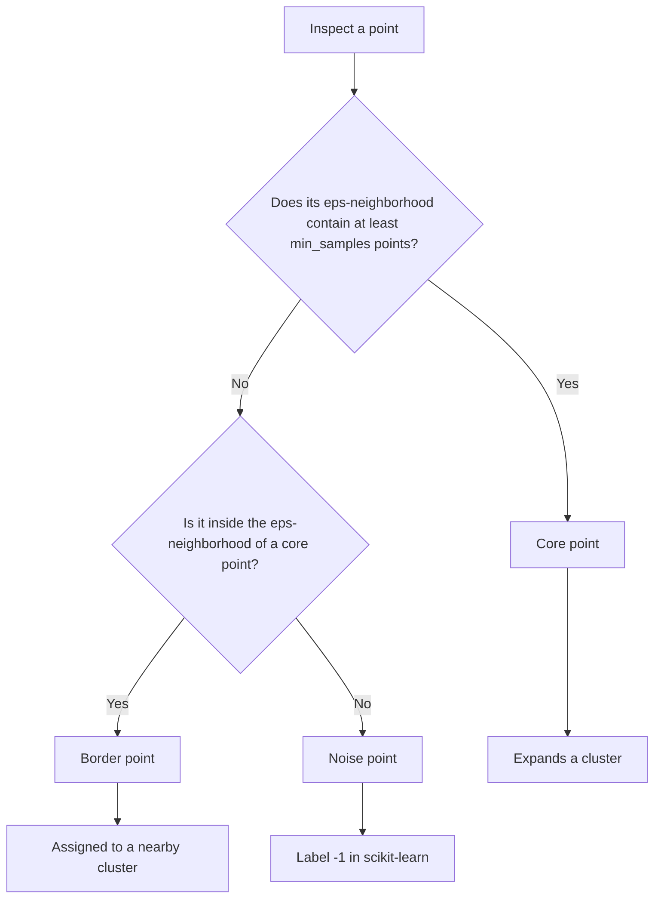
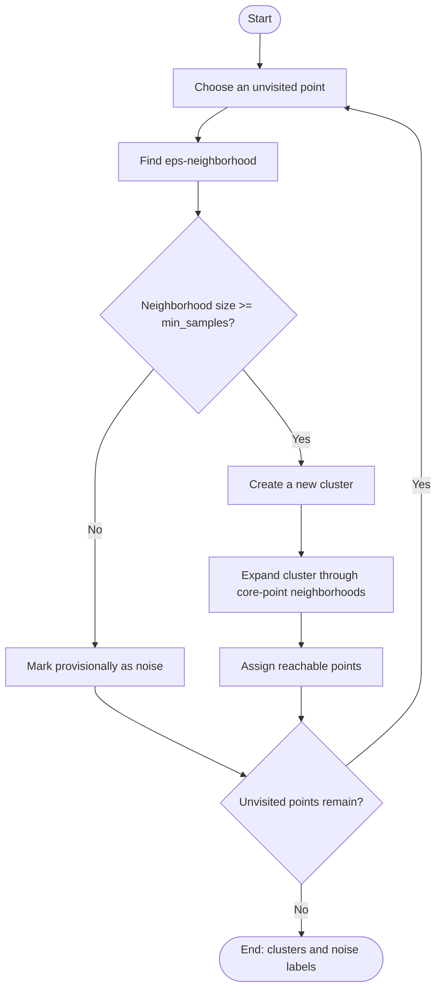
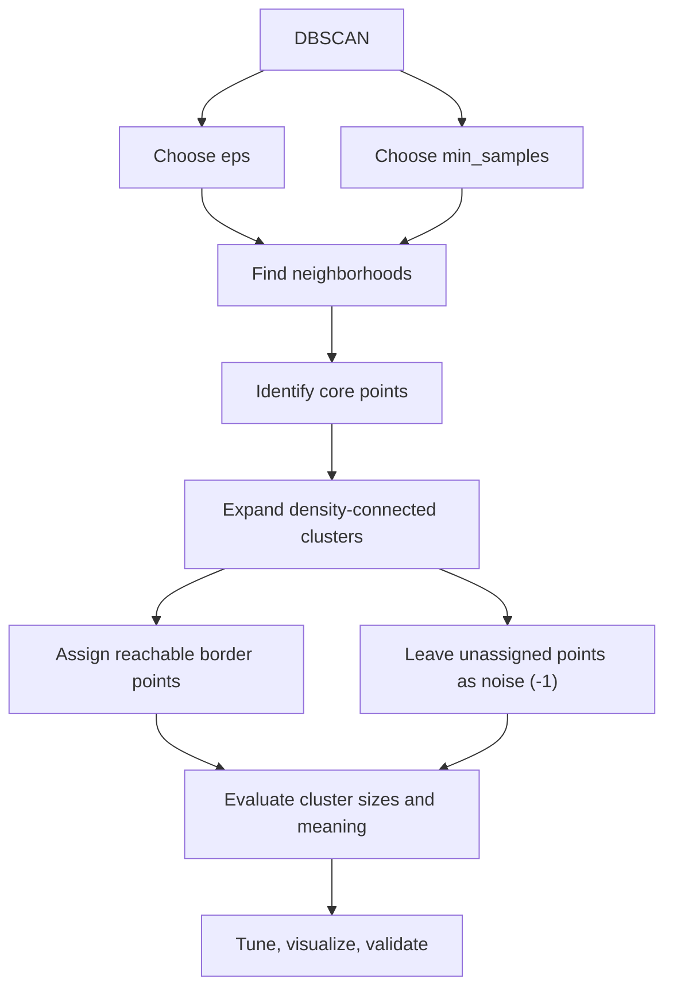

# 🧭 26. DBSCAN Clustering Algorithm

## 📌 Folder Overview
Welcome to the **DBSCAN (Density-Based Spatial Clustering of Applications with Noise)** module! DBSCAN is a density-based unsupervised clustering algorithm capable of discovering clusters of arbitrary shape while actively isolating noise and spatial outliers. This folder covers density reachability concepts, $\epsilon$-neighborhoods, minimum samples (`min_samples`), core/border/noise point classification, k-distance elbow plots for parameter selection, and non-linear cluster identification using Scikit-Learn.

### Why is this topic important?
Traditional partitioning algorithms like K-Means assume convex, spherical clusters and force every data point—including extreme anomalies—into a cluster. DBSCAN overcomes both limitations: it natively discovers clusters of arbitrary geometric topologies (e.g., concentric circles, interleaved crescents/moons) and explicitly labels low-density points as noise (label `-1`), making it indispensable for geospatial data, anomaly detection, and real-world spatial analytics.

### What You Will Learn
- **Density-Based Clustering Paradigm**: Defining clusters as continuous dense regions separated by sparse areas of low density.
- **Key Concepts & Point Classifications**:
  - **$\epsilon$-Neighborhood ($\text{eps}$)**: Radius defining the local search neighborhood around point $p$: $N_\epsilon(p) = \{q \in D \mid \text{dist}(p, q) \le \epsilon\}$.
  - **Minimum Samples ($\text{min\_samples}$)**: Threshold density count required to establish a dense region.
  - **Core Points**: Points having at least `min_samples` within distance $\epsilon$.
  - **Border Points**: Non-core points that fall within the $\epsilon$-neighborhood of a core point.
  - **Noise Points**: Outliers that are neither core nor border points (assigned label `-1`).
- **Density Reachability & Connectivity**: Directly density-reachable, density-reachable, and density-connected chains.
- **Heuristic Parameter Selection**:
  - Determining $\epsilon$ using the **K-Distance Graph** (sorting k-nearest neighbor distances and locating the inflection elbow).
  - Choosing `min_samples` based on dimensionality heuristic ($2 \times \text{dimensions}$).
- **Feature Scaling Prerequisite**: Why unstandardized features severely distort the isotropic $\epsilon$-sphere.
- **Practical Application**: Identifying intertwined non-linear patterns (moons, concentric rings) and filtering out spatial noise.

---

## 📚 Topics Covered

Organized logically from density intuition and reachability math to parameter estimation and complex geometry clustering:

### 🟢 Beginner
- **Limitations of K-Means**: Why centroid methods fail on non-spherical clusters.
- **Density Intuition**: Core points, border points, and noise points.
- **Understanding Noise**: How Scikit-Learn flags noise samples with label `-1`.

### 🟡 Intermediate
- **Hyperparameter Tuning**: Interplay between `eps` and `min_samples`.
- **Distance Metrics**: Euclidean, Manhattan, and Haversine (geospatial coordinates).
- **The K-Distance Graph**: Using nearest-neighbor distance elbow plots to choose optimal $\epsilon$.
- **Hands-on Demonstration**: Clustering complex geometries in `dbscan_demo.ipynb`.

### 🔴 Advanced
- **Algorithmic Complexity**: $\mathcal{O}(n \log n)$ with spatial index trees (k-d trees, BallTrees) vs $\mathcal{O}(n^2)$ worst-case.
- **Limitations & Pitfalls**: Inability to handle clusters with varying densities and sensitivity to high-dimensional sparsity.
- **Modern Extensions**: **OPTICS** (ordering points) and **HDBSCAN** (hierarchical density-based clustering).
- **Industry Applications**: Anomaly detection, GPS trajectory mining, fraud rings, and image segmentation.

| File / Notebook | Focus Area | Key Concepts & Tools | Level |
| :--- | :--- | :--- | :--- |
| `dbscan_demo.ipynb` | Hands-on clustering on complex geometries. | `sklearn.cluster.DBSCAN`, `make_moons`, `make_circles`, noise filtering. | Intermediate |
| `README.md (Complete Notes)` | Theoretical and mathematical master guide. | Density reachability math, parameter tuning, 20+ interview Q&As, cheat sheet. | Comprehensive Reference |

---

## 📂 File Structure

The module is organized as a self-contained, end-to-end master guide covering theory, mathematical formulations, Scikit-Learn pipelines, non-linear visualizations, and real-world spatial clustering use cases:

```text
26_DBSCAN Clustering Algorithms/
├── dbscan_demo.ipynb
└── README.md
```

---

# 🧭 DBSCAN Clustering Algorithm — Complete Notes

## 📚 Table of Contents

1. [Introduction to DBSCAN](#1--introduction-to-dbscan)
2. [Why DBSCAN?](#2--why-dbscan)
3. [Core Terminology](#3--core-terminology)
4. [How DBSCAN Works](#4--how-dbscan-works)
5. [Important Parameters](#5--important-parameters)
6. [Mathematical Foundation](#6--mathematical-foundation)
7. [DBSCAN Workflow](#7--dbscan-workflow)
8. [DBSCAN vs Other Clustering Algorithms](#8--dbscan-vs-other-clustering-algorithms)
9. [Practical Python Example](#9--practical-python-example)
10. [Choosing `eps` and `min_samples`](#10--choosing-eps-and-min_samples)
11. [Feature Scaling and Distance Metrics](#11--feature-scaling-and-distance-metrics)
12. [Visualizing Clusters and Noise](#12--visualizing-clusters-and-noise)
13. [Real-World Use Cases](#13--real-world-use-cases)
14. [Mini-Project: Customer Location Clustering](#14--mini-project-customer-location-clustering)
15. [Advantages and Limitations](#15--advantages-and-limitations)
16. [Common Mistakes and Best Practices](#16--common-mistakes-and-best-practices)
17. [Advanced Concepts](#17--advanced-concepts)
18. [Interview Questions and Answers](#18--interview-questions-and-answers)
19. [Quick Revision](#19--quick-revision)

---

## 1. 🎯 Introduction to DBSCAN

**DBSCAN** stands for **Density-Based Spatial Clustering of Applications with Noise**. It is an unsupervised machine learning algorithm that groups data points located in sufficiently dense regions and identifies points in sparse regions as noise or outliers.

Unlike algorithms such as K-Means, DBSCAN does not require the number of clusters to be specified in advance. It can discover clusters with irregular shapes, provided those clusters can be separated by regions of sufficiently low density.

### Key characteristics

- **Learning type:** Unsupervised learning.
- **Approach:** Density-based clustering.
- **Number of clusters:** Not required beforehand.
- **Cluster shape:** Can identify non-spherical and irregularly shaped clusters.
- **Noise handling:** Explicitly labels points that do not belong to a sufficiently dense cluster.
- **Typical output:** A cluster label for every sample; scikit-learn uses `-1` for noise.

### Intuition

Imagine people standing in a park. Groups of people standing close together form dense groups. A person standing far away from every group may be treated as noise. DBSCAN discovers these groups by examining how many people are within a specified radius of each person.

---

## 2. 🤔 Why DBSCAN?

Many clustering algorithms work best when clusters have particular shapes or when the number of clusters is known. DBSCAN instead focuses on local density.

### Example

Suppose a dataset contains two crescent-shaped groups and several isolated points.

- K-Means may split the crescents incorrectly because it tends to create compact, centroid-based clusters.
- DBSCAN can follow the curved dense regions.
- Isolated points can be labeled as noise instead of being forced into a cluster.

### When to consider DBSCAN

Use DBSCAN when:
- The number of clusters is unknown.
- Clusters may have irregular shapes.
- Outlier identification is useful.
- A meaningful distance measure can be defined.
- The data contains regions with distinguishable density.

Avoid assuming DBSCAN will work well when cluster densities vary greatly or when distances become uninformative in very high-dimensional data.

---

## 3. 🧩 Core Terminology

DBSCAN uses two main parameters: `eps` and `min_samples`.

| Term | Meaning |
|---|---|
| **Epsilon (`eps`)** | Radius of the neighborhood around a point. |
| **Minimum samples (`min_samples`)** | Minimum number of points required in an `eps`-neighborhood for a point to qualify as a core point. In scikit-learn, the count includes the point itself. |
| **Epsilon-neighborhood** | All points whose distance from a given point is less than or equal to `eps`. |
| **Core point** | A point whose neighborhood contains at least `min_samples` points. |
| **Border point** | A point that is not core itself but lies within the neighborhood of a core point. |
| **Noise point** | A point that is neither a core point nor assigned to a cluster as a border point. |
| **Density-reachable** | A point can be reached from another through a chain of core points, with each step satisfying the neighborhood condition. |
| **Density-connected** | Two points are density-connected when a point exists from which both are density-reachable. |
| **Cluster** | A maximal group connected through density relationships. |

### Core, border, and noise points



**Important:** A point initially identified as noise may later be assigned to a cluster if it is found to be a border point of a core point. A border point does not expand a cluster in the same way as a core point.

---

## 4. ⚙️ How DBSCAN Works

The algorithm explores neighborhoods and expands clusters from core points.

### Step-by-step process

1. Select an unvisited data point.
2. Find all points within its `eps` radius.
3. If the neighborhood contains fewer than `min_samples` points, provisionally mark the point as noise.
4. Otherwise, start a new cluster and add the point's neighborhood.
5. For each neighboring point:
   - If it has not been visited, inspect its neighborhood.
   - If it is a core point, add its neighbors to the expansion process.
   - If it is not yet assigned to a cluster, assign it to the current cluster.
6. Continue until the cluster cannot be expanded further.
7. Repeat for the remaining unvisited points.

### Algorithm flowchart



### Pseudocode

```text
for each point P:
    if P has already been visited:
        continue

    mark P as visited
    neighbors = points within eps of P

    if number of neighbors < min_samples:
        mark P as noise
    else:
        create a new cluster
        add P and its neighbors to the cluster

        for each point Q in the cluster's expansion queue:
            if Q has not been visited:
                mark Q as visited
                Q_neighbors = points within eps of Q

                if number of Q_neighbors >= min_samples:
                    add Q_neighbors to the expansion queue

            if Q is not yet assigned to any cluster:
                assign Q to the current cluster
```

This is conceptual pseudocode. Implementations commonly optimize neighborhood queries and cluster expansion.

---

## 5. 🎛️ Important Parameters

### 5.1 `eps`

`eps` defines the neighborhood radius.

- **Too small:** Many points may be classified as noise; clusters may fragment.
- **Too large:** Separate clusters may merge, and more points may become connected.
- It must be chosen relative to the scale of the features and the chosen distance metric.

### 5.2 `min_samples`

`min_samples` controls how much local density is required.

- **Smaller value:** More points qualify as core points; clusters may form more easily.
- **Larger value:** Denser regions are required; more points may be classified as noise.
- A common starting point is `min_samples = 2 × number_of_features`, but this is only a heuristic, not a universal rule.
- For noisy datasets, try several values and evaluate cluster stability and usefulness.

### Parameter summary

| Parameter | Meaning | If too low/small | If too high/large |
|---|---|---|---|
| `eps` | Neighborhood radius | Many noise points or fragmented clusters | Clusters may merge |
| `min_samples` | Density requirement | Weakly supported clusters may form | Only very dense regions qualify |
| `metric` | Distance calculation | Not a density threshold; inappropriate metrics distort neighborhoods | Not applicable |
| `metric_params` | Extra metric options | Depends on metric | Depends on metric |
| `algorithm` | Neighbor-search strategy | Does not change the intended clustering definition | May affect speed or compatibility |
| `leaf_size` | Tree-based search tuning | Usually affects performance only | Usually affects performance only |
| `n_jobs` | Parallelism for neighbor search where supported | Fewer resources used | More CPU resources may be used |

### Scikit-learn signature

```python
from sklearn.cluster import DBSCAN

model = DBSCAN(
    eps=0.5,
    min_samples=5,
    metric="euclidean",
    algorithm="auto",
    leaf_size=30,
    n_jobs=None
)
```

---

## 6. 📐 Mathematical Foundation

Let the dataset be:

\[
D = \{x_1, x_2, \ldots, x_n\}
\]

Let \(d(x_i, x_j)\) be the distance between points \(x_i\) and \(x_j\).

### 6.1 Epsilon-neighborhood

The neighborhood of point \(x_i\) is:

\[
N_{\varepsilon}(x_i) =
\{x_j \in D \mid d(x_i,x_j) \leq \varepsilon\}
\]

### 6.2 Core-point condition

A point \(x_i\) is a core point if:

\[
|N_{\varepsilon}(x_i)| \geq \text{min\_samples}
\]

In scikit-learn, the point itself is included in this count when its distance to itself is zero and the metric behaves as expected.

### 6.3 Distance example

Suppose two points are:

\[
A=(1,2), \quad B=(4,6)
\]

Their Euclidean distance is:

\[
d(A,B)=\sqrt{(4-1)^2+(6-2)^2}
=\sqrt{9+16}=5
\]

If `eps = 5`, the points are neighbors under the usual inclusive radius condition.

### 6.4 Density-based cluster

A cluster is formed by core points connected through density reachability, together with border points reachable from the core-point region. Noise points do not belong to any discovered cluster.

---

## 7. 🗺️ DBSCAN Workflow


### Recommended workflow

1. Understand what a point represents.
2. Remove or handle missing and invalid values.
3. Select meaningful features.
4. Scale features when their units or ranges differ.
5. Select a distance metric appropriate to the data.
6. Estimate `eps`, for example using a k-distance plot.
7. Fit DBSCAN.
8. Count clusters and noise points.
9. Visualize results where possible.
10. Assess whether the clusters are meaningful for the domain.

---

## 8. ⚖️ DBSCAN vs Other Clustering Algorithms

| Feature | DBSCAN | K-Means | Agglomerative Hierarchical | Mean Shift |
|---|---|---|---|---|
| Learning type | Unsupervised | Unsupervised | Unsupervised | Unsupervised |
| Must specify cluster count? | No | Yes (`n_clusters`) | Often yes when cutting the hierarchy | No, but bandwidth matters |
| Cluster shape | Arbitrary shapes when density-connected | Best for compact, centroid-based groups | Depends on linkage and distance | Density-based modes |
| Noise handling | Explicitly identifies noise | No native noise label | No native noise label in standard use | Can leave some points unassigned in some implementations |
| Varying density | Often struggles | Not designed around density | Depends on linkage | Depends on bandwidth |
| Scalability | Depends on neighborhood search and data | Often efficient | Can be expensive | Can be expensive |
| Main parameter | `eps`, `min_samples` | `n_clusters` | Linkage, distance, cut | Bandwidth |
| Typical strength | Irregular clusters and outliers | Large datasets with compact clusters | Hierarchical structure | Finding density modes |

### DBSCAN vs K-Means

Choose **DBSCAN** when noise detection and irregular cluster shapes matter. Choose **K-Means** when clusters are reasonably compact, centroid-based partitioning makes sense, and a target cluster count is available or can be estimated.

### DBSCAN vs Hierarchical Clustering

DBSCAN produces clusters from density connectivity rather than a full hierarchy of merges. Hierarchical clustering can reveal nested groupings but may require more memory or computation for large datasets.

---

## 9. 🐍 Practical Python Example

This example creates two curved clusters and adds random noise. DBSCAN should identify the dense curved groups and may label isolated points as noise.

### 9.1 Install dependencies

```bash
pip install numpy pandas matplotlib scikit-learn
```

### 9.2 Generate data and fit DBSCAN

```python
import numpy as np
import matplotlib.pyplot as plt

from sklearn.cluster import DBSCAN
from sklearn.datasets import make_moons
from sklearn.preprocessing import StandardScaler

# Generate two interleaving half-circle clusters.
X, _ = make_moons(
    n_samples=500,
    noise=0.07,
    random_state=42
)

# Add a few random points as potential outliers.
rng = np.random.default_rng(42)
outliers = rng.uniform(
    low=-1.5,
    high=2.5,
    size=(25, 2)
)
X = np.vstack([X, outliers])

# Scale features before distance-based clustering.
X_scaled = StandardScaler().fit_transform(X)

# Fit DBSCAN.
dbscan = DBSCAN(
    eps=0.20,
    min_samples=5,
    metric="euclidean"
)
labels = dbscan.fit_predict(X_scaled)

# Summary.
unique_labels = set(labels)
n_clusters = len(unique_labels - {-1})
n_noise = int(np.sum(labels == -1))

print(f"Number of clusters: {n_clusters}")
print(f"Number of noise points: {n_noise}")
print("Cluster sizes:")

for label in sorted(unique_labels):
    count = int(np.sum(labels == label))
    name = "Noise" if label == -1 else f"Cluster {label}"
    print(f"{name}: {count} points")

# Visualize clusters.
plt.figure(figsize=(9, 6))

for label in sorted(unique_labels):
    mask = labels == label

    if label == -1:
        plt.scatter(
            X[mask, 0],
            X[mask, 1],
            marker="x",
            s=45,
            label="Noise"
        )
    else:
        plt.scatter(
            X[mask, 0],
            X[mask, 1],
            s=30,
            label=f"Cluster {label}"
        )

plt.title("DBSCAN Clustering")
plt.xlabel("Feature 1")
plt.ylabel("Feature 2")
plt.legend()
plt.tight_layout()
plt.show()
```

### Explanation

- `make_moons()` creates two non-linear clusters.
- Random points are added to simulate possible outliers.
- `StandardScaler` standardizes each feature.
- `DBSCAN` identifies dense groups using `eps` and `min_samples`.
- `fit_predict()` returns a cluster label for each sample.
- Label `-1` represents noise in scikit-learn.
- The exact number of clusters and noise points depends on the data and parameters.

**Note:** Scaling changes the distance geometry. The selected `eps` applies to the scaled data, not directly to the original feature units.

### 9.3 Inspect core samples

```python
core_indices = dbscan.core_sample_indices_
core_points = X_scaled[core_indices]

print("Number of core points:", len(core_indices))
print("Core point array shape:", core_points.shape)
```

`core_sample_indices_` contains indices of core samples in the fitted input array.

### 9.4 Use a pandas DataFrame

```python
import pandas as pd

results = pd.DataFrame(X, columns=["feature_1", "feature_2"])
results["cluster"] = labels
results["point_type"] = np.where(
    results["cluster"] == -1,
    "Noise",
    "Clustered"
)

print(results.head())
print(results["cluster"].value_counts().sort_index())
```

This makes it easy to export results or join cluster labels with other records.

---

## 10. 🔍 Choosing `eps` and `min_samples`

Parameter selection is one of the most important parts of using DBSCAN.

### 10.1 K-distance plot

A k-distance plot sorts each point's distance to its k-th nearest neighbor. A bend or elbow in the curve can suggest a candidate `eps`.

For the usual DBSCAN convention in scikit-learn, select a k value consistent with the intended `min_samples` neighborhood count. The plot provides a heuristic, not a guaranteed optimum.

```python
import numpy as np
import matplotlib.pyplot as plt

from sklearn.neighbors import NearestNeighbors
from sklearn.preprocessing import StandardScaler

X_scaled = StandardScaler().fit_transform(X)

min_samples = 5

neighbors = NearestNeighbors(
    n_neighbors=min_samples,
    metric="euclidean"
)
neighbors.fit(X_scaled)

distances, _ = neighbors.kneighbors(X_scaled)

# The final column is the distance to the k-th neighbor.
k_distances = np.sort(distances[:, -1])

plt.figure(figsize=(9, 5))
plt.plot(k_distances)
plt.xlabel("Points sorted by k-distance")
plt.ylabel(f"Distance to {min_samples}-th nearest neighbor")
plt.title("DBSCAN k-Distance Plot")
plt.grid(True, alpha=0.3)
plt.tight_layout()
plt.show()
```

Look for a noticeable transition from slowly increasing distances to rapidly increasing distances. Test nearby `eps` values and inspect the resulting clusters rather than relying on the elbow alone.

### 10.2 Small parameter search

```python
from sklearn.cluster import DBSCAN

for eps in [0.15, 0.20, 0.25, 0.30]:
    for min_samples in [4, 5, 8]:
        labels = DBSCAN(
            eps=eps,
            min_samples=min_samples
        ).fit_predict(X_scaled)

        cluster_ids = set(labels) - {-1}
        n_clusters = len(cluster_ids)
        noise_ratio = np.mean(labels == -1)

        print(
            f"eps={eps:.2f}, min_samples={min_samples}, "
            f"clusters={n_clusters}, noise_ratio={noise_ratio:.2%}"
        )
```

Use the output to identify plausible configurations, then evaluate cluster quality and stability. Do not choose a configuration solely because it produces the most clusters or the least noise.

### 10.3 Evaluating clusters

Useful checks include:
- Number of clusters and size distribution.
- Percentage of samples labeled noise.
- Whether clusters make domain sense.
- Whether results remain similar under small parameter changes.
- Internal metrics such as silhouette score, used carefully.

Silhouette score can be misleading for density-based clusters with arbitrary shapes. It also requires at least two clusters and does not treat the noise label as an ordinary meaningful cluster by default. If using it, decide explicitly how noise will be handled.

---

## 11. 📏 Feature Scaling and Distance Metrics

DBSCAN relies on distances, so feature representation is crucial.

### 11.1 Why scaling matters

Suppose one feature is annual income (0–2,000,000) and another is age (18–80). Without scaling, income may dominate Euclidean distance.

Common scaling choices:

| Method | What it does | Typical use |
|---|---|---|
| `StandardScaler` | Centers each feature and scales to unit variance | Features with different units and roughly well-behaved distributions |
| `MinMaxScaler` | Scales values to a specified range, often 0–1 | Features where bounded scaling is useful |
| `RobustScaler` | Uses median and interquartile range | Features with substantial outliers |
| No scaling | Preserves original units | Only when units and distance interpretation are intentional |

```python
from sklearn.preprocessing import StandardScaler

X_scaled = StandardScaler().fit_transform(X)
```

Do not scale blindly: for geospatial coordinates, timestamps, categorical values, or domain-specific measurements, choose a representation and distance metric that reflect the problem.

### 11.2 Common distance metrics

| Metric | Meaning | Typical use |
|---|---|---|
| Euclidean | Straight-line distance | Continuous numerical features |
| Manhattan | Sum of absolute coordinate differences | Grid-like or some high-dimensional settings |
| Minkowski | Generalized distance; includes Euclidean and Manhattan | Configurable numeric distance |
| Cosine | Compares vector direction | Text embeddings and high-dimensional vectors, with careful metric interpretation |
| Haversine | Great-circle angular distance | Latitude/longitude coordinates, when input units and API requirements are respected |

Example:

```python
from sklearn.cluster import DBSCAN

model = DBSCAN(
    eps=0.3,
    min_samples=5,
    metric="manhattan"
)
labels = model.fit_predict(X_scaled)
```

The meaning of `eps` depends on the metric. Do not reuse the same `eps` value across different metrics without reevaluating it.

---

## 12. 🎨 Visualizing Clusters and Noise

A scatter plot is useful for two-dimensional data. For more than two features, use a domain-relevant projection or dimensionality reduction for visualization, but remember that a projection can distort distances and apparent cluster shapes.

```python
import matplotlib.pyplot as plt
import numpy as np

unique_labels = np.unique(labels)

plt.figure(figsize=(8, 6))

for label in unique_labels:
    mask = labels == label

    if label == -1:
        plt.scatter(
            X_scaled[mask, 0],
            X_scaled[mask, 1],
            marker="x",
            label="Noise"
        )
    else:
        plt.scatter(
            X_scaled[mask, 0],
            X_scaled[mask, 1],
            label=f"Cluster {label}"
        )

plt.xlabel("Feature 1")
plt.ylabel("Feature 2")
plt.title("Clusters Identified by DBSCAN")
plt.legend()
plt.tight_layout()
plt.show()
```

### Interpreting the plot

- Points with the same non-negative label belong to the same cluster.
- Points labeled `-1` are noise.
- A cluster label is an identifier, not a rank or quality score.
- Cluster label numbers may change when the data order or parameters change.

---

## 13. 🌍 Real-World Use Cases

| Domain | Example | How DBSCAN helps | Important caution |
|---|---|---|---|
| Geospatial analysis | Grouping GPS pings around busy locations | Finds dense geographic regions and isolated observations | Use a geographic distance metric and meaningful radius |
| Fraud analytics | Exploring unusual transaction feature patterns | Can reveal dense behavior groups and outliers | Noise is not proof of fraud |
| Network security | Grouping similar event or traffic records | Helps explore dense patterns and anomalies | Feature engineering and domain validation are essential |
| Retail | Grouping customer behavior profiles | Finds density-based segments without choosing cluster count first | Scale numeric features and encode categories thoughtfully |
| Manufacturing | Detecting unusual sensor readings | Sparse observations may be flagged as noise | Sensor drift and changing operating regimes affect results |
| Image processing | Grouping nearby points or pixels | Can identify spatially dense regions | Feature and color distance choices affect results |
| Astronomy | Grouping nearby observations | Can discover dense regions in spatial data | Measurement uncertainty and variable density matter |
| Urban planning | Identifying hotspots of activity | Groups dense event locations | Sampling bias can create misleading hotspots |

**Important distinction:** DBSCAN labels points as noise according to its density criteria. A noise point is not automatically an error, threat, fraud case, or abnormal event.

---

## 14. 🧪 Mini-Project: Customer Location Clustering

### Objective

Cluster customer visit coordinates to identify areas with concentrated activity and flag isolated visits for further review.

### Dataset format

A CSV file named `customer_visits.csv`:

| latitude | longitude |
|---:|---:|
| 16.7050 | 74.2430 |
| 16.7060 | 74.2440 |
| 16.7045 | 74.2425 |
| 16.9000 | 74.5000 |

The values above are illustrative only. Replace them with authorized, appropriately anonymized location data.

### Why use Haversine?

Latitude and longitude are angular coordinates, not ordinary Cartesian coordinates. The Haversine metric estimates great-circle distance on a sphere. Scikit-learn's Haversine metric expects coordinates in **radians**, and `eps` is therefore an angular radius in radians.

### Complete example

```python
import numpy as np
import pandas as pd
import matplotlib.pyplot as plt

from sklearn.cluster import DBSCAN

# Load authorized customer visit coordinates.
df = pd.read_csv("customer_visits.csv")

required_columns = {"latitude", "longitude"}
if not required_columns.issubset(df.columns):
    raise ValueError(
        "CSV must contain latitude and longitude columns."
    )

df = df.dropna(subset=["latitude", "longitude"]).copy()

# Basic coordinate validation.
valid = (
    df["latitude"].between(-90, 90)
    & df["longitude"].between(-180, 180)
)
df = df.loc[valid].copy()

# Haversine expects [latitude, longitude] in radians.
coordinates_rad = np.radians(
    df[["latitude", "longitude"]].to_numpy()
)

# Earth mean radius is approximately 6,371,000 meters.
earth_radius_m = 6_371_000
radius_m = 250

# Convert the target radius from meters to angular radians.
eps_radians = radius_m / earth_radius_m

dbscan = DBSCAN(
    eps=eps_radians,
    min_samples=5,
    metric="haversine",
    algorithm="ball_tree"
)

df["cluster"] = dbscan.fit_predict(coordinates_rad)

n_clusters = len(set(df["cluster"]) - {-1})
noise_count = int((df["cluster"] == -1).sum())

print("Clusters:", n_clusters)
print("Noise visits:", noise_count)
print(df["cluster"].value_counts().sort_index())

# Simple latitude/longitude visualization.
plt.figure(figsize=(9, 6))

for cluster_id in sorted(df["cluster"].unique()):
    group = df[df["cluster"] == cluster_id]

    if cluster_id == -1:
        plt.scatter(
            group["longitude"],
            group["latitude"],
            marker="x",
            label="Noise"
        )
    else:
        plt.scatter(
            group["longitude"],
            group["latitude"],
            label=f"Cluster {cluster_id}"
        )

plt.xlabel("Longitude")
plt.ylabel("Latitude")
plt.title("Customer Visit Location Clusters")
plt.legend()
plt.tight_layout()
plt.show()

# Save cluster assignments.
df.to_csv("customer_visits_clustered.csv", index=False)
print("Saved customer_visits_clustered.csv")
```

### Project steps

1. Collect or obtain permission to use location records.
2. Validate and clean coordinates.
3. Convert latitude and longitude to radians.
4. Choose a meaningful radius and convert meters to radians.
5. Run DBSCAN with the Haversine metric.
6. Review cluster sizes and noise points.
7. Visualize results on a map or scatter plot.
8. Export labels and document the parameter choices.

### Possible extensions

- Compare activity by day or hour.
- Add a minimum visit count for a hotspot.
- Compare clusters across time windows.
- Create a map with cluster summaries.
- Evaluate whether results are stable across different radius values.

**Privacy note:** Location data can be sensitive. Use consented or authorized data, minimize retention, and avoid exposing individual movement patterns in reports.

---

## 15. ✅ Advantages and Limitations

### Advantages

- Does not require the number of clusters in advance.
- Finds clusters with irregular shapes.
- Explicitly identifies noise and outliers.
- Uses a relatively small set of core parameters.
- Works well when clusters are separated by low-density regions.
- Can be applied with different distance metrics supported by the implementation.

### Limitations

- A single global `eps` can struggle when clusters have very different densities.
- Results can be sensitive to `eps` and `min_samples`.
- Distance becomes less informative in high-dimensional spaces.
- Neighborhood search can be expensive for large datasets or unfavorable data structures.
- Feature scaling and metric choice can strongly affect results.
- Border points near multiple clusters may be assigned depending on traversal order and implementation details.
- It is not naturally suited to every mixed-type dataset without thoughtful distance design.

### When DBSCAN may not be the best choice

| Situation | Possible alternative |
|---|---|
| Clusters have widely varying densities | HDBSCAN or OPTICS |
| Need exactly `k` compact groups | K-Means or K-Medoids |
| Need a full hierarchy | Agglomerative clustering |
| Very high-dimensional sparse text data | Consider dimensionality reduction or algorithms suited to the representation |
| Very large datasets with suitable density assumptions | Consider scalable implementations or alternatives based on the problem |

---

## 16. 🛠️ Common Mistakes and Best Practices

### Common mistakes

1. **Choosing `eps` arbitrarily:** Use domain knowledge, k-distance plots, and parameter sensitivity checks.
2. **Ignoring feature scales:** Large-scale features can dominate distance.
3. **Assuming `-1` means a bad record:** It only means the point did not meet DBSCAN's cluster assignment conditions.
4. **Treating cluster IDs as meaningful order:** Labels are arbitrary identifiers.
5. **Using Euclidean distance for raw latitude/longitude:** Use an appropriate geographic metric and units.
6. **Expecting equal-density clusters to be discovered with one universal setting:** DBSCAN has one global density scale.
7. **Using silhouette score blindly:** It can penalize non-convex clusters and does not automatically handle noise appropriately.
8. **Clustering every feature available:** Irrelevant or redundant features can distort distances.
9. **Comparing `eps` values across different scalers or metrics:** Their units and interpretations differ.
10. **Calling noise a confirmed anomaly:** Validate with domain expertise.

### Best practices checklist

- [ ] Understand what one sample represents.
- [ ] Inspect missing values, outliers, and feature distributions.
- [ ] Select features based on the task.
- [ ] Scale features when appropriate.
- [ ] Choose a distance metric that reflects similarity.
- [ ] Use a k-distance plot as a starting point.
- [ ] Test a range of `eps` and `min_samples` values.
- [ ] Record cluster counts, cluster sizes, and noise ratio.
- [ ] Visualize clusters and inspect representative samples.
- [ ] Check stability under modest parameter changes.
- [ ] Validate results with domain knowledge.
- [ ] Document preprocessing, metric, parameters, and software versions.

---

## 17. 🚀 Advanced Concepts

### 17.1 Complexity and performance

The practical runtime depends on the number of samples, dimensionality, metric, and neighborhood-search method. With efficient spatial indexes in favorable low-dimensional settings, DBSCAN can perform well. In unfavorable settings, neighborhood queries can become expensive; memory use can also grow substantially when many points have large neighborhoods.

Avoid relying on a single complexity figure without stating assumptions about the implementation and data.

### 17.2 DBSCAN and high-dimensional data

In high dimensions, distances between points can become less discriminative. This can make a meaningful `eps` difficult to choose.

Potential strategies:
- Remove irrelevant features.
- Use domain-informed feature engineering.
- Consider PCA for numerical data when appropriate.
- Explore suitable embeddings for text or images.
- Evaluate whether the transformed representation preserves the neighborhoods relevant to the task.

Dimensionality reduction is not automatically beneficial: it can change density structure and neighborhood relationships.

### 17.3 OPTICS

**OPTICS** (Ordering Points To Identify the Clustering Structure) explores density structure across a range of neighborhood radii. It can be useful when density varies and one global `eps` is not adequate.

### 17.4 HDBSCAN

**HDBSCAN** (Hierarchical Density-Based Spatial Clustering of Applications with Noise) builds a hierarchy of density-based clusters and extracts relatively stable clusters. It often handles varying densities better than classic DBSCAN, although it introduces its own parameters and trade-offs.

### 17.5 DBSCAN in scikit-learn

```python
from sklearn.cluster import DBSCAN, OPTICS

dbscan_labels = DBSCAN(
    eps=0.3,
    min_samples=5
).fit_predict(X_scaled)

optics_labels = OPTICS(
    min_samples=5,
    xi=0.05
).fit_predict(X_scaled)
```

Check the installed scikit-learn documentation for available parameters and behavior in your version.

### 17.6 Sample weights

Scikit-learn's DBSCAN supports `sample_weight`. Weights influence the density calculation, allowing samples to contribute different amounts to neighborhood density. Use weights only when they have a defensible meaning in the data; do not use them merely to force a desired cluster structure.

```python
from sklearn.cluster import DBSCAN

weights = np.ones(len(X_scaled))

model = DBSCAN(
    eps=0.3,
    min_samples=5
)
labels = model.fit_predict(
    X_scaled,
    sample_weight=weights
)
```

This example uses equal weights and is functionally similar to fitting without explicit weights.

### 17.7 Reproducibility

DBSCAN itself does not use random initialization like K-Means. However, reproducibility still depends on the dataset, preprocessing, software version, metric implementation, and handling of ambiguous border points. Fix random seeds for any randomized preprocessing or data generation.

---

## 18. 🎤 Interview Questions and Answers

### Q1. What is DBSCAN?

DBSCAN is a density-based unsupervised clustering algorithm that discovers dense regions and labels sufficiently isolated points as noise.

### Q2. What does DBSCAN stand for?

Density-Based Spatial Clustering of Applications with Noise.

### Q3. Which two parameters are most important?

`eps`, the neighborhood radius, and `min_samples`, the minimum neighborhood count needed for a core point.

### Q4. What is a core point?

A point with at least `min_samples` points in its `eps`-neighborhood, including itself in scikit-learn's usual implementation.

### Q5. What is a border point?

A non-core point that lies within the neighborhood of a core point and can therefore be assigned to a cluster.

### Q6. What is a noise point?

A point that is not part of any discovered cluster. Scikit-learn represents noise with label `-1`.

### Q7. Does DBSCAN require the number of clusters in advance?

No. The number of clusters is determined by the density structure and chosen parameters.

### Q8. Can DBSCAN find non-spherical clusters?

Yes. It can find irregular shapes when points are connected through sufficiently dense regions.

### Q9. What happens when `eps` is too small?

Many points may become noise, and clusters may split into smaller components.

### Q10. What happens when `eps` is too large?

Clusters may merge, and points from separate dense regions may become connected.

### Q11. What happens when `min_samples` increases?

A denser neighborhood is required for a point to qualify as a core point. This often produces fewer core points and more noise, though the exact result depends on the data and `eps`.

### Q12. How is DBSCAN different from K-Means?

DBSCAN uses local density, does not require a preselected cluster count, can identify noise, and can find irregularly shaped clusters. K-Means partitions data around centroids and is most suitable for compact groups.

### Q13. Why is feature scaling important?

Because DBSCAN relies on distance. Features with larger numerical scales can dominate distance calculations if scaling is not appropriate.

### Q14. How can `eps` be estimated?

A k-distance plot can help identify an elbow that suggests a candidate radius. The candidate should then be tested and validated.

### Q15. What are DBSCAN's major limitations?

Sensitivity to parameter choice, difficulty with widely varying cluster densities, and reduced distance quality in high-dimensional spaces.

### Q16. What are OPTICS and HDBSCAN?

They are density-based alternatives that can help explore clustering structure across varying densities rather than relying on one global DBSCAN radius.

### Q17. Is every noise point an outlier?

No. It is a point not assigned to a cluster under the chosen settings. It may be valid data from a rare or under-sampled region.

### Q18. What does `fit_predict()` return?

An array of cluster labels, one per input sample. In scikit-learn, `-1` indicates noise.

### Q19. Can DBSCAN cluster geographic coordinates?

Yes, when an appropriate distance metric and units are used. With scikit-learn's Haversine metric, coordinates must be supplied in radians and `eps` is angular.

### Q20. How do you evaluate DBSCAN?

Inspect cluster count and sizes, noise ratio, domain relevance, stability across parameters, and suitable internal or external metrics. No single score is sufficient for every density-based clustering task.

---

## 19. ⚡ Quick Revision

### Key points

- **DBSCAN:** Density-Based Spatial Clustering of Applications with Noise.
- **Type:** Unsupervised, density-based clustering.
- **Main parameters:** `eps` and `min_samples`.
- **Core point:** Has at least `min_samples` points in its `eps`-neighborhood.
- **Border point:** Is not core but is reachable from a core point.
- **Noise:** Not assigned to a cluster; represented by `-1` in scikit-learn.
- **Cluster count:** Not specified in advance.
- **Shape:** Can discover irregular, non-spherical clusters.
- **Main challenge:** One global density scale may not fit clusters with very different densities.
- **Preprocessing:** Feature scaling and metric choice are often critical.

### Important formulas

**Epsilon-neighborhood**

\[
N_{\varepsilon}(x_i)=
\{x_j \mid d(x_i,x_j)\leq\varepsilon\}
\]

**Core-point condition**

\[
|N_{\varepsilon}(x_i)| \geq \text{min\_samples}
\]

**Euclidean distance**

\[
d(x,y)=\sqrt{\sum_{i=1}^{m}(x_i-y_i)^2}
\]

**Approximate conversion for geographic DBSCAN**

\[
\varepsilon_{\text{radians}}
\approx
\frac{\text{radius in meters}}{6{,}371{,}000}
\]

Use this conversion with the Haversine metric and coordinates in radians.

### Important commands

```python
from sklearn.cluster import DBSCAN

model = DBSCAN(
    eps=0.5,
    min_samples=5,
    metric="euclidean"
)

labels = model.fit_predict(X)
```

```python
# Number of clusters, excluding the noise label -1
n_clusters = len(set(labels) - {-1})

# Number and proportion of noise samples
n_noise = int((labels == -1).sum())
noise_ratio = (labels == -1).mean()

# Indices of core samples after fitting
core_indices = model.core_sample_indices_
```

### Quick comparison

| Question | Answer |
|---|---|
| Need to specify number of clusters? | No |
| Can find irregular shapes? | Yes |
| Can identify noise? | Yes, label `-1` in scikit-learn |
| Most important parameter? | `eps`, together with `min_samples` |
| Best way to begin selecting `eps`? | Domain knowledge and a k-distance plot |
| Main weakness? | Varying densities and high-dimensional distance problems |
| Alternatives for varying densities? | OPTICS and HDBSCAN |

### Visual summary / roadmap



### Final memory trick 🧠

**“Radius + Density → Clusters + Noise.”**

- `eps` answers: **How close must points be?**
- `min_samples` answers: **How many nearby points make a region dense?**
- Core points grow clusters.
- Border points join clusters but do not expand them.
- Noise points remain unassigned unless later reached by a cluster.
