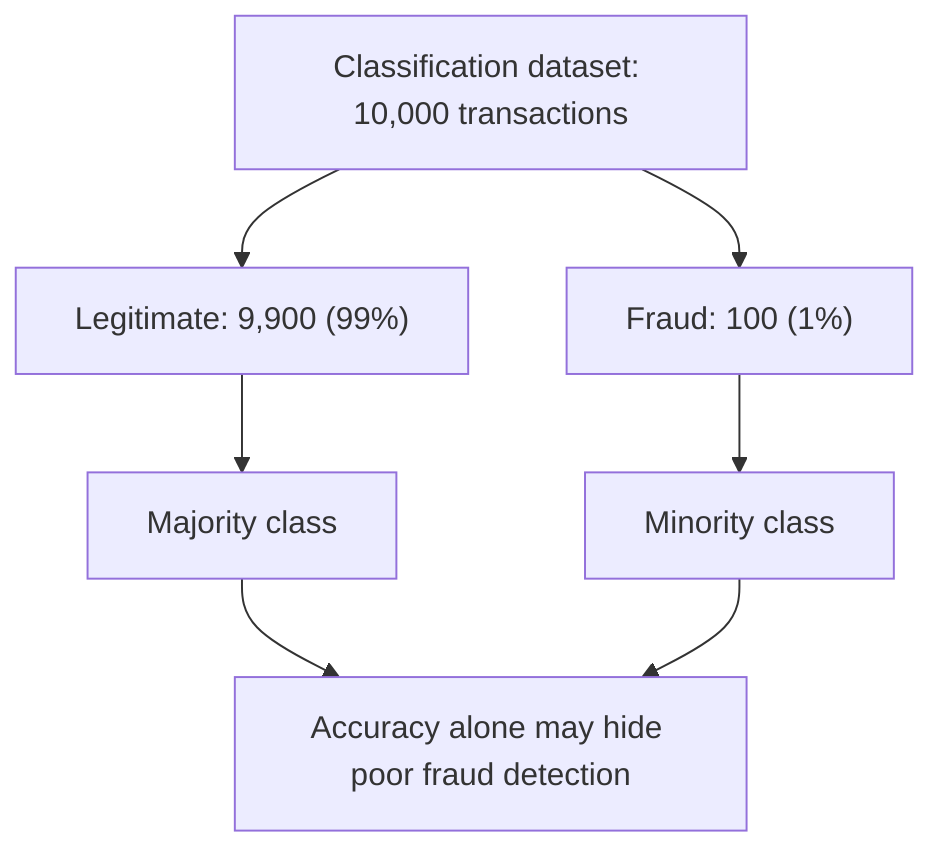
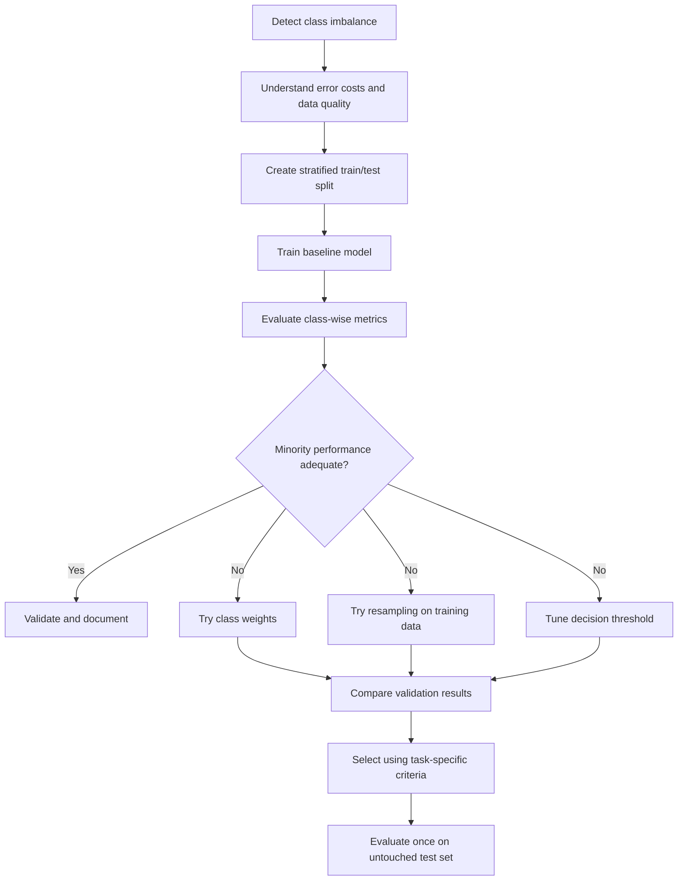
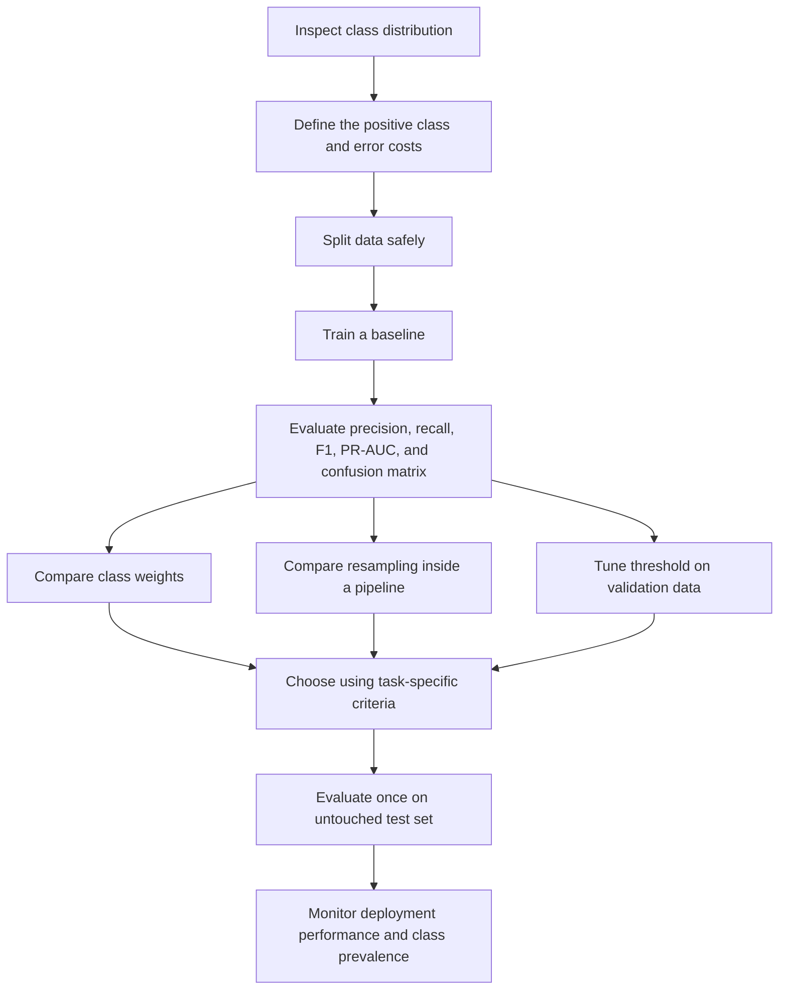

# ⚖️ 27. Handling Imbalanced Data in Machine Learning

## 📌 Folder Overview
Welcome to the **Handling Imbalanced Data in Machine Learning** module! Class imbalance is one of the most prevalent and critical challenges in applied data science, occurring whenever one target class dramatically outnumbers the other. This folder covers the accuracy paradox, appropriate evaluation metrics (Precision-Recall AUC, F1-Score, Balanced Accuracy), data-level resampling techniques (Random Undersampling, Random Oversampling, SMOTE, Borderline-SMOTE, ADASYN, Tomek Links), cost-sensitive learning (`class_weight='balanced'`), threshold tuning, and data-leakage-free cross-validation pipelines using `imbalanced-learn` and `scikit-learn`.

### Why is this topic important?
Standard machine learning algorithms minimize global loss functions, which incentivizes them to favor the majority class while ignoring rare minority events. In critical applications like credit card fraud detection, disease diagnosis, equipment breakdown, and cybersecurity intrusion, missing the minority class carries catastrophic costs. Mastering imbalance strategies ensures models deliver high recall and actionable precision on rare, high-value patterns.

### What You Will Learn
- **The Imbalance Problem & Accuracy Paradox**: Why a model achieving 99% accuracy can be utterly useless if it predicts only the majority class.
- **Robust Evaluation Metrics**:
  - Why ROC-AUC can provide an overly optimistic assessment under severe class skew.
  - Using Precision-Recall Curves & **PR-AUC (Average Precision)** as the true metric of merit.
  - Confusion matrix decomposition: Sensitivity (Recall), Specificity, Precision, F1-Score, and Balanced Accuracy.
- **Resampling Methodologies (`imbalanced-learn`)**:
  - **Undersampling**: Random Under-Sampling (RUS), Tomek Links, and Edited Nearest Neighbors (ENN).
  - **Oversampling**: Random Over-Sampling (ROS), **SMOTE** (Synthetic Minority Over-sampling Technique), **Borderline-SMOTE**, and **ADASYN**.
  - **Hybrid Combinations**: SMOTE + Tomek Links, SMOTE + ENN.
- **Algorithmic Solutions & Cost-Sensitive Learning**:
  - Applying inverse-frequency loss weighting using `class_weight='balanced'`.
  - Focal Loss concepts for extreme disparities.
- **Decision Threshold Optimization**: Moving decision thresholds away from default 0.5 using PR curves and Youden's $J$ statistic.
- **Preventing Data Leakage**: Enforcing that synthetic oversampling runs strictly inside cross-validation training folds using `imblearn.pipeline.Pipeline`.

---

## 📚 Topics Covered

Organized logically from imbalance detection and metric evaluation to advanced synthetic resampling and leak-free pipelines:

### 🟢 Beginner
- **Understanding Class Disparity**: Identifying Mild (20-40%), Moderate (1-20%), and Extreme (<1%) imbalances.
- **The Accuracy Paradox**: Demonstrating why accuracy fails on imbalanced classification.
- **Core Diagnostic Metrics**: Precision, Recall, and the $F_1$ harmonic mean.

### 🟡 Intermediate
- **Data-Level Resampling**: Random Undersampling vs Random Oversampling trade-offs.
- **Synthetic Sample Generation (SMOTE)**: Feature-space interpolation between minority $k$-nearest neighbors.
- **Cost-Sensitive Learning**: Penalizing minority classification mistakes via `class_weight='balanced'`.
- **Hands-on Demonstration**: Training and testing classifiers on imbalanced datasets in `imbalanced_data_yt.ipynb`.

### 🔴 Advanced
- **Preventing Data Leakage in Cross-Validation**: Building robust pipelines with `imblearn.pipeline.Pipeline` and `StratifiedKFold`.
- **Advanced Variants**: Borderline-SMOTE (focusing on decision boundaries) and ADASYN (adaptive density distribution).
- **Ensemble Techniques**: Balanced Random Forest, EasyEnsemble, and RUSBoost.
- **One-Class Reformulation**: Framing extreme imbalance as Anomaly Detection (Isolation Forest, One-Class SVM).

| File / Notebook | Focus Area | Key Concepts & Tools | Level |
| :--- | :--- | :--- | :--- |
| `imbalanced_data_yt.ipynb` | Hands-on resampling & modeling workflows. | `imblearn`, SMOTE, Undersampling, threshold tuning, metric comparisons. | Intermediate |
| `README.md (Complete Notes)` | Comprehensive theoretical reference manual. | SMOTE math, cost-sensitive matrices, leak-free pipelines, interview Q&As. | Comprehensive Reference |

---

## 📂 File Structure

The module is organized as a self-contained, end-to-end master guide covering theory, mathematical formulations, Scikit-Learn and Imbalanced-Learn pipelines, metric visualizations, and production best practices:

```text
27_Imbalanced Data in Machine Learning/
├── imbalanced_data_yt.ipynb
└── README.md
```

---

# ⚖️ Imbalanced Data in Machine Learning — Complete Notes

## 📚 Table of Contents

1. [Introduction to Imbalanced Data](#1--introduction-to-imbalanced-data)
2. [Class Imbalance: An Example](#2--class-imbalance-an-example)
3. [Why Imbalanced Data Is a Problem](#3--why-imbalanced-data-is-a-problem)
4. [Types and Levels of Imbalance](#4--types-and-levels-of-imbalance)
5. [How to Detect Class Imbalance](#5--how-to-detect-class-imbalance)
6. [Why Accuracy Can Be Misleading](#6--why-accuracy-can-be-misleading)
7. [Evaluation Metrics for Imbalanced Data](#7--evaluation-metrics-for-imbalanced-data)
8. [Strategies to Handle Imbalanced Data](#8--strategies-to-handle-imbalanced-data)
9. [Resampling Techniques](#9--resampling-techniques)
10. [Class Weights and Cost-Sensitive Learning](#10--class-weights-and-cost-sensitive-learning)
11. [Threshold Tuning and Probability Calibration](#11--threshold-tuning-and-probability-calibration)
12. [Train-Test Splitting and Cross-Validation](#12--train-test-splitting-and-cross-validation)
13. [Practical Python Example](#13--practical-python-example)
14. [Advanced Techniques](#14--advanced-techniques)
15. [Real-World Applications](#15--real-world-applications)
16. [Advantages, Limitations, and Trade-Offs](#16--advantages-limitations-and-trade-offs)
17. [Common Mistakes and Best Practices](#17--common-mistakes-and-best-practices)
18. [Interview Questions and Answers](#18--interview-questions-and-answers)
19. [Quick Revision](#19--quick-revision)

---

## 1. 🎯 Introduction to Imbalanced Data

**Imbalanced data** occurs when classes in a classification dataset have significantly different numbers of observations. One class is represented much more frequently than another.

It is common in real-world machine learning because many important events are rare. Examples include fraudulent transactions, defective products, certain diseases, and cybersecurity attacks.

### Key terminology

| Term | Meaning |
|---|---|
| **Majority class** | The class with the most observations |
| **Minority class** | The class with fewer observations |
| **Class distribution** | The number or proportion of samples in each class |
| **Class imbalance** | Unequal representation of classes |
| **Resampling** | Changing the training-data distribution by removing or adding samples |
| **Oversampling** | Increasing representation of a class, by duplication or synthesis |
| **Undersampling** | Reducing the number of samples from a class |
| **Cost-sensitive learning** | Making some prediction errors more costly during model training |
| **Decision threshold** | Probability cutoff used to convert scores into class predictions |
| **Data leakage** | Information from outside the proper training process influences model training or evaluation |

### Important distinction

Imbalanced data is not automatically bad data. A dataset reflecting a real-world event rate may naturally be imbalanced. The challenge is whether the model learns useful patterns and performs well on the outcomes that matter.

---

## 2. 📊 Class Imbalance: An Example

Imagine a fraud detection dataset containing 10,000 transactions:

| Class | Transactions | Percentage |
|---|---:|---:|
| Legitimate | 9,900 | 99% |
| Fraudulent | 100 | 1% |
| **Total** | **10,000** | **100%** |

The majority class is legitimate transactions; the minority class is fraudulent transactions.

A model that predicts every transaction as legitimate achieves 99% accuracy, but it detects zero fraud cases. This illustrates why class distribution and evaluation metrics must be considered together.

### Imbalance ratio

One common definition is:

\[
\text{Imbalance Ratio} =
\frac{\text{Number of majority-class samples}}
{\text{Number of minority-class samples}}
\]

For the example:

\[
IR = \frac{9900}{100} = 99
\]

The majority class has 99 times as many observations as the minority class.

Different tools and research papers may define imbalance ratio differently, especially in multiclass problems, so state the definition when reporting it.

### Visual representation



---

## 3. 🚨 Why Imbalanced Data Is a Problem

### 3.1 Majority-class bias

A model may minimize its overall loss by predicting the majority class frequently, even when minority-class predictions are important.

### 3.2 Misleading accuracy

Accuracy gives equal weight to correct predictions from every class. In a highly imbalanced dataset, the majority class can dominate the score.

### 3.3 Poor minority-class recall

The model may miss many rare positive cases, such as fraud or disease.

### 3.4 Poor precision after aggressive detection

A strategy that flags many cases as positive may improve recall but also create many false alarms. This can overwhelm investigators or lead to unnecessary follow-up.

### 3.5 Limited minority examples

A small number of positive examples may not represent the full range of minority-class patterns. Oversampling cannot create genuinely new information simply by repeating observations.

### 3.6 Decision costs differ

False negatives and false positives often have different real-world consequences. The appropriate trade-off depends on the application.

### When imbalance may be less problematic

Imbalance is not a guarantee of poor performance. If classes are easy to separate and the minority class is well represented across its meaningful subgroups, a standard model may still perform well. Evaluate actual model behavior rather than applying resampling automatically.

---

## 4. 🧩 Types and Levels of Imbalance

### 4.1 Binary imbalance

There are two classes, such as fraud versus legitimate.

### 4.2 Multiclass imbalance

There are more than two classes, and class frequencies differ. For example, a dataset may contain many normal images, fewer cataract images, and very few images from a rare condition.

### 4.3 Extreme imbalance

The minority class may represent a tiny fraction of observations, as in some fraud or rare-event detection tasks.

### 4.4 Within-class complexity

Even when class counts appear acceptable, the minority class may contain difficult subgroups or overlap heavily with the majority class. Class counts alone do not describe the full difficulty.

### Example distribution

| Class | Samples | Percentage |
|---|---:|---:|
| Class A | 8,000 | 80% |
| Class B | 1,500 | 15% |
| Class C | 500 | 5% |

This is a multiclass dataset. Class C is the least represented, but the choice of strategy should depend on the task, data quality, and error costs.

---

## 5. 🔎 How to Detect Class Imbalance

### 5.1 Inspect class counts with pandas

```python
import pandas as pd

df = pd.read_csv("dataset.csv")

target_column = "target"

print(df[target_column].value_counts())
print(df[target_column].value_counts(normalize=True) * 100)
```

- `value_counts()` returns class counts.
- `normalize=True` returns proportions; multiplying by 100 gives percentages.

### 5.2 Visualize the distribution

```python
import matplotlib.pyplot as plt
import seaborn as sns

sns.countplot(data=df, x="target")
plt.title("Class Distribution")
plt.xlabel("Class")
plt.ylabel("Number of Samples")
plt.tight_layout()
plt.show()
```

### 5.3 Calculate the imbalance ratio for a binary target

```python
counts = df["target"].value_counts()

majority_count = counts.max()
minority_count = counts.min()

imbalance_ratio = majority_count / minority_count

print("Class counts:")
print(counts)
print(f"Imbalance ratio: {imbalance_ratio:.2f}:1")
```

For multiclass data, this ratio compares the largest class count with the smallest. It does not summarize all aspects of multiclass imbalance.

### 5.4 Inspect the split distribution

```python
from sklearn.model_selection import train_test_split

X = df.drop(columns=["target"])
y = df["target"]

X_train, X_test, y_train, y_test = train_test_split(
    X,
    y,
    test_size=0.2,
    random_state=42,
    stratify=y
)

print("Full dataset:")
print(y.value_counts(normalize=True))

print("\nTraining set:")
print(y_train.value_counts(normalize=True))

print("\nTest set:")
print(y_test.value_counts(normalize=True))
```

`stratify=y` helps preserve class proportions across the split when the class counts permit it.

---

## 6. 🎭 Why Accuracy Can Be Misleading

Suppose there are 1,000 samples:
- 990 are negative.
- 10 are positive.
- A model predicts every sample as negative.

The confusion matrix would be:

| | Predicted Positive | Predicted Negative |
|---|---:|---:|
| Actual Positive | TP = 0 | FN = 10 |
| Actual Negative | FP = 0 | TN = 990 |

Accuracy:

\[
Accuracy = \frac{TP+TN}{TP+TN+FP+FN}
\]

\[
Accuracy = \frac{0+990}{1000}=99\%
\]

But positive-class recall is:

\[
Recall = \frac{TP}{TP+FN} = \frac{0}{10}=0
\]

So the model has 99% accuracy but detects none of the positive cases.

### Confusion matrix terms

| Term | Meaning |
|---|---|
| **TP — True Positive** | Actual positive predicted as positive |
| **TN — True Negative** | Actual negative predicted as negative |
| **FP — False Positive** | Actual negative predicted as positive |
| **FN — False Negative** | Actual positive predicted as negative |

---

## 7. 📏 Evaluation Metrics for Imbalanced Data

Do not select a metric solely because it is popular. Choose metrics based on the task, positive-class meaning, and cost of errors.

### 7.1 Precision

Of the samples predicted positive, how many are truly positive?

\[
Precision = \frac{TP}{TP+FP}
\]

High precision means fewer false positives among positive predictions.

### 7.2 Recall (Sensitivity)

Of the actual positive samples, how many did the model identify?

\[
Recall = \frac{TP}{TP+FN}
\]

High recall means fewer false negatives.

### 7.3 Specificity

Of the actual negative samples, how many did the model correctly identify?

\[
Specificity = \frac{TN}{TN+FP}
\]

### 7.4 F1-score

The harmonic mean of precision and recall:

\[
F1 = 2 \cdot \frac{Precision \cdot Recall}{Precision+Recall}
\]

F1 balances precision and recall but ignores true negatives and does not directly encode business costs.

### 7.5 Balanced accuracy

For binary classification:

\[
Balanced\ Accuracy = \frac{Sensitivity+Specificity}{2}
\]

It averages recall across the two classes, reducing the dominance of the majority class in ordinary accuracy.

### 7.6 ROC-AUC

The area under the Receiver Operating Characteristic curve measures ranking ability across decision thresholds using true-positive rate versus false-positive rate.

ROC-AUC can be useful, but in severe imbalance it may look strong even when the precision of positive predictions is low.

### 7.7 Precision-Recall AUC (PR-AUC)

Summarizes the precision-recall curve. It is often informative when the positive class is rare. The exact reported value can depend on the calculation method (for example, average precision versus trapezoidal area), so specify the metric used.

### 7.8 Matthews Correlation Coefficient (MCC)

MCC summarizes the confusion matrix using all four outcomes. It ranges from -1 to +1:
- +1: perfect predictions
- 0: no better than chance-like association under the metric's interpretation
- -1: completely inverse predictions

MCC can be useful for imbalanced binary classification, though it should be interpreted alongside class-specific metrics.

### Metric comparison

| Metric | Focus | Useful when | Caution |
|---|---|---|---|
| Accuracy | Overall correctness | Classes are reasonably balanced or costs are symmetric | Can hide minority-class failure |
| Precision | Reliability of positive alerts | False positives are costly | Can be low when recall is pushed very high |
| Recall | Coverage of actual positives | Missing a positive is costly | Can increase at the expense of precision |
| Specificity | Correct identification of negatives | False positives matter | Does not measure positive-class detection |
| F1-score | Precision-recall balance | Both precision and recall matter | Does not include TN directly |
| Balanced accuracy | Average class recall | Class-wise performance matters | Does not express precision |
| ROC-AUC | Ranking across thresholds | Comparing score ranking | Can obscure low precision at rare prevalence |
| PR-AUC / Average Precision | Precision-recall behavior | Positive class is rare | Depends on prevalence and calculation method |
| MCC | All confusion-matrix outcomes | Balanced summary is desired | Less intuitive to some audiences |

### Scikit-learn metric example

```python
from sklearn.metrics import (
    classification_report,
    confusion_matrix,
    balanced_accuracy_score,
    roc_auc_score,
    average_precision_score,
    matthews_corrcoef
)

print(confusion_matrix(y_test, y_pred))
print(classification_report(y_test, y_pred, zero_division=0))
print("Balanced accuracy:", balanced_accuracy_score(y_test, y_pred))
print("MCC:", matthews_corrcoef(y_test, y_pred))

# For binary classification, y_score should be the positive-class probability.
y_score = model.predict_proba(X_test)[:, 1]

print("ROC-AUC:", roc_auc_score(y_test, y_score))
print("Average precision:", average_precision_score(y_test, y_score))
```

Ensure that the positive class is defined correctly and that `y_score` contains the probability or ranking score for that class. `predict_proba()` is not supported by every estimator.

---

## 8. 🧰 Strategies to Handle Imbalanced Data

There is no universally best solution. Compare a baseline with several justified approaches.



### Main approaches

1. **Collect more minority-class data:** Often the most valuable option when feasible.
2. **Resampling:** Oversample the minority class or undersample the majority class.
3. **Class weights:** Penalize errors on selected classes more strongly.
4. **Cost-sensitive learning:** Optimize for different error costs.
5. **Threshold tuning:** Adjust the classification cutoff to fit operational needs.
6. **Ensemble methods:** Use methods designed to improve learning from rare classes.
7. **Data augmentation:** Create valid variations, especially for image, audio, or text tasks.
8. **Anomaly detection:** Consider when positives are extremely rare and do not form a consistent class, while validating whether the task truly fits anomaly detection.

---

## 9. 🔄 Resampling Techniques

**Critical rule:** Split the data first. Apply resampling only to the training portion (and inside each training fold during cross-validation). Never resample the complete dataset before splitting, because this can cause leakage and unrealistic test results.

### 9.1 Random oversampling

Random oversampling duplicates minority-class examples.

**Advantages**
- Simple to use.
- Does not discard majority-class data.
- Can improve minority-class learning.

**Limitations**
- Duplicated observations can encourage overfitting.
- Does not add genuinely new information.

```python
from imblearn.over_sampling import RandomOverSampler

ros = RandomOverSampler(random_state=42)
X_resampled, y_resampled = ros.fit_resample(X_train, y_train)
```

### 9.2 Random undersampling

Random undersampling removes majority-class examples.

**Advantages**
- Reduces training-set size.
- Can reduce majority-class dominance.

**Limitations**
- May discard useful patterns.
- Can make the training data less representative.

```python
from imblearn.under_sampling import RandomUnderSampler

rus = RandomUnderSampler(random_state=42)
X_resampled, y_resampled = rus.fit_resample(X_train, y_train)
```

### 9.3 SMOTE

**SMOTE** stands for **Synthetic Minority Over-sampling Technique**. It creates synthetic minority samples by interpolating between minority-class examples and their neighbors in feature space.

For two minority samples \(x_i\) and \(x_j\), a synthetic sample can be represented as:

\[
x_{\text{new}} = x_i + \lambda(x_j-x_i)
\]

where \(0 \leq \lambda \leq 1\).

**Advantages**
- Adds interpolated examples rather than only exact duplicates.
- Can improve minority-class learning for suitable numeric datasets.

**Limitations**
- Synthetic points may cross class boundaries.
- It can be unsuitable for raw categorical features.
- It may amplify noise or overlapping minority samples.
- It is not guaranteed to improve performance.

```python
from imblearn.over_sampling import SMOTE

smote = SMOTE(random_state=42)
X_resampled, y_resampled = smote.fit_resample(X_train, y_train)
```

### 9.4 ADASYN

**ADASYN** (Adaptive Synthetic Sampling) generates more synthetic examples in areas where minority examples are harder to learn, according to its neighborhood-based scheme.

It can focus on difficult regions, but those regions may contain noise or class overlap. More synthetic data is not always better.

```python
from imblearn.over_sampling import ADASYN

adasyn = ADASYN(random_state=42)
X_resampled, y_resampled = adasyn.fit_resample(X_train, y_train)
```

### 9.5 SMOTE variants

| Method | Main idea | Caution |
|---|---|---|
| SMOTE | Interpolate between minority neighbors | Can create points in overlapping regions |
| Borderline-SMOTE | Focus on minority samples near class boundaries | Boundary noise can be amplified |
| SMOTE-NC | Handles mixed numeric and categorical features | Requires correct identification of categorical features |
| SMOTE-Tomek | Combines SMOTE with Tomek-link cleaning | Cleaning may remove useful borderline examples |
| SMOTE-ENN | Combines SMOTE with Edited Nearest Neighbors cleaning | Can remove many samples; tune and validate |

Use the appropriate implementation and read its API documentation. Some techniques have limitations depending on class counts, feature types, and neighbor settings.

### 9.6 Compare resampling approaches

| Method | Adds examples? | Removes examples? | Typical concern |
|---|---:|---:|---|
| Random oversampling | Yes, duplicates | No | Overfitting repeated examples |
| Random undersampling | No | Yes | Information loss |
| SMOTE | Yes, synthetic | No by itself | Synthetic overlap |
| ADASYN | Yes, synthetic | No by itself | Noise in difficult regions |
| SMOTE + cleaning | Yes | May remove examples | More complex behavior |

### Install imbalanced-learn

```bash
pip install imbalanced-learn
```

---

## 10. ⚖️ Class Weights and Cost-Sensitive Learning

Class weighting increases the penalty associated with mistakes on selected classes. It changes the training objective rather than changing the number of samples.

### 10.1 Class weights in scikit-learn

Many classifiers support `class_weight="balanced"`.

```python
from sklearn.linear_model import LogisticRegression

model = LogisticRegression(
    class_weight="balanced",
    max_iter=1000,
    random_state=42
)

model.fit(X_train, y_train)
```

For a binary classification dataset, the common balanced weight formula used by scikit-learn is:

\[
w_c = \frac{n}{K \cdot n_c}
\]

where:
- \(n\) is the total number of training samples,
- \(K\) is the number of classes,
- \(n_c\) is the number of samples in class \(c\).

This gives greater weight to less frequent classes.

### 10.2 Manual class weights

```python
model = LogisticRegression(
    class_weight={0: 1, 1: 8},
    max_iter=1000,
    random_state=42
)
```

The values are examples, not universal recommendations. Tune weights using validation data and task-specific costs.

### 10.3 Class weighting vs resampling

| Aspect | Class weighting | Resampling |
|---|---|---|
| Changes training sample count | Usually no | Yes |
| Changes optimization penalty | Yes | Indirectly through the sample distribution |
| Synthetic data created | No | Sometimes |
| Works with all estimators | No | Depends on data and estimator |
| Can overfit duplicated samples | No duplication involved | Possible with oversampling |
| Can discard examples | No | Possible with undersampling |

### Practical guidance

Start by comparing:
1. A baseline model.
2. The same model with class weights.
3. A resampling approach inside a pipeline.
4. Threshold tuning on validation predictions.

Select the approach that best meets the application's error-cost and operational requirements.

---

## 11. 🎚️ Threshold Tuning and Probability Calibration

Many classifiers produce a probability or score, then assign a class using a threshold. The default binary threshold is often 0.5 for probability-based estimators, but it is not always the best operational choice.

- Lower threshold: often increases recall and false positives.
- Higher threshold: often increases precision and false negatives.

The exact effect depends on the score distributions.

### Example

A fraud model assigns a transaction a fraud probability of 0.32.

- At threshold 0.50, it is classified as legitimate.
- At threshold 0.25, it is classified as fraud.

This does not change the trained model's ranking, but it changes its decisions.

### Tune threshold using validation data

```python
import numpy as np
from sklearn.metrics import precision_recall_curve

# Fit the model on training data first.
model.fit(X_train, y_train)

# Use a separate validation set for threshold selection.
y_val_score = model.predict_proba(X_val)[:, 1]

precision, recall, thresholds = precision_recall_curve(
    y_val,
    y_val_score
)

# Example: choose a threshold that meets a minimum recall requirement.
minimum_recall = 0.90
valid_indices = np.where(recall[:-1] >= minimum_recall)[0]

if len(valid_indices) == 0:
    print("No threshold meets the recall requirement.")
else:
    # Among qualifying thresholds, choose the one with highest precision.
    best_index = valid_indices[
        np.argmax(precision[:-1][valid_indices])
    ]
    best_threshold = thresholds[best_index]
    print("Chosen threshold:", best_threshold)
    print("Validation precision:", precision[best_index])
    print("Validation recall:", recall[best_index])
```

`X_val` and `y_val` must be created separately from the training and final test sets. The threshold is selected on validation data, not on the final test set.

### Probability calibration

Calibration asks whether predictions assigned a probability of, for example, 0.8 are positive roughly 80% of the time across comparable cases. Resampling and class weighting can affect the relationship between model scores and real-world probabilities.

If calibrated probabilities matter, assess calibration using validation data and consider methods such as sigmoid or isotonic calibration. Use a leakage-safe calibration procedure.

---

## 12. 🧪 Train-Test Splitting and Cross-Validation

### 12.1 Stratified splitting

For classification, `stratify=y` helps preserve the target class proportions in each split.

```python
from sklearn.model_selection import train_test_split

X_train, X_test, y_train, y_test = train_test_split(
    X,
    y,
    test_size=0.2,
    random_state=42,
    stratify=y
)
```

If a class has too few samples, stratified splitting may fail or produce unreliable evaluation. Collect more data or choose a suitable validation strategy.

### 12.2 Why resampling before splitting is wrong

If SMOTE or oversampling is applied before the train-test split:
- Duplicate or closely related samples may appear in both sets.
- Synthetic samples may be influenced by observations that later enter the test set.
- Test metrics may be overly optimistic.
- The evaluation no longer reflects the intended independent test process.

### 12.3 Use an imbalanced-learn pipeline

A pipeline ensures resampling is performed only on the training data provided to each fit operation, including during cross-validation.

```python
from imblearn.pipeline import Pipeline
from imblearn.over_sampling import SMOTE
from sklearn.preprocessing import StandardScaler
from sklearn.linear_model import LogisticRegression
from sklearn.model_selection import StratifiedKFold, cross_validate

pipeline = Pipeline([
    ("scaler", StandardScaler()),
    ("smote", SMOTE(random_state=42)),
    ("classifier", LogisticRegression(max_iter=1000))
])

cv = StratifiedKFold(
    n_splits=5,
    shuffle=True,
    random_state=42
)

scores = cross_validate(
    pipeline,
    X_train,
    y_train,
    cv=cv,
    scoring=["precision", "recall", "f1", "roc_auc"],
    return_train_score=False
)

for metric in ["precision", "recall", "f1", "roc_auc"]:
    values = scores[f"test_{metric}"]
    print(f"{metric}: {values.mean():.3f} ± {values.std():.3f}")
```

This example assumes binary labels compatible with scikit-learn's default positive-class convention. For multiclass tasks, specify suitable scoring functions such as macro-averaged precision, recall, and F1.

**Important:** Standard scaling is fitted within each training fold because it is part of the pipeline. For mixed categorical data, use a suitable preprocessing strategy and sampler rather than applying ordinary SMOTE blindly.

### 12.4 Cross-validation strategies

| Method | Purpose | Notes |
|---|---|---|
| `StratifiedKFold` | Preserve class proportions across folds | Common for classification |
| `RepeatedStratifiedKFold` | Repeat stratified cross-validation with different splits | More robust estimate, more computation |
| `StratifiedGroupKFold` | Preserve groups while attempting class balance | Useful when samples from the same subject/entity must stay together |
| Time-based split | Respect chronological order | Necessary when future data must not influence past predictions |

Use group-based or time-based validation when ordinary random splitting would leak information through repeated entities or temporal dependencies.

---

## 13. 🐍 Practical Python Example

This example trains a baseline model and a class-weighted model, evaluates their performance, and demonstrates the importance of precision and recall.

### 13.1 Prepare the dataset

The code uses scikit-learn's breast cancer dataset as an illustrative binary classification dataset. The class distribution is not an extreme real-world imbalance example; the code demonstrates the workflow and can be adapted to a more imbalanced dataset.

```python
import pandas as pd

from sklearn.datasets import load_breast_cancer
from sklearn.model_selection import train_test_split

data = load_breast_cancer(as_frame=True)

X = data.data
y = data.target

print("Class counts:")
print(y.value_counts())
print("\nClass proportions:")
print(y.value_counts(normalize=True).round(3))

X_train, X_test, y_train, y_test = train_test_split(
    X,
    y,
    test_size=0.2,
    random_state=42,
    stratify=y
)
```

### 13.2 Train baseline and class-weighted models

```python
from sklearn.pipeline import Pipeline
from sklearn.preprocessing import StandardScaler
from sklearn.linear_model import LogisticRegression

baseline = Pipeline([
    ("scaler", StandardScaler()),
    ("model", LogisticRegression(max_iter=2000, random_state=42))
])

weighted = Pipeline([
    ("scaler", StandardScaler()),
    ("model", LogisticRegression(
        class_weight="balanced",
        max_iter=2000,
        random_state=42
    ))
])

baseline.fit(X_train, y_train)
weighted.fit(X_train, y_train)
```

### 13.3 Evaluate both models

```python
from sklearn.metrics import (
    classification_report,
    confusion_matrix,
    balanced_accuracy_score,
    matthews_corrcoef,
    roc_auc_score,
    average_precision_score
)

models = {
    "Baseline": baseline,
    "Class-weighted": weighted
}

for name, model in models.items():
    y_pred = model.predict(X_test)
    y_score = model.predict_proba(X_test)[:, 1]

    print(f"\n{'=' * 15} {name} {'=' * 15}")
    print("Confusion matrix:")
    print(confusion_matrix(y_test, y_pred))
    print("\nClassification report:")
    print(classification_report(y_test, y_pred, zero_division=0))
    print("Balanced accuracy:", round(
        balanced_accuracy_score(y_test, y_pred), 3
    ))
    print("MCC:", round(matthews_corrcoef(y_test, y_pred), 3))
    print("ROC-AUC:", round(roc_auc_score(y_test, y_score), 3))
    print("Average precision:", round(
        average_precision_score(y_test, y_score), 3
    ))
```

### Interpretation

- Compare precision, recall, and F1 for each class.
- Review the confusion matrix to understand error types.
- Compare ranking metrics using predicted scores.
- Do not assume class weighting must improve every metric.
- Select a final approach using validation data and the real cost of false positives and false negatives.

### 13.4 Optional: use SMOTE safely

```python
from imblearn.pipeline import Pipeline
from imblearn.over_sampling import SMOTE
from sklearn.preprocessing import StandardScaler
from sklearn.linear_model import LogisticRegression

smote_model = Pipeline([
    ("scaler", StandardScaler()),
    ("smote", SMOTE(random_state=42)),
    ("classifier", LogisticRegression(max_iter=2000))
])

smote_model.fit(X_train, y_train)
y_pred_smote = smote_model.predict(X_test)
```

SMOTE is applied during `fit()` to the training data only. The test set remains unchanged. For model selection, compare approaches using cross-validation on the training data and evaluate the chosen pipeline once on the final test set.

---

## 14. 🚀 Advanced Techniques

### 14.1 Balanced ensemble methods

Some ensemble algorithms explicitly combine sampling with ensemble learning.

Examples include:
- **Balanced Random Forest:** Trains trees using balanced samples.
- **EasyEnsemble:** Builds an ensemble from multiple undersampled subsets.
- **RUSBoost:** Combines random undersampling with boosting.

These methods can be useful when a single classifier or simple resampling is insufficient. Evaluate them with the same leakage-safe validation strategy.

### 14.2 Focal loss

Focal loss is often used in deep learning for imbalanced classification. It reduces the relative contribution of easy examples so training can focus more on hard examples.

A common binary form is:

\[
FL(p_t) = -\alpha_t(1-p_t)^\gamma \log(p_t)
\]

where:
- \(p_t\) is the predicted probability assigned to the true class,
- \(\alpha_t\) weights classes,
- \(\gamma\) controls how strongly easy examples are down-weighted.

Focal loss does not guarantee better performance and requires appropriate tuning.

### 14.3 Data augmentation

For images, audio, and text, realistic augmentation can create useful training variation. Transformations must preserve the label and be plausible for the task.

Examples:
- Images: modest rotation, cropping, brightness changes, or flips when medically or semantically valid.
- Audio: background noise or speed changes when appropriate.
- Text: carefully validated paraphrases or domain-specific augmentation.

Avoid augmentation that changes the true label or creates unrealistic examples.

### 14.4 One-class and anomaly detection approaches

When positive events are exceptionally rare and do not form a consistent class, consider anomaly detection methods. These methods learn normal patterns and flag unusual observations. They are not interchangeable with supervised classification and may produce many false alarms.

### 14.5 Multiclass imbalance

For multiclass problems:
- Inspect each class's support and confusion patterns.
- Consider macro-F1 or macro-recall when each class matters similarly.
- Consider weighted averages when class frequency should influence the aggregate.
- Use class weights or suitable resampling with care.
- Avoid assuming one-vs-rest threshold tuning solves all class interactions.

### 14.6 Prior probability shift

Oversampling changes the class proportions in the training data. If the real deployment prevalence differs, a model's predicted probabilities may not reflect the real-world probability without appropriate calibration or adjustment. Evaluate probability quality on validation data representative of deployment conditions.

### 14.7 Imbalance versus concept drift

Class imbalance concerns unequal class frequencies. **Concept drift** occurs when the relationship between features and labels changes over time. A rare class can become more common, or its patterns can change. Monitor both class prevalence and model performance after deployment.

---

## 15. 🌍 Real-World Applications

| Domain | Minority event | Useful measures | Important consideration |
|---|---|---|---|
| Banking | Fraudulent transaction | Recall, precision, PR-AUC, cost-based measures | False alerts and missed fraud have different costs |
| Healthcare | Positive diagnosis | Sensitivity, specificity, PR-AUC, calibration | Clinical validation and patient safety are essential |
| Manufacturing | Defective item | Recall, precision, cost per missed defect | Defect types may have different severity |
| Cybersecurity | Malicious activity | Recall, precision, PR-AUC, alert volume | High false-positive rates can overwhelm analysts |
| Retail | Rare purchase or churn event | PR-AUC, recall, lift, business value | Labels and behavior may drift over time |
| Computer vision | Rare object or disease class | Per-class recall, macro-F1, confusion matrix | Label quality and representative images matter |
| Predictive maintenance | Equipment failure | Recall, precision, lead time, cost-based metrics | Failures are time-dependent and data may be grouped by machine |

### Example: disease detection

A screening model may prioritize high sensitivity to reduce missed cases. However, a high false-positive rate can lead to unnecessary follow-up. The threshold must be selected with domain experts, clinical evidence, and the intended screening workflow.

### Example: fraud detection

A fraud team may have capacity to investigate only a fixed number of alerts per day. Precision at that alert volume, recall at a review budget, and expected financial loss may be more useful than accuracy alone.

---

## 16. ⚖️ Advantages, Limitations, and Trade-Offs

### Advantages of imbalance-aware methods

- Can improve learning of minority-class patterns.
- Provide better visibility into class-wise performance.
- Allow decisions to reflect different error costs.
- Offer several approaches that can be compared experimentally.
- Can make model behavior more suitable for rare-event applications.

### Limitations and trade-offs

- Oversampling can overfit or create unrealistic synthetic samples.
- Undersampling can remove useful majority-class information.
- Class weights can increase false positives or destabilize optimization if poorly chosen.
- Threshold tuning may reduce performance on another metric.
- Resampling can distort the training class prior and probability calibration.
- Better validation metrics do not necessarily translate to better business or clinical outcomes.
- Extremely small minority classes may not support reliable evaluation.

### Decision guide

| Situation | First approach to try |
|---|---|
| Small but meaningful class imbalance | Baseline model plus class-wise metrics |
| Minority class is under-detected | Class weights and threshold tuning |
| Numeric features with suitable minority neighborhoods | Compare SMOTE with class weighting |
| Large majority class and training cost is high | Consider undersampling or balanced ensembles |
| Images with limited minority examples | Valid data augmentation and class weighting |
| Extremely rare, poorly defined positive events | Investigate data collection and anomaly detection |
| Probabilities drive decisions | Assess calibration on representative validation data |

---

## 17. 🧠 Common Mistakes and Best Practices

### Common mistakes

1. **Optimizing accuracy alone:** Report class-wise metrics.
2. **Resampling before splitting:** This creates leakage risk.
3. **Using SMOTE on the full dataset:** Put it inside an imbalanced-learn pipeline.
4. **Assuming oversampling always helps:** Compare it against a baseline and class weighting.
5. **Using the test set to tune the threshold:** Keep threshold selection within validation data.
6. **Ignoring false-positive costs:** High recall can come with too many alerts.
7. **Assuming a high ROC-AUC means good precision:** Inspect the precision-recall curve and alert volume.
8. **Using SMOTE blindly on categorical features:** Choose an appropriate method such as SMOTE-NC when suitable.
9. **Ignoring groups or time:** Use group-aware or time-aware splitting to prevent leakage.
10. **Treating all minority examples as equally important:** Examine label quality, subgroups, and the application.
11. **Reporting only a single average metric:** Include per-class performance and support.
12. **Assuming synthetic samples equal new evidence:** Synthetic data cannot replace collection of genuine diverse examples.

### Best-practices checklist

- [ ] Inspect class counts and proportions.
- [ ] Define the positive class and the operational goal.
- [ ] Identify the costs of false positives and false negatives.
- [ ] Split data before resampling.
- [ ] Use stratified, group-aware, or time-aware validation as appropriate.
- [ ] Establish a baseline model.
- [ ] Compare class weights, resampling, and threshold tuning.
- [ ] Use an imbalanced-learn pipeline for resampling during cross-validation.
- [ ] Report precision, recall, F1, confusion matrix, and suitable ranking metrics.
- [ ] Select thresholds using validation data.
- [ ] Keep the final test set untouched until model selection is complete.
- [ ] Check probability calibration if probabilities will drive decisions.
- [ ] Monitor class prevalence and performance after deployment.
- [ ] Document data versions, splits, random seeds, parameters, and metrics.

---

## 18. 🎤 Interview Questions and Answers

### Q1. What is imbalanced data?

A dataset in which the target classes have substantially different numbers of samples.

### Q2. Why is accuracy misleading for imbalanced data?

A model can predict the majority class for almost every sample and still achieve high accuracy while failing to detect the minority class.

### Q3. What is the difference between oversampling and undersampling?

Oversampling increases representation of a class; undersampling reduces the number of samples from a class.

### Q4. What is SMOTE?

SMOTE creates synthetic minority-class examples by interpolating between minority samples and their neighbors.

### Q5. What is the difference between random oversampling and SMOTE?

Random oversampling duplicates existing minority examples. SMOTE generates interpolated synthetic examples in feature space.

### Q6. What is ADASYN?

ADASYN is an adaptive synthetic oversampling method that focuses more on minority examples in locally difficult regions.

### Q7. What is class weighting?

It assigns different loss weights to classes so that errors on selected classes have greater influence during model training.

### Q8. What is the difference between class weighting and resampling?

Class weighting changes the contribution of errors to the objective. Resampling changes the training examples or their frequencies.

### Q9. Which metrics are useful for imbalanced classification?

Precision, recall, F1-score, balanced accuracy, PR-AUC/average precision, MCC, and the confusion matrix are useful depending on the task.

### Q10. When is recall more important than precision?

When missing a positive case is especially costly, such as in some screening or safety applications. The resulting false-positive burden must still be considered.

### Q11. When is precision more important than recall?

When false alarms are expensive or investigation capacity is limited, although some missed positives may be acceptable.

### Q12. What is a precision-recall curve?

It shows how precision and recall change across classification thresholds.

### Q13. Why should resampling be performed only on training data?

Resampling before splitting can leak information or create overlapping related examples between training and test sets, producing overly optimistic evaluation.

### Q14. What is `class_weight="balanced"`?

In supported scikit-learn estimators, it assigns class weights inversely proportional to class frequencies in the data passed to fitting.

### Q15. What is threshold tuning?

Choosing a classification cutoff based on validation data and the desired balance of errors or operational constraints.

### Q16. What is focal loss?

A loss function that down-weights easy examples so that training focuses relatively more on difficult examples. It is often used in imbalanced deep-learning tasks.

### Q17. Is SMOTE always better than class weighting?

No. Their effectiveness depends on the data, model, overlap, noise, and evaluation objective. They should be compared using leakage-safe validation.

### Q18. What is balanced accuracy?

For binary classification, it is the average of sensitivity and specificity. It gives each class equal weight through class-specific recall.

### Q19. What is the difference between ROC-AUC and PR-AUC?

ROC-AUC summarizes ranking using true-positive and false-positive rates. PR-AUC summarizes precision and recall and is often more revealing when positives are rare.

### Q20. How would you handle an imbalanced dataset in a project?

Inspect class distribution, define the error costs, split the data appropriately, establish a baseline, compare class weighting and resampling within cross-validation, tune the threshold on validation data, evaluate with relevant metrics, and use the final test set only for the selected approach.

---

## 19. ⚡ Quick Revision

### Key points

- **Imbalanced data:** Unequal class representation.
- **Majority class:** Most frequent class.
- **Minority class:** Least frequent class.
- **Main risk:** High accuracy can hide poor minority-class detection.
- **Oversampling:** Increases class representation.
- **Undersampling:** Reduces class representation.
- **SMOTE:** Generates synthetic minority samples through interpolation.
- **Class weights:** Increase the training penalty for selected class errors.
- **Threshold tuning:** Changes the score cutoff used to predict a class.
- **Best evaluation:** Depends on error costs; commonly inspect precision, recall, F1, balanced accuracy, PR-AUC, and confusion matrix.
- **Leakage prevention:** Split first; resample only inside training folds.
- **Final rule:** Do not assume a technique helps—measure it with appropriate validation.

### Important formulas

**Imbalance ratio**

\[
IR = \frac{N_{\text{majority}}}{N_{\text{minority}}}
\]

**Accuracy**

\[
Accuracy = \frac{TP+TN}{TP+TN+FP+FN}
\]

**Precision**

\[
Precision = \frac{TP}{TP+FP}
\]

**Recall / Sensitivity**

\[
Recall = \frac{TP}{TP+FN}
\]

**Specificity**

\[
Specificity = \frac{TN}{TN+FP}
\]

**F1-score**

\[
F1 = 2 \cdot \frac{Precision \cdot Recall}{Precision+Recall}
\]

**Balanced accuracy for binary classification**

\[
Balanced\ Accuracy = \frac{Sensitivity+Specificity}{2}
\]

**SMOTE interpolation**

\[
x_{\text{new}} = x_i + \lambda(x_j-x_i), \quad 0 \leq \lambda \leq 1
\]

### Important commands

```python
# Class counts and proportions
y.value_counts()
y.value_counts(normalize=True)

# Preserve class proportions when splitting
train_test_split(X, y, stratify=y, random_state=42)

# Class weighting
LogisticRegression(class_weight="balanced", max_iter=1000)

# Random oversampling
RandomOverSampler(random_state=42)

# Random undersampling
RandomUnderSampler(random_state=42)

# SMOTE
SMOTE(random_state=42)

# Useful classification metrics
classification_report(y_test, y_pred)
confusion_matrix(y_test, y_pred)
balanced_accuracy_score(y_test, y_pred)
average_precision_score(y_test, y_score)
matthews_corrcoef(y_test, y_pred)
```

### Visual summary / roadmap



### Final memory trick 🧠

**“Measure → Split → Compare → Tune → Validate.”**

- **Measure** the class distribution and define error costs.
- **Split** before any resampling.
- **Compare** a baseline with class weighting and suitable resampling.
- **Tune** the threshold on validation data.
- **Validate** the selected model on untouched test data.
