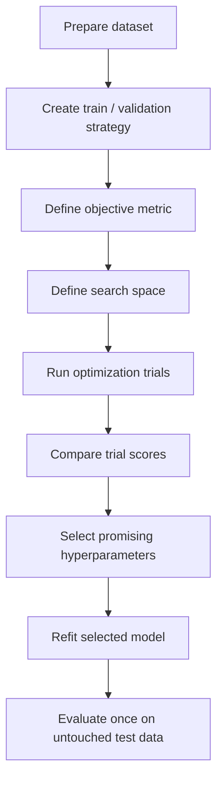
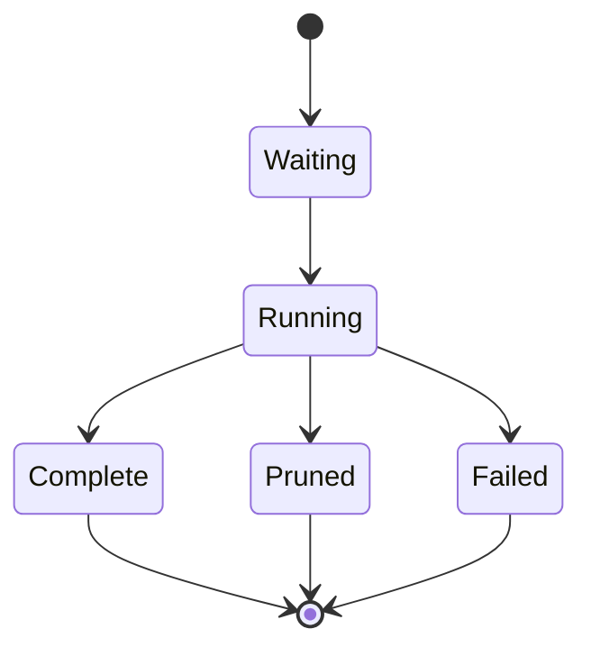
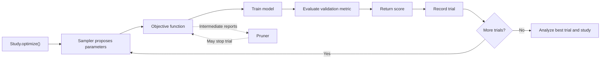
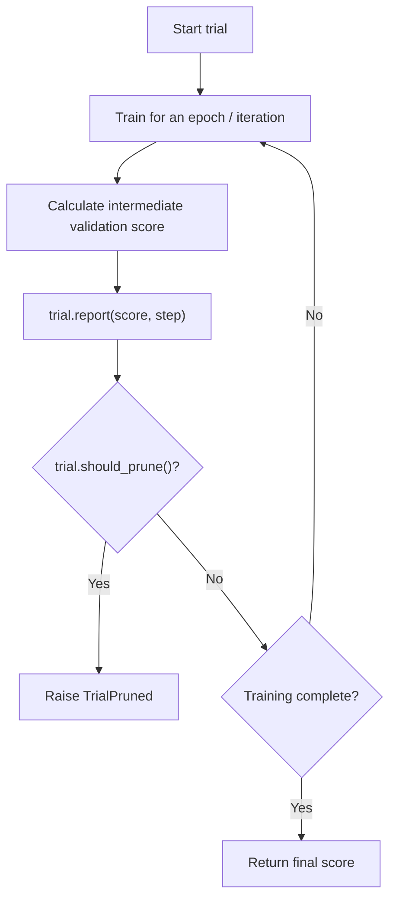
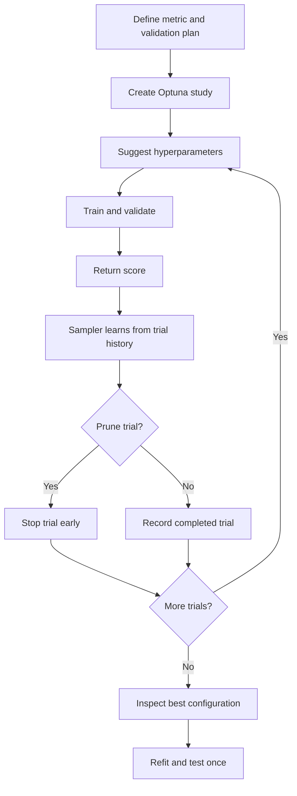

# 🎯 28. Hyperparameter Tuning using Optuna

## 📌 Folder Overview
Welcome to the **Hyperparameter Tuning using Optuna** module! Optuna is an open-source, next-generation hyperparameter optimization framework designed with an intuitive "define-by-run" API, efficient Bayesian sampling algorithms (Tree-structured Parzen Estimator - TPE), and automated early stopping (pruning) of unpromising trials. This folder covers the transition from brute-force Grid/Random Search to Bayesian Optimization, core Optuna primitives (Study, Trial, Objective), parameter search spaces, pruning strategies, Scikit-Learn cross-validation integration, and seminal research papers.

### Why is this topic important?
Model performance depends heavily on finding the right hyperparameter configuration (such as learning rate, tree depth, regularization penalty, or number of estimators). Exhaustive Grid Search becomes computationally prohibitive as the parameter space expands, whereas Random Search lacks memory of previous trials. Optuna accelerates the tuning process by focusing exploration on high-performing parameter regions and pruning unpromising training runs early, dramatically slashing computational budget and time.

### What You Will Learn
- **Hyperparameter Optimization Fundamentals**: Distinguishing model parameters (learned directly from data) from hyperparameters (set prior to training).
- **Define-by-Run Architecture**: Dynamically constructing search spaces within native Python loops and conditionals.
- **Core Optuna Primitives**:
  - **Trial**: A single evaluation of a specific hyperparameter configuration.
  - **Study**: The overarching optimization session directing multiple trials toward an objective (`direction='maximize'` / `'minimize'`).
  - **Objective Function**: The callable function evaluating model performance and returning an optimization score.
- **Search Spaces & Suggestion Methods**:
  - `trial.suggest_float('lr', 1e-5, 1e-1, log=True)`
  - `trial.suggest_int('max_depth', 3, 20)`
  - `trial.suggest_categorical('criterion', ['gini', 'entropy'])`
- **Samplers & Search Strategies**:
  - **TPESampler**: Tree-structured Parzen Estimator (Bayesian optimization using kernel density estimators).
  - **CmaEsSampler**: Covariance Matrix Adaptation Evolution Strategy.
  - **RandomSampler** & **GridSampler** for baseline benchmarking.
- **Automated Trial Pruning**: Early-stopping poorly performing trials using `MedianPruner`, `HyperbandPruner`, or `SuccessiveHalvingPruner`.
- **Visualization & Analysis**: Evaluating optimization histories, parameter importances, and multi-dimensional slices using `optuna.visualization`.
- **Foundational Literature**: Exploring the original Optuna framework paper (Akiba et al., 2019) and in-depth TPE mathematical analysis (Watanabe, 2023).

---

## 📚 Topics Covered

Organized logically from basic Optuna studies and Scikit-Learn tuning to Bayesian mathematics, trial pruning, and research papers:

### 🟢 Beginner
- **Hyperparameter Tuning Overview**: Parameters vs Hyperparameters.
- **Optuna Installation & First Study**: Setting up an objective function and optimizing trials.
- **Study Direction**: Maximizing metrics (Accuracy, ROC-AUC, $R^2$) vs minimizing losses (MSE, Log Loss).

### 🟡 Intermediate
- **Defining Complex Search Spaces**: Floats, Integers, Categoricals, and Log-uniform distributions.
- **Tuning Scikit-Learn Pipelines**: Optimizing Random Forest, Logistic Regression, Support Vector Machines, and Gradient Boosting.
- **Integrating Cross-Validation**: Preventing validation leakage with `cross_val_score` inside the objective function.
- **Visual Diagnostics**: Plotting optimization history, parameter importance, and contour surfaces.

### 🔴 Advanced
- **Mathematics of TPE**: Modeling probability distributions $\ell(x)$ and $g(x)$ to maximize Expected Improvement (EI).
- **Trial Pruning Mechanics**: Implementing intermediate reporting (`trial.report()`) and pruning checks (`trial.should_prune()`).
- **Multi-Objective Optimization**: Simultaneously optimizing conflicting objectives (e.g., accuracy vs inference speed).
- **Persistent Storage**: Utilizing SQLite databases (`sqlite:///optuna.db`) for multi-process distributed optimization and study resuming.
- **Research Papers**: Reviewing Akiba et al. (KDD 2019) and Watanabe (2023) provided in the repository.

| File / Notebook / Document | Focus Area | Key Concepts & Tools | Level |
| :--- | :--- | :--- | :--- |
| `optuna_basics_yt.ipynb` | Hands-on Optuna study and model tuning. | `optuna.create_study`, objective definition, parameter suggestions, tuning RF. | Intermediate |
| `1907.10902v1.pdf` | Foundational Research Paper. | *Optuna: A Next-generation Hyperparameter Optimization Framework* (Akiba et al., KDD 2019). | Advanced Literature |
| `2304.11127v5.pdf` | In-depth Algorithm Survey Paper. | *Tree-structured Parzen Estimator: Understanding Its Algorithm and Beyond* (Watanabe, 2023). | Advanced Literature |
| `README.md (Complete Notes)` | Theoretical and operational master guide. | Bayesian math, pruning algorithms, visualization APIs, 20+ interview Q&As. | Comprehensive Reference |

---

## 📂 File Structure

The module is organized as a self-contained, end-to-end master guide covering theory, mathematical formulations, Scikit-Learn integration, interactive Optuna visualizations, and original research literature:

```text
28_Hyperparameter Tuning using Optuna/
├── 1907.10902v1.pdf
├── 2304.11127v5.pdf
├── optuna_basics_yt.ipynb
└── README.md
```

---

# 🎯 Hyperparameter Tuning Using Optuna — Complete Notes

## 📚 Table of Contents

1. [Introduction to Hyperparameter Tuning](#1--introduction-to-hyperparameter-tuning)
2. [What Is Optuna?](#2--what-is-optuna)
3. [Parameters vs Hyperparameters](#3--parameters-vs-hyperparameters)
4. [Why Use Optuna?](#4--why-use-optuna)
5. [Core Optuna Terminology](#5--core-optuna-terminology)
6. [How Optuna Works](#6--how-optuna-works)
7. [Installation and Setup](#7--installation-and-setup)
8. [Your First Optuna Study](#8--your-first-optuna-study)
9. [Defining an Objective Function](#9--defining-an-objective-function)
10. [Search Spaces and Parameter Types](#10--search-spaces-and-parameter-types)
11. [Samplers and Search Strategies](#11--samplers-and-search-strategies)
12. [Pruning Unpromising Trials](#12--pruning-unpromising-trials)
13. [Optuna with Scikit-Learn](#13--optuna-with-scikit-learn)
14. [Optuna with Cross-Validation](#14--optuna-with-cross-validation)
15. [Practical Project: Tune a Random Forest](#15--practical-project-tune-a-random-forest)
16. [Visualization and Study Analysis](#16--visualization-and-study-analysis)
17. [Saving, Resuming, and Reproducibility](#17--saving-resuming-and-reproducibility)
18. [Advanced Concepts](#18--advanced-concepts)
19. [Optuna vs Other Tuning Methods](#19--optuna-vs-other-tuning-methods)
20. [Common Mistakes and Best Practices](#20--common-mistakes-and-best-practices)
21. [Interview Questions and Answers](#21--interview-questions-and-answers)
22. [Quick Revision](#22--quick-revision)

---

## 1. 🎯 Introduction to Hyperparameter Tuning

**Hyperparameter tuning** is the process of finding suitable configuration values for a machine learning algorithm before or during model training. The goal is to improve a chosen validation metric while managing training cost and avoiding overfitting.

Examples of hyperparameters include:
- Number of trees in a Random Forest.
- Maximum depth of a decision tree.
- Learning rate in gradient boosting.
- Regularization strength in Logistic Regression.
- Number of hidden units in a neural network.
- Batch size and dropout rate in deep learning.

### Why tuning matters

Two models using the same algorithm and dataset can perform differently because of their hyperparameter settings. A systematic search can often improve generalization compared with arbitrary settings, although tuning cannot guarantee improvement.

### Typical tuning workflow



---

## 2. 🧪 What Is Optuna?

**Optuna** is an open-source hyperparameter optimization framework for Python. It provides a flexible way to define search spaces, run trials, compare results, prune unpromising trials, and persist studies.

Official documentation: https://optuna.readthedocs.io/

### Key features

- Define search spaces directly in Python.
- Use samplers such as TPE to propose promising parameter values.
- Stop unpromising trials early using pruning where supported.
- Support single-objective and multi-objective optimization.
- Store study history in memory or persistent storage such as SQLite.
- Visualize parameter importance, optimization history, and relationships.
- Integrate with common ML workflows, including scikit-learn and deep learning.

### Optuna's main components

| Component | Purpose |
|---|---|
| `Study` | Coordinates the optimization process and stores trial history |
| `Trial` | Represents one evaluation of a proposed hyperparameter configuration |
| `objective()` | User-defined function that trains/evaluates a model and returns a score |
| `Sampler` | Chooses hyperparameters to evaluate |
| `Pruner` | Stops trials that appear unlikely to become competitive |
| `Storage` | Persists study and trial information |
| `Study.optimize()` | Runs the requested number of trials or until a stopping condition |

---

## 3. 🧠 Parameters vs Hyperparameters

| Model parameters | Hyperparameters |
|---|---|
| Learned from training data | Set or searched outside ordinary parameter fitting |
| Examples: tree split values, regression coefficients, neural-network weights | Examples: tree depth, learning rate, regularization strength |
| Updated during model fitting | Chosen through configuration, search, or optimization |

For example, a Random Forest learns each tree's split rules from data. The number of trees (`n_estimators`) and maximum depth (`max_depth`) are hyperparameters.

### Important distinction

Optuna usually does not directly learn the model's internal weights. It searches for hyperparameter settings that improve a score produced by a training-and-validation procedure.

---

## 4. 🚀 Why Use Optuna?

Traditional tuning often relies on manually trying values, a fixed grid, or random search. Optuna can make the process more adaptive.

### Benefits

- **Flexible search spaces:** Parameters can depend on other parameter choices.
- **Adaptive search:** TPE can use past trial results to guide future proposals.
- **Pruning:** Trials can be stopped early when intermediate results are poor.
- **Persistence:** Studies can be saved and resumed.
- **Visualization:** Results can be explored graphically.
- **Multi-objective support:** Optimize competing goals such as score and model size.
- **Python-native workflow:** Objective functions can contain almost any valid training/evaluation code.

### When Optuna is useful

Use it when:
- Training and validation can be repeated reliably.
- Many interacting hyperparameters need to be explored.
- Model training is expensive enough that pruning or adaptive search may help.
- You need to keep a record of tuning trials.

For a tiny model with only one or two obvious settings, a small manual search may be sufficient.

---

## 5. 🧩 Core Optuna Terminology

### 5.1 Study

A `Study` manages optimization. It records trials and tracks the best result for single-objective optimization.

### 5.2 Trial

A trial is one evaluation of a particular set of suggested hyperparameters. It may finish successfully, fail, or be pruned.

### 5.3 Objective function

The objective function:
1. Receives a `trial`.
2. Suggests hyperparameters.
3. Builds and trains a model.
4. Calculates a validation score.
5. Returns the score to Optuna.

### 5.4 Sampler

A sampler proposes the next hyperparameter values. The default sampler for many single-objective Optuna studies is TPE, but defaults can vary by version or study configuration. Specify it explicitly when reproducibility or clarity matters.

### 5.5 Pruner

A pruner uses intermediate results to decide whether a trial should stop early. It is most useful when the model reports meaningful intermediate scores during training.

### 5.6 Best trial

For a single-objective study, `study.best_trial` represents the best completed trial according to the study's direction. For multi-objective studies, there is generally a Pareto front rather than one universally best trial.

### Trial lifecycle



---

## 6. ⚙️ How Optuna Works

A typical single-objective study works as follows:

1. Create a study with a direction, such as `maximize` or `minimize`.
2. Define the objective function.
3. Use `trial.suggest_*()` methods to define candidate values.
4. Train and evaluate the model for each trial.
5. Return the validation score.
6. Let the sampler use trial history to suggest future candidates.
7. Repeat for the requested number of trials.
8. Inspect the best trial and the full study history.
9. Validate the selection with an appropriate final evaluation process.

### Architecture



### Optimization direction

- `direction="maximize"` for metrics such as F1-score, ROC-AUC, or accuracy.
- `direction="minimize"` for metrics such as log loss, mean squared error, latency, or model size.

Always make sure the direction matches the value returned by the objective function.

---

## 7. 💻 Installation and Setup

Install Optuna and common ML dependencies:

```bash
pip install optuna scikit-learn pandas numpy matplotlib
```

Optional plotting support may require additional packages depending on the visualization and installed Optuna version. Install dependencies indicated by any error message or the current official documentation.

### Verify installation

```python
import optuna

print("Optuna version:", optuna.__version__)
```

### Example project structure

```text
optuna-project/
├── data/
│   └── dataset.csv
├── notebooks/
│   └── experimentation.ipynb
├── src/
│   ├── objective.py
│   └── train.py
├── results/
│   └── study.db
└── requirements.txt
```

Keep dataset preparation, objective logic, and final model training organized so the experiment can be reproduced.

---

## 8. 🏁 Your First Optuna Study

This minimal example minimizes a mathematical function rather than training a machine learning model.

```python
import optuna

def objective(trial):
    x = trial.suggest_float("x", -10.0, 10.0)
    return (x - 2) ** 2

study = optuna.create_study(direction="minimize")
study.optimize(objective, n_trials=50)

print("Best value:", study.best_value)
print("Best parameters:", study.best_params)
```

The minimum is at \(x=2\), where the objective value is zero. Since the search is numerical and trial-based, the best observed value may be close to the exact optimum rather than exactly equal to it.

### Read the output

- `study.best_value`: Best objective value found.
- `study.best_params`: Parameter configuration for the best trial.
- `study.best_trial`: Complete information about that trial.
- `study.trials`: All recorded trials.

---

## 9. 🧪 Defining an Objective Function

The objective function is the heart of an Optuna experiment.

### Example with a classification model

```python
import optuna

from sklearn.datasets import load_breast_cancer
from sklearn.ensemble import RandomForestClassifier
from sklearn.model_selection import cross_val_score, StratifiedKFold

X, y = load_breast_cancer(return_X_y=True)

cv = StratifiedKFold(
    n_splits=5,
    shuffle=True,
    random_state=42
)

def objective(trial):
    n_estimators = trial.suggest_int(
        "n_estimators", 50, 300, step=50
    )
    max_depth = trial.suggest_int(
        "max_depth", 2, 20
    )
    min_samples_split = trial.suggest_int(
        "min_samples_split", 2, 20
    )
    min_samples_leaf = trial.suggest_int(
        "min_samples_leaf", 1, 10
    )

    model = RandomForestClassifier(
        n_estimators=n_estimators,
        max_depth=max_depth,
        min_samples_split=min_samples_split,
        min_samples_leaf=min_samples_leaf,
        random_state=42,
        n_jobs=-1
    )

    scores = cross_val_score(
        model,
        X,
        y,
        cv=cv,
        scoring="f1"
    )

    return scores.mean()

study = optuna.create_study(direction="maximize")
study.optimize(objective, n_trials=30)

print("Best F1:", study.best_value)
print("Best parameters:", study.best_params)
```

### Important points

- Each trial proposes a new hyperparameter configuration.
- Cross-validation provides a more stable score than a single validation split in many settings.
- The score returned must match the study direction.
- The final test set must not be used inside the objective if it is intended to provide an unbiased final estimate.
- For this simple dataset, preprocessing is not required for the Random Forest, but preprocessing should be included inside a pipeline when the estimator needs it.

---

## 10. 🎛️ Search Spaces and Parameter Types

Optuna's `Trial` API supports different kinds of search spaces.

### 10.1 Integer parameters

Use `suggest_int()` for whole-number settings.

```python
n_estimators = trial.suggest_int(
    "n_estimators",
    100,
    500,
    step=50
)
```

### 10.2 Floating-point parameters

Use `suggest_float()` for continuous or stepped values.

```python
learning_rate = trial.suggest_float(
    "learning_rate",
    0.001,
    0.1,
    log=True
)
```

With `log=True`, values are sampled on a logarithmic scale, which is often appropriate when several orders of magnitude are plausible.

### 10.3 Categorical parameters

Use `suggest_categorical()` for a finite list of choices.

```python
criterion = trial.suggest_categorical(
    "criterion",
    ["gini", "entropy", "log_loss"]
)
```

Ensure each candidate is supported by the estimator version in use.

### 10.4 Conditional search spaces

Some parameters depend on other choices.

```python
def objective(trial):
    model_type = trial.suggest_categorical(
        "model_type",
        ["random_forest", "extra_trees"]
    )

    n_estimators = trial.suggest_int(
        "n_estimators", 100, 400, step=100
    )

    if model_type == "random_forest":
        max_features = trial.suggest_categorical(
            "max_features", ["sqrt", "log2", None]
        )
    else:
        max_features = trial.suggest_float(
            "max_features_fraction", 0.3, 1.0
        )

    # Build and evaluate the selected model here.
    # Return a validation score.
```

Conditional search spaces let Optuna explore configurations with different parameter structures. The example demonstrates the idea; complete model construction and scoring are intentionally omitted.

### Search-space summary

| Method | Use | Example |
|---|---|---|
| `suggest_int()` | Integer range | Number of trees |
| `suggest_float()` | Continuous or stepped values | Learning rate |
| `suggest_categorical()` | Choices from a list | Criterion or optimizer |
| `suggest_discrete_uniform()` | Legacy discrete float range | Prefer `suggest_float(..., step=...)` in modern code |
| `suggest_loguniform()` | Legacy log-scale float range | Prefer `suggest_float(..., log=True)` in modern code |

**Note:** Older Optuna methods such as `suggest_uniform()`, `suggest_loguniform()`, and `suggest_discrete_uniform()` are deprecated in modern versions. Prefer `suggest_float()` with appropriate options.

---

## 11. 🧠 Samplers and Search Strategies

A sampler decides which hyperparameter values to test next.

### 11.1 TPE (Tree-structured Parzen Estimator)

TPE is an adaptive, model-based sampler. It uses results from earlier trials to guide future suggestions. It is a common choice for practical hyperparameter optimization.

```python
import optuna

sampler = optuna.samplers.TPESampler(seed=42)

study = optuna.create_study(
    direction="maximize",
    sampler=sampler
)
```

### 11.2 Random sampler

Random sampling selects values without adapting to the scores from previous trials.

```python
sampler = optuna.samplers.RandomSampler(seed=42)

study = optuna.create_study(
    direction="maximize",
    sampler=sampler
)
```

### 11.3 Grid sampler

Grid search evaluates combinations from a specified finite grid.

```python
search_space = {
    "max_depth": [3, 5, 10],
    "min_samples_split": [2, 5, 10]
}

sampler = optuna.samplers.GridSampler(search_space)
study = optuna.create_study(
    direction="maximize",
    sampler=sampler
)
```

Use a finite, manageable grid. Grid search can grow rapidly as parameters and candidate values are added.

### Sampler comparison

| Sampler | Strategy | Strength | Limitation |
|---|---|---|---|
| `TPESampler` | Adaptive model-based | Uses trial history | Can be affected by noisy scores and search-space design |
| `RandomSampler` | Random search | Simple and broad exploration | Does not learn from past results |
| `GridSampler` | Enumerates a finite grid | Systematic and reproducible coverage | Combinatorial growth |
| `CmaEsSampler` | Evolutionary strategy for suitable numerical spaces | Useful for continuous optimization | Not ideal for every categorical or conditional space |
| `NSGAIISampler` | Evolutionary multi-objective search | Useful for Pareto optimization | Requires thoughtful multi-objective interpretation |

Sampler capabilities and defaults can change across versions. Consult the installed version's documentation for supported parameter types and constraints.

---

## 12. ✂️ Pruning Unpromising Trials

Pruning stops a trial before it finishes when intermediate results suggest it is unlikely to be competitive. This is especially useful for iterative models, such as neural networks trained over epochs.

### Core methods

- `trial.report(value, step)`: Reports an intermediate objective value.
- `trial.should_prune()`: Checks whether the configured pruner recommends stopping.
- `optuna.TrialPruned`: Signals that the current trial should be stopped as pruned.

### Example with a simulated iterative objective

```python
import optuna

def objective(trial):
    quality = trial.suggest_float("quality", 0.0, 1.0)

    for epoch in range(10):
        # Illustrative intermediate score, not a real ML metric.
        score = quality * (epoch + 1) / 10

        trial.report(score, step=epoch)

        if trial.should_prune():
            raise optuna.TrialPruned()

    return score

study = optuna.create_study(
    direction="maximize",
    pruner=optuna.pruners.MedianPruner(
        n_startup_trials=5,
        n_warmup_steps=2
    )
)
study.optimize(objective, n_trials=30)
```

This demonstrates the API. A real objective should report a meaningful validation metric at each epoch or iteration.

### Pruning workflow



### Common pruners

| Pruner | General idea |
|---|---|
| `MedianPruner` | Prunes trials whose intermediate results are worse than a median-based reference under its configured rules |
| `SuccessiveHalvingPruner` | Allocates resources in stages and removes less promising trials |
| `HyperbandPruner` | Uses multiple successive-halving brackets |
| `NopPruner` | Disables pruning |

Pruning can save compute, but it can also stop a configuration whose performance improves late. Choose warmup steps and pruning settings appropriate to the training dynamics.

---

## 13. 🔬 Optuna with Scikit-Learn

Optuna can tune scikit-learn estimators by placing model construction and validation inside the objective function.

### Example: Logistic Regression

```python
import optuna

from sklearn.datasets import load_breast_cancer
from sklearn.linear_model import LogisticRegression
from sklearn.model_selection import StratifiedKFold, cross_val_score
from sklearn.pipeline import Pipeline
from sklearn.preprocessing import StandardScaler

X, y = load_breast_cancer(return_X_y=True)

cv = StratifiedKFold(
    n_splits=5,
    shuffle=True,
    random_state=42
)

def objective(trial):
    C = trial.suggest_float("C", 1e-4, 1e2, log=True)
    solver = trial.suggest_categorical(
        "solver", ["lbfgs", "liblinear"]
    )

    model = Pipeline([
        ("scaler", StandardScaler()),
        ("classifier", LogisticRegression(
            C=C,
            solver=solver,
            max_iter=3000,
            random_state=42
        ))
    ])

    scores = cross_val_score(
        model,
        X,
        y,
        cv=cv,
        scoring="f1"
    )

    return scores.mean()

study = optuna.create_study(
    direction="maximize",
    sampler=optuna.samplers.TPESampler(seed=42)
)
study.optimize(objective, n_trials=40)

print("Best F1:", study.best_value)
print("Best parameters:", study.best_params)
```

### Why use a pipeline?

The scaler is fitted separately within each training fold. This prevents validation-fold information from influencing preprocessing.

### Conditional compatibility

Some estimator parameters are only valid for certain solvers or model types. Keep the search space compatible with the estimator's API, and use conditional suggestions when necessary.

---

## 14. 🔁 Optuna with Cross-Validation

Cross-validation can provide a more robust estimate of generalization than a single split, especially when data is limited. It also increases computational cost.

### Typical pattern

```python
from sklearn.model_selection import cross_val_score, StratifiedKFold

cv = StratifiedKFold(
    n_splits=5,
    shuffle=True,
    random_state=42
)

def objective(trial):
    # Suggest hyperparameters.
    # model = ...
    scores = cross_val_score(
        model,
        X_train,
        y_train,
        cv=cv,
        scoring="roc_auc",
        n_jobs=-1
    )
    return scores.mean()
```

The `model` must be constructed from the current trial's suggested values. If preprocessing is needed, include it in a scikit-learn pipeline.

### Avoid nested parallelism overload

If each trial uses `n_jobs=-1` for cross-validation and Optuna also runs many trials in parallel, CPU and memory use can explode. A common strategy is to parallelize at one level and limit the other.

### Validation strategy guide

| Data situation | Suitable strategy |
|---|---|
| Standard classification | `StratifiedKFold` |
| Regression | `KFold` or repeated variants |
| Repeated subjects/customers | Group-aware splitting |
| Time-dependent observations | Time-series split |
| Very large dataset | A carefully chosen validation split may be more affordable |

Use a validation strategy that matches the way the model will be used in the real world.

---

## 15. 🧪 Practical Project: Tune a Random Forest

### Objective

Tune a Random Forest classifier using Optuna and cross-validation, select the best configuration, refit it on the training data, and evaluate it on a separate test set.

### Step 1: Load and split data

```python
from sklearn.datasets import load_breast_cancer
from sklearn.model_selection import train_test_split

X, y = load_breast_cancer(return_X_y=True)

X_train, X_test, y_train, y_test = train_test_split(
    X,
    y,
    test_size=0.2,
    stratify=y,
    random_state=42
)
```

### Step 2: Define the objective

```python
import optuna

from sklearn.ensemble import RandomForestClassifier
from sklearn.model_selection import StratifiedKFold, cross_val_score

cv = StratifiedKFold(
    n_splits=5,
    shuffle=True,
    random_state=42
)

def objective(trial):
    params = {
        "n_estimators": trial.suggest_int(
            "n_estimators", 100, 500, step=100
        ),
        "max_depth": trial.suggest_int(
            "max_depth", 3, 30
        ),
        "min_samples_split": trial.suggest_int(
            "min_samples_split", 2, 20
        ),
        "min_samples_leaf": trial.suggest_int(
            "min_samples_leaf", 1, 10
        ),
        "max_features": trial.suggest_categorical(
            "max_features", ["sqrt", "log2", None]
        ),
        "class_weight": trial.suggest_categorical(
            "class_weight", [None, "balanced"]
        )
    }

    model = RandomForestClassifier(
        **params,
        random_state=42,
        n_jobs=1
    )

    scores = cross_val_score(
        model,
        X_train,
        y_train,
        cv=cv,
        scoring="f1",
        n_jobs=-1
    )

    return scores.mean()
```

### Step 3: Run optimization

```python
study = optuna.create_study(
    direction="maximize",
    sampler=optuna.samplers.TPESampler(seed=42)
)

study.optimize(objective, n_trials=50)

print("Best CV F1:", study.best_value)
print("Best hyperparameters:")
print(study.best_params)
```

### Step 4: Refit the best model

```python
best_model = RandomForestClassifier(
    **study.best_params,
    random_state=42,
    n_jobs=-1
)

best_model.fit(X_train, y_train)
```

### Step 5: Evaluate on the test set

```python
from sklearn.metrics import (
    classification_report,
    confusion_matrix,
    roc_auc_score
)

y_pred = best_model.predict(X_test)
y_score = best_model.predict_proba(X_test)[:, 1]

print("Confusion matrix:")
print(confusion_matrix(y_test, y_pred))

print("\nClassification report:")
print(classification_report(y_test, y_pred, zero_division=0))

print("Test ROC-AUC:", roc_auc_score(y_test, y_score))
```

### Step 6: Save the best parameters

```python
import json

with open("best_params.json", "w", encoding="utf-8") as file:
    json.dump(study.best_params, file, indent=4)

print("Saved best_params.json")
```

### Project notes

- The test set is held aside from the tuning objective.
- The optimization score is cross-validated F1, while ROC-AUC is also reported on the test set. These metrics measure different aspects of performance.
- A single held-out test score can still have uncertainty, especially with few minority examples.
- For production work, persist the full fitted model and preprocessing pipeline, along with versions, data definitions, and evaluation details.

---

## 16. 📈 Visualization and Study Analysis

Optuna provides visualization functions for exploring trial results. Interactive visualizations commonly use Plotly; install the optional dependency if required.

### Optimization history

```python
import optuna.visualization as vis

fig = vis.plot_optimization_history(study)
fig.show()
```

Shows the objective values across trials and the progression of the best result.

### Parameter importance

```python
fig = vis.plot_param_importances(study)
fig.show()
```

Estimates which hyperparameters were most influential in the evaluated study. Importance estimates depend on the search space and completed trials; they are not causal explanations.

### Parallel coordinate plot

```python
fig = vis.plot_parallel_coordinate(study)
fig.show()
```

Helps inspect relationships between combinations of parameters and objective values.

### Parameter slice plot

```python
fig = vis.plot_slice(study)
fig.show()
```

Shows objective values against individual parameter values.

### Contour plot

```python
fig = vis.plot_contour(study)
fig.show()
```

Can reveal interactions between two parameters when enough informative trials exist.

### Inspect trial history in a DataFrame

```python
trials_df = study.trials_dataframe()
print(trials_df.head())

trials_df.to_csv("optuna_trials.csv", index=False)
```

### Visualization summary

| Plot | What it helps inspect |
|---|---|
| Optimization history | How trial scores change over time |
| Parameter importance | Which parameters appear influential |
| Parallel coordinates | Promising combinations across multiple parameters |
| Slice plot | Score behavior for one parameter |
| Contour plot | Interactions between two parameters |
| EDF plot | Distribution of objective values across trials |

---

## 17. 💾 Saving, Resuming, and Reproducibility

By default, a study created without persistent storage is held in memory. If the process ends, that in-memory study is not automatically saved.

### 17.1 Store a study in SQLite

```python
import optuna

study = optuna.create_study(
    study_name="random_forest_tuning",
    direction="maximize",
    storage="sqlite:///optuna_study.db",
    load_if_exists=True
)

study.optimize(objective, n_trials=50)
```

This creates or resumes the named study in `optuna_study.db`.

### 17.2 Load an existing study

```python
study = optuna.load_study(
    study_name="random_forest_tuning",
    storage="sqlite:///optuna_study.db"
)

print(study.best_params)
print(study.best_value)
```

### 17.3 Reproducibility checklist

- Set sampler seeds where supported.
- Set random seeds in estimators and data splitting.
- Record the Optuna, Python, and ML library versions.
- Store the objective metric and direction.
- Keep data splits fixed during comparable trials.
- Save the study to persistent storage.
- Record preprocessing and feature definitions.
- Do not tune on the final test set.
- Expect small numerical differences across hardware, library versions, and parallel execution.

### Study storage options

| Storage | Typical use |
|---|---|
| In-memory | Quick experiments |
| SQLite | Local, single-machine persistence |
| PostgreSQL or another supported RDB backend | Shared or larger persistent studies |
| Journal storage, where supported | Specific concurrent or resilient workflows |

Choose storage according to the installed Optuna version and deployment needs. For distributed optimization, use a storage backend and deployment setup designed for concurrency.

---

## 18. 🧠 Advanced Concepts

### 18.1 Multi-objective optimization

Sometimes one metric is not enough. You may want to maximize F1 while minimizing prediction latency or model size.

```python
import optuna

def objective(trial):
    # Example placeholders: replace with real training and measurement.
    f1_score = trial.suggest_float("quality", 0.70, 0.98)
    latency_ms = trial.suggest_float("latency_ms", 5.0, 100.0)

    return f1_score, latency_ms

study = optuna.create_study(
    directions=["maximize", "minimize"]
)
study.optimize(objective, n_trials=30)

print("Number of Pareto-optimal trials:", len(study.best_trials))
```

This example uses synthetic objective values to illustrate the API. In a real experiment, calculate both metrics from actual model evaluation.

A multi-objective study usually returns a **Pareto front**: configurations for which no objective can be improved without worsening at least one other objective.

### 18.2 User attributes and trial metadata

Store useful notes or diagnostics with a trial.

```python
def objective(trial):
    trial.set_user_attr("experiment_tag", "baseline_v1")
    # Train/evaluate the model.
    return 0.9  # Replace with a real objective score.
```

Avoid storing sensitive information or large artifacts directly as trial attributes. Use an appropriate artifact or experiment-tracking system for files.

### 18.3 Callbacks

Callbacks run after trials and can be used for logging or custom stopping logic.

```python
def log_trial(study, trial):
    print(
        f"Trial {trial.number} | "
        f"state={trial.state} | "
        f"value={trial.value}"
    )

study.optimize(
    objective,
    n_trials=20,
    callbacks=[log_trial]
)
```

The callback example assumes the objective is already defined.

### 18.4 Enqueue a known configuration

You can ask a study to evaluate a configuration early, for example a baseline configuration.

```python
study.enqueue_trial({
    "n_estimators": 200,
    "max_depth": 10,
    "min_samples_split": 2,
    "min_samples_leaf": 1
})
```

The parameter names and values must match the search space used by the objective.

### 18.5 Distributed optimization

Optuna can coordinate trials across multiple processes or machines when they share compatible persistent storage and the objective environment is configured correctly. Distributed runs require attention to storage concurrency, resource allocation, duplicate work, reproducibility, and failure handling.

### 18.6 Search-space design

A good search space is often more important than increasing the trial count.

- Use logarithmic ranges for parameters that naturally vary across orders of magnitude, such as regularization strength.
- Use categorical choices for discrete algorithm settings.
- Keep values within valid estimator constraints.
- Include sensible defaults or baseline values.
- Narrow the space using domain knowledge when justified.
- Avoid searching many irrelevant parameters simultaneously.
- Track compute budget and the cost of each trial.

### 18.7 Nested cross-validation

Selecting hyperparameters and estimating final generalization on the same cross-validation results can produce optimistic estimates because the selection process adapts to those results. For a less biased estimate in research settings, nested cross-validation uses an inner loop for tuning and an outer loop for evaluation. It can be computationally expensive.

---

## 19. ⚖️ Optuna vs Other Tuning Methods

| Method | Search strategy | Advantages | Limitations |
|---|---|---|---|
| Manual tuning | Human-guided | Fast for small spaces; uses expertise | Difficult to scale and reproduce consistently |
| Grid Search | Exhaustive finite combinations | Easy to understand and systematic | Expensive as dimensions grow |
| Random Search | Random configurations | Simple; can cover broad ranges efficiently | Does not adapt to trial results |
| Bayesian optimization | Uses a surrogate or probabilistic model | Can be sample-efficient | Method-specific assumptions and overhead |
| Optuna with TPE | Adaptive sampling framework | Flexible search spaces and practical integrations | Still needs good objective design and validation |
| Evolutionary methods | Population-based search | Can handle some complex spaces | May need many evaluations and careful configuration |

Optuna is a framework, not a single optimization algorithm. It supports multiple samplers and can run random, grid, TPE, and other search strategies.

### Grid Search vs Optuna

Grid Search is useful when the search space is small and finite. Optuna is often more practical for broader spaces, conditional parameters, pruning, and persistent trial tracking.

### Random Search vs Optuna

Optuna using TPE can learn from prior trials. Random search remains a strong baseline and may be competitive for noisy objectives or large, poorly understood spaces. Compare under the same compute budget.

---

## 20. 🛠️ Common Mistakes and Best Practices

### Common mistakes

1. **Tuning against the test set:** This leaks test information into model selection.
2. **Returning the wrong objective:** Ensure the returned score matches the study direction.
3. **Using too broad a search space:** Many trials may be wasted on implausible values.
4. **Using too few trials to draw strong conclusions:** The search may not have explored the space adequately.
5. **Ignoring random variation:** Use fixed splits and appropriate cross-validation.
6. **Pruning models without meaningful intermediate scores:** Pruning can become arbitrary or ineffective.
7. **Parallelizing every layer:** Nested parallelism can overload CPU and memory.
8. **Using incompatible parameter combinations:** Use conditional spaces when necessary.
9. **Comparing trials with different validation splits:** This makes trial scores less comparable.
10. **Assuming the best trial is automatically production-ready:** Refit, test, validate operational constraints, and document.
11. **Ignoring failed trials:** Investigate failures and parameter constraints instead of silently hiding systemic errors.
12. **Selecting only by one metric when trade-offs matter:** Include latency, size, calibration, or costs when required.

### Best-practices checklist

- [ ] Define the real objective metric before tuning.
- [ ] Establish a simple baseline.
- [ ] Keep the final test set untouched.
- [ ] Use an appropriate validation strategy.
- [ ] Put preprocessing inside a pipeline.
- [ ] Define valid, meaningful search ranges.
- [ ] Use logarithmic search for scale-sensitive parameters when appropriate.
- [ ] Fix random seeds for comparable experiments.
- [ ] Choose a trial budget that fits available compute.
- [ ] Use pruning only when intermediate scores are informative.
- [ ] Save studies to persistent storage for long runs.
- [ ] Inspect distributions and trial failures.
- [ ] Refit the chosen model on the permitted training data.
- [ ] Evaluate the final selected workflow on untouched test data.
- [ ] Record software versions, data splits, objective, and best parameters.

---

## 21. 🎤 Interview Questions and Answers

### Q1. What is hyperparameter tuning?

The process of selecting hyperparameter values that improve a model's validation performance or satisfy a chosen objective.

### Q2. What is Optuna?

An open-source Python framework for hyperparameter optimization, trial management, sampling, pruning, visualization, and study persistence.

### Q3. What is an Optuna study?

An object that manages an optimization run and stores trial results.

### Q4. What is a trial?

One evaluation of a proposed hyperparameter configuration.

### Q5. What is an objective function?

A function that suggests parameters, trains or evaluates a model, and returns a numeric objective value.

### Q6. What is TPE?

Tree-structured Parzen Estimator, an adaptive sampler that uses previous trial results to guide future suggestions.

### Q7. What is pruning?

Stopping an unpromising trial early based on intermediate results, saving compute when the training process supports meaningful reporting.

### Q8. What is the difference between `minimize` and `maximize`?

`minimize` searches for the lowest objective value; `maximize` searches for the highest.

### Q9. How do you define an integer hyperparameter?

Use `trial.suggest_int(name, low, high, step=...)`.

### Q10. How do you define a log-scaled learning rate?

Use `trial.suggest_float("learning_rate", low, high, log=True)`.

### Q11. How do you save a study?

Use a persistent storage URL such as `sqlite:///optuna_study.db` with `create_study()`.

### Q12. How do you resume an existing study?

Create it with the same `study_name` and storage using `load_if_exists=True`, or use `optuna.load_study()`.

### Q13. Why use cross-validation inside the objective?

It gives a score averaged over multiple training-validation folds, which can be more robust than one split, at the cost of more computation.

### Q14. Why must the test set stay outside tuning?

Repeatedly selecting parameters based on test results overfits the model-selection process to the test set and undermines its role as an independent evaluation.

### Q15. Can Optuna optimize multiple objectives?

Yes. Use `directions=[...]`; analyze the Pareto-optimal trials rather than expecting one universal best trial.

### Q16. What is the difference between Optuna and Grid Search?

Grid Search evaluates a predefined grid. Optuna is a framework that can use adaptive, random, grid, and other samplers, and supports features such as pruning and persistence.

### Q17. What does `study.best_params` return?

The parameter dictionary for the best trial in a single-objective study.

### Q18. What does `study.trials_dataframe()` do?

Returns trial history in a pandas DataFrame for inspection or export.

### Q19. How can Optuna reduce tuning time?

Adaptive sampling may find promising settings with fewer evaluations, and pruning can stop unpromising iterative trials early.

### Q20. What are the limitations of Optuna?

It cannot compensate for poor data, leakage, an unsuitable metric, an incorrect search space, or an unreliable validation strategy. Optimization also consumes compute and can overfit the validation process.

---

## 22. ⚡ Quick Revision

### Key points

- **Hyperparameter tuning:** Searching for good model configuration values.
- **Optuna:** Python framework for hyperparameter optimization.
- **Study:** Manages the optimization experiment.
- **Trial:** One candidate configuration and evaluation.
- **Objective:** Function that returns the metric being optimized.
- **Sampler:** Proposes candidate parameter values.
- **Pruner:** Stops weak trials early when intermediate results support pruning.
- **TPE:** Common adaptive sampler.
- **`suggest_int()`:** Integer search.
- **`suggest_float()`:** Continuous or stepped float search; supports log scale.
- **`suggest_categorical()`:** Discrete choices.
- **Persistence:** Use storage such as SQLite to save and resume studies.
- **Evaluation rule:** Tune using training/validation data and keep the final test set untouched.

### Important commands

```python
import optuna

# Create a study
study = optuna.create_study(direction="maximize")

# Run trials
study.optimize(objective, n_trials=50)

# Read the best result
study.best_value
study.best_params
study.best_trial

# Inspect all trials
study.trials
study.trials_dataframe()

# Define search values
trial.suggest_int("max_depth", 2, 30)
trial.suggest_float("learning_rate", 1e-4, 1e-1, log=True)
trial.suggest_categorical("criterion", ["gini", "entropy"])

# Persist a study
optuna.create_study(
    study_name="experiment",
    storage="sqlite:///study.db",
    load_if_exists=True,
    direction="maximize"
)

# Plot optimization history
optuna.visualization.plot_optimization_history(study).show()
```

### Core formulas / concepts

**Single-objective optimization**

\[
\theta^* = \arg\max_{\theta \in \Theta} f(\theta)
\]

or

\[
\theta^* = \arg\min_{\theta \in \Theta} f(\theta)
\]

where:
- \(\theta\) is a hyperparameter configuration,
- \(\Theta\) is the search space,
- \(f(\theta)\) is the validation objective.

**Cross-validation objective**

\[
f(\theta) = \frac{1}{K}\sum_{k=1}^{K} s_k(\theta)
\]

where \(s_k(\theta)\) is the validation score for fold \(k\).

### Visual summary / roadmap



### Final memory trick 🧠

**“Define → Suggest → Train → Score → Improve.”**

- **Define** the objective and search space.
- **Suggest** values with the sampler.
- **Train** the model using a leakage-safe validation procedure.
- **Score** the result using the correct metric.
- **Improve** through more trials, then refit and evaluate the final model.
