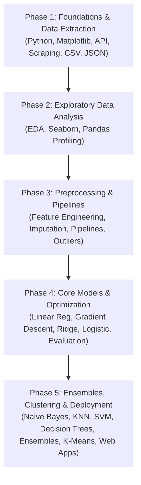

# 🚀 Machine Learning Journey: Zero to Hero

[](https://www.python.org/)
[](https://scikit-learn.org/)
[](https://pandas.pydata.org/)
[](https://numpy.org/)
[](https://flask.palletsprojects.com/)
[](https://streamlit.io/)

Welcome to the **Machine Learning Journey** repository! This is a complete, hands-on learning roadmap and code repository documenting the end-to-end path from fundamental Python programming to advanced Supervised & Unsupervised Machine Learning algorithms, Feature Engineering pipelines, Optimization engines, Web Scraping, REST APIs, Model Deployments, and Visual Infographics.

> 💡 **Repository Mission**: Provide clear, beginner-friendly yet mathematically rigorous notebooks, production-grade pipelines, custom algorithms built from scratch, interactive dashboards, real-world datasets, and dedicated documentation (`README.md`) for every core topic in machine learning.

> [!TIP]
> ### 📢 Actively Maintained & Community-Driven Evolution
> **This repository is actively maintained and continuously evolving!** It will regularly get updated with brand-new projects, emerging concepts, and advanced machine learning algorithms **based on your suggestions and contributions**. Whether you want a specific real-world project, a deep-dive algorithm guide, or an interactive tool, your input directly drives future additions. Star (⭐) and Watch the repository to stay updated with every new release!

---

## 📌 Repository Navigator & Hyperlinked Subtopics

Explore every module below to access hands-on notebooks, scripts, sample datasets, theoretical guides, and dedicated folder `README.md` files. **Click on any subtopic or notebook link to jump directly to its code**:

| # | Folder Module | Hyperlinked Subtopics & Notebooks | Core Focus & Tools | Dedicated Guide |
| :-: | :--- | :--- | :--- | :-: |
| **01** | [`01_Python`](./01_Python) | • [`Variables`](./01_Python/01_Variables.ipynb)<br>• [`Data Types`](./01_Python/02_Datatype.ipynb)<br>• [`Python Operators`](./01_Python/03_Python%20Operators.ipynb)<br>• [`Lists`](./01_Python/04_List.ipynb)<br>• [`Tuples`](./01_Python/05_Tuple.ipynb)<br>• [`Hello World Script`](./01_Python/0_helloword.py) | Python 3.9+ Fundamentals, Data Structures, Control Flow | [📖 Overview](./01_Python/README.md) |
| **02** | [`02_Matplotlib`](./02_Matplotlib) | • [`Basic Matplotlib`](./02_Matplotlib/Basic_matplotlib.ipynb)<br>• [`Advanced Plotting`](./02_Matplotlib/Matplotlib.ipynb)<br>• [`IPL Cricket Analytics Datasets`](./02_Matplotlib/) | Data Visualization, Custom Styles, Subplots, Scatter & Bar Charts | [📖 Overview](./02_Matplotlib/README.md) |
| **03** | [`03_API`](./03_API) | • [`REST API Data Fetching`](./03_API/API_Fatching.ipynb) | `requests` Library, HTTP Status, JSON Payloads, Pagination | [📖 Overview](./03_API/README.md) |
| **04** | [`04_web scraping`](./04_web%20scraping) | • [`Web Scraping Engine`](./04_web%20scraping/web%20Scraping.ipynb)<br>• [`DOM Parsing Demo`](./04_web%20scraping/Example.ipynb)<br>• [`AmbitionBox Companies Dataset`](./04_web%20scraping/ambitionbox_companies.csv) | `BeautifulSoup4`, HTML Parsing, Header Spoofing, Tabular Extraction | [📖 Overview](./04_web%20scraping/README.md) |
| **05** | [`05_CSV`](./05_CSV) | • [`Working with CSV Files`](./05_CSV/working-with-csv.ipynb)<br>• [`CSV Parsing Techniques`](./05_CSV/CSV.ipynb) | Pandas `read_csv()`, Memory Chunking, Custom Encodings | [📖 Overview](./05_CSV/README.md) |
| **06** | [`06_Json`](./06_Json) | • [`JSON Notebook`](./06_Json/json.ipynb)<br>• [`Nested JSON Parsing Demo`](./06_Json/Example.ipynb) | Semi-Structured Data, `json` module, `pd.json_normalize()` | [📖 Overview](./06_Json/README.md) |
| **07** | [`07_EDA`](./07_EDA) | • [`Univariate Analysis`](./07_EDA/Univariate%20Analysis.ipynb)<br>• [`Bivariate & Multivariate Analysis`](./07_EDA/Bivariate%20and%20Multivariate%20Analysis.ipynb)<br>• [`Seaborn Visualizations`](./07_EDA/Seaborn.ipynb) | Exploratory Data Analysis, Distribution Plots, Correlation Heatmaps | [📖 Overview](./07_EDA/README.md) |
| **08** | [`08_Pandas Profiling`](./08_Pandas%20Profiling) | • [`Pandas Profiling Notebook`](./08_Pandas%20Profiling/Pandas%20Profiling%20.ipynb) | `ydata-profiling`, Automated HTML Data Reports, Alert Metrics | [📖 Overview](./08_Pandas%20Profiling/README.md) |
| **09** | [`09_Feature Engineering`](./09_Feature%20Engineering) | • [`Normalization`](./09_Feature%20Engineering/01_Feature%20Scaling%20-%20Normalization/) ([Notebook](./09_Feature%20Engineering/01_Feature%20Scaling%20-%20Normalization/Normalization.ipynb))<br>• [`Standardization`](./09_Feature%20Engineering/02_Feature%20Scaling%20-%20Standardization/) ([Notebook](./09_Feature%20Engineering/02_Feature%20Scaling%20-%20Standardization/Standardization.ipynb))<br>• [`Encoding Categorical`](./09_Feature%20Engineering/03_Encoding/Encoding%20Categorical%20Data/) ([`OHE`](./09_Feature%20Engineering/03_Encoding/Encoding%20Categorical%20Data/One%20Hot%20Encoding/), [`Ordinal`](./09_Feature%20Engineering/03_Encoding/Encoding%20Categorical%20Data/Ordinal%20Encoding/))<br>• [`Encoding Numerical (Binning)`](./09_Feature%20Engineering/03_Encoding/Encoding%20Numerical%20Data/Binning/)<br>• [`Column Transformer`](./09_Feature%20Engineering/04_Feature%20Transformtion/01_Column%20Transformer%20in%20Machine%20Learning/)<br>• [`Mathematical Transformations`](./09_Feature%20Engineering/04_Feature%20Transformtion/02_Mathematic%20Transformation/)<br>• [`Mixed Data`](./09_Feature%20Engineering/05_Mixed%20Data/)<br>• [`Date & Time Variables`](./09_Feature%20Engineering/06_Handling%20Date%20and%20Time%20Variables/)<br>• [`Feature Construction`](./09_Feature%20Engineering/07_Feature%20Construction/)<br>• [`Curse of Dimensionality & PCA`](./09_Feature%20Engineering/08_Curse%20of%20Dimensionality/Feature%20Extration/) | Preprocessing, Scaling, Encodings, Power Transforms, Dimensionality Reduction | [📖 Overview](./09_Feature%20Engineering/README.md) |
| **10** | [`10_Handling Missing Data`](./10_Handling%20Missing%20Data) | • [`Complete Case Analysis (CCA)`](./10_Handling%20Missing%20Data/01_Remove%20Valus/)<br>• [`Simple Imputer - Categorical`](./10_Handling%20Missing%20Data/02_Simple%20Imputer/Categorical%20Data/)<br>• [`Simple Imputer - Numerical`](./10_Handling%20Missing%20Data/02_Simple%20Imputer/Numerical%20Data/) | MCAR, MAR, MNAR, Mean/Median Imputation, Arbitrary, KNNImputer, MICE | [📖 Overview](./10_Handling%20Missing%20Data/README.md) |
| **11** | [`11_Machine Learning Pipelines A_Z`](./11_Machine%20Learning%20Pipelines%20A_Z) | • [`Titanic Using Pipeline`](./11_Machine%20Learning%20Pipelines%20A_Z/titanic-using-pipeline.ipynb)<br>• [`Predict Using Pipeline`](./11_Machine%20Learning%20Pipelines%20A_Z/predict-using-pipeline.ipynb)<br>• [`Serialized Models Directory`](./11_Machine%20Learning%20Pipelines%20A_Z/model/) | Scikit-Learn `Pipeline`, `ColumnTransformer`, Data Leakage Prevention, Pickle | [📖 Overview](./11_Machine%20Learning%20Pipelines%20A_Z/README.md) |
| **12** | [`12_Outliers in Machine Learning`](./12_Outliers%20in%20Machine%20Learning) | • [`IQR Method`](./12_Outliers%20in%20Machine%20Learning/Outlier%20Detection%20and%20Removal%20using%20the%20IQR%20Method/)<br>• [`Z-Score Method`](./12_Outliers%20in%20Machine%20Learning/Outlier%20Detection%20and%20Removal%20using%20Z-score%20Method/)<br>• [`Percentile Method`](./12_Outliers%20in%20Machine%20Learning/Outlier%20Detection%20using%20the%20Percentile%20Method/) | Trimming vs Capping (Winsorization), Box Plots, Gaussian Outliers | [📖 Overview](./12_Outliers%20in%20Machine%20Learning/README.md) |
| **13** | [`13_Linear Regression`](./13_Linear%20Regression) | • [`Simple Linear Regression`](./13_Linear%20Regression/Simple%20Multiple%20Regression/)<br>• [`Multiple Linear Regression`](./13_Linear%20Regression/Multiple%20Linear%20Regression/)<br>• [`Polynomial Regression`](./13_Linear%20Regression/Polynomial%20Regression/)<br>• [`Regression Metrics`](./13_Linear%20Regression/Regression%20metrics/)<br>• [`5 Assumptions of Regression`](./13_Linear%20Regression/Assumptions_of_Linear_Regression.ipynb)<br>• [`Salary Prediction Flask App`](./13_Linear%20Regression/Project/salary-prediction/)<br>• [`Insurance Cost Modeling Project`](./13_Linear%20Regression/Project/) | OLS Closed-Form Matrix Math, Non-Linear Polynomials, MAE, MSE, RMSE, $R^2$, Flask App | [📖 Overview](./13_Linear%20Regression/README.md) |
| **14** | [`14_Gradient Descent`](./14_Gradient%20Descent) | • [`Batch, SGD & Mini-Batch GD`](./14_Gradient%20Descent/Types%20of%20Gradient%20Descent/)<br>• [`3D Cost Surface Notebook`](./14_Gradient%20Descent/gradient-descent-3d.ipynb)<br>• [`GD Code From Scratch`](./14_Gradient%20Descent/gradient-descent-code-from-scratch.ipynb)<br>• [`Animated Contour GIFs`](./14_Gradient%20Descent/Types%20of%20Gradient%20Descent/) | Optimization Engine, Loss Gradients ($\frac{\partial L}{\partial w}, \frac{\partial L}{\partial b}$), Learning Rates, 3D Surfaces | [📖 Overview](./14_Gradient%20Descent/README.md) |
| **15** | [`15_Bias Variance Trade-off`](./15_Bias%20Variance%20Trade-off) | • [`Bias-Variance Decomposition Notes`](./15_Bias%20Variance%20Trade-off/README.md) | Generalization Error, Underfitting vs Overfitting, Model Complexity Curve | [📖 Overview](./15_Bias%20Variance%20Trade-off/README.md) |
| **16** | [`16_Ridge Regression`](./16_Ridge%20Regression) | • [`Ridge From Scratch`](./16_Ridge%20Regression/ridge-regression-from-scratch.ipynb)<br>• [`Ridge Gradient Descent`](./16_Ridge%20Regression/ridge-regression-gradient-descent.ipynb)<br>• [`Ridge Regularization Demo`](./16_Ridge%20Regression/Ridge%20Regularization.ipynb) | L2 Regularization, Penalty Hyperparameter $\lambda / \alpha$, Weight Shrinkage | [📖 Overview](./16_Ridge%20Regression/README.md) |
| **17** | [`17_Logistic Regression`](./17_Logistic%20Regression) | • [`Perceptron Trick & Sigmoid`](./17_Logistic%20Regression/perceptron-trick-sigmoid.ipynb)<br>• [`Interactive Streamlit Tool`](./17_Logistic%20Regression/Logistic%20Regression%20Hyperparameters/)<br>• [`Polynomial Logistic Regression`](./17_Logistic%20Regression/Polynomial%20Features%20in%20Logistic%20Regression/)<br>• [`Softmax Multi-Class Regression`](./17_Logistic%20Regression/Softmax%20Regression/) | Binary Classification, Sigmoid, Cross-Entropy / Log Loss, Streamlit App | [📖 Overview](./17_Logistic%20Regression/README.md) |
| **18** | [`18_ Model Evaluation in Machine Learning`](./18_%20Model%20Evaluation%20in%20Machine%20Learning) | • [`Binary Classification Metrics`](./18_%20Model%20Evaluation%20in%20Machine%20Learning/classification-metrics-binary.ipynb)<br>• [`Multi-Class MNIST Metrics`](./18_%20Model%20Evaluation%20in%20Machine%20Learning/classification-metrics-multi-mnist1.ipynb)<br>• [`Multi-Class Iris Metrics`](./18_%20Model%20Evaluation%20in%20Machine%20Learning/classification-metrics-multi-iris1.ipynb) | Confusion Matrix, Precision, Recall, F1-Score, ROC-AUC Curves, Macro/Micro Avg | [📖 Overview](./18_%20Model%20Evaluation%20in%20Machine%20Learning/README.md) |
| **19** | [`19_Naive Bayes Classifier`](./19_Naive%20Bayes%20Classifier) | • [`Hand Calculations from Scratch`](./19_Naive%20Bayes%20Classifier/Naive%20Bayes%20Classifier%20From%20basic%20-%20Play%20tennis%20dataset.ipynb)<br>• [`Scikit-Learn Implementation`](./19_Naive%20Bayes%20Classifier/Naive%20Bayes%20Classification%20using%20Algorithm%20%E2%80%94%20Play%20Tennis%20Dataset.ipynb)<br>• [`Play Tennis Datasets`](./19_Naive%20Bayes%20Classifier/play_tennis.csv) | Bayes' Theorem, Conditional Independence, Laplace Smoothing, Gaussian & Multinomial NB | [📖 Overview](./19_Naive%20Bayes%20Classifier/README.md) |
| **20** | [`20_K Nearest Neighbors`](./20_K%20Nearest%20Neighbors) | • [`KNN on Breast Cancer`](./20_K%20Nearest%20Neighbors/knn-on-breast-cancer-dataset.ipynb)<br>• [`Decision Surfaces Guide`](./20_K%20Nearest%20Neighbors/README.md)<br>• [`Wisconsin Diagnostic Dataset`](./20_K%20Nearest%20Neighbors/Breast%20Cancer%20Wisconsin%20(Diagnostic)%20Data%20Set.csv) | Distance Metrics (Euclidean, Manhattan), Optimal $K$, `mlxtend` Decision Boundaries | [📖 Overview](./20_K%20Nearest%20Neighbors/README.md) |
| **21** | [`21_Support Vector Machines`](./21_Support%20Vector%20Machines) | • [`Linear & Soft-Margin SVM Demo`](./21_Support%20Vector%20Machines/SVM%20Demo.ipynb)<br>• [`The Kernel Trick (RBF & Poly)`](./21_Support%20Vector%20Machines/Kernel%20Trick%20SVM.ipynb) | Maximum-Margin Hyperplanes, Support Vectors, Cost $C$, RBF & Polynomial Kernels ($\gamma$) | [📖 Overview](./21_Support%20Vector%20Machines/README.md) |
| **22** | [`22_Decision Tree`](./22_Decision%20Tree) | • [`Classification Tree Demo`](./22_Decision%20Tree/Decision%20Tree%20Classification%20Demo.ipynb)<br>• [`Regression Trees`](./22_Decision%20Tree/Regression%20Tree/)<br>• [`dtreeviz Interactive Visualizations`](./22_Decision%20Tree/dtreeviz%20library/) | Entropy, Information Gain, Gini Impurity, Cost-Complexity Pruning, `dtreeviz` | [📖 Overview](./22_Decision%20Tree/README.md) |
| **23** | [`23_Ensemble Techniques`](./23_Ensemble%20Techniques) | • [`Bagging Ensemble`](./23_Ensemble%20Techniques/Bagging%20Ensemble/) ([`Bagging`](./23_Ensemble%20Techniques/Bagging%20Ensemble/Bagging/), [`Random Forest`](./23_Ensemble%20Techniques/Bagging%20Ensemble/Random%20Forest/))<br>• [`Boosting`](./23_Ensemble%20Techniques/Boosting/) ([`AdaBoost`](./23_Ensemble%20Techniques/Boosting/Adaboost%20Classifier/), [`Gradient Boosting`](./23_Ensemble%20Techniques/Boosting/Gradient%20Boosting/), [`XGBoost`](./23_Ensemble%20Techniques/Boosting/XGBOOST/))<br>• [`Stacking & Blending`](./23_Ensemble%20Techniques/Stacking%20and%20Blending%20Ensembles/) ([`K-Fold Approach`](./23_Ensemble%20Techniques/Stacking%20and%20Blending%20Ensembles/K-Fold%20Approch/))<br>• [`Voting Ensemble`](./23_Ensemble%20Techniques/Voting%20Ensemble/) | Wisdom of Crowds, Variance Reduction, Residual Optimization, Out-of-Bag (OOB), XGBoost | [📖 Overview](./23_Ensemble%20Techniques/README.md) |
| **24** | [`24_K-Means Clustering Algorithm`](./24_K-Means%20Clustering%20Algorithm) | • [`K-Means Complete Guide`](./24_K-Means%20Clustering%20Algorithm/README.md)<br>• [`Centroid Math & Voronoi Partitions`](./24_K-Means%20Clustering%20Algorithm/README.md#-6-mathematical-foundation)<br>• [`K-Means++ & Elbow Method`](./24_K-Means%20Clustering%20Algorithm/README.md#-8-initialization-methods)<br>• [`Customer Segmentation Mini-Project`](./24_K-Means%20Clustering%20Algorithm/README.md#-22-mini-project-customer-segmentation) | Unsupervised Clustering, Centroids, WCSS / Inertia, Silhouette Score, Mini-Batch K-Means | [📖 Overview](./24_K-Means%20Clustering%20Algorithm/README.md) |
| **Bonus** | [`Machine Learning Cheat Sheet`](./Machine%20Learning%20Cheat%20Sheet) | • [`24 High-Resolution Reference Posters`](./Machine%20Learning%20Cheat%20Sheet/README.md) | Visual Infographic Cheat Sheets covering Algorithms, Math Derivations, and Metrics | [📖 Overview](./Machine%20Learning%20Cheat%20Sheet/README.md) |

---

## 🗺️ Learning Roadmap Phases & Subtopic Breakdown

The repository is structured into 5 progressive learning phases. Every subtopic links directly to its folder or hands-on notebook:



### 🔹 Phase 1: Foundations & Data Harvesting (`01` – `06`)
* **[`01_Python`](./01_Python)**: Python syntax, [`Variables`](./01_Python/01_Variables.ipynb), [`Data Types`](./01_Python/02_Datatype.ipynb), [`Operators`](./01_Python/03_Python%20Operators.ipynb), [`Lists`](./01_Python/04_List.ipynb), [`Tuples`](./01_Python/05_Tuple.ipynb), and [`Hello World script`](./01_Python/0_helloword.py).
* **[`02_Matplotlib`](./02_Matplotlib)**: Data visualization syntax, [`Basic Plotting`](./02_Matplotlib/Basic_matplotlib.ipynb), [`Advanced Plotting`](./02_Matplotlib/Matplotlib.ipynb), custom styles, and IPL cricket player analytics datasets.
* **[`03_API`](./03_API)**: Querying REST APIs with [`API_Fatching.ipynb`](./03_API/API_Fatching.ipynb), handling HTTP response headers, JSON serialization, and pagination loops.
* **[`04_web scraping`](./04_web%20scraping)**: Web scraping via [`web Scraping.ipynb`](./04_web%20scraping/web%20Scraping.ipynb) and [`Example.ipynb`](./04_web%20scraping/Example.ipynb) with `BeautifulSoup4`, HTML DOM traversal, and corporate dataset harvesting.
* **[`05_CSV`](./05_CSV)**: Tabular data processing via [`working-with-csv.ipynb`](./05_CSV/working-with-csv.ipynb) and [`CSV.ipynb`](./05_CSV/CSV.ipynb), `chunksize` streaming, encodings, and index handling.
* **[`06_Json`](./06_Json)**: Semi-structured processing via [`json.ipynb`](./06_Json/json.ipynb) and [`Example.ipynb`](./06_Json/Example.ipynb), nested schema normalization with `pd.json_normalize()`.

### 🔹 Phase 2: Exploratory Data Analysis (`07` – `08`)
* **[`07_EDA`](./07_EDA)**: Statistical distributions via [`Univariate Analysis.ipynb`](./07_EDA/Univariate%20Analysis.ipynb), feature relationships via [`Bivariate and Multivariate Analysis.ipynb`](./07_EDA/Bivariate%20and%20Multivariate%20Analysis.ipynb), and [`Seaborn.ipynb`](./07_EDA/Seaborn.ipynb).
* **[`08_Pandas Profiling`](./08_Pandas%20Profiling)**: Automated data diagnostics via [`Pandas Profiling .ipynb`](./08_Pandas%20Profiling/Pandas%20Profiling%20.ipynb) using `ydata-profiling` for HTML report generation, cardinality alerts, and skewness indicators.

### 🔹 Phase 3: Feature Engineering & Preprocessing (`09` – `12`)
* **[`09_Feature Engineering`](./09_Feature%20Engineering)**:
  * Scaling: [`Normalization (MinMaxScaler)`](./09_Feature%20Engineering/01_Feature%20Scaling%20-%20Normalization/) and [`Standardization (StandardScaler)`](./09_Feature%20Engineering/02_Feature%20Scaling%20-%20Standardization/).
  * Categorical Encoding: [`One-Hot Encoding`](./09_Feature%20Engineering/03_Encoding/Encoding%20Categorical%20Data/One%20Hot%20Encoding/) and [`Ordinal Encoding`](./09_Feature%20Engineering/03_Encoding/Encoding%20Categorical%20Data/Ordinal%20Encoding/).
  * Numerical Encoding: [`Binning & Binarization`](./09_Feature%20Engineering/03_Encoding/Encoding%20Numerical%20Data/Binning/).
  * Transformers: [`ColumnTransformer`](./09_Feature%20Engineering/04_Feature%20Transformtion/01_Column%20Transformer%20in%20Machine%20Learning/) and [`Mathematical / Power Transforms (Box-Cox, Yeo-Johnson)`](./09_Feature%20Engineering/04_Feature%20Transformtion/02_Mathematic%20Transformation/).
  * Advanced Data: [`Mixed Data Handling`](./09_Feature%20Engineering/05_Mixed%20Data/), [`Date & Time Variables`](./09_Feature%20Engineering/06_Handling%20Date%20and%20Time%20Variables/), [`Feature Construction`](./09_Feature%20Engineering/07_Feature%20Construction/), and [`Curse of Dimensionality / PCA`](./09_Feature%20Engineering/08_Curse%20of%20Dimensionality/Feature%20Extration/).
* **[`10_Handling Missing Data`](./10_Handling%20Missing%20Data)**:
  * [`Complete Case Analysis (CCA)`](./10_Handling%20Missing%20Data/01_Remove%20Valus/) for MCAR data $< 5\%$.
  * Simple Imputation: [`Categorical Imputer`](./10_Handling%20Missing%20Data/02_Simple%20Imputer/Categorical%20Data/) (Mode / Missing Category) and [`Numerical Imputer`](./10_Handling%20Missing%20Data/02_Simple%20Imputer/Numerical%20Data/) (Mean, Median, Arbitrary).
  * Advanced Imputation: KNN Imputer and MICE Iterative Imputer.
* **[`11_Machine Learning Pipelines A_Z`](./11_Machine%20Learning%20Pipelines%20A_Z)**: Constructing leak-free pipelines on Titanic data via [`titanic-using-pipeline.ipynb`](./11_Machine%20Learning%20Pipelines%20A_Z/titanic-using-pipeline.ipynb), inference with [`predict-using-pipeline.ipynb`](./11_Machine%20Learning%20Pipelines%20A_Z/predict-using-pipeline.ipynb), and model serialization in [`model/`](./11_Machine%20Learning%20Pipelines%20A_Z/model/).
* **[`12_Outliers in Machine Learning`](./12_Outliers%20in%20Machine%20Learning)**:
  * [`IQR Rule`](./12_Outliers%20in%20Machine%20Learning/Outlier%20Detection%20and%20Removal%20using%20the%20IQR%20Method/) for skewed features.
  * [`Z-Score Method`](./12_Outliers%20in%20Machine%20Learning/Outlier%20Detection%20and%20Removal%20using%20Z-score%20Method/) for Gaussian features.
  * [`Percentile Capping / Winsorization`](./12_Outliers%20in%20Machine%20Learning/Outlier%20Detection%20using%20the%20Percentile%20Method/).

### 🔹 Phase 4: Core Models & Optimization (`13` – `18`)
* **[`13_Linear Regression`](./13_Linear%20Regression)**:
  * Models: [`Simple Multiple Regression`](./13_Linear%20Regression/Simple%20Multiple%20Regression/), [`Multiple Linear Regression`](./13_Linear%20Regression/Multiple%20Linear%20Regression/), and [`Polynomial Regression`](./13_Linear%20Regression/Polynomial%20Regression/).
  * Metrics: [`Regression Metrics`](./13_Linear%20Regression/Regression%20metrics/) (MAE, MSE, RMSE, $R^2$, Adjusted $R^2$).
  * Theory: [`Assumptions of Linear Regression`](./13_Linear%20Regression/Assumptions_of_Linear_Regression.ipynb) (Linearity, Homoscedasticity, Normality, Multicollinearity).
  * Deployments & Projects: [`Salary Prediction Flask App`](./13_Linear%20Regression/Project/salary-prediction/) and [`Medical Insurance Prediction`](./13_Linear%20Regression/Project/).
* **[`14_Gradient Descent`](./14_Gradient%20Descent)**:
  * Optimizer variants: [`Batch, Stochastic & Mini-Batch GD`](./14_Gradient%20Descent/Types%20of%20Gradient%20Descent/).
  * Visualizations: [`gradient-descent-3d.ipynb`](./14_Gradient%20Descent/gradient-descent-3d.ipynb) and animated contour GIFs.
  * Algorithms: [`gradient-descent-code-from-scratch.ipynb`](./14_Gradient%20Descent/gradient-descent-code-from-scratch.ipynb).
* **[`15_Bias Variance Trade-off`](./15_Bias%20Variance%20Trade-off)**: Error decomposition ($\text{Bias}^2 + \text{Variance} + \text{Irreducible Error}$), underfitting vs overfitting diagnosis.
* **[`16_Ridge Regression`](./16_Ridge%20Regression)**:
  * Closed-form matrix solution via [`ridge-regression-from-scratch.ipynb`](./16_Ridge%20Regression/ridge-regression-from-scratch.ipynb).
  * Gradient descent optimization via [`ridge-regression-gradient-descent.ipynb`](./16_Ridge%20Regression/ridge-regression-gradient-descent.ipynb).
  * Hyperparameter $\alpha$ tuning via [`Ridge Regularization.ipynb`](./16_Ridge%20Regression/Ridge%20Regularization.ipynb).
* **[`17_Logistic Regression`](./17_Logistic%20Regression)**:
  * Intuition: [`perceptron-trick-sigmoid.ipynb`](./17_Logistic%20Regression/perceptron-trick-sigmoid.ipynb) and Log Loss formulation.
  * Interactive Tool: [`Streamlit Hyperparameter Tuning App`](./17_Logistic%20Regression/Logistic%20Regression%20Hyperparameters/).
  * Non-Linear & Multi-Class: [`Polynomial Features`](./17_Logistic%20Regression/Polynomial%20Features%20in%20Logistic%20Regression/) and [`Softmax Regression`](./17_Logistic%20Regression/Softmax%20Regression/).
* **[`18_ Model Evaluation in Machine Learning`](./18_%20Model%20Evaluation%20in%20Machine%20Learning)**:
  * Binary evaluation: [`classification-metrics-binary.ipynb`](./18_%20Model%20Evaluation%20in%20Machine%20Learning/classification-metrics-binary.ipynb) (Precision, Recall, Specificity, F1, ROC-AUC).
  * Multi-class evaluation: [`classification-metrics-multi-mnist1.ipynb`](./18_%20Model%20Evaluation%20in%20Machine%20Learning/classification-metrics-multi-mnist1.ipynb) and [`classification-metrics-multi-iris1.ipynb`](./18_%20Model%20Evaluation%20in%20Machine%20Learning/classification-metrics-multi-iris1.ipynb).

### 🔹 Phase 5: Ensembles, Clustering & Deployment (`19` – `24`)
* **[`19_Naive Bayes Classifier`](./19_Naive%20Bayes%20Classifier)**:
  * Step-by-step hand calculation via [`Naive Bayes Classifier From basic`](./19_Naive%20Bayes%20Classifier/Naive%20Bayes%20Classifier%20From%20basic%20-%20Play%20tennis%20dataset.ipynb).
  * Scikit-Learn pipelines via [`Naive Bayes Classification using Algorithm`](./19_Naive%20Bayes%20Classifier/Naive%20Bayes%20Classification%20using%20Algorithm%20%E2%80%94%20Play%20Tennis%20Dataset.ipynb).
* **[`20_K Nearest Neighbors`](./20_K%20Nearest%20Neighbors)**:
  * Cancer diagnosis pipeline via [`knn-on-breast-cancer-dataset.ipynb`](./20_K%20Nearest%20Neighbors/knn-on-breast-cancer-dataset.ipynb).
  * Decision surfaces & distance metrics in [`20_K Nearest Neighbors/README.md`](./20_K%20Nearest%20Neighbors/README.md).
* **[`21_Support Vector Machines`](./21_Support%20Vector%20Machines)**:
  * Linear SVM and margin penalty $C$ via [`SVM Demo.ipynb`](./21_Support%20Vector%20Machines/SVM%20Demo.ipynb).
  * Kernel trick (RBF, Polynomial) and $\gamma$ tuning via [`Kernel Trick SVM.ipynb`](./21_Support%20Vector%20Machines/Kernel%20Trick%20SVM.ipynb).
* **[`22_Decision Tree`](./22_Decision%20Tree)**:
  * Classification trees via [`Decision Tree Classification Demo.ipynb`](./22_Decision%20Tree/Decision%20Tree%20Classification%20Demo.ipynb).
  * Continuous target trees via [`Regression Tree/`](./22_Decision%20Tree/Regression%20Tree/).
  * Visual node rendering via [`dtreeviz library/`](./22_Decision%20Tree/dtreeviz%20library/).
* **[`23_Ensemble Techniques`](./23_Ensemble%20Techniques)**:
  * Bagging & Random Forest: [`Bagging Ensemble/`](./23_Ensemble%20Techniques/Bagging%20Ensemble/) ([`Bagging`](./23_Ensemble%20Techniques/Bagging%20Ensemble/Bagging/), [`Random Forest`](./23_Ensemble%20Techniques/Bagging%20Ensemble/Random%20Forest/)).
  * Boosting: [`Boosting/`](./23_Ensemble%20Techniques/Boosting/) ([`AdaBoost`](./23_Ensemble%20Techniques/Boosting/Adaboost%20Classifier/), [`Gradient Boosting (GBDT)`](./23_Ensemble%20Techniques/Boosting/Gradient%20Boosting/), [`XGBoost`](./23_Ensemble%20Techniques/Boosting/XGBOOST/)).
  * Stacking & Blending: [`Stacking and Blending Ensembles/`](./23_Ensemble%20Techniques/Stacking%20and%20Blending%20Ensembles/) with [`K-Fold Approach`](./23_Ensemble%20Techniques/Stacking%20and%20Blending%20Ensembles/K-Fold%20Approch/).
  * Voting Ensemble: [`Voting Ensemble/`](./23_Ensemble%20Techniques/Voting%20Ensemble/) (Hard vs Soft Voting).
* **[`24_K-Means Clustering Algorithm`](./24_K-Means%20Clustering%20Algorithm)**:
  * Unsupervised clustering foundations, centroid updates, Voronoi cell geometry, and WCSS objective minimization.
  * Smart probabilistic centroid initialization via **K-Means++**.
  * Hyperparameter selection using the **Elbow Method** and **Silhouette Coefficient Analysis**.
  * Scalable clustering using **Mini-Batch K-Means** and real-world customer segmentation mini-project.
* **[`Machine Learning Cheat Sheet`](./Machine%20Learning%20Cheat%20Sheet)**: 24 high-resolution reference posters covering all algorithms, math formulas, and evaluation metrics.

---

## 🔮 Continuous Evolution & Upcoming Roadmap

> 📌 **Commitment to Continuous Improvement**: This repository is actively maintained and updated on an ongoing basis. It will continue to receive brand-new production projects, modern algorithms, emerging paradigms, and interactive visualization tools.

Here is what is currently planned and in active development:

```text
Machine-Learning-Journey/ (Upcoming Additions)
├── 🎯 Unsupervised Learning Expansion:
│   ├── Density-Based Clustering (DBSCAN & HDBSCAN)
│   ├── Hierarchical Clustering (Agglomerative & Dendrograms)
│   ├── Probabilistic Clustering (Gaussian Mixture Models / GMM)
│   └── Non-linear Dimensionality Reduction (t-SNE & UMAP)
├── 🤖 Deep Learning & Neural Networks:
│   ├── Artificial Neural Networks (ANN) & Backpropagation Math from Scratch
│   ├── Convolutional Neural Networks (CNN) for Computer Vision
│   └── Recurrent Neural Networks (RNN & LSTM) for Sequential & Time-Series Data
├── 📝 Natural Language Processing (NLP):
│   ├── Text Preprocessing, TF-IDF, N-Grams & Word2Vec
│   └── Transformer Architectures & HuggingFace Transfer Learning
├── ⚙️ Production MLOps & Deployment:
│   ├── Docker Containerization for ML Web Services
│   ├── Experiment Tracking & Artifact Logging with MLflow
│   ├── High-Performance REST APIs using FastAPI
│   └── Automated Retraining & CI/CD with GitHub Actions
└── 💼 End-to-End Industry Capstone Projects:
    ├── Customer Churn Prediction Engine with Streamlit & FastAPI
    ├── Credit Risk & Default Scoring System
    └── Automated Hyperparameter Optimization Pipeline with Optuna
```

> 💡 **Community-Driven Growth**: This repository evolves directly based on **your suggestions and contributions**! If you have a specific machine learning project, an end-to-end dataset, or an advanced concept you would like to see covered, let us know:
> - 💬 **Suggest a Concept / Project**: Open a [Feature Request Issue](https://github.com/swapnil3104/Machine-Learning-Journey/issues) with your ideas!
> - 🤝 **Contribute Code & Notebooks**: Submit a [Pull Request](https://github.com/swapnil3104/Machine-Learning-Journey/pulls) to add new projects, implementations, or optimizations.

---

## 📂 Repository File Tree

```text
Machine-Learning-Journey/
├── README.md
├── 01_Python/
│   ├── README.md
│   ├── 0_helloword.py
│   ├── 01_Variables.ipynb
│   ├── 02_Datatype.ipynb
│   ├── 03_Python Operators.ipynb
│   ├── 04_List.ipynb
│   └── 05_Tuple.ipynb
├── 02_Matplotlib/
│   ├── README.md
│   ├── Basic_matplotlib.ipynb
│   ├── Matplotlib.ipynb
│   └── *.csv (IPL Cricket Datasets)
├── 03_API/
│   ├── README.md
│   └── API_Fatching.ipynb
├── 04_web scraping/
│   ├── README.md
│   ├── web Scraping.ipynb
│   ├── Example.ipynb
│   ├── web.ipynb
│   └── ambitionbox_companies.csv
├── 05_CSV/
│   ├── README.md
│   ├── CSV.ipynb
│   ├── student-data.csv
│   └── working-with-csv.ipynb
├── 06_Json/
│   ├── README.md
│   ├── json.ipynb
│   ├── Example.ipynb
│   ├── test.json
│   └── train.json
├── 07_EDA/
│   ├── README.md
│   ├── Univariate Analysis.ipynb
│   ├── Bivariate and Multivariate Analysis.ipynb
│   ├── Seaborn.ipynb
│   └── train.csv
├── 08_Pandas Profiling/
│   ├── README.md
│   ├── Pandas Profiling .ipynb
│   └── Train.csv
├── 09_Feature Engineering/
│   ├── README.md
│   ├── 01_Feature Scaling - Normalization/
│   │   ├── Normalization.ipynb
│   │   ├── Normalization_Notes.ipynb
│   │   └── wine_data.csv
│   ├── 02_Feature Scaling - Standardization/
│   │   ├── Standardization.ipynb
│   │   ├── Standardization_Notes.ipynb
│   │   └── Social_Network_Ads.csv
│   ├── 03_Encoding/
│   │   ├── Encoding Categorical Data/
│   │   │   ├── One Hot Encoding/
│   │   │   └── Ordinal Encoding/
│   │   └── Encoding Numerical Data/
│   │       └── Binning/
│   ├── 04_Feature Transformtion/
│   │   ├── 01_Column Transformer in Machine Learning/
│   │   └── 02_Mathematic Transformation/
│   ├── 05_Mixed Data/
│   ├── 06_Handling Date and Time Variables/
│   ├── 07_Feature Construction/
│   └── 08_Curse of Dimensionality/
│       └── Feature Extration/
├── 10_Handling Missing Data/
│   ├── README.md
│   ├── 01_Remove Valus/
│   │   ├── data_science_job.csv
│   │   └── Example.ipynb
│   └── 02_Simple Imputer/
│       ├── Categorical Data/
│       │   ├── frequent-value-imputation.ipynb
│       │   └── missing-category-imputation.ipynb
│       └── Numerical Data/
│           ├── arbitrary-value-imputation.ipynb
│           └── mean-median-imputation.ipynb
├── 11_Machine Learning Pipelines A_Z/
│   ├── README.md
│   ├── titanic-using-pipeline.ipynb
│   ├── titanic-without-using-pipeline.ipynb
│   ├── predict-using-pipeline.ipynb
│   ├── pipe.pkl
│   └── model/ (Pickled pipeline components)
├── 12_Outliers in Machine Learning/
│   ├── README.md
│   ├── Outlier Detection and Removal using the IQR Method/
│   ├── Outlier Detection and Removal using Z-score Method/
│   └── Outlier Detection using the Percentile Method/
├── 13_Linear Regression/
│   ├── README.md
│   ├── Simple Multiple Regression/
│   ├── Multiple Linear Regression/
│   ├── Polynomial Regression/
│   ├── Regression metrics/
│   ├── Assumptions_of_Linear_Regression.ipynb
│   └── Project/
│       ├── Medical Insurance Cost Prediction.ipynb
│       ├── Salary Prediction Based on Experience.ipynb
│       └── salary-prediction/ (Flask Web App)
├── 14_Gradient Descent/
│   ├── README.md
│   ├── gradient-descent-3d.ipynb
│   ├── gradient-descent-code-from-scratch.ipynb
│   ├── gradient_descent_step_by_step.ipynb
│   └── Types of Gradient Descent/ (Batch, SGD, Mini-Batch + Animated GIFs)
├── 15_Bias Variance Trade-off/
│   └── README.md
├── 16_Ridge Regression/
│   ├── README.md
│   ├── ridge-regression-from-scratch.ipynb
│   ├── ridge-regression-gradient-descent.ipynb
│   └── Ridge Regularization.ipynb
├── 17_Logistic Regression/
│   ├── README.md
│   ├── perceptron-trick-sigmoid.ipynb
│   ├── Logistic Regression Hyperparameters/ (Streamlit Web App)
│   ├── Polynomial Features in Logistic Regression/
│   └── Softmax Regression/
├── 18_ Model Evaluation in Machine Learning/
│   ├── README.md
│   ├── classification-metrics-binary.ipynb
│   ├── classification-metrics-multi-mnist1.ipynb
│   └── classification-metrics-multi-iris1.ipynb
├── 19_Naive Bayes Classifier/
│   ├── README.md
│   ├── Naive Bayes Classifier From basic - Play tennis dataset.ipynb
│   ├── Naive Bayes Classification using Algorithm — Play Tennis Dataset.ipynb
│   └── play_tennis.csv
├── 20_K Nearest Neighbors/
│   ├── README.md
│   ├── knn-on-breast-cancer-dataset.ipynb
│   └── Breast Cancer Wisconsin (Diagnostic) Data Set.csv
├── 21_Support Vector Machines/
│   ├── README.md
│   ├── SVM Demo.ipynb
│   └── Kernel Trick SVM.ipynb
├── 22_Decision Tree/
│   ├── README.md
│   ├── Decision Tree Classification Demo.ipynb
│   ├── DT-on Breast Cancer.ipynb
│   ├── dtreeviz library/
│   └── Regression Tree/
├── 23_Ensemble Techniques/
│   ├── README.md
│   ├── Bagging Ensemble/
│   │   ├── Bagging/
│   │   └── Random Forest/
│   ├── Boosting/
│   │   ├── Adaboost Classifier/
│   │   ├── Gradient Boosting/
│   │   └── XGBOOST/
│   ├── Stacking and Blending Ensembles/
│   │   ├── K-Fold Approch/
│   │   └── Stacking and Blending Demo.ipynb
│   └── Voting Ensemble/
├── 24_K-Means Clustering Algorithm/
│   └── README.md
└── Machine Learning Cheat Sheet/
    ├── README.md
    └── *.png (24 Infographic Cheat Sheets)
```

---

## 🌟 Featured Projects & Practical Applications

| Project / Application | Domain / Task | Technologies Used | Path / Location |
| :--- | :--- | :--- | :--- |
| **Salary Prediction Web Application** | Production Deployment | Python, Scikit-Learn, Flask, HTML/CSS | [`13_Linear Regression/Project/salary-prediction/`](./13_Linear%20Regression/Project/salary-prediction/) |
| **Interactive Logistic Hyperparameter Tool** | Model Tuning & Visualization | Python, Streamlit, Matplotlib | [`17_Logistic Regression/Logistic Regression Hyperparameters/`](./17_Logistic%20Regression/Logistic%20Regression%20Hyperparameters/) |
| **Leak-Free Titanic Machine Learning Pipeline** | End-to-End Pipeline Engineering | Python, Scikit-Learn, Pipelines, Serialization | [`11_Machine Learning Pipelines A_Z/`](./11_Machine%20Learning%20Pipelines%20A_Z/) |
| **AmbitionBox Corporate Web Scraper** | Data Harvesting | Python, BeautifulSoup, Requests, Pandas | [`04_web scraping/web Scraping.ipynb`](./04_web%20scraping/web%20Scraping.ipynb) |
| **Medical Insurance Cost Prediction** | Predictive Modeling | Python, Pandas, Scikit-Learn, Ridge | [`13_Linear Regression/Project/`](./13_Linear%20Regression/Project/) |
| **Breast Cancer Medical Diagnosis** | Healthcare Classification | KNN, SVM, Decision Trees, MLxtend | [`20_K Nearest Neighbors/`](./20_K%20Nearest%20Neighbors/) |
| **Interactive Tree Visualizations** | Model Interpretability | `dtreeviz`, Decision Trees, Scikit-Learn | [`22_Decision Tree/dtreeviz library/`](./22_Decision%20Tree/dtreeviz%20library/) |
| **Customer Segmentation with K-Means** | Unsupervised Grouping | Python, Scikit-Learn, K-Means++, Silhouette | [`24_K-Means Clustering Algorithm/`](./24_K-Means%20Clustering%20Algorithm/) |
| **Multi-Model Stacking on Heart Disease** | Advanced Ensembling | Scikit-Learn, Out-of-Fold K-Fold, Meta-Learner | [`23_Ensemble Techniques/Stacking and Blending Ensembles/`](./23_Ensemble%20Techniques/Stacking%20and%20Blending%20Ensembles/) |
| **Gradient Descent From Scratch** | Optimization Engine | NumPy, Matplotlib 3D, Animated GIFs | [`14_Gradient Descent/`](./14_Gradient%20Descent/) |

---

## 💻 Quick Start & Setup Instructions

### 1. Clone the Repository
```bash
git clone https://github.com/swapnil3104/Machine-Learning-Journey.git
cd Machine-Learning-Journey
```

### 2. Create and Activate a Virtual Environment
```bash
# Windows
python -m venv venv
venv\Scripts\activate

# macOS / Linux
python3 -m venv venv
source venv/bin/activate
```

### 3. Install Dependencies
```bash
pip install numpy pandas matplotlib seaborn scikit-learn jupyter requests beautifulsoup4 flask streamlit dtreeviz ydata-profiling mlxtend xgboost lightgbm catboost
```

### 4. Run Notebooks or Applications

* **Launch Jupyter Notebooks**:
  ```bash
  jupyter notebook
  ```

* **Run the Salary Prediction Flask App**:
  ```bash
  cd "13_Linear Regression/Project/salary-prediction"
  python app.py
  # Open http://127.0.0.1:5000 in your browser
  ```

* **Run the Interactive Streamlit Hyperparameter Tool**:
  ```bash
  cd "17_Logistic Regression/Logistic Regression Hyperparameters"
  streamlit run streamlit-viz-tool.py
  ```

---

## 🛠️ Core Technology Stack

- **Language**: Python 3.9+
- **Data Manipulation**: Pandas, NumPy
- **Data Visualization**: Matplotlib, Seaborn, `dtreeviz`, `mlxtend`
- **Machine Learning**: Scikit-Learn, XGBoost, LightGBM, CatBoost
- **Data Collection**: BeautifulSoup4, Requests
- **Automated Profiling**: `ydata-profiling` / Pandas Profiling
- **Web Frameworks**: Flask, Streamlit
- **Development Environment**: Jupyter Notebook, VS Code

---

## 🤝 Community-Driven Contributions & Feedback

This repository is **community-powered** and grows through continuous feedback and collaboration:

* 💡 **Suggest New Projects & Concepts**: Have a specific machine learning algorithm, real-world project, or complex concept you want covered? Open an [Issue](https://github.com/swapnil3104/Machine-Learning-Journey/issues) with your suggestion — **the repository will continuously be updated with new projects and concepts based on your suggestions!**
* 🛠️ **Contribute Your Own Work**: Community contributions are always welcome! Feel free to submit a [Pull Request](https://github.com/swapnil3104/Machine-Learning-Journey/pulls) with new algorithms, notebook walkthroughs, bug fixes, or dataset explorations.
* ⭐ **Support the Journey**: If you find this repository valuable for your learning, portfolio building, or interview preparation, please give it a **⭐ Star** on GitHub and share it with other learners!

Happy Learning & Happy Coding! 🚀
