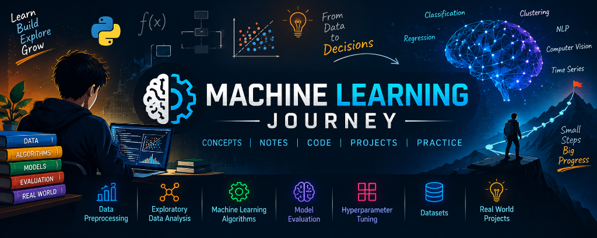
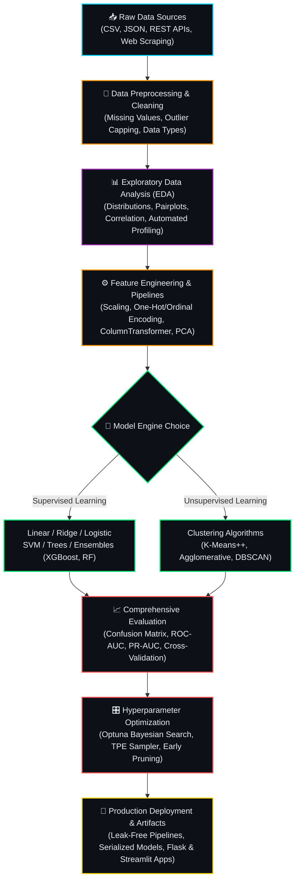

<div align="center" id="top">

<!-- ═══════════════════════════════════════════════════════════════════ -->
<!-- 🚀 REPOSITORY HERO BANNER -->
<!-- ═══════════════════════════════════════════════════════════════════ -->
<a href="https://github.com/swapnil3104/Machine-Learning-Journey">
  
</a>

<p align="center">
  
</p>

<!-- ═══════════════════════════════════════════════════════════════════ -->
<!-- ✨ REAL-TIME ANIMATED BANNER TEXT & ML VISUAL ENGINE -->
<!-- ═══════════════════════════════════════════════════════════════════ -->
<table width="100%" style="border-collapse: collapse; border: none;">
  <tr>
    <td align="center" width="20%" style="vertical-align: middle; border: none; padding: 5px;">
      
    </td>
    <td align="center" width="80%" style="vertical-align: middle; border: none; padding: 5px;">
      <a href="https://github.com/swapnil3104/Machine-Learning-Journey">
        
      </a>
      <br/>
      <a href="https://github.com/swapnil3104/Machine-Learning-Journey">
        
      </a>
    </td>
  </tr>
</table>

<p align="center">
  
</p>

<!-- ═══════════════════════════════════════════════════════════════════ -->
<!-- 🏆 REPOSITORY METRICS & BADGES -->
<!-- ═══════════════════════════════════════════════════════════════════ -->
[](https://github.com/swapnil3104/Machine-Learning-Journey/stargazers)
[](https://github.com/swapnil3104/Machine-Learning-Journey/network/members)
[](https://github.com/swapnil3104/Machine-Learning-Journey/issues)
[](https://github.com/swapnil3104/Machine-Learning-Journey/pulls)

<br/>

<!-- ═══════════════════════════════════════════════════════════════════ -->
<!-- 🛠️ TECHNOLOGY STACK PILLS -->
<!-- ═══════════════════════════════════════════════════════════════════ -->
[](https://www.python.org/)
[](https://scikit-learn.org/)
[](https://pandas.pydata.org/)
[](https://numpy.org/)
[](https://optuna.org/)
[](https://xgboost.readthedocs.io/)
[](https://flask.palletsprojects.com/)
[](https://streamlit.io/)

<br/><br/>

<!-- ═══════════════════════════════════════════════════════════════════ -->
<!-- ⚡ QUICK NAVIGATION PILLS -->
<!-- ═══════════════════════════════════════════════════════════════════ -->
<b><a href="#-repository-navigator--hyperlinked-subtopics">📚 28 Modules Roadmap</a></b> &nbsp;│&nbsp; 
<b><a href="#-the-6-core-pillars-of-the-journey">🧭 6 Core Pillars</a></b> &nbsp;│&nbsp; 
<b><a href="#-machine-learning-end-to-end-architecture">🗺️ Pipeline Architecture</a></b> &nbsp;│&nbsp; 
<b><a href="#-interactive-animations--visual-previews">🎬 Visual Animations</a></b> &nbsp;│&nbsp; 
<b><a href="#-featured-projects--practical-applications">🚀 Real-World Projects</a></b> &nbsp;│&nbsp; 
<b><a href="#visual-cheat-sheets">🎨 23 Cheat Sheets</a></b> &nbsp;│&nbsp; 
<b><a href="#-quick-start--setup-instructions">⚡ Quick Setup</a></b>

</div>

<p align="center">
  
</p>

<!-- ═══════════════════════════════════════════════════════════════════ -->
<!-- 🤖 WELCOME & AI CO-PILOT CARD -->
<!-- ═══════════════════════════════════════════════════════════════════ -->
<table width="100%">
  <tr>
    <td align="center" width="28%" style="vertical-align: middle; padding: 10px;">
      <br/>
      <div style="margin-top: 8px;">
        
        
      </div>
    </td>
    <td width="72%" style="vertical-align: middle; padding-left: 15px;">
      <!-- CREATIVE TEXT ANIMATION ON RIGHT SIDE -->
      <a href="https://github.com/swapnil3104/Machine-Learning-Journey">
        
      </a>
      <br/>
      <a href="https://github.com/swapnil3104/Machine-Learning-Journey">
        
      </a>
      <p style="margin-top: 10px; line-height: 1.6;">
        Welcome to your all-in-one interactive Machine Learning code laboratory and roadmap! Whether you're deriving gradient descent cost functions, building leak-free scikit-learn transformers, or tuning hyperparameter search spaces with Optuna, this repository is designed to be your hands-on guide.
      </p>
      <p style="margin-bottom: 10px;">
        💡 <b>Repository Mission</b>: Deliver clean, beginner-friendly yet mathematically rigorous notebooks, production-grade pipelines, custom algorithms implemented from scratch, interactive dashboards, and dedicated documentation (<code>README.md</code>) for every core machine learning topic.
      </p>
      <div>
        <a href="#-repository-navigator--hyperlinked-subtopics"></a>&nbsp;
        <a href="#visual-cheat-sheets"></a>&nbsp;
        <a href="#-machine-learning-end-to-end-architecture"></a>&nbsp;
        <a href="https://github.com/swapnil3104/deep-learning-journey"></a>
      </div>
    </td>
  </tr>
</table>

---

## 🧭 The 6 Core Pillars of the Journey

Represented directly in the banner, our curriculum is engineered across 6 foundational pillars that transform raw signals into intelligent automated decisions:

| 📈 **1. Data Preprocessing** | 🔍 **2. Exploratory Data Analysis** | ⚙️ **3. Machine Learning Algorithms** |
| :--- | :--- | :--- |
| • Python 3.9+ Fundamentals & Data Structures<br>• Missing Data Handling (`CCA`, `SimpleImputer`)<br>• Outlier Isolation (`IQR`, `Z-Score`, Percentile Capping)<br>• Normalization, Standardization & Power Transforms | • Univariate, Bivariate & Multivariate Analysis<br>• Automated Profiling (`ydata-profiling`)<br>• Custom Seaborn & Matplotlib Dashboards<br>• Correlation Heatmaps & Statistical Testing | • Linear, Ridge & Polynomial Regression<br>• Logistic Regression & Softmax Multi-Class<br>• SVM, Decision Trees, KNN & Naive Bayes<br>• Ensembles: Bagging, Random Forest, AdaBoost, XGBoost<br>• Clustering: K-Means++, Agglomerative, DBSCAN |
| 🧠 **4. Model Evaluation** | 🎛️ **5. Hyperparameter Tuning** | 💡 **6. Real-World Projects** |
| • Confusion Matrix, ROC-AUC & PR-AUC Curves<br>• Precision, Recall, Macro/Micro F1-Scores<br>• Bias-Variance Trade-Off & Generalization Error<br>• Classification Reports on Binary & Multiclass Datasets | • Bayesian Optimization with Optuna<br>• Tree-structured Parzen Estimator (TPE)<br>• Automated Trial Pruning & Optimization History<br>• Hyperparameter Slice & Importance Visualizations | • End-to-End Salary Prediction Flask Web App<br>• Interactive Streamlit Logistic Decision Boundary Tool<br>• Leak-Free Scikit-Learn Pipelines & Pickling<br>• Web Scraping AmbitionBox Corporate Data |

---

## 🗺️ Machine Learning End-to-End Architecture



---

## 🎬 Interactive Animations & Visual Previews

Experience the internal mathematical mechanics through step-by-step visualizations, animated optimization paths, and high-resolution posters included across the modules:

<div align="center">
<table>
  <tr>
    <td align="center" width="50%">
      <b>📉 Stochastic Gradient Descent Optimization</b><br/>
      <br/>
      <i>Step-by-step stochastic weight updates traversing 2D error contours toward global minima.</i>
    </td>
    <td align="center" width="50%">
      <b>⚡ Mini-Batch Gradient Descent Trajectory</b><br/>
      <br/>
      <i>Balanced, vector-accelerated mini-batch convergence on non-convex cost surfaces.</i>
    </td>
  </tr>
  <tr>
    <td align="center" width="50%">
      <b>🏃 Automated Pipeline & Rapid Execution Loop</b><br/>
      <br/>
      <i>Accelerated data transformations, batch inference routines, and automated model pipelines.</i>
    </td>
    <td align="center" width="50%">
      <b>🤖 Intelligent Autonomous Co-Pilot & Inference Engine</b><br/>
      <br/>
      <i>Guiding learners through mathematical foundations, notebook laboratories, and model deployment.</i>
    </td>
  </tr>
</table>
</div>

<details id="visual-cheat-sheets">
<summary><b>🎨 Click to Expand Visual Infographic Cheat Sheets Preview (23 High-Resolution Reference Posters)</b></summary>
<br/>

<div align="center">
<table>
  <tr>
    <td align="center" width="50%">
      <b>📐 Gradient Descent Derivations & Mechanics</b><br/>
      <br/>
      <i>Complete loss surfaces, partial derivatives, and convergence rules.</i>
    </td>
    <td align="center" width="50%">
      <b>🌳 Decision Tree Splits & Pruning Infographic</b><br/>
      <br/>
      <i>Information Gain, Entropy, Gini Impurity, and Cost-Complexity Pruning.</i>
    </td>
  </tr>
</table>

Explore all 23 visual study guides inside [`Machine Learning Cheat Sheet/`](./Machine%20Learning%20Cheat%20Sheet/README.md)!
</div>

</details>

<br/>

<p align="center">
  
</p>

---


## 📌 Repository Navigator & Hyperlinked Subtopics

Explore every module below to access hands-on notebooks, scripts, sample datasets, theoretical guides, and dedicated folder `README.md` files. **Click on any subtopic or notebook link to jump directly to its code**:

| # | Folder Module | Hyperlinked Subtopics & Notebooks | Core Focus & Tools | Dedicated Guide |
| :-: | :--- | :--- | :--- | :-: |
| **01** | [`01_Python`](./01_Python) | • [`Variables`](./01_Python/01_Variables.ipynb)<br>• [`Data Types`](./01_Python/02_Datatype.ipynb)<br>• [`Python Operators`](./01_Python/03_Python%20Operators.ipynb)<br>• [`Lists`](./01_Python/04_List.ipynb)<br>• [`Tuples`](./01_Python/05_Tuple.ipynb)<br>• [`Hello World Script`](./01_Python/0_helloword.py) | Python 3.9+ Fundamentals, Data Structures, Control Flow | [📖 Overview](./01_Python/README.md) |
| **02** | [`02_Matplotlib`](./02_Matplotlib) | • [`Basic Matplotlib`](./02_Matplotlib/Basic_matplotlib.ipynb)<br>• [`Advanced Plotting`](./02_Matplotlib/Matplotlib.ipynb)<br>• [`IPL Cricket Analytics Datasets`](./02_Matplotlib/) | Data Visualization, Custom Styles, Subplots, Scatter & Bar Charts | [📖 Overview](./02_Matplotlib/README.md) |
| **03** | [`03_API`](./03_API) | • [`REST API Data Fetching`](./03_API/API_Fatching.ipynb) | `requests` Library, HTTP Status, JSON Payloads, Pagination | [📖 Overview](./03_API/README.md) |
| **04** | [`04_web scraping`](./04_web%20scraping) | • [`Web Scraping Engine`](./04_web%20scraping/web%20Scraping.ipynb)<br>• [`DOM Parsing Demo`](./04_web%20scraping/Example.ipynb)<br>• [`AmbitionBox Companies Dataset`](./04_web%20scraping/ambitionbox_companies.csv) | `BeautifulSoup4`, HTML Parsing, Header Spoofing, Tabular Extraction | [📖 Overview](./04_web%20scraping/README.md) |
| **05** | [`05_CSV`](./05_CSV) | • [`Working with CSV Files`](./05_CSV/working-with-csv.ipynb)<br>• [`CSV Parsing Techniques`](./05_CSV/CSV.ipynb) | Pandas `read_csv()`, Memory Chunking, Custom Encodings | [📖 Overview](./05_CSV/README.md) |
| **06** | [`06_Json`](./06_Json) | • [`JSON Notebook`](./06_Json/json.ipynb)<br>• [`Nested JSON Parsing Demo`](./06_Json/Example.ipynb) | Semi-Structured Data, `json` module, `pd.json_normalize()` | [📖 Overview](./06_Json/README.md) |
| **07** | [`07_EDA`](./07_EDA) | • [`Univariate Analysis`](./07_EDA/Univariate%20Analysis.ipynb)<br>• [`Bivariate & Multivariate Analysis`](./07_EDA/Bivariate%20and%20Multivariate%20Analysis.ipynb)<br>• [`Seaborn Visualizations`](./07_EDA/Seaborn.ipynb) | Exploratory Data Analysis, Distribution Plots, Correlation Heatmaps | [📖 Overview](./07_EDA/README.md) |
| **08** | [`08_Pandas Profiling`](./08_Pandas%20Profiling) | • [`Pandas Profiling Notebook`](./08_Pandas%20Profiling/Pandas%20Profiling%20.ipynb) | `ydata-profiling`, Automated HTML Data Reports, Alert Metrics | [📖 Overview](./08_Pandas%20Profiling/README.md) |
| **09** | [`09_Feature Engineering`](./09_Feature%20Engineering) | • [`Normalization`](./09_Feature%20Engineering/01_Feature%20Scaling%20-%20Normalization/) ([Notebook](./09_Feature%20Engineering/01_Feature%20Scaling%20-%20Normalization/Normalization.ipynb))<br>• [`Standardization`](./09_Feature%20Engineering/02_Feature%20Scaling%20-%20Standardization/) ([Notebook](./09_Feature%20Engineering/02_Feature%20Scaling%20-%20Standardization/Standardization.ipynb))<br>• [`Encoding Categorical`](./09_Feature%20Engineering/03_Encoding/Encoding%20Categorical%20Data/) ([`OHE`](./09_Feature%20Engineering/03_Encoding/Encoding%20Categorical%20Data/One%20Hot%20Encoding/), [`Ordinal`](./09_Feature%20Engineering/03_Encoding/Encoding%20Categorical%20Data/Ordinal%20Encoding/))<br>• [`Encoding Numerical (Binning)`](./09_Feature%20Engineering/03_Encoding/Encoding%20Numerical%20Data/Binning/)<br>• [`Column Transformer`](./09_Feature%20Engineering/04_Feature%20Transformtion/01_Column%20Transformer%20in%20Machine%20Learning/)<br>• [`Mathematical Transformations`](./09_Feature%20Engineering/04_Feature%20Transformtion/02_Mathematic%20Transformation/)<br>• [`Mixed Data`](./09_Feature%20Engineering/05_Mixed%20Data/)<br>• [`Date & Time Variables`](./09_Feature%20Engineering/06_Handling%20Date%20and%20Time%20Variables/)<br>• [`Feature Construction`](./09_Feature%20Engineering/07_Feature%20Construction/)<br>• [`Curse of Dimensionality & PCA`](./09_Feature%20Engineering/08_Curse%20of%20Dimensionality/Feature%20Extration/Principle%20Component%20Analysis/) | Preprocessing, Scaling, Encodings, Power Transforms, Dimensionality Reduction | [📖 Overview](./09_Feature%20Engineering/README.md) |
| **10** | [`10_Handling Missing Data`](./10_Handling%20Missing%20Data) | • [`Complete Case Analysis (CCA)`](./10_Handling%20Missing%20Data/01_Remove%20Valus/)<br>• [`Simple Imputer - Categorical`](./10_Handling%20Missing%20Data/02_Simple%20Imputer/Categorical%20Data/)<br>• [`Simple Imputer - Numerical`](./10_Handling%20Missing%20Data/02_Simple%20Imputer/Numerical%20Data/) | MCAR, MAR, MNAR, Mean/Median Imputation, Arbitrary, Mode & Frequent Category | [📖 Overview](./10_Handling%20Missing%20Data/README.md) |
| **11** | [`11_Machine Learning Pipelines A_Z`](./11_Machine%20Learning%20Pipelines%20A_Z) | • [`Titanic Using Pipeline`](./11_Machine%20Learning%20Pipelines%20A_Z/titanic-using-pipeline.ipynb)<br>• [`Predict Using Pipeline`](./11_Machine%20Learning%20Pipelines%20A_Z/predict-using-pipeline.ipynb)<br>• [`Serialized Models Directory`](./11_Machine%20Learning%20Pipelines%20A_Z/model/) | Scikit-Learn `Pipeline`, `ColumnTransformer`, Data Leakage Prevention, Pickle | [📖 Overview](./11_Machine%20Learning%20Pipelines%20A_Z/README.md) |
| **12** | [`12_Outliers in Machine Learning`](./12_Outliers%20in%20Machine%20Learning) | • [`IQR Method`](./12_Outliers%20in%20Machine%20Learning/Outlier%20Detection%20and%20Removal%20using%20the%20IQR%20Method/)<br>• [`Z-Score Method`](./12_Outliers%20in%20Machine%20Learning/Outlier%20Detection%20and%20Removal%20using%20Z-score%20Method/)<br>• [`Percentile Method`](./12_Outliers%20in%20Machine%20Learning/Outlier%20Detection%20using%20the%20Percentile%20Method/) | Trimming vs Capping (Winsorization), Box Plots, Gaussian Outliers | [📖 Overview](./12_Outliers%20in%20Machine%20Learning/README.md) |
| **13** | [`13_Linear Regression`](./13_Linear%20Regression) | • [`Simple Linear Regression`](./13_Linear%20Regression/Simple%20Multiple%20Regression/)<br>• [`Multiple Linear Regression`](./13_Linear%20Regression/Multiple%20Linear%20Regression/)<br>• [`Polynomial Regression`](./13_Linear%20Regression/Polynomial%20Regression/)<br>• [`Regression Metrics`](./13_Linear%20Regression/Regression%20metrics/)<br>• [`5 Assumptions of Regression`](./13_Linear%20Regression/Assumptions_of_Linear_Regression.ipynb)<br>• [`Salary Prediction Flask App`](./13_Linear%20Regression/Project/salary-prediction/)<br>• [`Insurance Cost Modeling Project`](./13_Linear%20Regression/Project/) | OLS Closed-Form Matrix Math, Non-Linear Polynomials, MAE, MSE, RMSE, $R^2$, Flask App | [📖 Overview](./13_Linear%20Regression/README.md) |
| **14** | [`14_Gradient Descent`](./14_Gradient%20Descent) | • [`Batch, SGD & Mini-Batch GD`](./14_Gradient%20Descent/Types%20of%20Gradient%20Descent/)<br>• [`3D Cost Surface Notebook`](./14_Gradient%20Descent/gradient-descent-3d.ipynb)<br>• [`GD Code From Scratch`](./14_Gradient%20Descent/gradient-descent-code-from-scratch.ipynb)<br>• [`Animated Contour GIFs`](./14_Gradient%20Descent/Types%20of%20Gradient%20Descent/) | Optimization Engine, Loss Gradients ($\frac{\partial L}{\partial w}, \frac{\partial L}{\partial b}$), Learning Rates, 3D Surfaces | [📖 Overview](./14_Gradient%20Descent/README.md) |
| **15** | [`15_Bias Variance Trade-off`](./15_Bias%20Variance%20Trade-off) | • [`Bias-Variance Decomposition Notes`](./15_Bias%20Variance%20Trade-off/README.md) | Generalization Error, Underfitting vs Overfitting, Model Complexity Curve | [📖 Overview](./15_Bias%20Variance%20Trade-off/README.md) |
| **16** | [`16_Ridge Regression`](./16_Ridge%20Regression) | • [`Ridge From Scratch`](./16_Ridge%20Regression/ridge-regression-from-scratch.ipynb)<br>• [`Ridge Gradient Descent`](./16_Ridge%20Regression/ridge-regression-gradient-descent.ipynb)<br>• [`Ridge Regularization Demo`](./16_Ridge%20Regression/Ridge%20Regularization.ipynb) | L2 Regularization, Penalty Hyperparameter $\lambda / \alpha$, Weight Shrinkage | [📖 Overview](./16_Ridge%20Regression/README.md) |
| **17** | [`17_Logistic Regression`](./17_Logistic%20Regression) | • [`Perceptron Trick & Sigmoid`](./17_Logistic%20Regression/perceptron-trick-sigmoid.ipynb)<br>• [`Interactive Streamlit Tool`](./17_Logistic%20Regression/Logistic%20Regression%20Hyperparameters/)<br>• [`Polynomial Logistic Regression`](./17_Logistic%20Regression/Polynomial%20Features%20in%20Logistic%20Regression/)<br>• [`Softmax Multi-Class Regression`](./17_Logistic%20Regression/Softmax%20Regression/) | Binary Classification, Sigmoid, Cross-Entropy / Log Loss, Streamlit App | [📖 Overview](./17_Logistic%20Regression/README.md) |
| **18** | [`18_ Model Evaluation in Machine Learning`](./18_%20Model%20Evaluation%20in%20Machine%20Learning) | • [`Binary Classification Metrics`](./18_%20Model%20Evaluation%20in%20Machine%20Learning/classification-metrics-binary.ipynb)<br>• [`Multi-Class MNIST Metrics`](./18_%20Model%20Evaluation%20in%20Machine%20Learning/classification-metrics-multi-mnist1.ipynb)<br>• [`Multi-Class Iris Metrics`](./18_%20Model%20Evaluation%20in%20Machine%20Learning/classification-metrics-multi-iris1.ipynb) | Confusion Matrix, Precision, Recall, F1-Score, ROC-AUC Curves, Macro/Micro Avg | [📖 Overview](./18_%20Model%20Evaluation%20in%20Machine%20Learning/README.md) |
| **19** | [`19_Naive Bayes Classifier`](./19_Naive%20Bayes%20Classifier) | • [`Hand Calculations from Scratch`](./19_Naive%20Bayes%20Classifier/Naive%20Bayes%20Classifier%20From%20basic%20-%20Play%20tennis%20dataset.ipynb)<br>• [`Scikit-Learn Implementation`](./19_Naive%20Bayes%20Classifier/Naive%20Bayes%20Classification%20using%20Algorithm%20%E2%80%94%20Play%20Tennis%20Dataset.ipynb)<br>• [`Play Tennis Datasets`](./19_Naive%20Bayes%20Classifier/play_tennis.csv) | Bayes' Theorem, Conditional Independence, Laplace Smoothing, Gaussian & Multinomial NB | [📖 Overview](./19_Naive%20Bayes%20Classifier/README.md) |
| **20** | [`20_K Nearest Neighbors`](./20_K%20Nearest%20Neighbors) | • [`KNN on Breast Cancer`](./20_K%20Nearest%20Neighbors/knn-on-breast-cancer-dataset.ipynb)<br>• [`Decision Surfaces Guide`](./20_K%20Nearest%20Neighbors/README.md)<br>• [`Wisconsin Diagnostic Dataset`](./20_K%20Nearest%20Neighbors/Breast%20Cancer%20Wisconsin%20%28Diagnostic%29%20Data%20Set.csv) | Distance Metrics (Euclidean, Manhattan), Optimal $K$, `mlxtend` Decision Boundaries | [📖 Overview](./20_K%20Nearest%20Neighbors/README.md) |
| **21** | [`21_Support Vector Machines`](./21_Support%20Vector%20Machines) | • [`Linear & Soft-Margin SVM Demo`](./21_Support%20Vector%20Machines/SVM%20Demo.ipynb)<br>• [`The Kernel Trick (RBF & Poly)`](./21_Support%20Vector%20Machines/Kernel%20Trick%20SVM.ipynb) | Maximum-Margin Hyperplanes, Support Vectors, Cost $C$, RBF & Polynomial Kernels ($\gamma$) | [📖 Overview](./21_Support%20Vector%20Machines/README.md) |
| **22** | [`22_Decision Tree`](./22_Decision%20Tree) | • [`Classification Tree Demo`](./22_Decision%20Tree/Decision%20Tree%20Classification%20Demo.ipynb)<br>• [`Regression Trees`](./22_Decision%20Tree/Regression%20Tree/)<br>• [`dtreeviz Interactive Visualizations`](./22_Decision%20Tree/dtreeviz%20library/) | Entropy, Information Gain, Gini Impurity, Cost-Complexity Pruning, `dtreeviz` | [📖 Overview](./22_Decision%20Tree/README.md) |
| **23** | [`23_Ensemble Techniques`](./23_Ensemble%20Techniques) | • [`Bagging Ensemble`](./23_Ensemble%20Techniques/Bagging%20Ensemble/) ([`Bagging`](./23_Ensemble%20Techniques/Bagging%20Ensemble/Bagging/), [`Random Forest`](./23_Ensemble%20Techniques/Bagging%20Ensemble/Random%20Forest/))<br>• [`Boosting`](./23_Ensemble%20Techniques/Boosting/) ([`AdaBoost`](./23_Ensemble%20Techniques/Boosting/Adaboost%20Classifier/), [`Gradient Boosting`](./23_Ensemble%20Techniques/Boosting/Gradient%20Boosting/), [`XGBoost`](./23_Ensemble%20Techniques/Boosting/XGBOOST/))<br>• [`Stacking & Blending`](./23_Ensemble%20Techniques/Stacking%20and%20Blending%20Ensembles/) ([`K-Fold Approach`](./23_Ensemble%20Techniques/Stacking%20and%20Blending%20Ensembles/K-Fold%20Approch/))<br>• [`Voting Ensemble`](./23_Ensemble%20Techniques/Voting%20Ensemble/) | Wisdom of Crowds, Variance Reduction, Residual Optimization, Out-of-Bag (OOB), XGBoost | [📖 Overview](./23_Ensemble%20Techniques/README.md) |
| **24** | [`24_K-Means Clustering Algorithm`](./24_K-Means%20Clustering%20Algorithm) | • [`K-Means Complete Guide`](./24_K-Means%20Clustering%20Algorithm/README.md)<br>• [`K-Means from Scratch Code`](./24_K-Means%20Clustering%20Algorithm/kmeans.py)<br>• [`Clustering Demo Notebook`](./24_K-Means%20Clustering%20Algorithm/kmeans-clustering-demo.ipynb)<br>• [`Scatter Visualization App`](./24_K-Means%20Clustering%20Algorithm/app.py) | Unsupervised Clustering, Centroids, WCSS / Inertia, Custom Implementation, Visualization | [📖 Overview](./24_K-Means%20Clustering%20Algorithm/README.md) |
| **25** | [`25_Agglomerative Hierarchical Clustering`](./25_Agglomerative%20Hierarchical%20Clustering) | • [`Agglomerative Clustering Notebook`](./25_Agglomerative%20Hierarchical%20Clustering/agglomerative-clustering.ipynb)<br>• [`Shopping Customer Dataset`](./25_Agglomerative%20Hierarchical%20Clustering/hierarchical-clustering-with-python-and-scikit-learn-shopping-data.csv)<br>• [`Dendrograms & Linkage Criteria`](./25_Agglomerative%20Hierarchical%20Clustering/README.md#-7-linkage-criteria) | Bottom-Up Merging, Single/Complete/Average/Ward Linkage, Dendrograms, SciPy, Scikit-Learn | [📖 Overview](./25_Agglomerative%20Hierarchical%20Clustering/README.md) |
| **26** | [`26_DBSCAN Clustering Algorithms`](./26_DBSCAN%20Clustering%20Algorithms) | • [`DBSCAN Hands-on Demo`](./26_DBSCAN%20Clustering%20Algorithms/dbscan_demo.ipynb)<br>• [`Core, Border & Noise Concepts`](./26_DBSCAN%20Clustering%20Algorithms/README.md#3--core-terminology)<br>• [`K-Distance Graph & Epsilon Selection`](./26_DBSCAN%20Clustering%20Algorithms/README.md#10--choosing-eps-and-min_samples) | Density-Based Clustering, $\epsilon$-Neighborhood, `min_samples`, Outlier Isolation, Arbitrary Shapes | [📖 Overview](./26_DBSCAN%20Clustering%20Algorithms/README.md) |
| **27** | [`27_Imbalanced Data in Machine Learning`](./27_Imbalanced%20Data%20in%20Machine%20Learning) | • [`Imbalanced Data Notebook`](./27_Imbalanced%20Data%20in%20Machine%20Learning/imbalanced_data_yt.ipynb)<br>• [`Resampling Methods & Class Weights`](./27_Imbalanced%20Data%20in%20Machine%20Learning/README.md#9--resampling-techniques) | Accuracy Paradox, Oversampling, Undersampling, Precision-Recall AUC, Cost-Sensitive Learning | [📖 Overview](./27_Imbalanced%20Data%20in%20Machine%20Learning/README.md) |
| **28** | [`28_Hyperparameter Tuning using Optuna`](./28_Hyperparameter%20Tuning%20using%20Optuna) | • [`Optuna Basics Notebook`](./28_Hyperparameter%20Tuning%20using%20Optuna/optuna_basics_yt.ipynb)<br>• [`Foundational Optuna Paper (PDF)`](./28_Hyperparameter%20Tuning%20using%20Optuna/1907.10902v1.pdf)<br>• [`TPE In-Depth Paper (PDF)`](./28_Hyperparameter%20Tuning%20using%20Optuna/2304.11127v5.pdf) | Define-by-Run API, Tree-structured Parzen Estimator (TPE), Automated Pruning, Visualizations | [📖 Overview](./28_Hyperparameter%20Tuning%20using%20Optuna/README.md) |
| **Bonus** | [`Machine Learning Cheat Sheet`](./Machine%20Learning%20Cheat%20Sheet) | • [`23 High-Resolution Reference Posters`](./Machine%20Learning%20Cheat%20Sheet/README.md) | Visual Infographic Cheat Sheets covering Algorithms, Math Derivations, and Metrics | [📖 Overview](./Machine%20Learning%20Cheat%20Sheet/README.md) |

---

## 🔮 Continuous Evolution & Upcoming Roadmap

> 📌 **Commitment to Continuous Improvement**: This repository is actively maintained and updated on an ongoing basis. It will continue to receive brand-new production projects, modern algorithms, emerging paradigms, and interactive visualization tools.


> 💡 **Community-Driven Growth**: This repository evolves directly based on **your suggestions and contributions**! If you have a specific machine learning project, an end-to-end dataset, or an advanced concept you would like to see covered, let us know:
> - 💬 **Suggest a Concept / Project**: Open a [Feature Request Issue](https://github.com/swapnil3104/Machine-Learning-Journey/issues) with your ideas!
> - 🤝 **Contribute Code & Notebooks**: Submit a [Pull Request](https://github.com/swapnil3104/Machine-Learning-Journey/pulls) to add new projects, implementations, or optimizations.

---

## 📂 Repository File Tree

```text
Machine-Learning-Journey/
├── README.md
├── 01_Python/
│   ├── README.md
│   ├── 0_helloword.py
│   ├── 01_Variables.ipynb
│   ├── 02_Datatype.ipynb
│   ├── 03_Python Operators.ipynb
│   ├── 04_List.ipynb
│   └── 05_Tuple.ipynb
├── 02_Matplotlib/
│   ├── README.md
│   ├── Basic_matplotlib.ipynb
│   ├── Matplotlib.ipynb
│   └── *.csv (IPL Cricket Datasets)
├── 03_API/
│   ├── README.md
│   └── API_Fatching.ipynb
├── 04_web scraping/
│   ├── README.md
│   ├── web Scraping.ipynb
│   ├── Example.ipynb
│   ├── web.ipynb
│   └── ambitionbox_companies.csv
├── 05_CSV/
│   ├── README.md
│   ├── CSV.ipynb
│   ├── student-data.csv
│   └── working-with-csv.ipynb
├── 06_Json/
│   ├── README.md
│   ├── json.ipynb
│   ├── Example.ipynb
│   ├── test.json
│   └── train.json
├── 07_EDA/
│   ├── README.md
│   ├── Univariate Analysis.ipynb
│   ├── Bivariate and Multivariate Analysis.ipynb
│   ├── Seaborn.ipynb
│   └── train.csv
├── 08_Pandas Profiling/
│   ├── README.md
│   ├── Pandas Profiling .ipynb
│   └── Train.csv
├── 09_Feature Engineering/
│   ├── README.md
│   ├── 01_Feature Scaling - Normalization/
│   │   ├── Normalization.ipynb
│   │   ├── Normalization_Notes.ipynb
│   │   └── wine_data.csv
│   ├── 02_Feature Scaling - Standardization/
│   │   ├── Standardization.ipynb
│   │   ├── Standardization_Notes.ipynb
│   │   └── Social_Network_Ads.csv
│   ├── 03_Encoding/
│   │   ├── Encoding Categorical Data/
│   │   │   ├── One Hot Encoding/
│   │   │   └── Ordinal Encoding/
│   │   └── Encoding Numerical Data/
│   │       └── Binning/
│   ├── 04_Feature Transformtion/
│   │   ├── 01_Column Transformer in Machine Learning/
│   │   └── 02_Mathematic Transformation/
│   ├── 05_Mixed Data/
│   ├── 06_Handling Date and Time Variables/
│   ├── 07_Feature Construction/
│   └── 08_Curse of Dimensionality/
│       └── Feature Extration/
├── 10_Handling Missing Data/
│   ├── README.md
│   ├── 01_Remove Valus/
│   │   ├── data_science_job.csv
│   │   └── Example.ipynb
│   └── 02_Simple Imputer/
│       ├── Categorical Data/
│       │   ├── frequent-value-imputation.ipynb
│       │   └── missing-category-imputation.ipynb
│       └── Numerical Data/
│           ├── arbitrary-value-imputation.ipynb
│           └── mean-median-imputation.ipynb
├── 11_Machine Learning Pipelines A_Z/
│   ├── README.md
│   ├── titanic-using-pipeline.ipynb
│   ├── titanic-without-using-pipeline.ipynb
│   ├── predict-using-pipeline.ipynb
│   ├── pipe.pkl
│   └── model/ (Pickled pipeline components)
├── 12_Outliers in Machine Learning/
│   ├── README.md
│   ├── Outlier Detection and Removal using the IQR Method/
│   ├── Outlier Detection and Removal using Z-score Method/
│   └── Outlier Detection using the Percentile Method/
├── 13_Linear Regression/
│   ├── README.md
│   ├── Simple Multiple Regression/
│   ├── Multiple Linear Regression/
│   ├── Polynomial Regression/
│   ├── Regression metrics/
│   ├── Assumptions_of_Linear_Regression.ipynb
│   └── Project/
│       ├── Medical Insurance Cost Prediction.ipynb
│       ├── Salary Prediction Based on Experience.ipynb
│       └── salary-prediction/ (Flask Web App)
├── 14_Gradient Descent/
│   ├── README.md
│   ├── gradient-descent-3d.ipynb
│   ├── gradient-descent-code-from-scratch.ipynb
│   ├── gradient_descent_step_by_step.ipynb
│   └── Types of Gradient Descent/ (Batch, SGD, Mini-Batch + Animated GIFs)
├── 15_Bias Variance Trade-off/
│   └── README.md
├── 16_Ridge Regression/
│   ├── README.md
│   ├── ridge-regression-from-scratch.ipynb
│   ├── ridge-regression-gradient-descent.ipynb
│   └── Ridge Regularization.ipynb
├── 17_Logistic Regression/
│   ├── README.md
│   ├── perceptron-trick-sigmoid.ipynb
│   ├── Logistic Regression Hyperparameters/ (Streamlit Web App)
│   ├── Polynomial Features in Logistic Regression/
│   └── Softmax Regression/
├── 18_ Model Evaluation in Machine Learning/
│   ├── README.md
│   ├── classification-metrics-binary.ipynb
│   ├── classification-metrics-multi-mnist1.ipynb
│   └── classification-metrics-multi-iris1.ipynb
├── 19_Naive Bayes Classifier/
│   ├── README.md
│   ├── Naive Bayes Classifier From basic - Play tennis dataset.ipynb
│   ├── Naive Bayes Classification using Algorithm — Play Tennis Dataset.ipynb
│   └── play_tennis.csv
├── 20_K Nearest Neighbors/
│   ├── README.md
│   ├── knn-on-breast-cancer-dataset.ipynb
│   └── Breast Cancer Wisconsin (Diagnostic) Data Set.csv
├── 21_Support Vector Machines/
│   ├── README.md
│   ├── SVM Demo.ipynb
│   └── Kernel Trick SVM.ipynb
├── 22_Decision Tree/
│   ├── README.md
│   ├── Decision Tree Classification Demo.ipynb
│   ├── DT-on Breast Cancer.ipynb
│   ├── dtreeviz library/
│   └── Regression Tree/
├── 23_Ensemble Techniques/
│   ├── README.md
│   ├── Bagging Ensemble/
│   │   ├── Bagging/
│   │   └── Random Forest/
│   ├── Boosting/
│   │   ├── Adaboost Classifier/
│   │   ├── Gradient Boosting/
│   │   └── XGBOOST/
│   ├── Stacking and Blending Ensembles/
│   │   ├── K-Fold Approch/
│   │   └── Stacking and Blending Demo.ipynb
│   └── Voting Ensemble/
├── 24_K-Means Clustering Algorithm/
│   ├── README.md
│   ├── app.py
│   ├── kmeans-clustering-demo.ipynb
│   ├── kmeans.py
│   └── student_clustering.csv
├── 25_Agglomerative Hierarchical Clustering/
│   ├── README.md
│   ├── agglomerative-clustering.ipynb
│   └── hierarchical-clustering-with-python-and-scikit-learn-shopping-data.csv
├── 26_DBSCAN Clustering Algorithms/
│   ├── README.md
│   └── dbscan_demo.ipynb
├── 27_Imbalanced Data in Machine Learning/
│   ├── README.md
│   └── imbalanced_data_yt.ipynb
├── 28_Hyperparameter Tuning using Optuna/
│   ├── README.md
│   ├── 1907.10902v1.pdf
│   ├── 2304.11127v5.pdf
│   └── optuna_basics_yt.ipynb
└── Machine Learning Cheat Sheet/
    ├── README.md
    └── *.png (23 Infographic Cheat Sheets)
```

---

## 🌟 Featured Projects & Practical Applications

| Project / Application | Domain / Task | Technologies Used | Path / Location |
| :--- | :--- | :--- | :--- |
| **Salary Prediction Web Application** | Production Deployment | Python, Scikit-Learn, Flask, HTML/CSS | [`13_Linear Regression/Project/salary-prediction/`](./13_Linear%20Regression/Project/salary-prediction/) |
| **Interactive Logistic Hyperparameter Tool** | Model Tuning & Visualization | Python, Streamlit, Matplotlib | [`17_Logistic Regression/Logistic Regression Hyperparameters/`](./17_Logistic%20Regression/Logistic%20Regression%20Hyperparameters/) |
| **Leak-Free Titanic Machine Learning Pipeline** | End-to-End Pipeline Engineering | Python, Scikit-Learn, Pipelines, Serialization | [`11_Machine Learning Pipelines A_Z/`](./11_Machine%20Learning%20Pipelines%20A_Z/) |
| **AmbitionBox Corporate Web Scraper** | Data Harvesting | Python, BeautifulSoup, Requests, Pandas | [`04_web scraping/web Scraping.ipynb`](./04_web%20scraping/web%20Scraping.ipynb) |
| **Medical Insurance Cost Prediction** | Predictive Modeling | Python, Pandas, Scikit-Learn, Ridge | [`13_Linear Regression/Project/`](./13_Linear%20Regression/Project/) |
| **Breast Cancer Medical Diagnosis** | Healthcare Classification | KNN, SVM, Decision Trees, MLxtend | [`20_K Nearest Neighbors/`](./20_K%20Nearest%20Neighbors/) |
| **Interactive Tree Visualizations** | Model Interpretability | `dtreeviz`, Decision Trees, Scikit-Learn | [`22_Decision Tree/dtreeviz library/`](./22_Decision%20Tree/dtreeviz%20library/) |
| **Customer Segmentation with K-Means** | Unsupervised Grouping | Python, Scikit-Learn, K-Means++, Silhouette | [`24_K-Means Clustering Algorithm/`](./24_K-Means%20Clustering%20Algorithm/) |
| **Hierarchical Customer Segmentation** | Unsupervised Customer Profiling | Scikit-Learn, SciPy, Dendrograms, Agglomerative | [`25_Agglomerative Hierarchical Clustering/`](./25_Agglomerative%20Hierarchical%20Clustering/) |
| **Arbitrary Shape & Noise Clustering** | Density-Based Anomaly Detection | Scikit-Learn, DBSCAN, Non-Linear Geometry | [`26_DBSCAN Clustering Algorithms/`](./26_DBSCAN%20Clustering%20Algorithms/) |
| **Fraud & Rare-Event Classification** | Imbalanced Learning & Resampling | Imbalanced-Learn, SMOTE, PR-AUC, Cost-Sensitive | [`27_Imbalanced Data in Machine Learning/`](./27_Imbalanced%20Data%20in%20Machine%20Learning/) |
| **Bayesian Hyperparameter Optimization** | Automated ML Model Tuning | Optuna, TPE Sampler, Early Stopping Pruning | [`28_Hyperparameter Tuning using Optuna/`](./28_Hyperparameter%20Tuning%20using%20Optuna/) |
| **Multi-Model Stacking on Heart Disease** | Advanced Ensembling | Scikit-Learn, Out-of-Fold K-Fold, Meta-Learner | [`23_Ensemble Techniques/Stacking and Blending Ensembles/`](./23_Ensemble%20Techniques/Stacking%20and%20Blending%20Ensembles/) |
| **Gradient Descent From Scratch** | Optimization Engine | NumPy, Matplotlib 3D, Animated GIFs | [`14_Gradient Descent/`](./14_Gradient%20Descent/) |

---

## 💻 Quick Start & Setup Instructions

### 1. Clone the Repository
```bash
git clone https://github.com/swapnil3104/Machine-Learning-Journey.git
cd Machine-Learning-Journey
```

### 2. Create and Activate a Virtual Environment
```bash
# Windows
python -m venv venv
venv\Scripts\activate

# macOS / Linux
python3 -m venv venv
source venv/bin/activate
```

### 3. Install Dependencies
```bash
pip install numpy pandas matplotlib seaborn scikit-learn jupyter requests beautifulsoup4 flask streamlit dtreeviz ydata-profiling mlxtend xgboost imbalanced-learn scipy optuna
```

### 4. Run Notebooks or Applications

* **Launch Jupyter Notebooks**:
  ```bash
  jupyter notebook
  ```

* **Run the Salary Prediction Flask App**:
  ```bash
  cd "13_Linear Regression/Project/salary-prediction"
  python app.py
  # Open http://127.0.0.1:5000 in your browser
  ```

* **Run the Interactive Streamlit Hyperparameter Tool**:
  ```bash
  cd "17_Logistic Regression/Logistic Regression Hyperparameters"
  streamlit run streamlit-viz-tool.py
  ```

---

## 🛠️ Core Technology Stack

- **Language**: Python 3.9+
- **Data Manipulation**: Pandas, NumPy
- **Data Visualization**: Matplotlib, Seaborn, `dtreeviz`, `mlxtend`
- **Machine Learning**: Scikit-Learn, XGBoost, `imbalanced-learn`, SciPy
- **Hyperparameter Optimization**: Optuna
- **Data Harvesting & Web Scraping**: BeautifulSoup4, Requests
- **Automated Profiling**: `ydata-profiling` / Pandas Profiling
- **Web Frameworks**: Flask, Streamlit
- **Development Environment**: Jupyter Notebook, VS Code

---

## 🧠 Next Step: Deep Learning Journey

Looking to advance beyond classical machine learning into Artificial Neural Networks, Computer Vision, and Natural Language Processing? Check out the companion repository:

👉 **[Deep Learning Journey](https://github.com/swapnil3104/deep-learning-journey)**

[](https://github.com/swapnil3104/deep-learning-journey)

<p align="center">
  
</p>

## 🤝 Community-Driven Contributions & Feedback

This repository is **community-powered** and grows through continuous feedback and collaboration:

* 💡 **Suggest New Projects & Concepts**: Have a specific machine learning algorithm, real-world project, or complex concept you want covered? Open an [Issue](https://github.com/swapnil3104/Machine-Learning-Journey/issues) with your suggestion — **the repository will continuously be updated with new projects and concepts based on your suggestions!**
* 🛠️ **Contribute Your Own Work**: Community contributions are always welcome! Feel free to submit a [Pull Request](https://github.com/swapnil3104/Machine-Learning-Journey/pulls) with new algorithms, notebook walkthroughs, bug fixes, or dataset explorations.
* ⭐ **Support the Journey**: If you find this repository valuable for your learning, portfolio building, or interview preparation, please give it a **⭐ Star** on GitHub and share it with other learners!

<br/>

<div align="center">
  <a href="https://github.com/swapnil3104/Machine-Learning-Journey">
    
  </a>
  <br/><br/>
  <b><a href="#top">⬆️ Back to Top</a></b>
</div>

